# Page: Overview

# Overview

<details>
<summary>Relevant source files</summary>

The following files were used as context for generating this wiki page:

- [README.md](README.md)

</details>


This document provides an overview of the cuda-checkpoint repository and utility. It introduces the core concepts, explains the problem cuda-checkpoint solves, describes how it integrates with CRIU for complete application checkpointing, and outlines the key use cases and capabilities. For detailed architecture information, see [Architecture and Design](#2). For command-line usage, see [Command-Line Reference](#4). For demonstration programs, see [Examples and Demos](#5).

**Sources:** [README.md:1-6]()

---

## What is cuda-checkpoint?

The `cuda-checkpoint` utility is a command-line tool that enables transparent checkpointing and restoration of CUDA state within running Linux processes. The utility is provided as a pre-compiled binary at [bin/x86_64_Linux/cuda-checkpoint]() and works by coordinating with the NVIDIA display driver (version 550 or higher) to suspend and resume GPU resources, device memory, and CUDA API calls.

When combined with [CRIU](https://criu.org/Main_Page) (Checkpoint/Restore in Userspace), `cuda-checkpoint` enables complete application checkpointing that includes both CPU state (managed by CRIU) and GPU state (managed by cuda-checkpoint). This two-tool approach provides transparent, per-process checkpointing for CUDA applications without requiring application code modifications.

**Sources:** [README.md:1-6](), [README.md:37-54]()

---

## The GPU Checkpoint Problem

CRIU is a widely-used Linux utility that can checkpoint and restore process trees by capturing kernel-mode resources such as memory, threads, file descriptors, sockets, and pipes. However, NVIDIA GPUs provide functionality beyond the standard Linux kernel, exposing GPU-specific resources that CRIU cannot directly manage:

- Device memory allocations
- CUDA contexts and streams
- GPU execution state
- CUDA driver API state

Without GPU-aware checkpointing, attempting to checkpoint a CUDA application with CRIU alone would fail because GPU resources cannot be properly saved and restored. The `cuda-checkpoint` utility addresses this limitation by managing the GPU-specific state, enabling CRIU to handle the rest of the process.

**Sources:** [README.md:37-54]()

---

## System Integration

The following diagram shows how `cuda-checkpoint` integrates with CRIU and CUDA applications to provide complete checkpointing:

**Diagram: cuda-checkpoint System Integration**

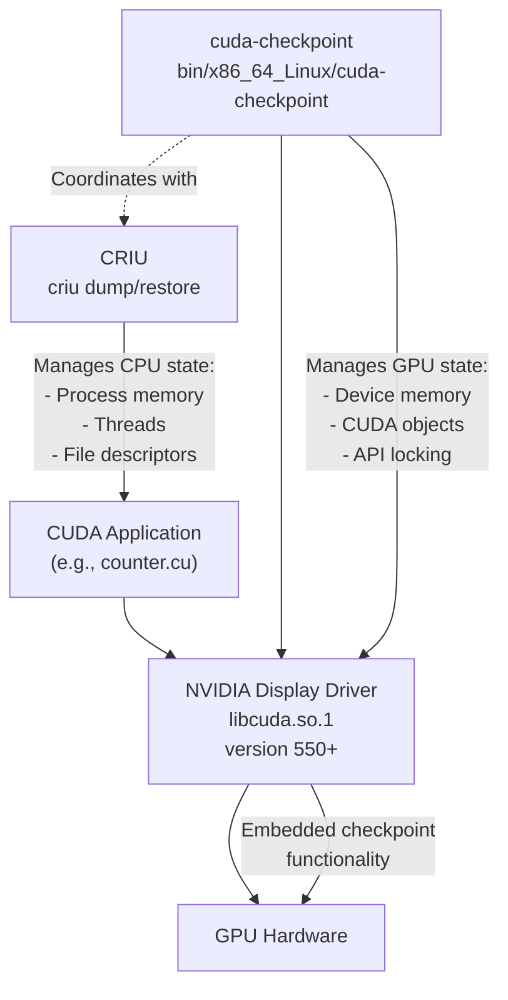

**Sources:** [README.md:1-6](), [README.md:37-54](), [README.md:263-264]()

---

## Checkpoint and Restore Workflow

The cuda-checkpoint utility manages CUDA state through a suspend-resume cycle. A process's CUDA state begins in the running state and can be toggled to suspended and back.

**Diagram: CUDA State Transitions**

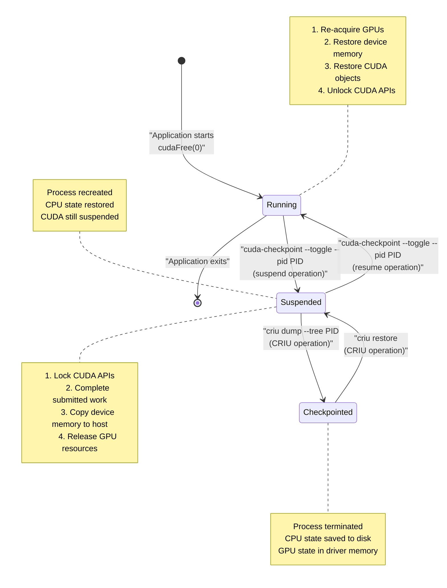

During the suspend operation, `cuda-checkpoint` ensures that:
- All CUDA driver APIs that launch work or manage resources are locked [README.md:97]()
- Already-submitted work completes, including stream callbacks [README.md:98]()
- Device memory is copied to host memory managed by the driver [README.md:99]()
- All GPU resources are released at the OS level [README.md:100]()

After suspension, CPU threads continue running and can safely call CUDA APIs (which block) or access host memory allocated by `cudaMallocHost()` and similar functions [README.md:102-104]().

**Sources:** [README.md:91-116]()

---

## Use Cases

The `cuda-checkpoint` utility enables three primary use cases, progressing from basic to advanced capabilities:

| Use Case | Description | Driver Version | Example |
|----------|-------------|----------------|---------|
| **Fault Tolerance** | Periodic checkpoints protect against hardware failures or crashes. If a failure occurs, the application can be restored to the last checkpoint. | 550+ | Checkpoint every 5 minutes during a long-running simulation |
| **Workload Preemption** | Lower-priority tasks can be checkpointed and suspended to free GPU resources for higher-priority work, then restored later. | 570+ | Preempt batch jobs for interactive sessions |
| **Cluster Migration** | Workloads can be checkpointed, migrated to different nodes (potentially with different GPUs), and restored with GPU remapping. | 580+ | Move training jobs between cluster nodes for load balancing |

**Sources:** [README.md:24-31]()

---

## Repository Structure and Components

The repository contains the core utility, demonstration programs, and documentation:

**Diagram: Repository Components**

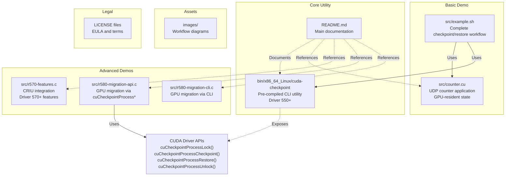

**Sources:** [README.md:4](), [README.md:13](), [README.md:22](), [README.md:119-121]()

---

## Feature Evolution Across Driver Versions

The `cuda-checkpoint` utility exposes functionality embedded in the NVIDIA display driver. As driver versions evolve, new capabilities become available without requiring updates to the utility itself:

### Driver 550 (Baseline)
- Basic checkpoint and restore functionality
- x64 architecture only
- Command-line interface via [bin/x86_64_Linux/cuda-checkpoint]()
- `--toggle` operation for suspend/resume
- `--get-state` query operation

**Sources:** [README.md:59](), [README.md:252-264]()

### Driver 570 (Enhanced)
- NVML support for device management
- CRIU 4.0+ integration with process tree support
- CUDA Driver API parity: `cuCheckpointProcessLock()`, `cuCheckpointProcessCheckpoint()`, `cuCheckpointProcessRestore()`, `cuCheckpointProcessUnlock()`
- Separate `--action lock` command with `--timeout` parameter to prevent deadlocks
- Demonstrated by [src/r570-features.c]()

**Sources:** [README.md:15-22]()

### Driver 580 (GPU Migration)
- GPU migration capability with UUID-based device remapping
- `--device-map` parameter for restore operations
- Container partial passthrough support
- Demonstrated by [src/r580-migration-api.c]() and [src/r580-migration-cli.c]()

**Sources:** [README.md:8-13]()

---

## Basic Example: Counter Application

The repository includes a simple demonstration using [src/counter.cu](), a UDP server that maintains a counter in GPU device memory. Each packet received increments the counter and returns the current value. The complete workflow is shown in [src/example.sh]().

**Example Workflow:**
```bash
# Start the counter application
./counter &
PID=$!

# Verify it's running on GPU
nvidia-smi --query --display=PIDS | grep $PID

# Suspend CUDA state
cuda-checkpoint --toggle --pid $PID

# Checkpoint CPU state with CRIU
criu dump --shell-job --images-dir demo --tree $PID

# Restore CPU state with CRIU
criu restore --shell-job --restore-detached --images-dir demo

# Resume CUDA state
cuda-checkpoint --toggle --pid $PID

# Application continues with preserved GPU state
```

This example demonstrates that the GPU-resident counter value persists across the checkpoint/restore cycle, proving that device memory is correctly saved and restored [README.md:244-249]().

**Sources:** [README.md:118-250](), [src/counter.cu:132-136](), [src/example.sh:14-40]()

---

## API vs CLI Access

Users can interact with checkpoint functionality in two ways:

**Command-Line Interface:**
- Use [bin/x86_64_Linux/cuda-checkpoint]() utility
- Available since driver 550
- Operations: `--toggle`, `--action lock|checkpoint|restore|unlock`, `--get-state`
- Suitable for shell scripts and manual operations

**Programmatic Interface (Driver 570+):**
- Use CUDA Driver APIs: `cuCheckpointProcessLock()`, `cuCheckpointProcessCheckpoint()`, `cuCheckpointProcessRestore()`, `cuCheckpointProcessUnlock()`
- Provides same functionality as CLI
- Suitable for integration into larger applications or orchestration systems
- Documented at [CUDA Driver Checkpoint API](https://docs.nvidia.com/cuda/cuda-driver-api/group__CUDA__CHECKPOINT.html)

The [src/r580-migration-api.c]() demonstration shows programmatic usage, while [src/r580-migration-cli.c]() shows equivalent functionality via the command-line utility.

**Sources:** [README.md:15-20](), [README.md:57-89]()

---

## Limitations and Active Development

As of driver version 570, the checkpoint functionality has the following limitations [README.md:252-264]():

- **Architecture:** x64 only
- **Memory Types:** UVM and IPC memory are not supported
- **Work Completion:** Waits for all submitted CUDA work to complete before checkpointing
- **Error Handling:** Does not attempt recovery if unsupported features (e.g., UVM allocations) are encountered

These limitations are being addressed in future driver releases. The utility itself does not need updates because the checkpoint/restore logic is embedded in the driver [README.md:261-264]().

**Sources:** [README.md:252-264]()

---

## Next Steps

- To understand the internal architecture and suspend/resume mechanisms, see [Architecture and Design](#2)
- For installation and setup instructions, see [Getting Started](#3)
- For a step-by-step tutorial, see [Quick Start Guide](#3.1)
- For complete command-line documentation, see [Command-Line Reference](#4)
- For demonstration programs, see [Examples and Demos](#5)
- For GPU migration capabilities, see [Advanced Features](#6)

---

# Page: Architecture and Design

# Architecture and Design

<details>
<summary>Relevant source files</summary>

The following files were used as context for generating this wiki page:

- [README.md](README.md)

</details>


This document explains the internal architecture of the cuda-checkpoint system, focusing on how it bridges CRIU and CUDA to enable transparent checkpointing of GPU-accelerated applications. It covers the technical approach to managing GPU state during checkpoint/restore operations and the coordination mechanisms between different system components.

For step-by-step usage instructions, see [Getting Started](#3). For specific command-line options and parameters, see [Command-Line Reference](#4).

## System Architecture Overview

The cuda-checkpoint system implements a **driver-embedded architecture** where checkpoint/restore functionality resides within the NVIDIA CUDA driver itself. The `cuda-checkpoint` utility is a thin command-line wrapper that exposes this driver functionality. This design solves the fundamental problem that CRIU alone cannot handle GPU resources, which exist outside the standard Linux kernel resource model.

**Key Architectural Principle**: The `cuda-checkpoint` utility simply exposes functionality that is contained in the driver. Driver updates add new capabilities without requiring changes to the utility itself.

### High-Level Component Interaction

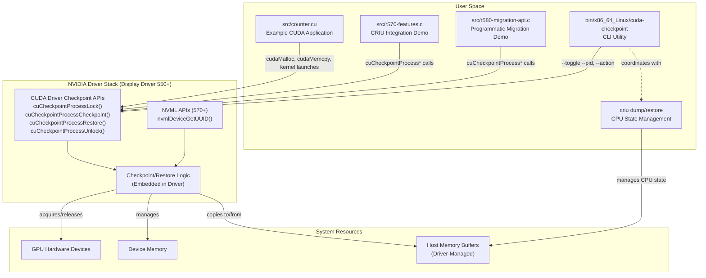

**Two-Phase Coordination Model**: The architecture enforces strict sequencing where GPU state suspension must complete before CPU checkpointing begins, and CPU restoration must complete before GPU state resumption. This separation allows CRIU to operate on process state without encountering active GPU resources.

Sources: [README.md:3-4](), [README.md:26-27](), [README.md:260-263]()

### Core Components and Responsibilities

| Component | Primary Responsibility | Driver Version Requirements | Code Reference |
|-----------|----------------------|---------------------------|----------------|
| `bin/x86_64_Linux/cuda-checkpoint` | Exposes driver checkpoint APIs via CLI | 550+ | Binary utility |
| CRIU (`criu` command) | CPU state checkpointing and process tree management | Any version (4.0+ for process tree) | External dependency |
| CUDA Driver Checkpoint APIs | Low-level GPU resource management embedded in driver | 550+ | `cuCheckpointProcess*` functions |
| NVML Integration | GPU device identification and monitoring | 570+ | `nvmlDeviceGetUUID()` |
| `src/r570-features.c` | Demonstrates CRIU 4.0+ integration features | 570+ | Demo program |
| `src/r580-migration-api.c` | Demonstrates programmatic GPU migration | 580+ | Demo program |
| `src/r580-migration-cli.c` | Demonstrates CLI-based GPU migration | 580+ | Demo program |

The system architecture evolves across driver versions:
- **Driver 550+**: Core checkpoint/restore with CLI utility
- **Driver 570+**: CUDA Driver APIs at feature parity with CLI, NVML support, CRIU 4.0+ integration, timeout-based locking
- **Driver 580+**: GPU migration via device mapping, container support

Sources: [README.md:8-22](), [README.md:58-59]()

## Command Interface Architecture

The `cuda-checkpoint` utility provides a command-line interface that maps directly to CUDA Driver checkpoint APIs embedded in the driver. The interface is designed for both manual operation and script integration (as demonstrated in [src/example.sh]()).

### Command-to-Driver API Mapping

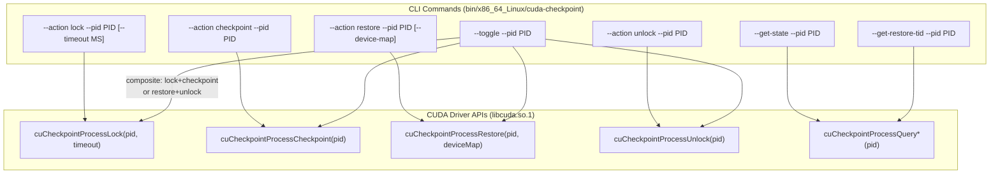

### Command Interface Design

| CLI Option | Driver API | Parameters | Driver Version | Purpose |
|------------|-----------|------------|----------------|---------|
| `--get-state --pid <pid>` | Query functions | Process ID | 550+ | Check if CUDA is suspended or running |
| `--action lock --pid <pid>` | `cuCheckpointProcessLock()` | Process ID, optional timeout | 550+ (timeout in 570+) | Lock CUDA APIs and prepare for checkpoint |
| `--action checkpoint --pid <pid>` | `cuCheckpointProcessCheckpoint()` | Process ID | 550+ | Save GPU state to host memory |
| `--action restore --pid <pid>` | `cuCheckpointProcessRestore()` | Process ID, optional device map | 550+ (device-map in 580+) | Restore GPU state from host memory |
| `--action unlock --pid <pid>` | `cuCheckpointProcessUnlock()` | Process ID | 550+ | Unlock CUDA APIs and resume execution |
| `--toggle --pid <pid>` | Composite operation | Process ID | 550+ | Automatic suspend/resume based on current state |
| `--get-restore-tid --pid <pid>` | Query function | Process ID | 550+ | Get thread ID used for restore operations |

**Process Targeting**: All operations require `--pid <pid>` to specify the target process. This enables precise control over individual CUDA contexts within multi-process applications (as demonstrated in [src/r570-features.c:59-108]()).

**Timeout Support (570+)**: The `--timeout <ms>` parameter prevents indefinite blocking during lock operations, addressing potential deadlock scenarios in production deployments.

**Device Mapping (580+)**: The `--device-map` parameter enables GPU migration by mapping source GPU UUIDs to destination GPU UUIDs during restore operations (demonstrated in [src/r580-migration-cli.c:72-89]()).

Sources: [README.md:58-89](), [README.md:20]()

## Checkpoint/Restore Workflow Architecture

The checkpoint and restore workflow implements a four-step state machine for GPU state management. These steps coordinate with CRIU to enable complete application checkpointing.

### Suspend (Checkpoint) Workflow

**Diagram: Complete Suspend Workflow with CRIU Integration**

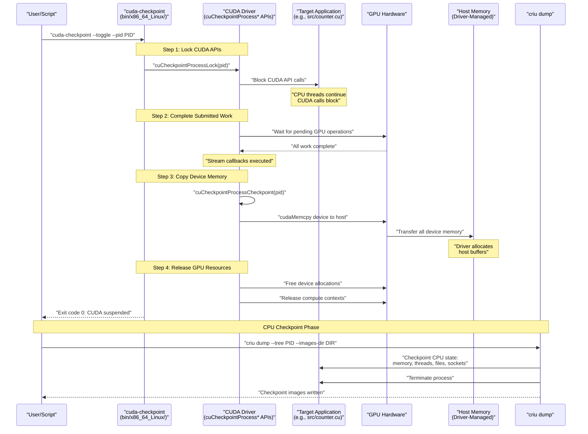

**Workflow Details**:
1. **Lock Phase** ([README.md:97]()): CUDA driver APIs are locked, blocking new GPU operations. CPU threads continue executing and can access host memory.
2. **Completion Phase** ([README.md:98]()): Already-submitted CUDA work completes, including stream callbacks.
3. **Memory Transfer Phase** ([README.md:99]()): Device memory is copied to host memory allocations managed by the driver.
4. **Release Phase** ([README.md:100]()): GPU resources are fully released, leaving no OS-level GPU handles in the process.

After suspension, the process no longer references GPU hardware and can be checkpointed by CRIU ([README.md:106-107]()).

Sources: [README.md:95-107]()

### Resume (Restore) Workflow

**Diagram: Complete Restore Workflow with CRIU Integration**

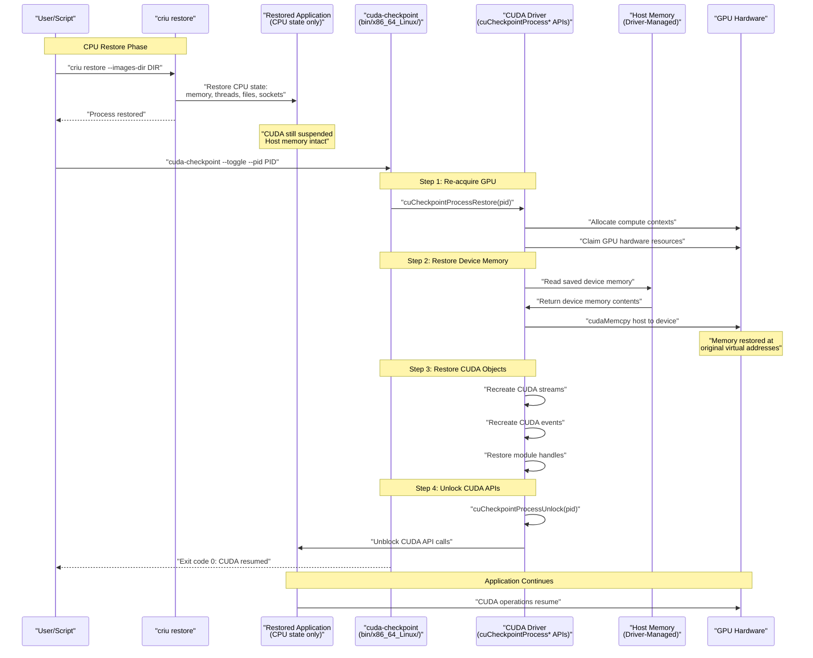

**Workflow Details**:
1. **Re-acquisition Phase** ([README.md:111]()): GPUs are re-acquired by the process, allocating compute contexts and hardware resources.
2. **Memory Restore Phase** ([README.md:112]()): Device memory is copied back to the GPU with memory mappings restored at original addresses.
3. **Object Restore Phase** ([README.md:113]()): CUDA objects such as streams, events, and contexts are recreated.
4. **Unlock Phase** ([README.md:114]()): CUDA driver APIs are unlocked, allowing GPU operations to resume.

At this point, CUDA calls unblock and the application continues execution as if it had never been suspended ([README.md:116]()).

**Critical Ordering Constraint**: CRIU must restore CPU state before `cuda-checkpoint` restores GPU state. This ordering ensures that the driver can access restored host memory when rebuilding GPU state.

Sources: [README.md:109-116]()

### Example Workflow Script

The [src/example.sh]() script demonstrates the complete workflow:
- Lines 14-18: Launch counter application
- Lines 20-21: Suspend CUDA state with `cuda-checkpoint --toggle`
- Lines 23-24: Checkpoint CPU state with `criu dump`
- Lines 26-27: Restore CPU state with `criu restore`
- Lines 29-30: Resume CUDA state with `cuda-checkpoint --toggle`

Sources: [README.md:118-250]()

## State Management Architecture

The CUDA driver manages four categories of GPU state during checkpoint/restore operations. All state management logic is embedded in the driver itself, with the `cuda-checkpoint` utility acting only as a trigger.

### GPU State Categories and Management

**Diagram: State Category Management**

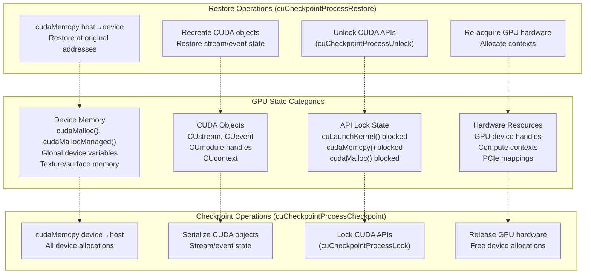

### State Category Details

| State Category | Checkpoint Behavior | Restore Behavior | Code Example |
|----------------|---------------------|------------------|--------------|
| **Device Memory** | Copied to driver-managed host buffers via `cudaMemcpy` | Copied back to GPU at original virtual addresses | [src/counter.cu:132]() `__device__ int counter` |
| **CUDA Objects** | Stream/event/context state serialized by driver | Objects recreated with identical handles and state | `CUstream`, `CUevent` objects |
| **API Locks** | All CUDA APIs blocked (except host memory access) | APIs unblocked, allowing operation submission | `cuLaunchKernel()`, `cudaMalloc()` |
| **Hardware Resources** | GPU device handles released, process has no GPU attachment | GPU contexts re-allocated, hardware resources claimed | Compute contexts, PCIe mappings |

**Memory Address Preservation**: The driver ensures GPU memory mappings are restored at their original virtual addresses ([README.md:112]()), maintaining pointer validity across checkpoint/restore cycles. This allows device pointers stored in host memory to remain valid.

**Thread Behavior During Suspension**: CPU threads continue executing during CUDA suspension ([README.md:102-104]()). Host memory allocated by CUDA APIs (via `cudaMallocHost`, `cudaHostAlloc`) remains accessible. CUDA API calls block until unlock.

Sources: [README.md:95-114]()

### API Locking Scope

**Diagram: API Blocking Behavior**

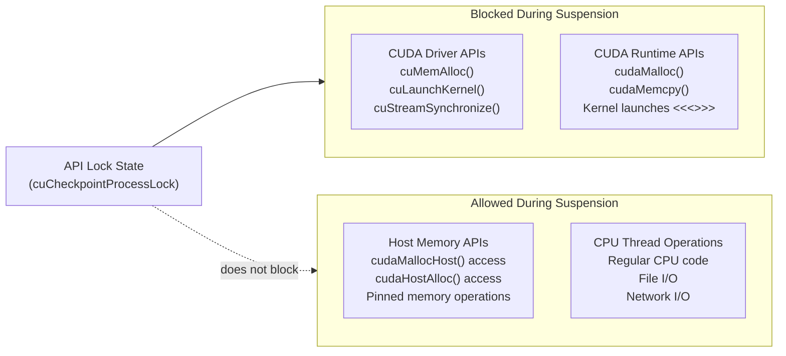

The driver's API locking mechanism selectively blocks GPU-related operations while allowing CPU operations and host memory access to continue. This enables CPU threads to remain active during suspension, supporting use cases like maintaining network connections while GPU state is checkpointed.

Sources: [README.md:102-104]()

### API Locking Mechanism

The system implements a sophisticated API locking mechanism to ensure consistency during state transitions:

| Lock Scope | Affected APIs | Behavior During Lock |
|------------|---------------|---------------------|
| Driver APIs | `cuMemAlloc`, `cuLaunchKernel`, `cuStreamSynchronize` | Block until unlock |
| Runtime APIs | `cudaMalloc`, `cudaMemcpy`, kernel launches | Block until unlock |
| Host Memory APIs | `cudaMallocHost`, `cudaHostAlloc` | **Continue operating** |
| CPU Threads | Application CPU code | **Continue executing** |

**Thread Safety**: CPU threads continue execution during CUDA suspension and can safely access host memory allocated by CUDA APIs, but CUDA API calls will block until resumption.

Sources: [README.md:95-97]()

## Driver Integration Model

The checkpoint/restore functionality is embedded within the NVIDIA display driver and evolves across driver versions. The `cuda-checkpoint` utility remains unchanged while driver updates add new capabilities.

### Feature Evolution Across Driver Versions

**Diagram: Driver Version Feature Availability**

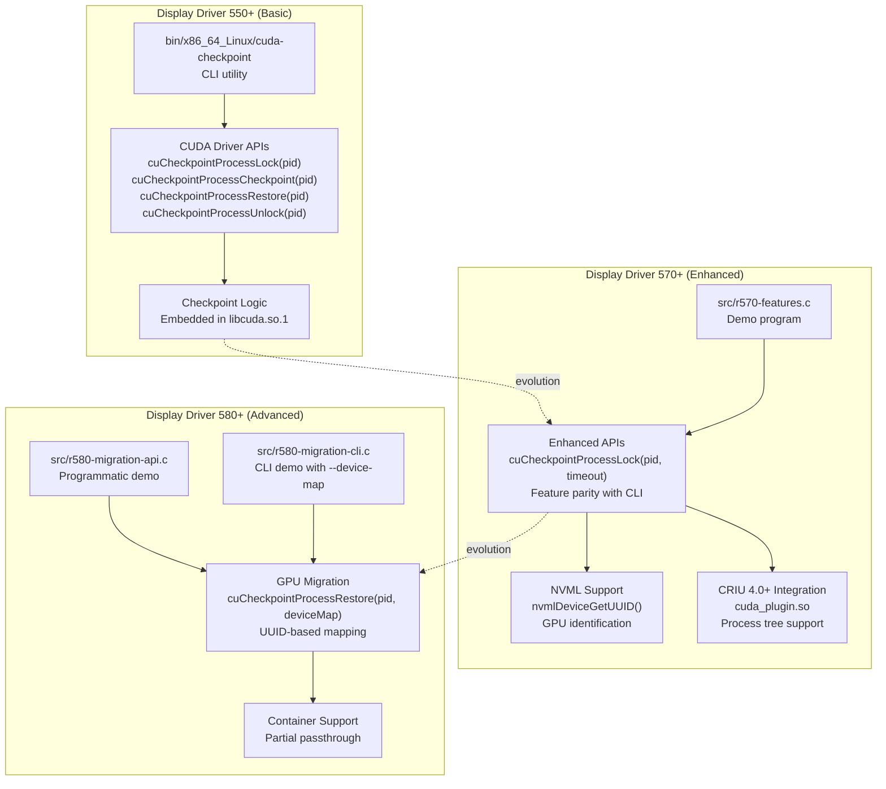

### Driver Version Feature Matrix

| Feature | Driver 550+ | Driver 570+ | Driver 580+ | Code Reference |
|---------|-------------|-------------|-------------|----------------|
| **CLI Utility** | `bin/x86_64_Linux/cuda-checkpoint` | Same utility, no changes | Same utility, no changes | Binary unchanged |
| **Lock API** | `cuCheckpointProcessLock(pid)` | `cuCheckpointProcessLock(pid, timeout)` | Same as 570 | Timeout parameter added |
| **Checkpoint API** | `cuCheckpointProcessCheckpoint(pid)` | Same | Same | No changes |
| **Restore API** | `cuCheckpointProcessRestore(pid)` | Same | `cuCheckpointProcessRestore(pid, deviceMap)` | Device mapping added |
| **Unlock API** | `cuCheckpointProcessUnlock(pid)` | Same | Same | No changes |
| **NVML Support** | ❌ | ✅ `nvmlDeviceGetUUID()` | ✅ | [README.md:17]() |
| **CRIU Integration** | Basic | CRIU 4.0+ with `cuda_plugin.so` | Same as 570 | [README.md:18]() |
| **Process Tree Support** | ❌ | ✅ via CRIU 4.0+ | ✅ | [src/r570-features.c:59-108]() |
| **Timeout Mechanism** | ❌ | ✅ `--timeout <ms>` | ✅ | [README.md:20]() |
| **GPU Migration** | ❌ | ❌ | ✅ `--device-map` parameter | [README.md:10](), [src/r580-migration-api.c](), [src/r580-migration-cli.c]() |
| **Container Support** | ❌ | ❌ | ✅ Partial passthrough | [README.md:11]() |
| **Programmatic APIs** | ❌ | ✅ Feature parity with CLI | ✅ | [README.md:19]() |

**Architectural Insight**: The binary utility at `bin/x86_64_Linux/cuda-checkpoint` does not change across driver versions. New features are exposed by the underlying driver APIs, demonstrating the driver-embedded architecture ([README.md:260-263]()).

Sources: [README.md:8-22]()

### Driver 570+ CRIU Integration

Driver 570 introduced deeper integration with CRIU 4.0+ through a plugin mechanism:

**Diagram: CRIU Plugin Architecture (570+)**

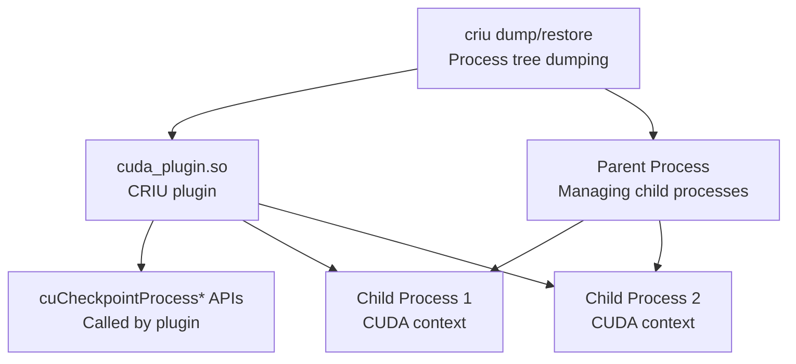

The [src/r570-features.c]() demo shows this integration, where a parent process forks child processes that each have CUDA contexts. CRIU 4.0+ can checkpoint the entire process tree, with the `cuda_plugin.so` ensuring each child process's GPU state is properly suspended and resumed.

Sources: [README.md:18](), [src/r570-features.c:59-108]()

### Driver 580+ GPU Migration Architecture

Driver 580 added GPU migration capabilities, allowing checkpoint on one GPU and restore on a different GPU:

**Diagram: GPU Migration with Device Mapping**

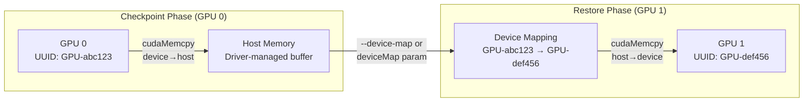

Migration is demonstrated in two ways:
- **Programmatic**: [src/r580-migration-api.c]() uses `cuCheckpointProcessRestore()` with a device map structure
- **CLI**: [src/r580-migration-cli.c]() uses `cuda-checkpoint --action restore --device-map` parameter

The device map specifies source GPU UUID to destination GPU UUID mappings, allowing the driver to redirect GPU allocations during restore.

Sources: [README.md:10-13](), [src/r580-migration-api.c](), [src/r580-migration-cli.c]()

## System Limitations and Constraints

The current architecture has specific limitations that constrain its applicability:

### Architectural Constraints

| Limitation Category | Specific Constraints | Architectural Impact |
|-------------------|---------------------|---------------------|
| Platform Support | x64 only | Memory layout assumptions |
| Memory Types | No UVM or IPC memory support | Simplified memory management model |
| Migration | No GPU migration support | Single-node constraint |
| Work Completion | Must wait for submitted work | Synchronous checkpoint model |
| Error Handling | Limited error recovery | Fail-fast approach |

**Work Completion Model**: The architecture implements a **completion-based** approach where all submitted CUDA work must finish before checkpoint proceeds, rather than attempting to serialize in-flight operations.

**Error Recovery Strategy**: The system follows a **fail-fast** approach where encountering unsupported features (like UVM allocations) during checkpoint results in leaving the process in an undefined state rather than attempting partial recovery.

Sources: [README.md:245-257]()

---

# Page: Getting Started

# Getting Started

<details>
<summary>Relevant source files</summary>

The following files were used as context for generating this wiki page:

- [README.md](README.md)
- [bin/x86_64_Linux/cuda-checkpoint](bin/x86_64_Linux/cuda-checkpoint)

</details>


This page covers the prerequisites, system requirements, and initial setup needed to use cuda-checkpoint for checkpointing and restoring CUDA applications. For a hands-on walkthrough demonstrating checkpoint and restore operations with the counter demo application, see [Quick Start Guide](#3.1).

## Purpose and Scope

The `cuda-checkpoint` utility enables transparent checkpointing and restoration of CUDA state within running Linux processes. This page documents the system requirements across different NVIDIA driver versions, installation procedures for required components, and verification steps to ensure your environment is properly configured. For detailed command-line usage, see [Command-Line Reference](#4). For information about the demonstration programs, see [Examples and Demos](#5).

**Sources:** [README.md:1-6]()

---

## System Requirements

### Hardware Requirements

The cuda-checkpoint utility requires:
- **Architecture:** x86_64 Linux systems only
- **GPU:** NVIDIA CUDA-capable GPU

**Current Limitations:** As documented in [README.md:252-263](), the utility does not support:
- Non-x86_64 architectures
- Applications using Unified Virtual Memory (UVM)
- Applications using Inter-Process Communication (IPC) memory

**Sources:** [README.md:252-263]()

### Software Prerequisites

| Component | Minimum Version | Recommended Version | Notes |
|-----------|----------------|---------------------|-------|
| **NVIDIA Display Driver** | 550+ | 580+ | Feature set depends on driver version (see below) |
| **CRIU** | 3.x | 4.0+ | Version 4.0+ required for process tree support with driver 570+ |
| **Linux Kernel** | Compatible with CRIU | Latest stable | Must support CRIU checkpointing features |
| **CUDA Runtime** | Matches driver | Latest | Application dependency |
| **libcuda.so.1** | Bundled with driver | - | Required by `cuda-checkpoint` utility |

**Sources:** [README.md:16-21](), [README.md:37-54]()

### Driver Version Feature Matrix

The cuda-checkpoint functionality has evolved across driver versions. Understanding which features are available in your driver version is essential for planning your checkpointing strategy.

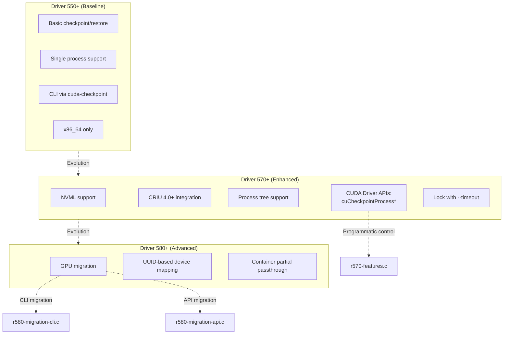

**Driver Version Feature Details**

| Driver Version | Key Features | Demonstration Programs |
|----------------|--------------|------------------------|
| **550+** | Basic checkpoint/restore via CLI, x64 only, no UVM/IPC support | [counter.cu]()/[example.sh]() |
| **570+** | NVML integration, CRIU 4.0+ process tree support, programmatic CUDA Driver APIs (`cuCheckpointProcessLock`, `cuCheckpointProcessCheckpoint`, `cuCheckpointProcessRestore`, `cuCheckpointProcessUnlock`), lock timeout parameter | [r570-features.c]() |
| **580+** | GPU migration with `--device-map`, container partial passthrough (some 575 builds) | [r580-migration-api.c](), [r580-migration-cli.c]() |

**Sources:** [README.md:8-22](), [README.md:59-64]()

---

## CRIU Background and Integration

### What is CRIU?

CRIU (Checkpoint/Restore in Userspace) is an open-source Linux utility that checkpoints and restores process trees by managing kernel-level resources:

- Anonymous memory
- Thread states
- File descriptors (regular files, sockets, pipes)
- Signal handlers
- Process relationships

### Why CRIU Cannot Handle CUDA Alone

CRIU operates by checkpointing resources defined by the Linux kernel specification. Since NVIDIA GPUs provide functionality beyond standard Linux kernel resources, CRIU cannot directly manage:

- GPU device memory allocations
- CUDA contexts and streams
- GPU-resident data structures
- Driver-managed state

The cuda-checkpoint utility bridges this gap by managing CUDA-specific state while CRIU handles traditional process resources.

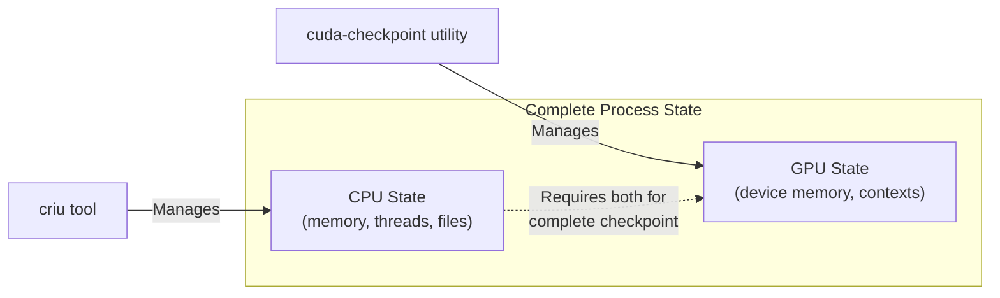

**Sources:** [README.md:37-54]()

---

## Installation

### Installing NVIDIA Display Drivers

The cuda-checkpoint utility requires NVIDIA Display Driver version 550 or higher. The checkpoint/restore functionality is embedded within the driver itself—the `cuda-checkpoint` binary merely exposes this functionality.

**Verification Command:**
```bash
nvidia-smi --query-gpu=driver_version --format=csv,noheader
```

Expected output format: `550.XX.XX` or higher

**Driver Installation Resources:**
- NVIDIA Driver Downloads: [https://www.nvidia.com/Download/index.aspx](https://www.nvidia.com/Download/index.aspx)
- Installation typically requires root/sudo privileges
- Reboot may be required after installation

**Sources:** [README.md:59-64](), [README.md:252-263]()

### Installing CRIU

CRIU must be installed separately from the cuda-checkpoint utility. For driver 570+ features (process tree support), CRIU 4.0 or higher is required.

**Installation Methods:**

**Via Package Manager (Ubuntu/Debian):**
```bash
sudo apt-get update
sudo apt-get install criu
```

**Via Package Manager (RHEL/CentOS):**
```bash
sudo yum install criu
```

**From Source:**
```bash
git clone https://github.com/checkpoint-restore/criu
cd criu
make
sudo make install
```

**Verification Command:**
```bash
criu --version
```

**Sources:** [README.md:37-54]()

### Obtaining cuda-checkpoint Binary

The `cuda-checkpoint` utility is distributed as a pre-compiled binary in this repository.

**Binary Location:**
[bin/x86_64_Linux/cuda-checkpoint]()

**Binary Dependencies:**
The utility links against:
- `libcuda.so.1` - CUDA Driver library (bundled with NVIDIA drivers)
- `libc.so.6` - Standard C library

These dependencies can be verified by examining the ELF binary headers in [bin/x86_64_Linux/cuda-checkpoint:1-13]().

**Installation Steps:**

1. **Clone the repository:**
   ```bash
   git clone https://github.com/NVIDIA/cuda-checkpoint
   cd cuda-checkpoint
   ```

2. **Verify binary exists:**
   ```bash
   ls -lh bin/x86_64_Linux/cuda-checkpoint
   ```

3. **Make executable (if needed):**
   ```bash
   chmod +x bin/x86_64_Linux/cuda-checkpoint
   ```

4. **Add to PATH (optional):**
   ```bash
   export PATH="$PWD/bin/x86_64_Linux:$PATH"
   ```
   
   Or copy to system location:
   ```bash
   sudo cp bin/x86_64_Linux/cuda-checkpoint /usr/local/bin/
   ```

**Sources:** [README.md:3-6](), [bin/x86_64_Linux/cuda-checkpoint:1-13]()

---

## Initial Setup and Verification

### Verify NVIDIA Driver Installation

Before using cuda-checkpoint, ensure the NVIDIA driver is properly installed and the required version is present.

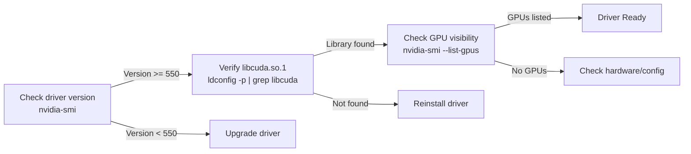

**Verification Commands:**

1. **Check driver version:**
   ```bash
   nvidia-smi --query-gpu=driver_version --format=csv,noheader
   ```
   Expected: Version 550 or higher

2. **Verify CUDA Driver library:**
   ```bash
   ldconfig -p | grep libcuda.so.1
   ```
   Expected: Path to libcuda.so.1 displayed

3. **List available GPUs:**
   ```bash
   nvidia-smi --list-gpus
   ```
   Expected: One or more GPUs listed

**Sources:** [README.md:193-198]()

### Verify CRIU Installation

Confirm CRIU is installed and operational.

**Verification Commands:**

1. **Check CRIU version:**
   ```bash
   criu --version
   ```
   Expected output format: `Version: 3.X` or `Version: 4.X`

2. **Test CRIU basic functionality:**
   ```bash
   criu check
   ```
   Expected: All checks should pass

3. **Verify CRIU can access process information:**
   ```bash
   criu check --all
   ```
   Expected: Comprehensive capability check results

**Common Issues:**
- If `criu check` fails, kernel may not have required features enabled
- Some distributions require additional kernel modules or configuration
- Root/sudo privileges may be required for full CRIU functionality

**Sources:** [README.md:37-54]()

### Verify cuda-checkpoint Utility

Test that the cuda-checkpoint binary is functional and can communicate with the driver.

**Verification Commands:**

1. **Display help message:**
   ```bash
   ./bin/x86_64_Linux/cuda-checkpoint --help
   ```
   
   Expected output structure (as shown in [README.md:62-89]()):
   ```
   CUDA checkpoint and restore utility.
   Version XXX.XX.XX. Copyright (C) 2025 NVIDIA Corporation. All rights reserved.
   
   Operations:
   --get-state --pid <pid>
   --action lock | checkpoint | restore | unlock --pid <pid> [--timeout <ms>]
   --toggle --pid <pid>
   --get-restore-tid --pid <pid>
   
   Options:
   --pid|-p <pid>
   --timeout|-t <timeout>
   --help|-h
   ```

2. **Verify driver integration:**
   
   The utility performs a driver version check when executed. If you see an error message like `Insufficient driver`, the driver version is below the minimum requirement (550).

**Troubleshooting:**

| Error | Cause | Solution |
|-------|-------|----------|
| `Insufficient driver` | Driver version < 550 | Upgrade NVIDIA driver |
| `libcuda.so.1: cannot open shared object` | CUDA driver library not found | Add driver library path to `LD_LIBRARY_PATH` or reinstall driver |
| `Permission denied` | Binary not executable | Run `chmod +x bin/x86_64_Linux/cuda-checkpoint` |

**Sources:** [README.md:57-89](), [bin/x86_64_Linux/cuda-checkpoint:10-10]()

---

## Understanding the Basic Workflow

Before proceeding to use cuda-checkpoint, it's important to understand the state model and workflow.

### CUDA Process State Model

A CUDA process exists in one of two states managed by cuda-checkpoint:

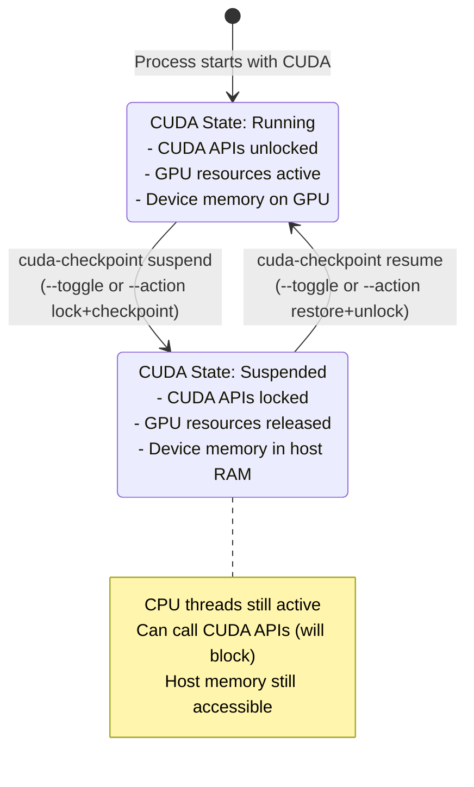

**State Characteristics:**

| State | CUDA APIs | GPU Resources | Device Memory Location | CPU Threads | CRIU Compatible |
|-------|-----------|---------------|------------------------|-------------|-----------------|
| **Running** | Unlocked, operational | Active on GPU | GPU device memory | Active | ❌ No |
| **Suspended** | Locked, blocking | Released | Host memory (driver-managed) | Active | ✅ Yes |

**Sources:** [README.md:90-117]()

### Checkpoint and Restore Workflow

The complete checkpoint and restore process involves coordinating cuda-checkpoint with CRIU:

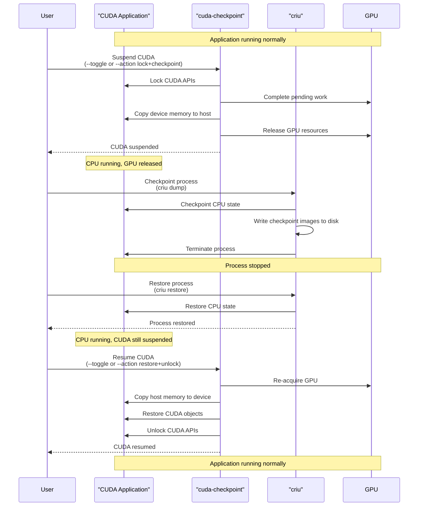

**Key Points:**

1. **Two-Phase Suspension:** CUDA must be suspended (via cuda-checkpoint) before CPU checkpointing (via CRIU)
2. **Two-Phase Restoration:** CPU must be restored (via CRIU) before CUDA resumption (via cuda-checkpoint)
3. **Independent Tools:** cuda-checkpoint and CRIU operate independently but must be coordinated
4. **GPU Resource Management:** GPU resources are completely released during suspension, enabling migration in driver 580+

**Sources:** [README.md:88-117](), [README.md:118-250]()

---

## Component Architecture

The following diagram maps the concrete code entities involved in the checkpoint/restore system:

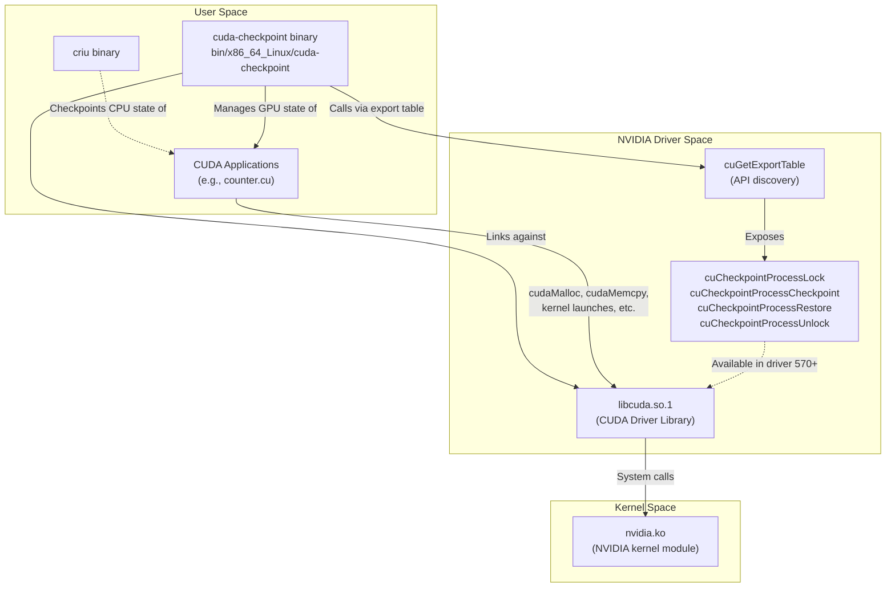

**Code Entity References:**

- **Binary:** [bin/x86_64_Linux/cuda-checkpoint]() - Pre-compiled utility
- **Library Dependencies:** `libcuda.so.1`, `libc.so.6` as shown in [bin/x86_64_Linux/cuda-checkpoint:3-3]()
- **Driver API Functions:** `cuDriverGetVersion`, `cuGetExportTable` as shown in [bin/x86_64_Linux/cuda-checkpoint:3-3]()
- **Checkpoint API Functions:** Referenced in [README.md:19-20]() - `cuCheckpointProcess*` family

**Sources:** [README.md:252-263](), [bin/x86_64_Linux/cuda-checkpoint:1-13]()

---

## Next Steps

Once your environment is configured and verified:

1. **Try the Quick Start Guide:** Follow the step-by-step tutorial at [Quick Start Guide](#3.1) using the counter demo application
2. **Explore Command-Line Options:** See [Command-Line Reference](#4) for detailed documentation of all flags and parameters
3. **Review Example Programs:** Examine the demonstration programs at [Examples and Demos](#5) to understand different use cases
4. **Learn About Advanced Features:** For GPU migration and other advanced topics, see [Advanced Features](#6)

**Sources:** [README.md:118-250]()

---

# Page: Quick Start Guide

# Quick Start Guide

<details>
<summary>Relevant source files</summary>

The following files were used as context for generating this wiki page:

- [README.md](README.md)
- [src/counter.cu](src/counter.cu)
- [src/example.sh](src/example.sh)

</details>


## Purpose and Scope

This guide provides a step-by-step walkthrough of using the `cuda-checkpoint` utility to checkpoint and restore a CUDA application. It demonstrates the complete workflow using the `counter` demo application, showing how to suspend CUDA state, checkpoint the process with CRIU, restore it, and resume CUDA operations.

For detailed information about individual command-line options and parameters, see [Command-Line Reference](#4). For more advanced demonstrations including GPU migration and CRIU integration features, see [Examples and Demos](#5).

**Sources:** [README.md:118-250]()

---

## Prerequisites

Before beginning this walkthrough, ensure the following requirements are met:

| Requirement | Details |
|-------------|---------|
| **NVIDIA Display Driver** | Version 550 or higher |
| **CRIU** | Installed and accessible in PATH |
| **CUDA Toolkit** | For building the counter application with `nvcc` |
| **Root/sudo privileges** | Required for `criu` operations |
| **Network tools** | `nc` (netcat) for UDP communication |

**Sources:** [README.md:59](), [README.md:6]()

---

## The Counter Demo Application

The counter application is a UDP server that maintains a GPU-resident counter. Each time it receives a network packet, it increments the counter using a CUDA kernel and replies with the updated value. This demonstrates that GPU memory state persists correctly across checkpoint and restore operations.

### Application Structure

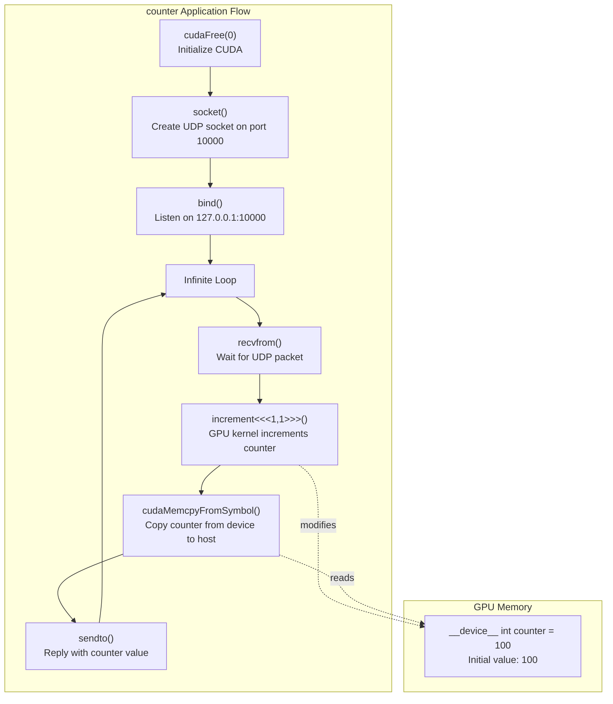

**Sources:** [src/counter.cu:1-51]()

### Building the Application

Build the counter application using `nvcc`:

```bash
nvcc counter.cu -o counter
```

The resulting binary is referenced throughout this guide as `./counter`.

**Sources:** [README.md:164-168]()

---

## Step-by-Step Checkpoint and Restore Workflow

The following sections walk through the complete checkpoint and restore process, showing each command and its expected output.

### Step 1: Launch the Application

Start the counter application in the background and wait for it to bind to its UDP socket:

```bash
./counter &
PID=$!
sleep 1
```

The `$!` shell variable captures the PID of the backgrounded process, which is needed for subsequent `cuda-checkpoint` and `criu` commands.

**Sources:** [README.md:173-183](), [src/example.sh:15-22]()

### Step 2: Test Initial Functionality

Send a UDP packet to the counter application and observe the response:

```bash
echo hello | nc -u localhost 10000 -W 1
```

**Expected output:**
```
101
```

The counter's initial device value is 100 ([src/counter.cu:21]()), but the response is 101 because the kernel increments it before replying. This confirms the application is functioning correctly.

**Sources:** [README.md:185-191](), [src/example.sh:24-25]()

### Step 3: Verify GPU Usage

Use `nvidia-smi` to confirm the counter process is actively using a GPU:

```bash
nvidia-smi --query --display=PIDS | grep $PID
```

**Expected output (example):**
```
        Process ID                        : 298027
```

**Sources:** [README.md:193-198](), [src/example.sh:27-28]()

### Step 4: Suspend CUDA State

Use `cuda-checkpoint` to suspend the application's CUDA state:

```bash
cuda-checkpoint --toggle --pid $PID
```

This command performs the following operations:

| Phase | Operation | Description |
|-------|-----------|-------------|
| 1. Lock | API locking | Blocks new CUDA driver API calls |
| 2. Drain | Work completion | Waits for submitted GPU work to finish |
| 3. Checkpoint | Memory copy-out | Copies device memory to host buffers |
| 4. Release | Resource cleanup | Releases all GPU resources |

After suspension, CPU threads remain active but CUDA API calls will block until resumed.

**Sources:** [README.md:200-204](), [src/example.sh:30-31](), [README.md:95-107]()

### Step 5: Verify GPU Release

Confirm the process no longer appears in the GPU process list:

```bash
nvidia-smi --query --display=PIDS | grep $PID
```

**Expected output:** (empty - no match found)

**Sources:** [README.md:206-210](), [src/example.sh:33-34]()

### Step 6: Checkpoint with CRIU

Create a directory for the checkpoint image and use CRIU to checkpoint the entire process:

```bash
mkdir -p demo
criu dump --shell-job --images-dir demo --tree $PID
```

**Expected output:**
```
[1]+  Killed                  ./counter
```

The `--shell-job` flag handles job control signals, `--images-dir` specifies where checkpoint data is stored, and `--tree` checkpoints the entire process tree rooted at the given PID.

**Sources:** [README.md:212-223](), [src/example.sh:36-40]()

### Step 7: Verify Process Termination

Confirm the counter process is no longer running:

```bash
ps --pid $PID
```

**Expected output (example):**
```
    PID TTY          TIME CMD
```

The header line appears but no process entry exists.

**Sources:** [README.md:225-230](), [src/example.sh:42-43]()

### Step 8: Restore with CRIU

Restore the checkpointed process using CRIU:

```bash
criu restore --shell-job --restore-detached --images-dir demo
```

The `--restore-detached` flag causes the restored process to run in the background. After this command, the process is restored but CUDA state remains suspended.

**Sources:** [README.md:232-236](), [src/example.sh:45-46]()

### Step 9: Resume CUDA State

Use `cuda-checkpoint` to resume the application's CUDA state:

```bash
cuda-checkpoint --toggle --pid $PID
```

This command performs the following operations:

| Phase | Operation | Description |
|-------|-----------|-------------|
| 1. Acquire | GPU allocation | Re-acquires GPU resources |
| 2. Restore | Memory copy-in | Copies host buffers back to device memory |
| 3. Reconstruct | Object restoration | Restores CUDA streams, contexts, and events |
| 4. Unlock | API unlocking | Unblocks CUDA driver API calls |

**Sources:** [README.md:238-242](), [src/example.sh:48-49](), [README.md:109-116]()

### Step 10: Verify Restored Functionality

Send another UDP packet to verify the counter's state was preserved:

```bash
echo hello | nc -u localhost 10000 -W 1
```

**Expected output:**
```
102
```

The counter value increased from 101 to 102, confirming that the GPU memory state (the device variable `counter`) persisted correctly through the checkpoint and restore cycle.

**Sources:** [README.md:244-250](), [src/example.sh:51-52]()

---

## Complete Workflow Diagram

The following diagram shows the complete checkpoint and restore workflow with actual commands and state transitions:

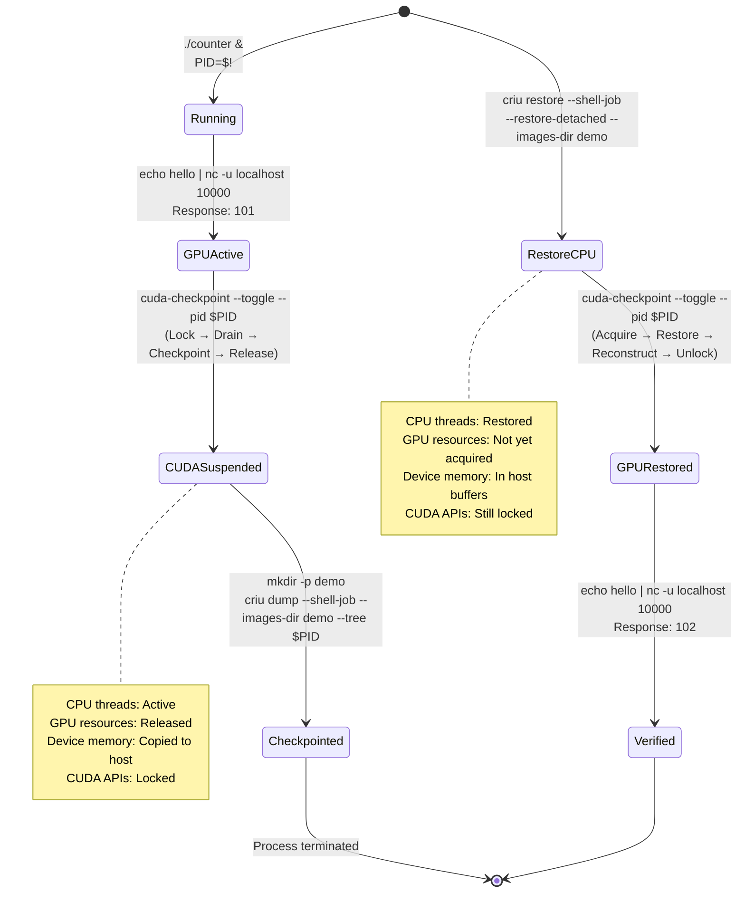

**Sources:** [README.md:118-250](), [src/example.sh:1-55]()

---

## Automated Script Option

For convenience, the complete workflow is automated in the `example.sh` script, which executes all the steps described above sequentially. To run the automated demo:

```bash
bash example.sh
```

The script uses `set -v` to display each command before execution, making it useful for understanding the workflow or as a template for custom checkpoint/restore scripts.

### Script Structure

```mermaid
flowchart TD
    Start["example.sh execution"]
    Launch["./counter &<br/>PID=$!"]
    Wait["sleep 1"]
    Test1["echo hello | nc -u localhost 10000 -W 1"]
    Check1["nvidia-smi --query --display=PIDS | grep $PID"]
    Suspend["cuda-checkpoint --toggle --pid $PID"]
    Check2["nvidia-smi --query --display=PIDS | grep $PID"]
    Mkdir["mkdir -p demo"]
    Dump["criu dump --shell-job --images-dir demo --tree $PID"]
    Check3["ps --pid $PID"]
    Restore["criu restore --shell-job --restore-detached --images-dir demo"]
    Resume["cuda-checkpoint --toggle --pid $PID"]
    Test2["echo hello | nc -u localhost 10000 -W 1"]
    Kill["kill $PID"]
    End["Script complete"]
    
    Start --> Launch
    Launch --> Wait
    Wait --> Test1
    Test1 --> Check1
    Check1 --> Suspend
    Suspend --> Check2
    Check2 --> Mkdir
    Mkdir --> Dump
    Dump --> Check3
    Check3 --> Restore
    Restore --> Resume
    Resume --> Test2
    Test2 --> Kill
    Kill --> End
```

**Sources:** [src/example.sh:1-55]()

---

## Key Observations

### CUDA State Independence

The counter application demonstrates a critical property of the checkpoint/restore system: CPU threads and CUDA GPU operations are managed independently. During the suspended state:

- **CPU threads remain active** and can safely call CUDA APIs (calls will block until resumed)
- **Host memory allocated via `cudaMallocHost` remains accessible** to CPU threads
- **GPU resources are completely released** at the OS level, allowing CRIU to checkpoint the process

This separation enables CRIU (which understands CPU resources) and `cuda-checkpoint` (which understands GPU resources) to work together.

**Sources:** [README.md:102-107]()

### Memory Persistence

The counter value incrementing from 101 to 102 across the checkpoint/restore boundary proves that:

1. The `__device__ int counter` variable at [src/counter.cu:21]() is correctly saved during checkpoint
2. Device memory is restored to the exact same values during resume
3. GPU memory mappings are restored at their original addresses

**Sources:** [README.md:244-250](), [README.md:112]()

### Command Sequencing

The order of operations is critical:

**Checkpoint sequence:**
1. Suspend CUDA (`cuda-checkpoint`)
2. Checkpoint CPU state (`criu dump`)

**Restore sequence:**
1. Restore CPU state (`criu restore`)
2. Resume CUDA (`cuda-checkpoint`)

Reversing this order will fail because CRIU cannot checkpoint active GPU resources, and resumed CUDA state requires the process to already exist.

**Sources:** [README.md:95-116]()

---

## Next Steps

After completing this quick start guide:

- For detailed command-line options and advanced usage patterns, see [Command-Line Reference](#4)
- For advanced CRIU integration features (process trees, NVML support), see [Advanced Integration Demo](#5.2)
- For GPU migration capabilities (moving contexts between physical GPUs), see [GPU Migration Demos](#5.3)
- For driver version feature differences and limitations, see [Advanced Features](#6)

**Sources:** [README.md:1-267]()

---

# Page: Command-Line Reference

# Command-Line Reference

<details>
<summary>Relevant source files</summary>

The following files were used as context for generating this wiki page:

- [README.md](README.md)
- [bin/x86_64_Linux/cuda-checkpoint](bin/x86_64_Linux/cuda-checkpoint)

</details>


This document provides comprehensive reference documentation for the `cuda-checkpoint` command-line utility. The utility exposes CUDA driver checkpoint/restore functionality through a command-line interface that can be invoked directly or integrated into scripts and automation workflows.

For conceptual understanding of checkpoint/restore workflows and architecture, see [Architecture and Design](#2). For step-by-step usage instructions with the demo application, see [Quick Start Guide](#3.1). For examples of programmatic API usage instead of CLI, see [API-Based Migration](#5.3.1).

**Sources**: [README.md:57-89]()

---

## Binary Location and Basic Invocation

The `cuda-checkpoint` utility is a precompiled ELF binary located at:

```
bin/x86_64_Linux/cuda-checkpoint
```

The utility is invoked with operation flags and required parameters. All operations require root privileges as they manipulate process state at the driver level.

Basic invocation syntax:

```bash
cuda-checkpoint <operation> --pid <pid> [options]
```

**Sources**: [README.md:3-4](), [README.md:58-59](), [bin/x86_64_Linux/cuda-checkpoint:1-13]()

---

## Command Structure Overview

```mermaid
graph TD
    CLI["cuda-checkpoint binary"]
    
    CLI --> GetState["--get-state<br/>Query operation"]
    CLI --> Action["--action<br/>Granular control"]
    CLI --> Toggle["--toggle<br/>Convenience operation"]
    CLI --> GetTID["--get-restore-tid<br/>Query operation"]
    CLI --> Help["--help<br/>Documentation"]
    
    Action --> Lock["lock"]
    Action --> Checkpoint["checkpoint"]
    Action --> Restore["restore"]
    Action --> Unlock["unlock"]
    
    GetState --> PidReq1["Requires: --pid"]
    Toggle --> PidReq2["Requires: --pid"]
    GetTID --> PidReq3["Requires: --pid"]
    Lock --> PidReq4["Requires: --pid"]
    Checkpoint --> PidReq5["Requires: --pid"]
    Restore --> PidReq6["Requires: --pid"]
    Unlock --> PidReq7["Requires: --pid"]
    
    Lock --> OptTimeout["Optional: --timeout <ms>"]
    Restore --> OptDevMap["Optional: --device-map <mapping>"]
    
    GetState --> DriverAPI1["cuCheckpointProcessGet*"]
    Lock --> DriverAPI2["cuCheckpointProcessLock"]
    Checkpoint --> DriverAPI3["cuCheckpointProcessCheckpoint"]
    Restore --> DriverAPI4["cuCheckpointProcessRestore"]
    Unlock --> DriverAPI5["cuCheckpointProcessUnlock"]
    Toggle --> DriverAPI6["cuCheckpointProcessGet* +<br/>cuCheckpointProcess*"]
    GetTID --> DriverAPI7["cuCheckpointProcessGetRestoreTid"]
```

The command structure divides into five main operation types. Query operations (`--get-state`, `--get-restore-tid`) retrieve information without modifying state. Control operations (`--action`, `--toggle`) modify CUDA state. The `--action` operation provides granular control over individual state transitions, while `--toggle` provides a higher-level convenience interface.

**Sources**: [README.md:66-78]()

---

## Operations Reference

### --get-state

Queries the current checkpoint state of the target process.

**Syntax**:
```bash
cuda-checkpoint --get-state --pid <pid>
```

**Parameters**:
| Parameter | Required | Description |
|-----------|----------|-------------|
| `--pid <pid>` | Yes | Process ID of the target CUDA application |

**Return Values**:
- Exit code 0 on success
- Prints current state to stdout (states: `running`, `locked`, `checkpointed`, `restoring`)

**Example**:
```bash
cuda-checkpoint --get-state --pid 298027
```

**Driver Mapping**: Invokes driver query functions to determine current checkpoint state.

**Sources**: [README.md:67-68]()

---

### --action

Performs a specific checkpoint/restore action on the target process. This operation provides fine-grained control over the four distinct phases of checkpoint/restore.

**Syntax**:
```bash
cuda-checkpoint --action <action-type> --pid <pid> [options]
```

**Parameters**:
| Parameter | Required | Description |
|-----------|----------|-------------|
| `--pid <pid>` | Yes | Process ID of the target CUDA application |
| `<action-type>` | Yes | One of: `lock`, `checkpoint`, `restore`, `unlock` |
| `--timeout <ms>` | No | Timeout in milliseconds (lock action only, driver 570+) |
| `--device-map <mapping>` | No | GPU UUID mapping (restore action only, driver 580+) |

**Action Types**:

#### lock
Locks CUDA driver APIs in the target process, preventing new GPU operations.

```bash
cuda-checkpoint --action lock --pid <pid> [--timeout <ms>]
```

The optional `--timeout` parameter (driver 570+) causes the lock operation to wait up to the specified number of milliseconds before timing out. This prevents deadlocks in scenarios where the application is blocked waiting for a CUDA operation that cannot complete.

**Driver Mapping**: `cuCheckpointProcessLock`

#### checkpoint
Completes pending GPU work, copies device memory to host, and releases GPU resources.

```bash
cuda-checkpoint --action checkpoint --pid <pid>
```

This action must be preceded by a `lock` action. After checkpointing, the process no longer holds any GPU resources at the OS level.

**Driver Mapping**: `cuCheckpointProcessCheckpoint`

#### restore
Re-acquires GPU resources, copies memory to device, and restores CUDA objects.

```bash
cuda-checkpoint --action restore --pid <pid> [--device-map <mapping>]
```

The optional `--device-map` parameter (driver 580+) specifies GPU UUID mapping for migration scenarios. Format: `<old-uuid>:<new-uuid>[,<old-uuid>:<new-uuid>...]`

Example with device mapping:
```bash
cuda-checkpoint --action restore --pid 12345 \
  --device-map GPU-a1b2c3d4:GPU-e5f6g7h8
```

**Driver Mapping**: `cuCheckpointProcessRestore`

#### unlock
Unlocks CUDA driver APIs, allowing the application to resume GPU operations.

```bash
cuda-checkpoint --action unlock --pid <pid>
```

This action must be preceded by a `restore` action. After unlocking, blocked CUDA API calls will unblock and the application can submit new work.

**Driver Mapping**: `cuCheckpointProcessUnlock`

**Sources**: [README.md:70-72](), [README.md:20](), [README.md:80-81]()

---

### --toggle

Convenience operation that automatically determines current state and performs the appropriate transition.

**Syntax**:
```bash
cuda-checkpoint --toggle --pid <pid>
```

**Parameters**:
| Parameter | Required | Description |
|-----------|----------|-------------|
| `--pid <pid>` | Yes | Process ID of the target CUDA application |

**Behavior**:

```mermaid
stateDiagram-v2
    [*] --> Running
    Running --> Suspended: toggle (suspend)
    Suspended --> Running: toggle (resume)
    
    state Suspended {
        [*] --> Locked
        Locked --> Checkpointed
    }
    
    state Running {
        Restored --> Unlocked
        Unlocked --> [*]
    }
    
    note right of Running
        Initial state
        GPU resources active
    end note
    
    note right of Suspended
        GPU resources released
        Ready for CRIU dump
    end note
```

When the target process is in `running` state, `--toggle` performs a **suspend** sequence:
1. Lock CUDA APIs
2. Checkpoint GPU state

When the target process is in `checkpointed` state, `--toggle` performs a **resume** sequence:
1. Restore GPU state
2. Unlock CUDA APIs

This operation is the most commonly used command as it handles the complete state transition with a single invocation.

**Example Usage Pattern**:
```bash
# Launch application
./counter &
PID=$!

# Suspend CUDA (prepare for CRIU)
cuda-checkpoint --toggle --pid $PID

# Use CRIU to checkpoint CPU state
criu dump --tree $PID --images-dir checkpoint

# Restore CPU state
criu restore --images-dir checkpoint

# Resume CUDA
cuda-checkpoint --toggle --pid $PID
```

**Driver Mapping**: Queries current state via driver APIs, then invokes appropriate sequence of `cuCheckpointProcessLock` + `cuCheckpointProcessCheckpoint` or `cuCheckpointProcessRestore` + `cuCheckpointProcessUnlock`.

**Sources**: [README.md:74-75](), [README.md:91-116](), [README.md:200-242]()

---

### --get-restore-tid

Retrieves the thread ID of the CUDA restore thread for the target process. This thread is created by the driver to manage restoration of GPU state.

**Syntax**:
```bash
cuda-checkpoint --get-restore-tid --pid <pid>
```

**Parameters**:
| Parameter | Required | Description |
|-----------|----------|-------------|
| `--pid <pid>` | Yes | Process ID of the target CUDA application |

**Return Values**:
- Exit code 0 on success
- Prints thread ID to stdout

This operation is useful for debugging and monitoring restore operations, particularly in complex process tree scenarios.

**Driver Mapping**: `cuCheckpointProcessGetRestoreTid`

**Sources**: [README.md:77-78]()

---

### --help

Displays help message with usage information.

**Syntax**:
```bash
cuda-checkpoint --help
```

Outputs version information, available operations, and parameter descriptions.

**Example Output**:
```
CUDA checkpoint and restore utility.
Version 570.86.10. Copyright (C) 2025 NVIDIA Corporation. All rights reserved.

Operations:
--get-state --pid <pid>
        Prints the current checkpoint state of the process specified by <pid>

--action lock | checkpoint | restore | unlock --pid <pid> [--timeout <ms>]
        Performs the specified action on <pid>.
        For the lock action a timeout can be provided...
```

**Sources**: [README.md:62-89]()

---

## Options Reference

### --pid / -p

Specifies the process ID of the target CUDA application.

**Syntax**:
```bash
--pid <pid>
-p <pid>
```

**Required for**: All operations except `--help`

**Validation**: The target process must:
- Be a running Linux process
- Have initialized CUDA (called at least one CUDA API)
- Be accessible to the invoking user (typically requires root)

**Example**:
```bash
cuda-checkpoint --toggle --pid 298027
cuda-checkpoint --get-state -p 298027
```

**Sources**: [README.md:81-82]()

---

### --timeout / -t

Specifies a timeout in milliseconds for the lock operation.

**Syntax**:
```bash
--timeout <milliseconds>
-t <milliseconds>
```

**Applicable to**: `--action lock` only

**Driver Version**: Requires driver 570 or higher

**Behavior**: The lock operation will attempt to lock CUDA APIs, waiting up to the specified timeout period. If APIs cannot be locked within the timeout, the operation fails with a non-zero exit code.

**Use Case**: Prevents deadlocks when locking applications that may be blocked on CUDA operations that cannot complete (e.g., waiting for GPU work that depends on external events).

**Example**:
```bash
# Wait up to 5 seconds for lock to succeed
cuda-checkpoint --action lock --pid 12345 --timeout 5000
```

**Sources**: [README.md:70-72](), [README.md:84-85](), [README.md:20]()

---

### --device-map

Specifies GPU UUID mapping for migration scenarios where GPU contexts are restored to different physical GPUs.

**Syntax**:
```bash
--device-map <old-uuid>:<new-uuid>[,<old-uuid>:<new-uuid>...]
```

**Applicable to**: `--action restore` only

**Driver Version**: Requires driver 580 or higher

**Format**: Comma-separated list of UUID pairs, where each pair maps an original GPU UUID to a target GPU UUID. UUIDs are the device UUIDs reported by `nvidia-smi` or NVML.

**Behavior**: During restore, CUDA contexts originally created on GPUs identified by `<old-uuid>` will be restored to GPUs identified by `<new-uuid>`. Device memory and all CUDA objects are migrated accordingly.

**Example**:
```bash
# Single GPU migration
cuda-checkpoint --action restore --pid 12345 \
  --device-map GPU-12345678-1234-1234-1234-123456789abc:GPU-87654321-4321-4321-4321-cba987654321

# Multi-GPU migration
cuda-checkpoint --action restore --pid 12345 \
  --device-map GPU-aaa:GPU-bbb,GPU-ccc:GPU-ddd
```

**Use Case**: Enables workload migration between:
- Different physical GPUs on the same system
- Different nodes in a cluster
- Different GPU generations or models

**Sources**: [README.md:10](), [README.md:80-81]()

---

## Action Workflow Diagram

The following diagram shows the complete workflow for granular checkpoint/restore control using the `--action` operation:

```mermaid
sequenceDiagram
    participant User
    participant CLI["cuda-checkpoint CLI"]
    participant Driver["CUDA Driver<br/>(libcuda.so.1)"]
    participant GPU
    
    Note over User,GPU: Phase 1: Lock CUDA APIs
    User->>CLI: --action lock --pid PID [--timeout MS]
    CLI->>Driver: cuCheckpointProcessLock()
    Driver->>Driver: Lock driver API entry points
    Driver-->>CLI: CUDA_SUCCESS
    CLI-->>User: Exit code 0
    Note over Driver,GPU: New CUDA calls block<br/>Existing work continues
    
    Note over User,GPU: Phase 2: Checkpoint GPU State
    User->>CLI: --action checkpoint --pid PID
    CLI->>Driver: cuCheckpointProcessCheckpoint()
    Driver->>GPU: Complete pending work
    GPU-->>Driver: Work complete
    Driver->>Driver: Copy device memory to host
    Driver->>GPU: Release GPU resources
    Driver-->>CLI: CUDA_SUCCESS
    CLI-->>User: Exit code 0
    Note over Driver,GPU: No GPU resources held<br/>CPU threads continue
    
    Note over User,GPU: [CRIU checkpoint/restore occurs here]
    
    Note over User,GPU: Phase 3: Restore GPU State
    User->>CLI: --action restore --pid PID [--device-map MAP]
    CLI->>Driver: cuCheckpointProcessRestore()
    Driver->>GPU: Re-acquire GPU resources
    Driver->>Driver: Copy host memory to device
    Driver->>Driver: Restore CUDA objects
    Driver-->>CLI: CUDA_SUCCESS
    CLI-->>User: Exit code 0
    Note over Driver,GPU: GPU resources restored<br/>APIs still locked
    
    Note over User,GPU: Phase 4: Unlock CUDA APIs
    User->>CLI: --action unlock --pid PID
    CLI->>Driver: cuCheckpointProcessUnlock()
    Driver->>Driver: Unlock driver API entry points
    Driver-->>CLI: CUDA_SUCCESS
    CLI-->>User: Exit code 0
    Note over Driver,GPU: Application fully operational<br/>Blocked calls unblock
```

This four-phase workflow provides maximum control and observability. Each phase can be monitored independently, and the application state can be inspected between phases.

**Sources**: [README.md:70-72](), [README.md:95-116]()

---

## Exit Codes and Error Handling

The `cuda-checkpoint` utility uses standard Unix exit codes to indicate operation status.

| Exit Code | Meaning | Common Causes |
|-----------|---------|---------------|
| 0 | Success | Operation completed successfully |
| Non-zero | Error | - Invalid PID<br/>- Process not using CUDA<br/>- Insufficient permissions<br/>- Driver error<br/>- Timeout (lock operation)<br/>- Invalid parameters<br/>- Unsupported features (UVM, IPC) |

**Error Detection**: Scripts should check exit codes after each `cuda-checkpoint` invocation:

```bash
if ! cuda-checkpoint --toggle --pid $PID; then
    echo "Failed to toggle CUDA state" >&2
    exit 1
fi
```

**Driver Version Check**: The utility will fail with an error message if the installed driver version is insufficient:

```
Insufficient driver
```

This occurs when attempting to use features not available in the current driver version (e.g., `--timeout` on driver 550, or `--device-map` on driver 570).

**Sources**: [README.md:61-89](), [bin/x86_64_Linux/cuda-checkpoint:1-13]()

---

## Driver API Mapping

The following table maps CLI operations to their corresponding CUDA Driver API functions:

```mermaid
graph LR
    subgraph "CLI Operations"
        GetState["--get-state"]
        ActionLock["--action lock"]
        ActionCheckpoint["--action checkpoint"]
        ActionRestore["--action restore"]
        ActionUnlock["--action unlock"]
        Toggle["--toggle"]
        GetTID["--get-restore-tid"]
    end
    
    subgraph "CUDA Driver APIs<br/>(Available in libcuda.so.1)"
        API1["cuCheckpointProcessGet*"]
        API2["cuCheckpointProcessLock"]
        API3["cuCheckpointProcessCheckpoint"]
        API4["cuCheckpointProcessRestore"]
        API5["cuCheckpointProcessUnlock"]
        API6["cuCheckpointProcessGetRestoreTid"]
    end
    
    GetState --> API1
    ActionLock --> API2
    ActionCheckpoint --> API3
    ActionRestore --> API4
    ActionUnlock --> API5
    GetTID --> API6
    
    Toggle --> API1
    Toggle --> API2
    Toggle --> API3
    Toggle --> API4
    Toggle --> API5
```

For programmatic access to these operations without using the CLI, applications can link against `libcuda.so.1` and call these driver functions directly. See [API-Based Migration](#5.3.1) for examples.

The CLI utility itself is a thin wrapper that:
1. Parses command-line arguments
2. Loads `libcuda.so.1` via `dlopen`
3. Retrieves function pointers via `cuGetExportTable`
4. Invokes the appropriate driver API functions
5. Returns exit codes based on driver return values

**Sources**: [README.md:19](), [bin/x86_64_Linux/cuda-checkpoint:1-13]()

---

## Driver Version Feature Matrix

Different driver versions support different CLI features:

| Feature | Driver 550 | Driver 570 | Driver 580+ |
|---------|------------|------------|-------------|
| Basic operations (`--get-state`, `--toggle`) | ✓ | ✓ | ✓ |
| Granular actions (`--action lock/checkpoint/restore/unlock`) | ✓ | ✓ | ✓ |
| `--timeout` parameter | ✗ | ✓ | ✓ |
| `--get-restore-tid` | ✗ | ✓ | ✓ |
| `--device-map` parameter | ✗ | ✗ | ✓ |
| CRIU integration | Basic | Process tree | Process tree |
| NVML support | ✗ | ✓ | ✓ |

**Backward Compatibility**: The `cuda-checkpoint` binary remains unchanged across driver versions. Feature availability depends solely on the installed driver version. The utility queries the driver version at runtime and fails with an appropriate error message if an unsupported feature is requested.

**Version Detection**: The utility displays the driver version in its help output:
```
Version 570.86.10. Copyright (C) 2025 NVIDIA Corporation. All rights reserved.
```

**Sources**: [README.md:8-21](), [README.md:253-263]()

---

## Common Usage Patterns

### Pattern 1: Simple Checkpoint/Restore with CRIU

Most common pattern using `--toggle` for convenience:

```bash
# Suspend CUDA
cuda-checkpoint --toggle --pid $PID

# Checkpoint with CRIU
criu dump --shell-job --images-dir checkpoint --tree $PID

# Restore with CRIU
criu restore --shell-job --restore-detached --images-dir checkpoint

# Resume CUDA
cuda-checkpoint --toggle --pid $PID
```

**Sources**: [README.md:118-250]()

### Pattern 2: Granular Control with State Inspection

Pattern using `--action` for detailed control and observability:

```bash
# Lock CUDA
cuda-checkpoint --action lock --pid $PID

# Verify locked state
cuda-checkpoint --get-state --pid $PID

# Checkpoint GPU state
cuda-checkpoint --action checkpoint --pid $PID

# [Perform CRIU operations here]

# Restore GPU state
cuda-checkpoint --action restore --pid $PID

# Verify restored state
cuda-checkpoint --get-state --pid $PID

# Unlock CUDA
cuda-checkpoint --action unlock --pid $PID
```

**Sources**: [README.md:70-78]()

### Pattern 3: GPU Migration (Driver 580+)

Pattern for migrating GPU contexts between different physical GPUs:

```bash
# Get source GPU UUID
SRC_UUID=$(nvidia-smi --query-gpu=gpu_uuid --format=csv,noheader -i 0)

# Get target GPU UUID  
DST_UUID=$(nvidia-smi --query-gpu=gpu_uuid --format=csv,noheader -i 1)

# Lock and checkpoint
cuda-checkpoint --action lock --pid $PID
cuda-checkpoint --action checkpoint --pid $PID

# [Optional: CRIU checkpoint/restore if migrating between nodes]

# Restore with device mapping
cuda-checkpoint --action restore --pid $PID --device-map $SRC_UUID:$DST_UUID

# Unlock
cuda-checkpoint --action unlock --pid $PID
```

**Sources**: [README.md:10-13](), [src/r580-migration-cli.c:17]()

### Pattern 4: Timeout for Deadlock Avoidance (Driver 570+)

Pattern using timeout to prevent hanging on unresponsive applications:

```bash
# Attempt lock with 10 second timeout
if cuda-checkpoint --action lock --pid $PID --timeout 10000; then
    echo "Lock successful"
    cuda-checkpoint --action checkpoint --pid $PID
else
    echo "Lock timeout - application may be deadlocked" >&2
    exit 1
fi
```

**Sources**: [README.md:70-72](), [README.md:20]()

---

## Integration with Scripts

The `cuda-checkpoint` utility is designed for shell script integration. The [example.sh](src/example.sh:1-40)() script demonstrates a complete checkpoint/restore workflow:

```bash
#!/bin/bash

# Launch CUDA application
./counter &
PID=$!
sleep 1  # Wait for application to initialize

# Test application
echo hello | nc -u localhost 10000 -W 1

# Checkpoint workflow
cuda-checkpoint --toggle --pid $PID
mkdir -p checkpoint
criu dump --shell-job --images-dir checkpoint --tree $PID

# Restore workflow  
criu restore --shell-job --restore-detached --images-dir checkpoint
cuda-checkpoint --toggle --pid $PID

# Verify application state preserved
echo hello | nc -u localhost 10000 -W 1
```

**Error Handling in Scripts**: Always check exit codes:

```bash
checkpoint_cuda() {
    local pid=$1
    if ! cuda-checkpoint --toggle --pid "$pid"; then
        echo "ERROR: Failed to suspend CUDA for PID $pid" >&2
        return 1
    fi
    return 0
}
```

**Sources**: [src/example.sh:14-40]()

---

# Page: Examples and Demos

# Examples and Demos

<details>
<summary>Relevant source files</summary>

The following files were used as context for generating this wiki page:

- [README.md](README.md)

</details>


The cuda-checkpoint repository includes five demonstration programs that showcase different aspects of GPU checkpointing functionality. These demos range from basic checkpoint/restore operations to advanced GPU migration scenarios, with each targeting specific driver versions and use cases.

For step-by-step usage instructions, see [Quick Start Guide](#3.1). For driver-specific feature documentation, see [Advanced Features](#6).

## Demo Programs Overview

The repository contains demonstrations organized into two categories: basic checkpoint/restore demos and GPU migration demos.

| Demo | File | Driver | Key Features | Use Case |
|------|------|--------|--------------|----------|
| UDP Counter | [src/counter.cu]() | 550+ | Basic checkpoint/restore, CUDA Runtime API | Learning cuda-checkpoint fundamentals |
| Orchestration Script | [src/example.sh]() | 550+ | Shell-based workflow automation | Complete checkpoint/restore workflow example |
| Advanced Integration | [src/r570-features.c]() | 570+ | NVML, CRIU plugin, parent-child processes, Driver API | Production integration patterns |
| API-Based Migration | [src/r580-migration-api.c]() | 580+ | Programmatic GPU migration via Driver API | Application-integrated migration control |
| CLI-Based Migration | [src/r580-migration-cli.c]() | 580+ | GPU migration via cuda-checkpoint CLI | Script-based migration workflows |

Sources: [README.md:1-22](), [src/counter.cu:1-1](), [src/example.sh:1-1](), [src/r570-features.c:1-1](), [src/r580-migration-api.c:1-1](), [src/r580-migration-cli.c:1-1]()

## Demo Program Relationships

#### Diagram: Demo Program Architecture and Dependencies

```mermaid
graph TB
    subgraph "Basic Checkpoint/Restore Demos"
        counter["counter.cu<br/>UDP Counter Service"]
        examplesh["example.sh<br/>Orchestration Script"]
        r570["r570-features.c<br/>Advanced Integration"]
    end
    
    subgraph "GPU Migration Demos (580+)"
        r580api["r580-migration-api.c<br/>API-Based Migration"]
        r580cli["r580-migration-cli.c<br/>CLI-Based Migration"]
    end
    
    subgraph "External Tools"
        cudacp["cuda-checkpoint utility"]
        criu["CRIU"]
        nvml["NVML (libnvidia-ml.so)"]
        cudadriver["CUDA Driver API"]
    end
    
    examplesh -->|"executes"| counter
    examplesh -->|"calls"| cudacp
    examplesh -->|"calls"| criu
    
    r570 -->|"uses"| cudadriver
    r570 -->|"uses"| nvml
    r570 -->|"calls"| criu
    
    r580api -->|"uses"| cudadriver
    r580api -->|"cuCheckpointProcess* APIs"| cudadriver
    
    r580cli -->|"calls"| cudacp
    r580cli -->|"--device-map parameter"| cudacp
    
    counter -.->|"demonstrated by"| examplesh
```

Sources: [src/example.sh:1-55](), [src/counter.cu:1-161](), [src/r570-features.c:1-177](), [src/r580-migration-api.c:1-111](), [src/r580-migration-cli.c:1-104]()

## Basic Checkpoint/Restore Demonstrations

### UDP Counter Demo

The `counter.cu` application provides a minimal CUDA program that demonstrates fundamental checkpoint/restore functionality. The application maintains a GPU-resident counter variable (`__device__ int counter`) and increments it via a CUDA kernel (`increment<<<1,1>>>()`) each time it receives a UDP packet on port 10000. After checkpoint/restore, the GPU memory content is preserved and operations continue from the checkpointed state.

**Key Code Elements:**
- Device variable: `__device__ int counter = 100` [src/counter.cu:132]()
- Kernel: `__global__ void increment()` [src/counter.cu:133-136]()
- Main loop: packet reception, kernel launch, response [src/counter.cu:146-159]()

The counter demo is documented in detail in [UDP Counter Demo](#5.1).

Sources: [README.md:118-250](), [src/counter.cu:132-161]()

### Orchestration Script

The `example.sh` script demonstrates a complete checkpoint/restore workflow by automating the counter demo. The script launches the counter application, verifies GPU usage with `nvidia-smi`, suspends CUDA state with `cuda-checkpoint --toggle`, checkpoints the process with `criu dump`, restores with `criu restore`, and resumes CUDA state with another `cuda-checkpoint --toggle`.

**Key Operations:**
- Launch and PID capture: [src/example.sh:14-20]()
- CUDA suspend: `cuda-checkpoint --toggle --pid $PID` [src/example.sh:31]()
- CRIU checkpoint: `criu dump --shell-job --images-dir demo --tree $PID` [src/example.sh:38]()
- CRIU restore: `criu restore --shell-job --restore-detached --images-dir demo` [src/example.sh:45]()
- CUDA resume: `cuda-checkpoint --toggle --pid $PID` [src/example.sh:48]()

The orchestration script workflow is documented in detail in [UDP Counter Demo](#5.1).

Sources: [README.md:169-250](), [src/example.sh:14-51]()

### Advanced Integration Demo

The `r570-features.c` program demonstrates driver 570+ capabilities including NVML integration, CRIU plugin usage, and parent-child process checkpointing. The program creates a parent process (`runParent()`) that manages CRIU operations and a child process (`runChild()`) that performs CUDA and NVML operations. The demo validates that GPU memory contents and NVML state persist correctly across checkpoint/restore operations.

**Key Code Elements:**
- Process state query: `cuCheckpointProcessGetState()` [src/r570-features.c:82-84]()
- NVML memory tracking: `nvmlDeviceGetMemoryInfo()` [src/r570-features.c:137](), [src/r570-features.c:157]()
- Parent-child IPC: `socketpair(AF_UNIX, SOCK_STREAM, 0)` [src/r570-features.c:49]()
- CRIU integration: `criu dump --shell-job --libdir --ext-unix-sk` [src/r570-features.c:95]()
- Magic value validation: [src/r570-features.c:145-155]()

The advanced integration demo is documented in detail in [Advanced Integration Demo](#5.2).

Sources: [README.md:15-22](), [src/r570-features.c:42-177]()

## GPU Migration Demonstrations

Driver 580+ introduced GPU migration capabilities, allowing CUDA contexts to be moved between physical GPUs during the restore phase. This enables use cases such as cluster scheduling with workload migration and dynamic GPU resource management.

### Migration Concept

GPU migration uses UUID-based device mapping to redirect CUDA contexts from source GPUs to destination GPUs during restore. The key mechanism is specifying a mapping (called `device-map` in the CLI or `gpuPairs` in the API) that associates old GPU UUIDs with new GPU UUIDs.

**Migration Phases:**
1. Lock CUDA APIs on the source system
2. Checkpoint GPU state (device memory copied to host)
3. Release GPU resources
4. Restore with device mapping to new GPU(s)
5. Unlock CUDA APIs on the destination system

Sources: [README.md:8-13](), [README.md:20-31]()

### API-Based Migration Demo

The `r580-migration-api.c` program demonstrates GPU migration using the CUDA Driver API functions (`cuCheckpointProcessLock`, `cuCheckpointProcessCheckpoint`, `cuCheckpointProcessRestore`, `cuCheckpointProcessUnlock`). The program performs migration between two GPUs on the same system using programmatic control.

**Key Code Elements:**
- Lock operation: `cuCheckpointProcessLock()` [src/r580-migration-api.c:50]()
- Checkpoint operation: `cuCheckpointProcessCheckpoint()` [src/r580-migration-api.c:53]()
- GPU pair mapping: `CUprocessResourcePropertiesGpuPair gpuPairs[]` [src/r580-migration-api.c:63-69]()
- Restore with mapping: `cuCheckpointProcessRestore()` [src/r580-migration-api.c:59-79]()
- Unlock operation: `cuCheckpointProcessUnlock()` [src/r580-migration-api.c:82]()

The API-based migration demo is documented in detail in [API-Based Migration](#5.3.1).

Sources: [README.md:13](), [src/r580-migration-api.c:40-85]()

### CLI-Based Migration Demo

The `r580-migration-cli.c` program demonstrates GPU migration using the `cuda-checkpoint` command-line utility with the `--device-map` parameter. The program builds a device mapping string and invokes the utility via shell commands to perform migration.

**Key Code Elements:**
- Device map construction: [src/r580-migration-cli.c:72-80]()
- Lock command: `cuda-checkpoint --action lock --pid` [src/r580-migration-cli.c:49]()
- Checkpoint command: `cuda-checkpoint --action checkpoint --pid` [src/r580-migration-cli.c:52]()
- Restore with device map: `cuda-checkpoint --action restore --pid --device-map` [src/r580-migration-cli.c:55-58]()
- Unlock command: `cuda-checkpoint --action unlock --pid` [src/r580-migration-cli.c:61]()

The CLI-based migration demo is documented in detail in [CLI-Based Migration](#5.3.2).

Sources: [README.md:13](), [src/r580-migration-cli.c:43-64]()

## Demo Feature Comparison

| Feature | Counter Demo | Advanced Demo |
|---------|-------------|---------------|
| CUDA Runtime | Basic (`cudaFree`, `cudaMemcpyFromSymbol`) | Driver API (`cuInit`, `cuMemAlloc`) |
| NVML Integration | None | Full (`nvmlInit`, `nvmlDeviceGetMemoryInfo`) |
| Process Pattern | Single process | Parent-child with IPC |
| Network I/O | UDP server | Unix domain sockets |
| CRIU Integration | External script | Direct API calls |
| Driver Requirements | 550+ | 570+ |
| Validation | Manual testing | Automated assertions |

Sources: [src/counter.cu:27-50](), [src/r570-features.c:118-164](), [src/example.sh:1-55]()

---

# Page: UDP Counter Demo

# UDP Counter Demo

<details>
<summary>Relevant source files</summary>

The following files were used as context for generating this wiki page:

- [README.md](README.md)
- [src/counter.cu](src/counter.cu)
- [src/example.sh](src/example.sh)

</details>


This document describes the basic demonstration application that showcases fundamental checkpoint/restore functionality using `cuda-checkpoint` and CRIU. The demo consists of two components: [src/counter.cu](), a simple CUDA-accelerated UDP server, and [src/example.sh](), a shell script that orchestrates the complete checkpoint and restore workflow. This demo is referenced as the primary example in [README.md:118-250]().

For advanced integration features including CRIU plugin usage and process tree checkpointing, see [Advanced Integration Demo](#5.2). For GPU migration demonstrations, see [GPU Migration Demos](#5.3).

## Application Overview

The `counter` application is a UDP server that maintains an integer counter in GPU device memory. Each time it receives a UDP packet, it increments the counter on the GPU and responds with the updated value. This simple design demonstrates that GPU-resident state persists correctly across checkpoint/restore operations.

**Sources:** [README.md:119-121](), [src/counter.cu:1-51]()

### CUDA Components

```mermaid
graph TB
    subgraph "counter.cu Application"
        main["main()"]
        kernel["__global__ void increment()"]
        devCounter["__device__ int counter"]
        
        main -->|"Launches"| kernel
        kernel -->|"Increments"| devCounter
        main -->|"Reads via cudaMemcpyFromSymbol"| devCounter
    end
    
    subgraph "CUDA Runtime Operations"
        cudaFree["cudaFree(0)"]
        cudaLaunch["increment<<<1,1>>>()"]
        cudaMemcpy["cudaMemcpyFromSymbol(&hCounter, counter, sizeof counter)"]
    end
    
    main -->|"Initializes CUDA context"| cudaFree
    main -->|"Executes"| cudaLaunch
    main -->|"Executes"| cudaMemcpy
    
    cudaLaunch -.->|"Invokes"| kernel
    cudaMemcpy -.->|"Reads from"| devCounter
```

The application uses three key CUDA constructs:

| Code Entity | Type | Purpose | Location |
|-------------|------|---------|----------|
| `counter` | Device variable | GPU-resident integer initialized to 100 | [src/counter.cu:21]() |
| `increment()` | CUDA kernel | Atomically increments `counter` on GPU | [src/counter.cu:22-25]() |
| `cudaMemcpyFromSymbol()` | CUDA API | Copies device variable value to host | [src/counter.cu:44]() |

The call to `cudaFree(0)` at [src/counter.cu:29]() is used to initialize the CUDA context before setting up the UDP socket. This ensures that GPU resources are allocated before the server begins accepting requests.

**Sources:** [src/counter.cu:21-51](), [README.md:123-162]()

### Network Components

```mermaid
graph LR
    subgraph "UDP Server Setup"
        socket["socket(PF_INET, SOCK_DGRAM, IPPROTO_UDP)"]
        addr["sockaddr_in{AF_INET, htons(10000), 127.0.0.1}"]
        bind["bind(sock, addr, sizeof addr)"]
    end
    
    subgraph "Request Processing Loop"
        recvfrom["recvfrom(sock, buffer, ...)"]
        increment["increment<<<1,1>>>()"]
        cudaMemcpy["cudaMemcpyFromSymbol(&hCounter, counter, ...)"]
        sprintf["sprintf(buffer, '%d\n', hCounter)"]
        sendto["sendto(sock, buffer, bytes, ...)"]
    end
    
    socket --> addr
    addr --> bind
    bind --> recvfrom
    recvfrom --> increment
    increment --> cudaMemcpy
    cudaMemcpy --> sprintf
    sprintf --> sendto
    sendto -->|"Loop"| recvfrom
```

The server binds to UDP port 10000 on localhost. The main loop at [src/counter.cu:35-48]() processes incoming packets by:

1. Receiving a packet with `recvfrom()`
2. Launching the `increment` kernel to update GPU memory
3. Copying the updated counter value to the host
4. Formatting and sending the response with `sendto()`

**Sources:** [src/counter.cu:31-48](), [README.md:130]()

## Checkpoint/Restore Workflow

The [src/example.sh]() script demonstrates the complete checkpoint and restore process. This workflow shows how `cuda-checkpoint` and `criu` work together to preserve both CPU and GPU state.

**Sources:** [src/example.sh:1-55](), [README.md:118-250]()

### Workflow Sequence

```mermaid
sequenceDiagram
    participant Script as example.sh
    participant Counter as counter process
    participant GPU as GPU Device
    participant CudaCP as cuda-checkpoint
    participant CRIU
    participant Disk as Checkpoint Image
    
    Script->>Counter: Launch ./counter
    Note over Script: PID=$! (save process ID)
    Script->>Script: sleep 1 (wait for socket bind)
    
    Script->>Counter: echo hello | nc -u localhost 10000
    Counter->>GPU: increment<<<1,1>>>()
    GPU->>Counter: counter = 101
    Counter->>Script: Response: "101"
    
    Script->>Script: nvidia-smi --query --display=PIDS
    Note over Script,Counter: Confirms GPU usage
    
    Script->>CudaCP: cuda-checkpoint --toggle --pid $PID
    CudaCP->>Counter: Suspend CUDA state
    Counter->>GPU: Complete pending work
    GPU->>Counter: Copy device memory to host
    Counter->>GPU: Release GPU resources
    Note over Counter,GPU: CPU threads active, GPU released
    
    Script->>Script: nvidia-smi --query --display=PIDS
    Note over Script,Counter: Confirms no GPU usage
    
    Script->>Script: mkdir -p demo
    Script->>CRIU: criu dump --shell-job --images-dir demo --tree $PID
    CRIU->>Counter: Checkpoint CPU state
    CRIU->>Disk: Write checkpoint images
    CRIU->>Counter: Terminate process
    Note over Counter: Process killed
    
    Script->>CRIU: criu restore --shell-job --restore-detached --images-dir demo
    CRIU->>Disk: Read checkpoint images
    CRIU->>Counter: Recreate process with CPU state
    Note over Counter: CUDA still suspended
    
    Script->>CudaCP: cuda-checkpoint --toggle --pid $PID
    CudaCP->>Counter: Resume CUDA state
    Counter->>GPU: Re-acquire GPU
    Counter->>GPU: Restore device memory from host
    Counter->>GPU: Restore CUDA objects
    Note over Counter,GPU: Fully operational
    
    Script->>Counter: echo hello | nc -u localhost 10000
    Counter->>GPU: increment<<<1,1>>>()
    GPU->>Counter: counter = 102
    Counter->>Script: Response: "102"
    Note over Script: State persisted correctly!
    
    Script->>Counter: kill $PID
```

This sequence demonstrates the key principle: the counter increments from 100 to 101 before checkpoint, then from 101 to 102 after restore, proving that GPU-resident state (the `counter` device variable) was successfully preserved across the checkpoint/restore cycle.

**Sources:** [src/example.sh:15-52](), [README.md:170-250]()

### State Transitions

```mermaid
stateDiagram-v2
    [*] --> Running: Launch counter
    Running --> GPUActive: cudaFree(0) initializes context
    GPUActive --> Responding: Bind UDP socket
    
    Responding --> CUDASuspended: cuda-checkpoint --toggle --pid $PID
    note right of CUDASuspended: GPU released, CPU threads active<br/>Device memory copied to host
    
    CUDASuspended --> Checkpointed: criu dump --tree $PID
    note right of Checkpointed: Process terminated<br/>State saved to demo/ directory
    
    Checkpointed --> Restored: criu restore --images-dir demo
    note right of Restored: CPU state restored<br/>CUDA still suspended
    
    Restored --> Responding: cuda-checkpoint --toggle --pid $PID
    note right of Responding: GPU re-acquired<br/>Device memory restored<br/>counter value preserved
    
    Responding --> [*]: kill $PID
```

The state diagram shows that the process goes through two distinct suspend states:
- **CUDASuspended**: CPU active, GPU released (managed by `cuda-checkpoint`)
- **Checkpointed**: Neither CPU nor GPU active, state saved to disk (managed by `criu`)

**Sources:** [README.md:91-116](), [src/example.sh:30-49]()

## Script Implementation

The [src/example.sh]() script implements the workflow in 55 lines of bash. Key implementation details:

### Process Lifecycle Management

```bash
# Launch counter in background
./counter &
PID=$!

# Wait for socket binding
sleep 1
```

The script uses `$!` at [src/example.sh:19]() to capture the PID of the backgrounded `counter` process. The `sleep 1` at [src/example.sh:22]() ensures the UDP socket is fully bound before sending test packets, which is critical when running as a single automated script (mentioned in [README.md:171]()).

**Sources:** [src/example.sh:15-22]()

### Verification Steps

The script includes verification at each stage:

| Step | Command | Purpose | Location |
|------|---------|---------|----------|
| GPU Usage Check | `nvidia-smi --query --display=PIDS \| grep $PID` | Confirms counter is using GPU | [src/example.sh:28]() |
| GPU Release Check | `nvidia-smi --query --display=PIDS \| grep $PID` | Confirms GPU released after suspend | [src/example.sh:34]() |
| Process Termination | `ps --pid $PID` | Confirms process killed by CRIU | [src/example.sh:43]() |

These verification steps mirror the example walkthrough in [README.md:193-230]().

**Sources:** [src/example.sh:28-43](), [README.md:193-230]()

### CRIU Commands

```bash
# Checkpoint
criu dump --shell-job --images-dir demo --tree $PID

# Restore
criu restore --shell-job --restore-detached --images-dir demo
```

The `--shell-job` flag at [src/example.sh:40,46]() indicates the process was launched from a shell, allowing CRIU to properly handle the background job. The `--tree` flag dumps the entire process tree rooted at the specified PID. The `--restore-detached` flag ensures the restored process detaches from the CRIU command, allowing the script to continue.

**Sources:** [src/example.sh:40-46](), [README.md:218-236]()

### Counter Value Verification

```mermaid
graph TD
    Initial["Initial state: counter = 100"]
    First["First packet: echo hello | nc"]
    FirstResp["Response: 101"]
    Checkpoint["CRIU checkpoint/restore cycle"]
    Second["Second packet: echo hello | nc"]
    SecondResp["Response: 102"]
    
    Initial --> First
    First --> FirstResp
    FirstResp --> Checkpoint
    Checkpoint --> Second
    Second --> SecondResp
    
    style FirstResp fill:#f9f9f9
    style SecondResp fill:#f9f9f9
```

The critical validation occurs at [src/example.sh:25]() (first packet) and [src/example.sh:52]() (second packet). The counter's response progression (101, then 102) proves the device variable `counter` at [src/counter.cu:21]() maintained its state through the checkpoint/restore cycle.

As noted in [README.md:244-246](): "The response is 102, showing that earlier GPU operations were persisted correctly!"

**Sources:** [src/example.sh:25-52](), [README.md:185-250](), [src/counter.cu:21]()

## Building and Running

The counter application can be built with `nvcc`:

```bash
nvcc counter.cu -o counter
```

This is documented in [README.md:164-168](). The compiled binary `counter` is then executable by the [src/example.sh]() script.

To run the complete demonstration:

```bash
# Execute as root (required for CRIU)
sudo ./example.sh
```

The script must run as root because CRIU requires elevated privileges to checkpoint and restore process state. The `set -v` flag at [src/example.sh:13]() enables verbose output, showing each command as it executes.

**Sources:** [README.md:164-177](), [src/example.sh:13-15]()

## Design Rationale

The counter demo was designed with specific characteristics to effectively demonstrate checkpoint/restore:

1. **GPU-resident state**: The `__device__` variable at [src/counter.cu:21]() ensures data lives on the GPU, not just in CPU memory
2. **Observable changes**: Each packet increments the counter, creating visible state changes
3. **External interaction**: UDP communication allows external verification without modifying the process
4. **Minimal complexity**: Single kernel, single device variable, simple network protocol

This design allows clear demonstration that GPU state (not just CPU state) is preserved across the checkpoint/restore boundary.

**Sources:** [README.md:119-121](), [src/counter.cu:1-51]()

---

# Page: Advanced Integration Demo

# Advanced Integration Demo

<details>
<summary>Relevant source files</summary>

The following files were used as context for generating this wiki page:

- [README.md](README.md)
- [src/r570-features.c](src/r570-features.c)

</details>


This document describes the `r570-features.c` demonstration program, which showcases advanced CRIU integration capabilities introduced in display driver 570. The demo illustrates parent-child process management, NVML support, process tree checkpointing with CRIU's plugin system, and verification that CUDA contexts persist correctly across checkpoint/restore operations.

For basic checkpoint/restore functionality using the standalone `counter` application, see [UDP Counter Demo](#5.1). For GPU migration capabilities introduced in driver 580, see [GPU Migration Demos](#5.3).

**Sources:** [README.md:15-22](), [src/r570-features.c:1-23]()

## Overview

The `r570-features.c` demo demonstrates a multi-process CUDA application where a parent process orchestrates the checkpoint and restore of a child process that uses both CUDA and NVML. This scenario validates that:

1. CRIU can checkpoint process trees containing CUDA applications
2. The `cuda_plugin.so` CRIU plugin integrates correctly with CRIU 4.0+
3. CUDA contexts and device memory persist across checkpoint/restore
4. NVML functionality remains operational after restore
5. Unix domain sockets between parent and child processes are preserved

The demo requires display driver 570 or higher and CRIU 4.0 or higher.

**Sources:** [src/r570-features.c:13-22]()

## Architecture

### Process Structure

```mermaid
graph TB
    Main["main()<br/>[r570-features.c:49-74]"]
    Parent["runParent()<br/>[r570-features.c:76-93]"]
    Child["runChild()<br/>[r570-features.c:118-164]"]
    CheckpointRestore["checkpointAndRestore()<br/>[r570-features.c:95-116]"]
    
    Main -->|"fork()"| Parent
    Main -->|"fork()"| Child
    
    Parent -->|"coordinates via socketpair"| Child
    Parent -->|"orchestrates"| CheckpointRestore
    
    subgraph "Parent Process Responsibilities"
        Parent
        CheckpointRestore
        VerifyState["cuCheckpointProcessGetState()<br/>Verify CUDA state"]
        CRIUDump["criu dump with cuda_plugin.so"]
        CRIURestore["criu restore"]
    end
    
    subgraph "Child Process Responsibilities"
        Child
        CUDAInit["cuInit(0)<br/>Initialize CUDA"]
        NVMLInit["nvmlInit()<br/>Initialize NVML"]
        MemAlloc["cuMemAlloc()<br/>Allocate device memory"]
        Verify["cuMemcpyDtoH()<br/>Verify magic value"]
    end
    
    Parent --> VerifyState
    CheckpointRestore --> CRIUDump
    CheckpointRestore --> CRIURestore
    
    Child --> CUDAInit
    Child --> NVMLInit
    Child --> MemAlloc
    Child --> Verify
```

**Sources:** [src/r570-features.c:49-74](), [src/r570-features.c:76-93](), [src/r570-features.c:118-164]()

### Key Components

| Component | Location | Purpose |
|-----------|----------|---------|
| `main()` | [r570-features.c:49-74]() | Creates socketpair, forks child, invokes parent logic |
| `runParent()` | [r570-features.c:76-93]() | Verifies CUDA state, orchestrates checkpoint/restore, synchronizes with child |
| `runChild()` | [r570-features.c:118-164]() | Initializes CUDA/NVML, allocates device memory, verifies persistence after restore |
| `checkpointAndRestore()` | [r570-features.c:95-116]() | Invokes CRIU commands with plugin support |
| `systemf()` | [r570-features.c:166-176]() | Helper function for executing shell commands with formatted arguments |

**Sources:** [src/r570-features.c:42-46]()

## Execution Flow

### Complete Sequence Diagram

```mermaid
sequenceDiagram
    participant Main as main()
    participant Parent as runParent()
    participant Child as runChild()
    participant CkptRst as checkpointAndRestore()
    participant CUDADriver as CUDA Driver
    participant CRIU as CRIU with cuda_plugin.so
    
    Main->>Main: socketpair(AF_UNIX, SOCK_STREAM)
    Main->>Child: fork() and close(socks[1])
    Main->>Parent: runParent(child, socks[1], socks[0])
    
    Child->>CUDADriver: cuInit(0)
    Child->>CUDADriver: nvmlInit()
    Child->>CUDADriver: cuDeviceGet(&cuDev, 0)
    Child->>CUDADriver: cuDevicePrimaryCtxRetain(&ctx, cuDev)
    Child->>CUDADriver: cuMemAlloc(&ptr, sizeof magic)
    Child->>CUDADriver: cuMemcpyHtoD(ptr, &magic=0x12345678)
    
    Note over Child: CUDA and NVML initialized<br/>Device memory allocated
    
    Child->>Parent: write(sock, &scratch, 1) - request checkpoint
    Parent->>Parent: read(sock, &scratch, 1) - receive request
    
    Parent->>CUDADriver: cuCheckpointProcessGetState(child)
    CUDADriver-->>Parent: CU_PROCESS_STATE_RUNNING
    
    Parent->>CkptRst: checkpointAndRestore(child, childSock)
    CkptRst->>CkptRst: mkdtemp(imagesDir)
    CkptRst->>CkptRst: fstat(childSock, &sockInfo)
    
    CkptRst->>CRIU: criu dump --tree child<br/>--libdir with cuda_plugin.so<br/>--ext-unix-sk for socket
    CRIU->>CUDADriver: Plugin invokes checkpoint APIs
    CUDADriver->>CUDADriver: Suspend CUDA state
    CRIU->>CRIU: Save process tree state
    CRIU->>Child: Terminate process
    
    Note over Child: Process terminated<br/>State saved to images-dir
    
    CkptRst->>CkptRst: waitpid(child, NULL, 0)
    
    CkptRst->>CRIU: criu restore --inherit-fd<br/>--libdir with cuda_plugin.so<br/>--restore-detached
    CRIU->>CRIU: Restore process tree
    CRIU->>Child: Recreate child process
    CRIU->>CUDADriver: Plugin invokes restore APIs
    CUDADriver->>CUDADriver: Resume CUDA state
    
    Note over Child: Process restored<br/>CUDA context intact
    
    CkptRst-->>Parent: Return
    Parent->>Child: write(sock, &scratch, 1) - unblock child
    Child->>Child: read(sock, &scratch, 1) - receive signal
    
    Child->>CUDADriver: cuMemcpyDtoH(&value, ptr)
    CUDADriver-->>Child: value = 0x12345678
    Child->>Child: CHECK_EQ(value, magic) - SUCCESS
    
    Child->>CUDADriver: nvmlDeviceGetMemoryInfo(mlDev, &after)
    Child->>Child: Verify memory usage changed
    
    Child->>Child: printf("SUCCESS\n")
    Child->>Parent: write(sock, &scratch, 1) - signal completion
    Parent->>Parent: read(sock, &scratch, 1) - receive completion
```

**Sources:** [src/r570-features.c:49-164]()

## CUDA and NVML Integration

### Child Process Initialization

The child process performs comprehensive initialization of both CUDA and NVML to validate that both subsystems work correctly after checkpoint/restore:

```
cuInit(0)                                              // [r570-features.c:120]
nvmlInit()                                             // [r570-features.c:121]
```

The child retrieves device information using CUDA Driver APIs:

```
cuDeviceGet(&cuDev, 0)                                 // [r570-features.c:124]
cuDeviceGetAttribute() × 3                             // [r570-features.c:127-129]
```

The PCI bus ID is formatted and used to establish the connection between CUDA and NVML device handles:

| Step | Code Location | Purpose |
|------|---------------|---------|
| Get PCI domain/bus/device IDs | [r570-features.c:127-129]() | Extract hardware addressing info |
| Format bus ID string | [r570-features.c:131-132]() | Create "domain:bus:device.0" format |
| Get NVML handle | [r570-features.c:134-135]() | Map CUDA device to NVML device |
| Query memory before checkpoint | [r570-features.c:137-138]() | Establish baseline memory usage |

**Sources:** [src/r570-features.c:120-138]()

### Device Memory Verification

The demo allocates device memory and writes a magic value to verify data persistence:

```
cuDevicePrimaryCtxRetain(&ctx, cuDev)                  // [r570-features.c:142]
cuCtxSetCurrent(ctx)                                   // [r570-features.c:143]
cuMemAlloc(&ptr, sizeof magic)                         // [r570-features.c:146]
cuMemcpyHtoD(ptr, &magic, sizeof magic)                // [r570-features.c:147]
```

The magic value `0x12345678` is defined at [r570-features.c:145](). After restore, the child reads back the value and verifies it matches:

```
cuMemcpyDtoH(&value, ptr, sizeof value)                // [r570-features.c:154]
CHECK_EQ(value, magic)                                 // [r570-features.c:155]
```

This validates that device memory contents are correctly preserved across the checkpoint/restore cycle.

**Sources:** [src/r570-features.c:140-155]()

### NVML Verification

The demo also verifies that NVML continues to function after restore by querying memory information both before and after the checkpoint/restore cycle:

```
nvmlDeviceGetMemoryInfo(mlDev, &before)                // [r570-features.c:138]
// ... checkpoint/restore occurs ...
nvmlDeviceGetMemoryInfo(mlDev, &after)                 // [r570-features.c:158]
CHECK(before.free > after.free)                        // [r570-features.c:159]
```

The assertion at [r570-features.c:159]() verifies that memory usage has changed (free memory decreased) because the device allocation created at [r570-features.c:146]() persists after restore.

**Sources:** [src/r570-features.c:137-159]()

## CRIU Integration

### Plugin System

The demo demonstrates CRIU 4.0+'s plugin architecture, which is a key feature added in driver 570. The plugin (`cuda_plugin.so`) is specified via the `--libdir` parameter:

```bash
criu dump --shell-job --images-dir <dir> --libdir <libDir> ...
criu restore --shell-job --images-dir <dir> --libdir <libDir> ...
```

The plugin directory is passed as a command-line argument to the demo at [r570-features.c:51-54](). The demo performs sanity checks at startup:

```
systemf("ls %s/cuda_plugin.so", libDir)                // [r570-features.c:58]
systemf("which cuda-checkpoint")                       // [r570-features.c:59]
systemf("which criu")                                  // [r570-features.c:60]
```

**Sources:** [src/r570-features.c:49-60](), [src/r570-features.c:103-115](), [README.md:18]()

### Process Tree Checkpointing

The `checkpointAndRestore()` function demonstrates CRIU's process tree support using the `--tree` parameter:

```
criu dump --shell-job --images-dir %s --libdir %s --ext-unix-sk=%ld --tree %d
```

This command at [r570-features.c:103-107]() checkpoints the entire process tree rooted at the child PID. The key parameters are:

| Parameter | Value | Purpose |
|-----------|-------|---------|
| `--shell-job` | N/A | Allows CRIU to checkpoint processes launched from shell |
| `--images-dir` | `images-dir-XXXXXX` | Temporary directory created by `mkdtemp()` at [r570-features.c:97-98]() |
| `--libdir` | User-provided path | Directory containing `cuda_plugin.so` |
| `--ext-unix-sk` | Socket inode number | External unix socket to be preserved |
| `--tree` | Child PID | Root of process tree to checkpoint |

**Sources:** [src/r570-features.c:95-116]()

### Socket Preservation

The demo uses a Unix domain socket pair created by `socketpair(AF_UNIX, SOCK_STREAM, 0, socks)` at [r570-features.c:62-63]() for inter-process communication. CRIU must preserve this socket across checkpoint/restore.

Socket information is retrieved using `fstat()`:

```c
struct stat sockInfo;
fstat(childSock, &sockInfo)                            // [r570-features.c:100-101]
```

The socket inode is passed to CRIU dump via `--ext-unix-sk`:

```
--ext-unix-sk=%ld                                      // [r570-features.c:106]
```

During restore, the socket is re-established using `--inherit-fd`:

```
--inherit-fd fd[%d]:socket:[%ld]                       // [r570-features.c:114]
```

This ensures the parent-child communication channel remains functional after restore.

**Sources:** [src/r570-features.c:62-63](), [src/r570-features.c:100-115]()

## Synchronization Protocol

### Communication Pattern

```mermaid
stateDiagram-v2
    [*] --> ChildInit: fork()
    ChildInit --> ChildReady: cuInit, nvmlInit, cuMemAlloc
    ChildReady --> ParentNotified: write(sock, 1 byte)
    ParentNotified --> StateVerified: cuCheckpointProcessGetState
    StateVerified --> Checkpointing: criu dump --tree
    Checkpointing --> ProcessTerminated: CRIU kills child
    ProcessTerminated --> Restoring: criu restore
    Restoring --> ChildRestored: CRIU recreates child
    ChildRestored --> ChildUnblocked: Parent write(sock, 1 byte)
    ChildUnblocked --> DataVerified: cuMemcpyDtoH, verify magic
    DataVerified --> Success: printf("SUCCESS")
    Success --> [*]: Final write(sock)
```

**Sources:** [src/r570-features.c:76-164]()

### Synchronization Points

The demo uses simple one-byte read/write operations on the socket pair for synchronization:

| Line | Operation | Purpose |
|------|-----------|---------|
| [r570-features.c:150]() | Child: `write(sock, &scratch, 1)` | Request checkpoint |
| [r570-features.c:79]() | Parent: `read(sock, &scratch, 1)` | Receive checkpoint request |
| [r570-features.c:89]() | Parent: `write(sock, &scratch, 1)` | Unblock child after restore |
| [r570-features.c:151]() | Child: `read(sock, &scratch, 1)` | Wait for restore completion |
| [r570-features.c:163]() | Child: `write(sock, &scratch, 1)` | Signal verification complete |
| [r570-features.c:92]() | Parent: `read(sock, &scratch, 1)` | Wait for child completion |

The `scratch` variable is a global char defined at [r570-features.c:47]() used as a single-byte buffer.

**Sources:** [src/r570-features.c:47](), [src/r570-features.c:79-92](), [src/r570-features.c:150-163]()

## Build Instructions

The demo is built with GCC and links against CUDA Driver and NVML libraries:

```bash
gcc -I /usr/local/cuda-12.8/include r570-features.c -o r570-features -lcuda -lnvidia-ml
```

Build requirements:

| Component | Purpose |
|-----------|---------|
| `gcc` | C compiler |
| `-I /usr/local/cuda-12.8/include` | CUDA header files (`cuda.h`, `nvml.h`) |
| `-lcuda` | CUDA Driver library (`libcuda.so`) |
| `-lnvidia-ml` | NVML library (`libnvidia-ml.so`) |

The demo includes CUDA and NVML headers at [r570-features.c:35-36]().

**Sources:** [src/r570-features.c:20-21](), [src/r570-features.c:35-36]()

## Usage

Execute the demo by providing the directory containing `cuda_plugin.so`:

```bash
./r570-features /path/to/cuda_plugin
```

The demo performs the following sequence:

1. Validates that `cuda_plugin.so`, `cuda-checkpoint`, and `criu` are available
2. Creates a socketpair for parent-child communication
3. Forks a child process
4. Child initializes CUDA and NVML, allocates device memory with magic value
5. Parent verifies CUDA state is running using `cuCheckpointProcessGetState()`
6. Parent invokes CRIU to checkpoint the child process tree
7. CRIU terminates the child and saves state to temporary directory
8. Parent invokes CRIU to restore the child process
9. Child verifies device memory magic value matches original
10. Child verifies NVML reports changed memory usage
11. Child prints "SUCCESS" and exits

**Sources:** [src/r570-features.c:49-74]()

## Error Handling

The demo uses assertion macros for error checking:

| Macro | Definition | Usage |
|-------|------------|-------|
| `CHECK(x)` | `assert(x)` | [r570-features.c:38]() |
| `CHECK_EQ(x, y)` | `CHECK((x) == (y))` | [r570-features.c:39]() |
| `CHECK_OK(x)` | `CHECK_EQ(x, 0)` | [r570-features.c:40]() |

These macros are used throughout to validate:
- All CUDA API calls return success (0)
- All system calls return expected values
- Socket operations transfer expected number of bytes
- Device memory contains expected magic value after restore

The `systemf()` helper function also validates that shell commands complete successfully at [r570-features.c:175]().

**Sources:** [src/r570-features.c:38-40](), [src/r570-features.c:166-176]()

## Key Differences from Counter Demo

Compared to the basic counter demo (see [UDP Counter Demo](#5.1)), the r570-features demo demonstrates:

1. **Multi-process architecture**: Parent orchestrates checkpoint/restore of child process
2. **CRIU plugin integration**: Uses `--libdir` to load `cuda_plugin.so` instead of separate `cuda-checkpoint` invocations
3. **Process tree support**: Uses `--tree` parameter to checkpoint entire process tree
4. **NVML usage**: Validates that NVML APIs work before and after restore
5. **Socket preservation**: Demonstrates Unix domain socket preservation across checkpoint/restore
6. **Programmatic state verification**: Uses `cuCheckpointProcessGetState()` API to verify CUDA state

**Sources:** [src/r570-features.c:1-177](), [README.md:15-22]()

---

# Page: GPU Migration Demos

# GPU Migration Demos

<details>
<summary>Relevant source files</summary>

The following files were used as context for generating this wiki page:

- [README.md](README.md)
- [src/r580-migration-api.c](src/r580-migration-api.c)
- [src/r580-migration-cli.c](src/r580-migration-cli.c)

</details>


## Purpose and Scope

This page documents the GPU migration demonstrations introduced in display driver version 580 and higher. GPU migration enables CUDA contexts to be checkpointed on one physical GPU and restored on a different physical GPU using UUID-based device mapping. Two demonstration programs showcase migration capabilities: one using programmatic CUDA Driver APIs ([5.3.1](#5.3.1)) and one using the `cuda-checkpoint` command-line utility ([5.3.2](#5.3.2)). 

For basic checkpoint/restore without migration, see the [UDP Counter Demo](#5.1). For advanced CRIU integration without migration, see the [Advanced Integration Demo](#5.2).

**Sources:** [README.md:8-13]()

---

## GPU Migration Feature Overview

GPU migration extends basic checkpoint/restore functionality to enable workload movement between physical GPUs. This capability supports cluster scheduling use cases where CUDA applications must be migrated between nodes with different GPU configurations. The migration process preserves all CUDA state (device memory, contexts, streams, events) while remapping GPU device associations.

### Key Capabilities

| Feature | Description | Availability |
|---------|-------------|--------------|
| **Device Remapping** | Map contexts from source GPU UUIDs to target GPU UUIDs | Driver 580+ |
| **State Preservation** | Maintain device memory contents and CUDA objects across migration | Driver 580+ |
| **Multi-GPU Support** | Specify mappings for all GPUs accessible to CUDA | Driver 580+ |
| **Container Support** | Migrate containerized CUDA applications (partial passthrough) | Driver 580+ (some 575) |

The migration feature builds upon the lock-checkpoint-restore-unlock workflow established in earlier driver versions, adding UUID-based device mapping during the restore phase.

**Sources:** [README.md:8-13](), [README.md:20-31]()

---

## UUID-Based Device Mapping

GPU migration uses UUID-based device mapping to specify how GPU contexts should be remapped during restore. Each physical GPU has a unique UUID that persists across reboots and can be queried via CUDA Driver APIs or NVML.

### UUID Format

UUIDs are 16-byte identifiers that appear in different formats depending on the interface:

**Binary Format (CUDA Driver API):**
```
CUuuid uuid;
cuDeviceGetUuid(&uuid, deviceIndex);
// uuid.bytes[0..15] contains raw bytes
```

**ASCII Format (CLI):**
```
GPU-01234567-89ab-cdef-0123-456789abcdef
```

### Device Pair Specification

Migration requires specifying a mapping for **every GPU accessible to CUDA**, even if the application doesn't actively use them. This ensures the driver can correctly remap all device references.

```mermaid
graph LR
    subgraph "Pre-Migration State"
        GPU0["GPU 0<br/>UUID: aaa...aaa"]
        GPU1["GPU 1<br/>UUID: bbb...bbb"]
        GPU2["GPU 2<br/>UUID: ccc...ccc"]
    end
    
    subgraph "Device Mapping"
        Map["oldUuid → newUuid<br/>aaa...aaa → bbb...bbb<br/>bbb...bbb → ccc...ccc<br/>ccc...ccc → aaa...aaa"]
    end
    
    subgraph "Post-Migration State"
        GPU0New["GPU 0<br/>UUID: aaa...aaa<br/>(receives GPU2 contexts)"]
        GPU1New["GPU 1<br/>UUID: bbb...bbb<br/>(receives GPU0 contexts)"]
        GPU2New["GPU 2<br/>UUID: ccc...ccc<br/>(receives GPU1 contexts)"]
    end
    
    GPU0 --> Map
    GPU1 --> Map
    GPU2 --> Map
    Map --> GPU0New
    Map --> GPU1New
    Map --> GPU2New
```

**Diagram: UUID Device Mapping for GPU Migration**

Both demonstration programs implement circular rotation: contexts on GPU *i* migrate to GPU *(i+1) % device_count*. This pattern simplifies verification by ensuring each migration produces an observable change.

**Sources:** [src/r580-migration-api.c:77-88](), [src/r580-migration-cli.c:100-117]()

---

## Migration Workflow

GPU migration follows a four-phase workflow that extends the basic checkpoint/restore pattern with device remapping:

```mermaid
sequenceDiagram
    participant App as "CUDA Application"
    participant Lock as "Lock Phase"
    participant Checkpoint as "Checkpoint Phase"
    participant Restore as "Restore Phase<br/>(with device-map)"
    participant Unlock as "Unlock Phase"
    participant GPU0 as "Source GPU"
    participant GPU1 as "Target GPU"
    
    App->>Lock: "cuCheckpointProcessLock()<br/>or cuda-checkpoint --action lock"
    Lock->>App: "CUDA APIs locked"
    
    App->>Checkpoint: "cuCheckpointProcessCheckpoint()<br/>or cuda-checkpoint --action checkpoint"
    Checkpoint->>GPU0: "Complete pending work"
    GPU0->>Checkpoint: "Work complete"
    Checkpoint->>Checkpoint: "Copy device memory GPU→Host"
    Checkpoint->>GPU0: "Release GPU resources"
    Checkpoint->>App: "State saved in host memory"
    
    App->>Restore: "cuCheckpointProcessRestore(gpuPairs)<br/>or cuda-checkpoint --action restore --device-map"
    Restore->>Restore: "Apply UUID mapping:<br/>oldUuid → newUuid"
    Restore->>GPU1: "Acquire mapped GPU"
    Restore->>GPU1: "Copy host memory→GPU"
    GPU1->>Restore: "Memory restored"
    Restore->>App: "CUDA objects recreated on new GPU"
    
    App->>Unlock: "cuCheckpointProcessUnlock()<br/>or cuda-checkpoint --action unlock"
    Unlock->>App: "CUDA APIs unlocked"
    App->>GPU1: "Resume operations on new GPU"
```

**Diagram: GPU Migration Workflow with API/CLI Operations**

The restore phase is where device mapping occurs. Without a device map specified, contexts restore to their original GPUs. With a device map, contexts remap according to the UUID pairs provided.

**Sources:** [src/r580-migration-api.c:90-97](), [src/r580-migration-cli.c:122-128]()

---

## Demonstration Program Comparison

The repository includes two programs that demonstrate identical migration functionality using different interfaces:

### Program Structure Comparison

```mermaid
graph TB
    subgraph "r580-migration-api.c"
        API_Init["cuInit(0)<br/>cuDevicePrimaryCtxRetain()"]
        API_Pairs["CUcheckpointGpuPair array<br/>Binary UUID format"]
        API_Lock["cuCheckpointProcessLock()"]
        API_Checkpoint["cuCheckpointProcessCheckpoint()"]
        API_Restore["cuCheckpointProcessRestore()<br/>gpuPairs parameter"]
        API_Unlock["cuCheckpointProcessUnlock()"]
        API_Verify["print_current_ctx_uuid()<br/>cuCtxGetDevice()+cuDeviceGetUuid()"]
    end
    
    subgraph "r580-migration-cli.c"
        CLI_Init["cuInit(0)<br/>cuDevicePrimaryCtxRetain()"]
        CLI_Map["ascii_uuid_key_value_t array<br/>ASCII string format"]
        CLI_Lock["spawn cuda-checkpoint<br/>--action lock"]
        CLI_Checkpoint["spawn cuda-checkpoint<br/>--action checkpoint"]
        CLI_Restore["spawn cuda-checkpoint<br/>--action restore --device-map"]
        CLI_Unlock["spawn cuda-checkpoint<br/>--action unlock"]
        CLI_Verify["print_current_ctx_uuid()<br/>cuCtxGetDevice()+cuDeviceGetUuid()"]
    end
    
    API_Init --> API_Pairs
    API_Pairs --> API_Lock
    API_Lock --> API_Checkpoint
    API_Checkpoint --> API_Restore
    API_Restore --> API_Unlock
    API_Unlock --> API_Verify
    
    CLI_Init --> CLI_Map
    CLI_Map --> CLI_Lock
    CLI_Lock --> CLI_Checkpoint
    CLI_Checkpoint --> CLI_Restore
    CLI_Restore --> CLI_Unlock
    CLI_Unlock --> CLI_Verify
```

**Diagram: Side-by-Side Program Structure Comparison**

| Aspect | r580-migration-api.c | r580-migration-cli.c |
|--------|---------------------|---------------------|
| **Interface** | CUDA Driver API functions | `cuda-checkpoint` CLI spawned via `fork()`+`execvp()` |
| **UUID Format** | Binary `CUuuid` structs | ASCII string `"GPU-xx...xx=GPU-yy...yy,..."` |
| **Device Pairs** | `CUcheckpointGpuPair` array passed to `cuCheckpointProcessRestore()` | Concatenated string passed as `--device-map` argument |
| **Dependencies** | `-lcuda -lnvidia-ml` | `cuda-checkpoint` binary in PATH |
| **Error Handling** | Return codes from `cuCheckpointProcess*()` functions | Child process exit status via `WEXITSTATUS()` |
| **Verification** | Direct CUDA API calls | Direct CUDA API calls (same as API demo) |

Both programs:
- Clear `CUDA_VISIBLE_DEVICES` and `CUDA_DEVICE_ORDER` environment variables
- Initialize a CUDA context on GPU 0
- Iterate `device_count` times, migrating contexts in a circular pattern
- Print the current context's GPU UUID before and after all migrations
- Verify that contexts return to original GPU after full rotation

**Sources:** [src/r580-migration-api.c:57-101](), [src/r580-migration-cli.c:87-132]()

---

## Common Patterns and Requirements

### Environment Configuration

Both demonstration programs explicitly clear CUDA device environment variables to ensure all GPUs are visible:

```c
unsetenv("CUDA_VISIBLE_DEVICES");
unsetenv("CUDA_DEVICE_ORDER");
```

This is critical for migration because device mapping must specify **all accessible GPUs**, not just the subset filtered by environment variables.

**Sources:** [src/r580-migration-api.c:59-60](), [src/r580-migration-cli.c:89-90]()

### Persistence Mode (API Demo Only)

The API-based demo requires GPU persistence mode enabled, verified via NVML:

```c
void check_persistence_mode(void)
{
    nvmlDevice_t dev;
    nvmlEnableState_t persistence_mode;
    
    nvmlInit();
    nvmlDeviceGetHandleByIndex(0, &dev);
    nvmlDeviceGetPersistenceMode(dev, &persistence_mode);
    assert(persistence_mode == NVML_FEATURE_ENABLED);
}
```

Persistence mode keeps the NVIDIA kernel driver loaded between process invocations, preventing GPU resets that would invalidate checkpointed state.

**Sources:** [src/r580-migration-api.c:32-41]()

### UUID Retrieval and Formatting

#### Binary UUID (API Demo)

The API demo uses `cuDeviceGetUuid()` to populate `CUcheckpointGpuPair` structures:

```c
CUcheckpointGpuPair *pairs = calloc(dev_count, sizeof pairs[0]);

for (int i = 0; i < dev_count; i++) {
    cuDeviceGetUuid(&pairs[i].oldUuid, i);
    cuDeviceGetUuid(&pairs[i].newUuid, (i + 1) % dev_count);
}

restore_args.gpuPairsCount = dev_count;
restore_args.gpuPairs = pairs;
```

**Sources:** [src/r580-migration-api.c:77-88]()

#### ASCII UUID (CLI Demo)

The CLI demo builds an ASCII string in the format required by `--device-map`:

```c
void ascii_uuid(char *str, int dev_idx)
{
    CUuuid uuid = {0};
    uint8_t *b = (uint8_t *)uuid.bytes;
    cuDeviceGetUuid(&uuid, dev_idx);
    sprintf(str, "GPU-%02x%02x%02x%02x-%02x%02x-%02x%02x-%02x%02x-%02x%02x%02x%02x%02x%02x",
            b[0x0], b[0x1], b[0x2], b[0x3], b[0x4], b[0x5], b[0x6], b[0x7],
            b[0x8], b[0x9], b[0xA], b[0xB], b[0xC], b[0xD], b[0xE], b[0xF]);
}
```

The resulting string has pairs concatenated with commas: `"UUID1=UUID2,UUID3=UUID4,UUID5=UUID6"`

**Sources:** [src/r580-migration-cli.c:44-54](), [src/r580-migration-cli.c:100-117]()

### Verification Pattern

Both programs verify migration success by printing the current context's GPU UUID before each migration and after all migrations complete. After `device_count` migrations with circular rotation, contexts return to their original GPU:

```c
void print_current_ctx_uuid(void)
{
    CUdevice dev;
    CUuuid uuid;
    
    cuCtxGetDevice(&dev);
    cuDeviceGetUuid(&uuid, dev);
    
    for (int i = 0; i < sizeof uuid; i++) {
        printf("%02x", uuid.bytes[i] & 0xFF);
    }
    printf("\n");
}
```

Expected output for a system with 3 GPUs shows the context rotating through all GPUs and returning to the original:

```
<GPU0_UUID>
<GPU1_UUID>
<GPU2_UUID>
<GPU0_UUID>
```

**Sources:** [src/r580-migration-api.c:43-55](), [src/r580-migration-cli.c:56-68]()

---

## Build Requirements

Both demonstrations require CUDA Toolkit 13.0 or later for checkpoint API definitions.

### API Demo Build

```bash
gcc -I /usr/local/cuda-13.0/include r580-migration-api.c -o r580-migration-api -lcuda -lnvidia-ml
```

Links against:
- `libcuda.so`: CUDA Driver library providing `cuCheckpointProcess*()` functions
- `libnvidia-ml.so`: NVML library for persistence mode verification

**Sources:** [src/r580-migration-api.c:18]()

### CLI Demo Build

```bash
gcc -I /usr/local/cuda-13.0/include r580-migration-cli.c -o r580-migration-cli -lcuda
```

Links against:
- `libcuda.so`: CUDA Driver library for context creation and UUID queries only

Requires `cuda-checkpoint` binary in PATH at runtime.

**Sources:** [src/r580-migration-cli.c:17]()

---

## Next Steps

For detailed walkthroughs of each demonstration program:

- **API-Based Migration:** See [API-Based Migration](#5.3.1) for detailed coverage of `r580-migration-api.c`, including the `CUcheckpointGpuPair` structure and programmatic checkpoint API usage
- **CLI-Based Migration:** See [CLI-Based Migration](#5.3.2) for detailed coverage of `r580-migration-cli.c`, including ASCII UUID formatting and process spawning patterns

**Sources:** [README.md:13](), [src/r580-migration-api.c:1-101](), [src/r580-migration-cli.c:1-132]()

---

# Page: API-Based Migration

# API-Based Migration

<details>
<summary>Relevant source files</summary>

The following files were used as context for generating this wiki page:

- [README.md](README.md)
- [src/r580-migration-api.c](src/r580-migration-api.c)

</details>


## Purpose and Scope

This document describes the **r580-migration-api.c** demonstration program, which showcases GPU context migration using programmatic CUDA Driver APIs. The demo uses the `cuCheckpointProcess*` family of functions to migrate GPU contexts between physical devices without using the command-line `cuda-checkpoint` utility.

For migration using the command-line utility, see [CLI-Based Migration](#5.3.2). For the broader context of GPU migration features in driver 580+, see [GPU Migration Demos](#5.3).

**Sources:** [src/r580-migration-api.c:1-101](), [README.md:8-13]()

---

## Prerequisites and Requirements

The API-based migration demo requires:

| Requirement | Specification | Notes |
|------------|---------------|-------|
| **Display Driver** | Version 580 or higher | GPU migration APIs introduced in 580 |
| **CUDA Toolkit** | Version 13.0 or later | Provides checkpoint API headers |
| **GPU Persistence Mode** | Enabled | Required for stable device state during migration |
| **System Type** | x86_64 Linux | Current checkpoint functionality limitation |
| **Multiple GPUs** | 2+ recommended | Migration cycles through available devices |

The program verifies persistence mode at startup and will terminate if it is not enabled.

**Sources:** [src/r580-migration-api.c:14-18](), [src/r580-migration-api.c:32-41]()

---

## CUDA Driver Checkpoint APIs

The migration demo uses four core CUDA Driver API functions that provide programmatic control over checkpoint and restore operations. These APIs are documented in the [CUDA Driver API documentation](https://docs.nvidia.com/cuda/cuda-driver-api/group__CUDA__CHECKPOINT.html) and require driver 570 or higher (migration features require 580+).

### API Function Overview

```mermaid
graph LR
    subgraph "CUDA Driver Checkpoint APIs"
        cuLock["cuCheckpointProcessLock()"]
        cuCheckpoint["cuCheckpointProcessCheckpoint()"]
        cuRestore["cuCheckpointProcessRestore()"]
        cuUnlock["cuCheckpointProcessUnlock()"]
    end
    
    subgraph "Parameter Structures"
        LockArgs["CUcheckpointLockArgs"]
        CheckpointArgs["CUcheckpointCheckpointArgs"]
        RestoreArgs["CUcheckpointRestoreArgs"]
        UnlockArgs["CUcheckpointUnlockArgs"]
    end
    
    cuLock --> LockArgs
    cuCheckpoint --> CheckpointArgs
    cuRestore --> RestoreArgs
    cuUnlock --> UnlockArgs
    
    LockArgs --> |"timeout (optional)"| cuLock
    RestoreArgs --> |"gpuPairs, gpuPairsCount"| cuRestore
```

**Diagram: CUDA Driver Checkpoint API Functions and Their Parameter Structures**

| Function | Purpose | Key Parameters |
|----------|---------|----------------|
| `cuCheckpointProcessLock` | Lock CUDA APIs in target process | `pid`, `CUcheckpointLockArgs*` (with optional timeout) |
| `cuCheckpointProcessCheckpoint` | Save GPU state to host memory | `pid`, `CUcheckpointCheckpointArgs*` |
| `cuCheckpointProcessRestore` | Restore GPU state to (potentially different) GPUs | `pid`, `CUcheckpointRestoreArgs*` (with GPU mapping) |
| `cuCheckpointProcessUnlock` | Unlock CUDA APIs in target process | `pid`, `CUcheckpointUnlockArgs*` |

All functions take a process ID (`pid_t`) as the first parameter and return `CUresult` status codes.

**Sources:** [src/r580-migration-api.c:72-75](), [src/r580-migration-api.c:93-96]()

---

## GPU Pair Mapping Structure

The key to GPU migration is the `CUcheckpointGpuPair` structure, which maps contexts from source GPUs (old UUIDs) to destination GPUs (new UUIDs). This structure is populated and passed to `cuCheckpointProcessRestore` via the `CUcheckpointRestoreArgs` structure.

### UUID-Based Device Mapping

```mermaid
graph TB
    subgraph "GPU Pair Array Construction"
        DevCount["cuDeviceGetCount()"]
        AllocPairs["calloc(dev_count, sizeof(CUcheckpointGpuPair))"]
        
        DevCount --> AllocPairs
    end
    
    subgraph "Populate Each Pair"
        GetOldUuid["cuDeviceGetUuid(&pairs[i].oldUuid, i)"]
        GetNewUuid["cuDeviceGetUuid(&pairs[i].newUuid, (i+1) % dev_count)"]
        
        GetOldUuid --> PairStruct["CUcheckpointGpuPair {<br/>CUuuid oldUuid<br/>CUuuid newUuid<br/>}"]
        GetNewUuid --> PairStruct
    end
    
    subgraph "Assign to Restore Args"
        PairStruct --> RestoreArgs["CUcheckpointRestoreArgs {<br/>gpuPairsCount = dev_count<br/>gpuPairs = pairs<br/>}"]
    end
    
    AllocPairs --> GetOldUuid
```

**Diagram: GPU Pair Construction and Assignment to Restore Arguments**

### Structure Definition

The `CUcheckpointGpuPair` structure contains:
- `CUuuid oldUuid`: UUID of the source GPU (where context was checkpointed)
- `CUuuid newUuid`: UUID of the destination GPU (where context will be restored)

**Important:** Every GPU accessible to CUDA must be specified in the pairs array, even if the application doesn't actively use them. This ensures the driver can correctly handle all device references during restore.

**Sources:** [src/r580-migration-api.c:77-84](), [src/r580-migration-api.c:86-88]()

---

## Migration Workflow

The demo performs a cyclic migration pattern where GPU contexts rotate through all available devices. After `N` migrations (where `N` is the device count), each context returns to its original GPU.

### Complete Migration Sequence

```mermaid
sequenceDiagram
    participant Main as "main()"
    participant cuLock as "cuCheckpointProcessLock"
    participant cuCheckpoint as "cuCheckpointProcessCheckpoint"
    participant cuRestore as "cuCheckpointProcessRestore"
    participant cuUnlock as "cuCheckpointProcessUnlock"
    participant GPU as "GPU Hardware"
    
    Note over Main: "Initialize CUDA context on GPU 0"
    Main->>Main: "cuInit(0), cuDevicePrimaryCtxRetain"
    
    Note over Main: "Prepare GPU pairs: 0→1, 1→2, ..., N→0"
    Main->>Main: "Build CUcheckpointGpuPair array"
    
    loop "For each GPU in system"
        Main->>Main: "print_current_ctx_uuid()"
        Note over Main,GPU: "Display current GPU UUID"
        
        Main->>cuLock: "cuCheckpointProcessLock(self, &lock_args)"
        Note over cuLock: "Lock CUDA APIs"
        
        Main->>cuCheckpoint: "cuCheckpointProcessCheckpoint(self, &checkpoint_args)"
        Note over cuCheckpoint,GPU: "Copy device memory to host"
        cuCheckpoint->>GPU: "Release GPU resources"
        
        Main->>cuRestore: "cuCheckpointProcessRestore(self, &restore_args)"
        Note over cuRestore: "Apply UUID mapping from pairs array"
        cuRestore->>GPU: "Acquire new GPU, restore state"
        
        Main->>cuUnlock: "cuCheckpointProcessUnlock(self, &unlock_args)"
        Note over cuUnlock: "Unlock CUDA APIs"
        
        Note over Main,GPU: "Context now on different GPU"
    end
    
    Main->>Main: "print_current_ctx_uuid()"
    Note over Main: "Final UUID matches initial (cyclic)"
```

**Diagram: API-Based Migration Workflow with Actual Function Calls**

### Cyclic Migration Pattern

For a system with 3 GPUs (0, 1, 2), the demo performs:

| Iteration | Before Migration | GPU Pair Mapping | After Migration |
|-----------|-----------------|------------------|-----------------|
| 0 | Context on GPU 0 | 0→1, 1→2, 2→0 | Context on GPU 1 |
| 1 | Context on GPU 1 | 0→1, 1→2, 2→0 | Context on GPU 2 |
| 2 | Context on GPU 2 | 0→1, 1→2, 2→0 | Context on GPU 0 |

The UUID is printed before and after the full cycle to verify correct migration behavior.

**Sources:** [src/r580-migration-api.c:90-99]()

---

## Building and Executing

### Build Command

The program requires the CUDA Driver API headers and must link against `libcuda` and `libnvidia-ml`:

```bash
gcc -I /usr/local/cuda-13.0/include r580-migration-api.c -o r580-migration-api -lcuda -lnvidia-ml
```

### Execution Requirements

1. **Enable persistence mode** (required):
   ```bash
   sudo nvidia-smi -pm 1
   ```

2. **Unset environment variables** (handled automatically by the program):
   - `CUDA_VISIBLE_DEVICES` and `CUDA_DEVICE_ORDER` are cleared at startup to ensure all GPUs are visible

3. **Run the demo**:
   ```bash
   ./r580-migration-api
   ```

### Expected Output

The program prints GPU UUIDs before and after the migration cycle. For a system with 2 GPUs, expected output:

```
<UUID of GPU 0>
<UUID of GPU 1>
<UUID of GPU 0>  # Back to original after 2 migrations
```

**Sources:** [src/r580-migration-api.c:17-18](), [src/r580-migration-api.c:59-60]()

---

## Program Structure and Flow

### Initialization Phase

```mermaid
graph TD
    Start["main() entry"]
    UnsetEnv["unsetenv('CUDA_VISIBLE_DEVICES')<br/>unsetenv('CUDA_DEVICE_ORDER')"]
    CheckPersist["check_persistence_mode()<br/>nvmlDeviceGetPersistenceMode"]
    InitCuda["cuInit(0)<br/>cuDevicePrimaryCtxRetain(&ctx, 0)<br/>cuCtxSetCurrent(ctx)"]
    GetCount["cuDeviceGetCount(&dev_count)"]
    AllocStructs["Allocate CUcheckpoint*Args structures"]
    BuildPairs["Build CUcheckpointGpuPair array"]
    
    Start --> UnsetEnv
    UnsetEnv --> CheckPersist
    CheckPersist --> InitCuda
    InitCuda --> GetCount
    GetCount --> AllocStructs
    AllocStructs --> BuildPairs
    BuildPairs --> MigrationLoop["Migration loop"]
```

**Diagram: Program Initialization Sequence**

### Key Code Sections

| Lines | Purpose | Key Functions/Structures |
|-------|---------|-------------------------|
| [src/r580-migration-api.c:32-41]() | Persistence mode verification | `nvmlDeviceGetPersistenceMode` |
| [src/r580-migration-api.c:43-55]() | UUID printing utility | `cuCtxGetDevice`, `cuDeviceGetUuid` |
| [src/r580-migration-api.c:59-60]() | Environment cleanup | `unsetenv` |
| [src/r580-migration-api.c:64-70]() | CUDA initialization | `cuInit`, `cuDevicePrimaryCtxRetain`, `cuDeviceGetCount` |
| [src/r580-migration-api.c:72-75]() | Args structure allocation | `CUcheckpointLockArgs`, `CUcheckpointCheckpointArgs`, etc. |
| [src/r580-migration-api.c:77-88]() | GPU pair construction | `CUcheckpointGpuPair` array, `cuDeviceGetUuid` |
| [src/r580-migration-api.c:90-97]() | Migration execution loop | All four checkpoint API functions |

**Sources:** [src/r580-migration-api.c:57-101]()

---

## GPU Pair Array Requirements

### Complete Device Coverage

The GPU pair array must include **all** GPUs accessible to CUDA, regardless of whether the application uses them:

```mermaid
graph LR
    subgraph "System GPUs"
        GPU0["GPU 0<br/>(Used by app)"]
        GPU1["GPU 1<br/>(Used by app)"]
        GPU2["GPU 2<br/>(Unused by app)"]
        GPU3["GPU 3<br/>(Unused by app)"]
    end
    
    subgraph "Required GPU Pairs"
        Pair0["pairs[0]: GPU 0 → GPU 1"]
        Pair1["pairs[1]: GPU 1 → GPU 2"]
        Pair2["pairs[2]: GPU 2 → GPU 3"]
        Pair3["pairs[3]: GPU 3 → GPU 0"]
    end
    
    GPU0 -.-> Pair0
    GPU1 -.-> Pair1
    GPU2 -.-> Pair2
    GPU3 -.-> Pair3
```

**Diagram: GPU Pair Array Must Cover All System Devices**

This requirement is explicitly noted in the code comments and is critical for correct restore behavior.

**Sources:** [src/r580-migration-api.c:79-80]()

---

## UUID Format and Retrieval

### UUID Structure

CUDA device UUIDs (`CUuuid`) are 16-byte identifiers that uniquely identify GPU hardware. The demo prints UUIDs as 32 hexadecimal characters:

```c
for (int i = 0; i < sizeof uuid; i++) {
    printf("%02x", uuid.bytes[i] & 0xFF);
}
printf("\n");
```

### Retrieving UUIDs

The program uses two CUDA Driver API functions to work with UUIDs:

1. **Get current context's device UUID**:
   - `cuCtxGetDevice(&dev)` - Get CUdevice handle for current context
   - `cuDeviceGetUuid(&uuid, dev)` - Get UUID for that device

2. **Get UUID by device index**:
   - `cuDeviceGetUuid(&uuid, device_index)` - Direct lookup by ordinal

These are used in [src/r580-migration-api.c:43-55]() for printing and [src/r580-migration-api.c:82-83]() for building the GPU pair array.

**Sources:** [src/r580-migration-api.c:43-55](), [src/r580-migration-api.c:82-83]()

---

## Comparison with CLI Approach

The API-based approach provides programmatic control compared to the CLI-based approach:

| Aspect | API-Based (this demo) | CLI-Based ([5.3.2](#5.3.2)) |
|--------|----------------------|---------------------------|
| **Control Point** | Application code | External script/tool |
| **API Used** | `cuCheckpointProcess*` functions | `cuda-checkpoint` binary |
| **Integration** | Direct library calls | Shell invocation |
| **Dependencies** | CUDA Driver API, NVML | `cuda-checkpoint` utility |
| **Flexibility** | Full programmatic control | Script-based orchestration |
| **Use Case** | Embedded in application logic | External checkpoint management |

Both approaches use the same underlying driver functionality and support identical migration capabilities.

**Sources:** [src/r580-migration-api.c:1-101](), [README.md:13]()

---

# Page: CLI-Based Migration

# CLI-Based Migration

<details>
<summary>Relevant source files</summary>

The following files were used as context for generating this wiki page:

- [README.md](README.md)
- [src/r580-migration-cli.c](src/r580-migration-cli.c)

</details>


## Purpose and Scope

This document describes the CLI-based GPU migration demonstration program located at [src/r580-migration-cli.c](). This program showcases how to perform GPU context migration using the `cuda-checkpoint` command-line utility with the `--device-map` parameter. For programmatic migration using CUDA Driver APIs directly, see [API-Based Migration](#5.3.1). For general information about GPU migration capabilities, see [GPU Migration Demos](#5.3).

The demonstration requires NVIDIA Display Driver 580 or higher and illustrates:
- Building ASCII UUID mapping strings for device migration
- Invoking `cuda-checkpoint` with device mapping parameters
- Cycling CUDA contexts through multiple GPUs using CLI operations
- Verifying successful migration by tracking context device UUIDs

**Sources**: [src/r580-migration-cli.c:1-18](), [README.md:8-13]()

---

## Overview

The `r580-migration-cli` program demonstrates GPU migration by creating a CUDA context on GPU 0, then repeatedly migrating it through all available GPUs in a round-robin fashion. Each migration cycle consists of:

1. Lock CUDA APIs in the current process
2. Checkpoint GPU state to host memory
3. Restore GPU state with UUID mapping (GPU `i` → GPU `(i+1) % device_count`)
4. Unlock CUDA APIs to resume execution

After `device_count` migrations, the context returns to its original GPU, completing the cycle. The program prints the current context's device UUID before and after each migration to verify correctness.

**Sources**: [src/r580-migration-cli.c:87-132](), [README.md:20-31]()

---

## Program Architecture

```mermaid
graph TB
    subgraph "Process Initialization"
        Main["main()<br/>Line 87"]
        UnsetEnv["Unset CUDA_VISIBLE_DEVICES<br/>CUDA_DEVICE_ORDER<br/>Lines 89-90"]
        InitCUDA["cuInit(0)<br/>Line 93"]
        RetainCtx["cuDevicePrimaryCtxRetain(&ctx, 0)<br/>Line 94"]
        SetCtx["cuCtxSetCurrent(ctx)<br/>Line 95"]
    end
    
    subgraph "Device Mapping Construction"
        GetCount["cuDeviceGetCount(&dev_count)<br/>Line 98"]
        AllocMap["calloc(dev_count, sizeof uuid_map)<br/>Line 100"]
        LoopDevices["Loop i = 0 to dev_count<br/>Lines 106-117"]
        AsciiUuidOld["ascii_uuid(pair->old_uuid, i)<br/>Line 114"]
        AsciiUuidNew["ascii_uuid(pair->new_uuid, (i+1) % dev_count)<br/>Line 115"]
        MapString["Build comma-separated string<br/>oldUUID=newUUID,...]"]
    end
    
    subgraph "Migration Loop"
        MigrationLoop["Loop i = 0 to dev_count<br/>Lines 122-128"]
        PrintBefore["print_current_ctx_uuid()<br/>Line 123"]
        SpawnLock["CUDA_CHECKPOINT('lock')<br/>Line 124"]
        SpawnCheckpoint["CUDA_CHECKPOINT('checkpoint')<br/>Line 125"]
        SpawnRestore["CUDA_CHECKPOINT('restore', '--device-map', uuid_map)<br/>Line 126"]
        SpawnUnlock["CUDA_CHECKPOINT('unlock')<br/>Line 127"]
        PrintAfter["print_current_ctx_uuid()<br/>Line 130"]
    end
    
    subgraph "Helper Functions"
        Spawn["spawn()<br/>Lines 70-85"]
        Fork["fork() + execvp('cuda-checkpoint')<br/>Lines 72-78"]
        WaitChild["waitpid() + check exit status<br/>Lines 81-84"]
        AsciiFunc["ascii_uuid()<br/>Lines 44-54"]
        GetUUID["cuDeviceGetUuid(&uuid, dev_idx)<br/>Line 48"]
        FormatUUID["sprintf() UUID string<br/>Lines 49-52"]
    end
    
    Main --> UnsetEnv
    UnsetEnv --> InitCUDA
    InitCUDA --> RetainCtx
    RetainCtx --> SetCtx
    SetCtx --> GetCount
    
    GetCount --> AllocMap
    AllocMap --> LoopDevices
    LoopDevices --> AsciiUuidOld
    AsciiUuidOld --> AsciiUuidNew
    AsciiUuidNew --> MapString
    
    MapString --> MigrationLoop
    MigrationLoop --> PrintBefore
    PrintBefore --> SpawnLock
    SpawnLock --> SpawnCheckpoint
    SpawnCheckpoint --> SpawnRestore
    SpawnRestore --> SpawnUnlock
    SpawnUnlock --> MigrationLoop
    MigrationLoop --> PrintAfter
    
    SpawnLock --> Spawn
    SpawnCheckpoint --> Spawn
    SpawnRestore --> Spawn
    SpawnUnlock --> Spawn
    
    Spawn --> Fork
    Fork --> WaitChild
    
    AsciiUuidOld --> AsciiFunc
    AsciiUuidNew --> AsciiFunc
    AsciiFunc --> GetUUID
    GetUUID --> FormatUUID
```

**Diagram: CLI Migration Program Flow and Code Entity Mapping**

This diagram maps the program's execution flow to specific functions and line numbers. The program follows three main phases: initialization (lines 89-95), device mapping construction (lines 98-117), and migration loop execution (lines 122-130).

**Sources**: [src/r580-migration-cli.c:44-132]()

---

## Device Mapping Format

The `--device-map` parameter accepts a comma-separated string of UUID pairs in the format:

```
oldUUID1=newUUID1,oldUUID2=newUUID2,...,oldUUIDN=newUUIDN
```

Each UUID follows the NVIDIA GPU UUID format:
```
GPU-XXXXXXXX-XXXX-XXXX-XXXX-XXXXXXXXXXXX
```

The program constructs this mapping using the `ascii_uuid_key_value_t` structure:

| Field | Type | Purpose | Line Reference |
|-------|------|---------|----------------|
| `old_uuid[40]` | `char[]` | Source GPU UUID string | [36-38]() |
| `equals` | `char` | Literal '=' separator | [39]() |
| `new_uuid[40]` | `char[]` | Target GPU UUID string | [40]() |
| `comma_or_null` | `char` | ',' separator or '\0' terminator | [41]() |

This structure guarantees contiguous memory layout, allowing the entire array to be cast to a single string and passed to `cuda-checkpoint`.

**Sources**: [src/r580-migration-cli.c:35-42](), [src/r580-migration-cli.c:100-117]()

---

## UUID Construction and Mapping

```mermaid
flowchart TB
    subgraph "ascii_uuid Function [Lines 44-54]"
        Input["Input: dev_idx"]
        GetUUID["cuDeviceGetUuid(&uuid, dev_idx)"]
        ExtractBytes["Extract bytes array: uuid.bytes[16]"]
        Format["sprintf(str, 'GPU-%02x%02x...')"]
        Output["Output: 39-char UUID string"]
        
        Input --> GetUUID
        GetUUID --> ExtractBytes
        ExtractBytes --> Format
        Format --> Output
    end
    
    subgraph "Mapping Construction Loop [Lines 106-117]"
        LoopStart["for i = 0 to dev_count"]
        CommaInsert["Insert comma after previous pair<br/>Lines 108-110"]
        GetOldUUID["ascii_uuid(pair->old_uuid, i)"]
        GetNewUUID["ascii_uuid(pair->new_uuid, (i+1) % dev_count)"]
        SetEquals["pair->equals = '='"]
        
        LoopStart --> CommaInsert
        CommaInsert --> GetOldUUID
        GetOldUUID --> GetNewUUID
        GetNewUUID --> SetEquals
        SetEquals --> LoopStart
    end
    
    subgraph "Result String"
        Example["Example with 3 GPUs:<br/>GPU-00000000-...-000000000000=GPU-11111111-...-111111111111,<br/>GPU-11111111-...-111111111111=GPU-22222222-...-222222222222,<br/>GPU-22222222-...-222222222222=GPU-00000000-...-000000000000"]
    end
    
    Output --> GetOldUUID
    Output --> GetNewUUID
    SetEquals --> Example
```

**Diagram: UUID String Construction Process**

The `ascii_uuid()` function [lines 44-54]() converts a CUDA device index to the standard GPU UUID format by calling `cuDeviceGetUuid()` and formatting the 16-byte UUID into ASCII. The main loop [lines 106-117]() builds a circular mapping where GPU `i` maps to GPU `(i+1) % device_count`, creating a rotation effect.

**Sources**: [src/r580-migration-cli.c:44-54](), [src/r580-migration-cli.c:106-117]()

---

## CLI Invocation via spawn()

The program invokes `cuda-checkpoint` through the `spawn()` helper function, which provides error-checked process spawning:

```mermaid
sequenceDiagram
    participant Main as "main()"
    participant Macro as "CUDA_CHECKPOINT macro"
    participant Spawn as "spawn()"
    participant Child as "Child Process"
    participant CLI as "cuda-checkpoint"
    
    Main->>Macro: CUDA_CHECKPOINT("--action", "lock", "--pid", self)
    Note over Macro: Expands to spawn() call with NULL-terminated array
    Macro->>Spawn: spawn({"cuda-checkpoint", "--action", "lock", "--pid", "PID", NULL})
    Spawn->>Spawn: fork()
    Spawn->>Child: Create child process
    Child->>CLI: execvp("cuda-checkpoint", args)
    Note over CLI: Execute CLI operation
    CLI-->>Child: Exit with status
    Child-->>Spawn: Process terminates
    Spawn->>Spawn: waitpid(child, &status, 0)
    Spawn->>Spawn: Check WIFEXITED(status)
    Spawn->>Spawn: Check WEXITSTATUS(status) == 0
    Spawn-->>Main: Return (success or abort)
```

**Diagram: CLI Invocation Mechanism**

The `CUDA_CHECKPOINT` macro [line 32]() provides a convenient interface for invoking `cuda-checkpoint` with variable arguments. It automatically NULL-terminates the argument array and delegates to `spawn()` [lines 70-85](), which forks a child process, executes the CLI utility via `execvp()`, and verifies successful completion.

**Sources**: [src/r580-migration-cli.c:32](), [src/r580-migration-cli.c:70-85]()

---

## Migration Workflow

The migration loop [lines 122-128]() performs `device_count` complete migration cycles:

| Step | CLI Command | Line | Purpose |
|------|-------------|------|---------|
| 0 | N/A | 123 | Print current context device UUID |
| 1 | `cuda-checkpoint --action lock --pid <PID>` | 124 | Lock all CUDA APIs in process |
| 2 | `cuda-checkpoint --action checkpoint --pid <PID>` | 125 | Save GPU state to host memory |
| 3 | `cuda-checkpoint --action restore --pid <PID> --device-map <mapping>` | 126 | Restore GPU state with device remapping |
| 4 | `cuda-checkpoint --action unlock --pid <PID>` | 127 | Unlock CUDA APIs, resume execution |
| 5 | N/A | (next iteration) | Return to step 0 or exit |

Each iteration migrates all contexts to the next GPU in sequence. After `N` iterations (where `N` = number of GPUs), contexts return to their original devices.

**Sources**: [src/r580-migration-cli.c:122-128](), [README.md:70-73]()

---

## Context Verification

The program verifies migration correctness using `print_current_ctx_uuid()`:

```mermaid
flowchart LR
    subgraph "print_current_ctx_uuid [Lines 56-68]"
        GetDevice["cuCtxGetDevice(&dev)<br/>Line 61"]
        GetDevUUID["cuDeviceGetUuid(&uuid, dev)<br/>Line 62"]
        PrintLoop["Loop i = 0 to 15<br/>Lines 64-66"]
        PrintByte["printf('%02x', uuid.bytes[i])<br/>Line 65"]
        PrintNewline["printf('\\n')<br/>Line 67"]
        
        GetDevice --> GetDevUUID
        GetDevUUID --> PrintLoop
        PrintLoop --> PrintByte
        PrintByte --> PrintLoop
        PrintLoop --> PrintNewline
    end
```

**Diagram: Context UUID Verification Function**

This function prints the 16-byte device UUID as a 32-character hexadecimal string, allowing visual verification that the context has migrated to the expected GPU. The UUID format differs from the ASCII format used in device mapping (no dashes or "GPU-" prefix).

**Sources**: [src/r580-migration-cli.c:56-68]()

---

## Building and Running

### Build Command

```bash
gcc -I /usr/local/cuda-13.0/include r580-migration-cli.c -o r580-migration-cli -lcuda
```

The program requires:
- CUDA 13.0 or later toolkit headers
- `libcuda.so` driver library linkage
- Display driver 580 or higher installed

**Sources**: [src/r580-migration-cli.c:16-17]()

### Runtime Requirements

| Requirement | Details |
|-------------|---------|
| Driver Version | 580+ with GPU migration support |
| `cuda-checkpoint` | Must be in PATH |
| GPU Count | At least 2 GPUs for visible migration effect |
| Environment | `CUDA_VISIBLE_DEVICES` and `CUDA_DEVICE_ORDER` unset [lines 89-90]() |

### Expected Output

For a system with 3 GPUs, the program prints 4 UUID lines (initial + 3 migrations):

```
<hex-uuid-of-gpu-0>
<hex-uuid-of-gpu-1>
<hex-uuid-of-gpu-2>
<hex-uuid-of-gpu-0>
```

The final UUID matches the first, confirming successful round-robin migration.

**Sources**: [src/r580-migration-cli.c:89-90](), [src/r580-migration-cli.c:122-131]()

---

## Key Differences from API-Based Migration

| Aspect | CLI-Based (this demo) | API-Based ([page 5.3.1](#5.3.1)) |
|--------|----------------------|----------------------------------|
| Migration Interface | `cuda-checkpoint` CLI with `--device-map` | Direct `cuCheckpointProcessRestore()` API calls |
| Process Control | Must spawn child processes for CLI | In-process API calls |
| Device Mapping Format | ASCII string: `"UUID=UUID,..."` | Array of `CUcheckpointGpuDevicePair_v1` structures |
| Portability | Requires `cuda-checkpoint` binary in PATH | Requires linking against CUDA driver library |
| Complexity | Higher (process spawning, string formatting) | Lower (direct API, typed structures) |
| Error Handling | Exit status checking via `waitpid()` | Direct `CUresult` return codes |

The CLI approach is useful for scripting and integration with external tools, while the API approach is preferred for applications requiring programmatic control with lower overhead.

**Sources**: [src/r580-migration-cli.c:70-85](), [src/r580-migration-cli.c:100-117](), [README.md:70-73]()

---

# Page: Advanced Features

# Advanced Features

<details>
<summary>Relevant source files</summary>

The following files were used as context for generating this wiki page:

- [README.md](README.md)
- [src/r580-migration-api.c](src/r580-migration-api.c)
- [src/r580-migration-cli.c](src/r580-migration-cli.c)

</details>


## Purpose and Scope

This document covers advanced features of the cuda-checkpoint system, including GPU migration capabilities, driver version evolution, timeout handling, and container support. It also documents current limitations and known issues that users should be aware of when deploying cuda-checkpoint in production environments.

For basic checkpoint/restore operations, see [Getting Started](#3). For examples of using these advanced features, see [GPU Migration Demos](#5.3).

**Sources:** [README.md:1-267]()

## Driver Version Feature Evolution

The cuda-checkpoint utility exposes functionality embedded in the NVIDIA Display Driver, which has evolved across driver versions. The utility itself remains unchanged while driver capabilities expand.

### Feature Comparison by Driver Version

| Driver Version | Key Features | API Support | Migration | Demo Programs |
|---|---|---|---|---|
| **550** | - Basic checkpoint/restore<br/>- x64 architecture only<br/>- CLI utility (`cuda-checkpoint`) | None | No | [counter.cu](#5.1) with [example.sh](#5.1) |
| **570** | - NVML support<br/>- CRIU 4.0+ integration<br/>- Process tree support<br/>- Lock with `--timeout` parameter<br/>- CUDA Driver APIs (`cuCheckpointProcess*`) | [cuCheckpointProcessLock]()<br/>[cuCheckpointProcessCheckpoint]()<br/>[cuCheckpointProcessRestore]()<br/>[cuCheckpointProcessUnlock]() | No | [r570-features.c](#5.2) |
| **580** | - GPU migration (UUID-based device mapping)<br/>- Container partial passthrough<br/>- `--device-map` CLI parameter | Same as 570 with `gpuPairs` parameter | Yes | [r580-migration-api.c](#5.3.1)<br/>[r580-migration-cli.c](#5.3.2) |
| **575** (selected builds) | - Container partial passthrough | Varies | Varies | N/A |

**Sources:** [README.md:8-22]()

### Feature Details

#### Driver 550 Foundation

Driver 550 introduced the core checkpoint/restore mechanism with these operations:
- Locking CUDA APIs to prevent new GPU operations
- Waiting for submitted work to complete
- Copying device memory to host-managed allocations
- Releasing GPU resources
- Reversing the process during restore

**Sources:** [README.md:95-116]()

#### Driver 570 Enhancements

Driver 570 added production-ready features:

- **NVML Support**: Integration with NVIDIA Management Library for device queries and management
- **CRIU Integration**: Process tree support through CRIU 4.0+ with `cuda_plugin.so`
- **Programmatic APIs**: CUDA Driver interfaces at feature parity with the CLI
- **Timeout Support**: The `--timeout` parameter prevents deadlocks during lock operations

**Sources:** [README.md:15-22]()

#### Driver 580 Advanced Capabilities

Driver 580 introduced GPU migration and container support:

- **GPU Migration**: Ability to restore CUDA contexts on different physical GPUs using UUID mapping
- **Container Support**: Partial passthrough for containerized applications
- **CLI Enhancement**: `--device-map` parameter for specifying GPU mappings

**Sources:** [README.md:8-13]()

## GPU Migration

GPU migration is the capability to checkpoint CUDA state on one GPU and restore it on a different physical GPU. This feature enables cluster scheduling with workload migration between nodes with different GPU configurations.

### Migration Architecture

```mermaid
graph TB
    subgraph "Source System"
        GPU0["GPU 0<br/>(UUID: aaa-bbb-ccc)"]
        CtxA["CUDA Context A<br/>Running on GPU 0"]
        DevMem0["Device Memory<br/>Allocation on GPU 0"]
    end
    
    subgraph "Checkpoint Phase"
        LockOp["cuCheckpointProcessLock<br/>Lock CUDA APIs"]
        ChkptOp["cuCheckpointProcessCheckpoint<br/>Copy device memory to host"]
        HostBuf["Host-Managed Buffer<br/>Stores device memory"]
    end
    
    subgraph "Migration Mapping"
        UUIDMap["UUID Mapping<br/>CUcheckpointGpuPair<br/>or --device-map"]
        OldUUID["oldUuid: aaa-bbb-ccc"]
        NewUUID["newUuid: xxx-yyy-zzz"]
    end
    
    subgraph "Target System"
        GPU1["GPU 1<br/>(UUID: xxx-yyy-zzz)"]
        CtxB["CUDA Context B<br/>Restored on GPU 1"]
        DevMem1["Device Memory<br/>Allocation on GPU 1"]
    end
    
    subgraph "Restore Phase"
        RestoreOp["cuCheckpointProcessRestore<br/>with gpuPairs or --device-map"]
        UnlockOp["cuCheckpointProcessUnlock<br/>Resume operations"]
    end
    
    GPU0 --> CtxA
    CtxA --> DevMem0
    DevMem0 --> LockOp
    LockOp --> ChkptOp
    ChkptOp --> HostBuf
    
    HostBuf --> UUIDMap
    UUIDMap --> OldUUID
    UUIDMap --> NewUUID
    
    OldUUID -.->|"Maps to"| NewUUID
    
    UUIDMap --> RestoreOp
    RestoreOp --> GPU1
    GPU1 --> CtxB
    CtxB --> DevMem1
    
    RestoreOp --> UnlockOp
```

**Sources:** [README.md:8-13](), [src/r580-migration-api.c:57-101](), [src/r580-migration-cli.c:87-132]()

### UUID-Based Device Mapping

GPU migration uses UUID-based device mapping to specify which source GPU should map to which target GPU. Every GPU accessible to CUDA must be specified in the mapping, even if the application doesn't actively use them.

#### API-Based Mapping

When using CUDA Driver APIs, device mapping is specified using `CUcheckpointGpuPair` structures:

```c
CUcheckpointGpuPair {
    CUuuid oldUuid;  // Source GPU UUID
    CUuuid newUuid;  // Target GPU UUID
};
```

The mapping is passed to `cuCheckpointProcessRestore` via the `CUcheckpointRestoreArgs` structure:

```c
CUcheckpointRestoreArgs restore_args = {0};
restore_args.gpuPairsCount = dev_count;
restore_args.gpuPairs = pairs;  // Array of CUcheckpointGpuPair
```

**Sources:** [src/r580-migration-api.c:72-88]()

#### CLI-Based Mapping

When using the `cuda-checkpoint` CLI utility, device mapping is specified using the `--device-map` parameter with an ASCII string format:

```
--device-map "GPU-<UUID1>=GPU-<UUID2>,GPU-<UUID3>=GPU-<UUID4>,..."
```

UUID format follows the pattern:
```
GPU-XXXXXXXX-XXXX-XXXX-XXXX-XXXXXXXXXXXX
```

Where `X` represents hexadecimal digits of the GPU's UUID.

**Sources:** [src/r580-migration-cli.c:32-54](), [src/r580-migration-cli.c:100-117]()

### Migration Workflow

#### Complete Migration Sequence

```mermaid
sequenceDiagram
    participant App as "CUDA Application"
    participant Driver as "CUDA Driver"
    participant GPU0 as "Source GPU 0"
    participant Host as "Host Memory"
    participant GPU1 as "Target GPU 1"
    
    Note over App,GPU0: Application running on GPU 0
    
    rect rgb(240, 240, 240)
        Note over App,Host: Lock Phase
        App->>Driver: cuCheckpointProcessLock(pid, &lock_args)
        Driver->>Driver: Lock CUDA APIs
        Driver->>GPU0: Complete submitted work
        GPU0-->>Driver: Work complete
    end
    
    rect rgb(240, 240, 240)
        Note over Driver,Host: Checkpoint Phase
        App->>Driver: cuCheckpointProcessCheckpoint(pid, &checkpoint_args)
        Driver->>GPU0: Read device memory
        GPU0-->>Host: Copy to host buffer
        Driver->>GPU0: Release GPU resources
        GPU0-->>Driver: Resources released
    end
    
    Note over Host,GPU1: Migration occurs or time passes
    
    rect rgb(240, 240, 240)
        Note over Host,GPU1: Restore Phase with Migration
        App->>Driver: cuCheckpointProcessRestore(pid, &restore_args)<br/>with gpuPairs mapping
        Driver->>Driver: Parse UUID mappings
        Driver->>GPU1: Acquire target GPU
        GPU1-->>Driver: GPU acquired
        Driver->>GPU1: Allocate device memory
        Host-->>GPU1: Copy from host buffer
        Driver->>Driver: Restore CUDA objects
    end
    
    rect rgb(240, 240, 240)
        Note over App,GPU1: Unlock Phase
        App->>Driver: cuCheckpointProcessUnlock(pid, &unlock_args)
        Driver->>Driver: Unlock CUDA APIs
    end
    
    Note over App,GPU1: Application running on GPU 1
```

**Sources:** [README.md:95-116](), [src/r580-migration-api.c:90-97]()

### Migration Requirements

#### Persistence Mode

GPU migration requires persistence mode to be enabled on all participating GPUs. Persistence mode keeps the NVIDIA driver loaded even when no applications are using the GPU, ensuring faster context initialization.

Enable persistence mode using:
```bash
nvidia-smi -pm 1
```

Verify persistence mode:
```bash
nvidia-smi --query-gpu=persistence_mode --format=csv
```

**Sources:** [src/r580-migration-api.c:32-41]()

#### Complete GPU Specification

When creating GPU mappings, every GPU accessible to CUDA must be included, even if the application doesn't use them. This is enforced by the driver to ensure consistent state management.

**Sources:** [src/r580-migration-api.c:79-84](), [src/r580-migration-cli.c:102-104]()

#### Environment Variables

GPU migration requires clearing `CUDA_VISIBLE_DEVICES` and `CUDA_DEVICE_ORDER` environment variables to ensure the driver sees all physical GPUs:

```c
unsetenv("CUDA_VISIBLE_DEVICES");
unsetenv("CUDA_DEVICE_ORDER");
```

**Sources:** [src/r580-migration-api.c:59-60](), [src/r580-migration-cli.c:89-90]()

## Timeout Handling for Lock Operations

Driver 570 introduced timeout support for the lock operation to prevent deadlocks when applications have long-running or infinite CUDA operations.

### Timeout Parameter

The timeout can be specified in milliseconds using:

**CLI:**
```bash
cuda-checkpoint --action lock --pid <pid> --timeout <milliseconds>
```

**API:**
```c
CUcheckpointLockArgs lock_args = {0};
lock_args.timeoutMs = 5000;  // 5 second timeout
cuCheckpointProcessLock(pid, &lock_args);
```

### Timeout Behavior

| Scenario | Behavior | Return Value |
|---|---|---|
| Lock succeeds before timeout | Lock acquired, CUDA APIs blocked | Success (0) |
| Timeout expires | Lock not acquired, operation aborted | Error (non-zero) |
| Timeout = 0 | Wait indefinitely (default behavior) | Success when lock acquired |

### Timeout Use Cases

Timeouts are useful when:
- Applications may have infinite GPU kernels or callbacks
- Implementing time-bounded checkpoint attempts in scheduling systems
- Preventing checkpoint operations from blocking indefinitely
- Testing checkpoint feasibility without risking deadlock

**Sources:** [README.md:70-72](), [README.md:84-85]()

## Container Support

Driver 580 (and selected 575 builds) include partial passthrough support for containerized CUDA applications. This enables checkpoint/restore operations on CUDA applications running inside containers with GPU passthrough.

### Container Checkpoint Workflow

```mermaid
graph TB
    subgraph "Host System"
        HostDriver["NVIDIA Driver<br/>580+"]
        CudaCPHost["cuda-checkpoint<br/>(host invocation)"]
    end
    
    subgraph "Container Runtime"
        ContainerEngine["Docker/Podman/etc"]
        GPUPassthrough["GPU Passthrough<br/>(--gpus flag)"]
    end
    
    subgraph "Container"
        CUDAApp["CUDA Application<br/>(containerized)"]
        ContainerCUDA["CUDA Driver<br/>(container view)"]
    end
    
    subgraph "Hardware"
        GPU["Physical GPU"]
    end
    
    CudaCPHost --> HostDriver
    CudaCPHost -.->|"Checkpoint PID<br/>in container namespace"| CUDAApp
    
    ContainerEngine --> GPUPassthrough
    GPUPassthrough --> HostDriver
    
    CUDAApp --> ContainerCUDA
    ContainerCUDA --> HostDriver
    HostDriver --> GPU
    
    Note1["cuda-checkpoint must<br/>reference container PID"]
    CudaCPHost -.-> Note1
```

### Container Requirements

- Driver 580 or selected 575 builds
- GPU passthrough enabled (`--gpus` flag or similar)
- Access to container process PID from host namespace
- Same driver version inside and outside container

### Known Container Limitations

Container support is described as "partial passthrough" due to ongoing development. Full container orchestration integration (e.g., Kubernetes operators) is not yet available.

**Sources:** [README.md:8-13]()

## Current Limitations and Known Issues

As of driver 570, checkpoint and restore functionality remains under active development. The following limitations apply:

### Architecture Limitations

| Component | Limitation | Status |
|---|---|---|
| CPU Architecture | x64 only | Active limitation |
| GPU Architecture | All CUDA-capable GPUs supported | No limitation |

**Sources:** [README.md:256]()

### Memory Type Support

| Memory Type | Supported | Notes |
|---|---|---|
| Standard device memory (`cudaMalloc`) | ✓ | Fully supported |
| Pinned host memory (`cudaMallocHost`) | ✓ | Remains valid during checkpoint |
| Unified Virtual Memory (UVM) | ✗ | Not supported, causes errors |
| IPC memory | ✗ | Not supported, causes errors |

Applications using UVM or IPC memory will encounter errors during checkpoint operations. The driver does not attempt to maintain a valid state when these memory types are detected.

**Sources:** [README.md:257]()

### Work Completion Behavior

The checkpoint operation waits for all already-submitted CUDA work to complete before capturing GPU state. This includes:
- Pending kernel launches
- Memory copies
- Stream callbacks
- Other asynchronous operations

**Implications:**
- Long-running kernels will delay checkpoint completion
- Infinite loops in kernels will prevent checkpoint from completing
- Use timeout parameter with lock operation to bound checkpoint duration

**Sources:** [README.md:258]()

### Error Handling

Current error handling has these characteristics:

| Error Scenario | Behavior |
|---|---|
| UVM allocation detected | Error returned, process state may be invalid |
| IPC memory detected | Error returned, process state may be invalid |
| Checkpoint operation failure | Process may be left in inconsistent state |
| Restore operation failure | Process may be left in inconsistent state |

**Best Practice:** Applications should implement their own error recovery or be prepared to terminate and restart after checkpoint/restore errors.

**Sources:** [README.md:259]()

### Driver-Embedded Functionality

The checkpoint/restore logic is embedded in the NVIDIA driver itself, not in the `cuda-checkpoint` utility. This has several implications:

```mermaid
graph LR
    subgraph "Versioning Model"
        CudaCPBin["cuda-checkpoint<br/>Binary (unchanged)"]
        Driver550["Driver 550<br/>(Basic features)"]
        Driver570["Driver 570<br/>(+ NVML, timeout, APIs)"]
        Driver580["Driver 580<br/>(+ Migration, containers)"]
    end
    
    CudaCPBin -.->|"Exposes"| Driver550
    CudaCPBin -.->|"Exposes"| Driver570
    CudaCPBin -.->|"Exposes"| Driver580
    
    Note1["Same utility binary<br/>works with all driver versions"]
    CudaCPBin --> Note1
    
    Note2["New features require<br/>driver upgrade only"]
    Driver580 --> Note2
```

**Implications:**
- New features require only driver updates, not utility updates
- The utility version does not indicate capability level
- Query driver version to determine available features
- Future limitations will be addressed in driver releases

**Sources:** [README.md:252-264]()

### Feature Availability Summary

To determine available features for your system:

```bash
# Check driver version
nvidia-smi --query-gpu=driver_version --format=csv,noheader

# Check CUDA checkpoint state support (570+)
cuda-checkpoint --get-state --pid <pid>

# Check for migration support (580+)
cuda-checkpoint --action restore --help 2>&1 | grep device-map
```

**Sources:** [README.md:58-89]()

---

# Page: Assets and Resources

# Assets and Resources

<details>
<summary>Relevant source files</summary>

The following files were used as context for generating this wiki page:

- [images/app.png](images/app.png)
- [images/copy-in.png](images/copy-in.png)
- [images/copy-out.png](images/copy-out.png)
- [images/lock.png](images/lock.png)
- [images/moon.png](images/moon.png)
- [images/off.png](images/off.png)
- [images/on.png](images/on.png)
- [images/proc.png](images/proc.png)
- [images/sun.png](images/sun.png)
- [images/unlock.png](images/unlock.png)
- [images/vm.png](images/vm.png)

</details>


This document catalogs the visual assets and image resources included in the cuda-checkpoint repository. These assets provide graphical representations of system states, operations, and components that can be used in documentation, presentations, and user interfaces.

For information about the core checkpoint/restore functionality, see [Architecture and Design](#2). For details about the command-line interface, see [Command-Line Reference](#4).

## Overview

The cuda-checkpoint repository contains nine PNG image assets in the [images/]() directory. These visual resources represent different aspects of the checkpoint/restore system:

- **Status Indicators**: Icons representing CUDA operational states (active, suspended, locked)
- **Data Flow Operations**: Visual representations of memory transfer operations
- **Process Representations**: Icons for applications and system processes
- **Theme Support**: Light and dark mode indicators

All assets are stored as PNG files with full color support and alpha transparency.

## Asset Categories

### State Indicator Icons

The project includes several icons that represent different operational states of the cuda-checkpoint system:

| Icon | Purpose | Description |
|------|---------|-------------|
| `on.png` | Active State | Indicates when CUDA operations are active |
| `off.png` | Inactive State | Indicates when CUDA operations are suspended |
| `lock.png` | Locked State | Represents when CUDA APIs are locked during checkpoint |

```mermaid
graph TD
    subgraph "CUDA State Management"
        ON[on.png<br/>"Active State"]
        OFF[off.png<br/>"Suspended State"] 
        LOCK[lock.png<br/>"Locked APIs"]
    end
    
    subgraph "Checkpoint Process"
        SUSPEND["cuda-checkpoint --toggle"]
        CRIU["CRIU dump/restore"]
        RESUME["cuda-checkpoint --toggle"]
    end
    
    ON --> SUSPEND
    SUSPEND --> LOCK
    LOCK --> OFF
    OFF --> CRIU
    CRIU --> RESUME
    RESUME --> ON
```

### Data Flow Icons

Icons representing data movement and transfer operations during checkpoint/restore cycles:

| Icon | Purpose | Description |
|------|---------|-------------|
| `copy-in.png` | Data Input | GPU memory being copied to host during checkpoint |
| `copy-out.png` | Data Output | Host memory being restored to GPU during resume |

```mermaid
graph LR
    subgraph "Checkpoint Flow"
        GPU1["GPU Memory"]
        HOST1["Host Memory"]
        GPU1 --> COPYIN[copy-in.png<br/>"GPU → Host"]
        COPYIN --> HOST1
    end
    
    subgraph "Restore Flow"  
        HOST2["Host Memory"]
        GPU2["GPU Memory"]
        HOST2 --> COPYOUT[copy-out.png<br/>"Host → GPU"]
        COPYOUT --> GPU2
    end
```

### Application and Process Icons

Icons representing applications and processes within the cuda-checkpoint ecosystem:

| Icon | Purpose | Description |
|------|---------|-------------|
| `app.png` | Application | Represents CUDA applications being checkpointed |
| `proc.png` | Process | Represents system processes and process management |

### Theme Icons

Icons supporting different visual themes or modes:

| Icon | Purpose | Description |
|------|---------|-------------|
| `sun.png` | Light Theme | Light mode visual theme indicator |
| `moon.png` | Dark Theme | Dark mode visual theme indicator |

## File Organization

All visual assets are organized within the project structure as follows:

```mermaid
graph TD
    ROOT["cuda-checkpoint/"]
    IMAGES["images/"]
    ROOT --> IMAGES
    
    IMAGES --> APP["app.png"]
    IMAGES --> COPYIN["copy-in.png"]
    IMAGES --> COPYOUT["copy-out.png"]
    IMAGES --> LOCK["lock.png"]
    IMAGES --> MOON["moon.png"]
    IMAGES --> OFF["off.png"] 
    IMAGES --> ON["on.png"]
    IMAGES --> PROC["proc.png"]
    IMAGES --> SUN["sun.png"]
```

## Technical Specifications

### Image Format Standards

All visual assets conform to the following technical specifications:

- **Format**: PNG (Portable Network Graphics)
- **Color Support**: Full color with alpha transparency
- **Compression**: Lossless PNG compression
- **Metadata**: Includes creation/modification timestamps

### File Properties

Each PNG file includes standard metadata fields:

```
- Creation Date: 2024-01-04T15:29:33+00:00 (varies by file)
- Modification Date: 2024-01-04T15:29:33+00:00 (varies by file)  
- Color Type: RGB with alpha channel
- Compression: PNG standard deflate compression
```

## Integration Context

### Potential GUI Applications

These assets are designed to support graphical user interfaces that might be built around the cuda-checkpoint functionality:

```mermaid
graph TB
    subgraph "GUI Application Components"
        TOOLBAR["Toolbar Icons"]
        STATUS["Status Indicators"]
        ACTIONS["Action Buttons"]
        THEME["Theme Switcher"]
    end
    
    subgraph "Asset Mapping"
        TOOLBAR --> APP
        TOOLBAR --> PROC
        STATUS --> ON
        STATUS --> OFF
        STATUS --> LOCK
        ACTIONS --> COPYIN
        ACTIONS --> COPYOUT
        THEME --> SUN
        THEME --> MOON
    end
    
    APP["app.png"]
    PROC["proc.png"]
    ON["on.png"]
    OFF["off.png"]
    LOCK["lock.png"]
    COPYIN["copy-in.png"]
    COPYOUT["copy-out.png"]
    SUN["sun.png"]
    MOON["moon.png"]
```

### Demonstration Materials

The icons serve as visual aids for documentation and demonstration purposes, helping to illustrate the checkpoint/restore workflow in presentations and educational materials.

### Status Monitoring

In monitoring applications, these icons could provide immediate visual feedback about the state of CUDA applications and checkpoint operations:

- Process state visualization
- Operation progress indication  
- Error and success state representation
- Real-time status updates

**Sources:** [images/app.png:1-174](), [images/copy-in.png:1-51](), [images/copy-out.png:1-48](), [images/lock.png:1-111](), [images/moon.png:1-128](), [images/off.png:1-194](), [images/on.png:1-243](), [images/proc.png:1-8](), [images/sun.png:1-36]()

---

# Page: Legal and Licensing

# Legal and Licensing

<details>
<summary>Relevant source files</summary>

The following files were used as context for generating this wiki page:

- [LICENSE](LICENSE)
- [bin/x86_64_Linux/LICENSE](bin/x86_64_Linux/LICENSE)

</details>


This page documents the licensing terms and legal restrictions that govern the use of the cuda-checkpoint utility and its associated components. The cuda-checkpoint utility is distributed as part of the NVIDIA CUDA Toolkit ecosystem and is subject to NVIDIA's Software License Agreement with a CUDA-specific supplement.

## License Structure

The licensing framework consists of two primary documents that govern all use of the cuda-checkpoint utility:

```mermaid
graph TD
    Root["cuda-checkpoint Repository"]
    
    Primary["NVIDIA SDK License Agreement<br/>(Chapter 1)"]
    Supplement["CUDA Toolkit Supplement<br/>(Chapter 2)"]
    
    AttachA["Attachment A:<br/>Distributable Components"]
    AttachB["Attachment B:<br/>Third-Party Licenses"]
    
    Root --> Primary
    Root --> Supplement
    
    Supplement --> AttachA
    Supplement --> AttachB
    
    Primary --> Grant["License Grant<br/>Section 1.1.1"]
    Primary --> DistReq["Distribution Requirements<br/>Section 1.1.2"]
    Primary --> Limits["Limitations<br/>Section 1.2"]
    Primary --> Warranty["No Warranties<br/>Section 1.4"]
    Primary --> Liability["Limitation of Liability<br/>Section 1.5"]
    Primary --> Termination["Termination<br/>Section 1.6"]
    
    Supplement --> Scope["License Scope<br/>Section 2.1"]
    Supplement --> Distribution["Distribution<br/>Section 2.2"]
    Supplement --> OS["Operating Systems<br/>Section 2.3"]
```

**Sources:** [LICENSE:1-1599](), [bin/x86_64_Linux/LICENSE:1-1599]()

## Primary License Terms

The NVIDIA Software License Agreement grants a **non-exclusive, non-transferable license** to use the SDK with the following core permissions and restrictions:

| Permission | Description | Reference |
|------------|-------------|-----------|
| **Install and Use** | Install and use the SDK on authorized systems | [LICENSE:143]() |
| **Modify Sample Code** | Create derivative works of sample source code | [LICENSE:145-146]() |
| **Distribute** | Distribute identified portions in object code format | [LICENSE:148-151]() |
| **Authorized Users** | Allow employees and contractors to use from secure network | [LICENSE:189-203]() |

### Key Restrictions

The following restrictions apply to all use of the cuda-checkpoint utility:

| Restriction | Description | Reference |
|-------------|-------------|-----------|
| **No Reverse Engineering** | Cannot reverse engineer, decompile, or disassemble SDK | [LICENSE:268-270]() |
| **No Stand-Alone Distribution** | Cannot distribute SDK as a stand-alone product | [LICENSE:272-276]() |
| **No Open Source Contamination** | Cannot use in manner that subjects SDK to open source licenses | [LICENSE:286-296]() |
| **Critical Applications** | Not certified for life-critical or safety-critical applications | [LICENSE:298-314]() |
| **NVIDIA GPU Only** | Licensed only for systems with NVIDIA GPUs | [LICENSE:544-545]() |
| **No Platform Translation** | Cannot reverse engineer output to target non-NVIDIA platforms | [LICENSE:328-331]() |

**Sources:** [LICENSE:93-332]()

## Distribution Requirements

To exercise distribution rights, applications incorporating cuda-checkpoint components must meet specific requirements:

```mermaid
graph LR
    App["Your Application"]
    
    Req1["Material Additional<br/>Functionality"]
    Req2["SDK Only Accessed<br/>by Application"]
    Req3["NVIDIA Attribution<br/>in Source Derivatives"]
    Req4["Developer Tools<br/>Internal Use Only"]
    Req5["Consistent License<br/>Terms"]
    Req6["Report Non-Compliance<br/>to NVIDIA"]
    
    App --> Req1
    App --> Req2
    App --> Req3
    App --> Req4
    App --> Req5
    App --> Req6
    
    Req3 --> Notice["'This software contains source code<br/>provided by NVIDIA Corporation.'"]
```

### Distribution Checklist

Applications must satisfy all of the following conditions:

1. **Material Functionality** - Application must have substantial additional functionality beyond the SDK components ([LICENSE:159-160]())
2. **Encapsulation** - Distributable SDK portions shall only be accessed by your application ([LICENSE:162-163]())
3. **Attribution** - Include required notice in derivative works: `"This software contains source code provided by NVIDIA Corporation."` ([LICENSE:165-168]())
4. **Internal Tools** - Developer tools (like `cuda-checkpoint` binary) are for internal use unless explicitly identified as distributable ([LICENSE:170-172]())
5. **Consistent Terms** - Distribution terms must be consistent with this Agreement and protect NVIDIA intellectual property ([LICENSE:174-180]())
6. **Compliance Enforcement** - Must notify NVIDIA of known non-compliance ([LICENSE:182-186]())

**Sources:** [LICENSE:154-187]()

## CUDA Toolkit Distributable Components

The `cuda-checkpoint` utility itself is **NOT listed as a distributable component** in Attachment A. The distributable CUDA Toolkit components are limited to specific runtime libraries and headers:

### Relevant Distributable Components

| Component Category | Files | Platform | Reference |
|-------------------|-------|----------|-----------|
| **CUDA Runtime** | `libcudart.so`, `libcudart_static.a`, `libcudadevrt.a` | Linux | [LICENSE:610]() |
| **CUDA Driver Libraries** | `libcuda.so`, `libnvidia-ptxjitcompiler.so` | Linux (Docker only) | [LICENSE:913]() |
| **NVML** | Not listed as separately distributable | - | - |

### Special Distribution Rules for CUDA Driver Libraries

The CUDA Driver Libraries have restricted distribution conditions:

```mermaid
graph TD
    App["Application Using<br/>CUDA Driver Libraries"]
    
    Cond1{"Developed from<br/>NVIDIA CUDA Container?"}
    Cond2{"Packaged as<br/>Docker Container?"}
    Cond3{"Distributed on<br/>Docker Hub or NGC?"}
    
    Allowed["Distribution Allowed"]
    NotAllowed["Distribution Not Allowed"]
    
    App --> Cond1
    Cond1 -->|Yes| Cond2
    Cond1 -->|No| NotAllowed
    Cond2 -->|Yes| Cond3
    Cond2 -->|No| NotAllowed
    Cond3 -->|Yes| Allowed
    Cond3 -->|No| NotAllowed
```

The CUDA Driver Libraries (`libcuda.so`, `libnvidia-ptxjitcompiler.so`) are only distributable in applications that:
1. Were developed starting from a NVIDIA CUDA container from Docker Hub or NVIDIA GPU Cloud
2. Are packaged as Docker containers
3. Are distributed only on Docker Hub or NVIDIA GPU Cloud

**Sources:** [LICENSE:587-949](), [LICENSE:928-937]()

## cuda-checkpoint Binary Distribution

The `cuda-checkpoint` utility binary ([bin/x86_64_Linux/cuda-checkpoint]()) is classified as a **developer tool** and falls under the "internal use only" restriction unless explicitly identified as distributable.

### Binary Location and License

| File Path | License File Location | Distribution Status |
|-----------|----------------------|---------------------|
| `bin/x86_64_Linux/cuda-checkpoint` | `bin/x86_64_Linux/LICENSE` | Internal Use Only |

The presence of the LICENSE file in the binary directory indicates that the utility is subject to the full SDK license agreement. Since it is not listed in Attachment A's distributable components, it is **delivered for internal use only** per [LICENSE:170-172]().

**Sources:** [bin/x86_64_Linux/LICENSE:1-1599]()

## Third-Party Components and Licenses

The SDK includes components from third parties, each with their own license terms. When there is a conflict between the SDK license and a component license, the component license controls to the extent necessary to resolve the conflict ([LICENSE:240-249]()).

### Third-Party License Summary

```mermaid
graph TD
    SDK["CUDA Toolkit SDK"]
    
    GDB["CUDA-GDB"]
    Thrust["Thrust Library"]
    LLVM["LLVM"]
    PCRE["PCRE"]
    Boost["Boost Libraries"]
    LZ4["lz4"]
    
    SDK --> GDB
    SDK --> Thrust
    SDK --> LLVM
    SDK --> PCRE
    SDK --> Boost
    SDK --> LZ4
    
    GDB --> GPL3["GNU GPL v3"]
    Thrust --> Apache2["Apache License 2.0"]
    LLVM --> NCSA["University of Illinois/NCSA<br/>Open Source License"]
    PCRE --> BSD["BSD License"]
    Boost --> BoostLic["Boost Software License 1.0"]
    LZ4 --> BSD2["BSD 2-Clause License"]
```

### Complete Third-Party License Table

| Component | License Type | Copyright Holder | Reference |
|-----------|--------------|------------------|-----------|
| **CUDA-GDB** | GNU GPL v3 | Various authors | [LICENSE:960-981]() |
| **Thrust Library** | Apache License 2.0 | Boost contributors | [LICENSE:987-1024]() |
| **LLVM** | University of Illinois/NCSA Open Source | University of Illinois | [LICENSE:1026-1071]() |
| **PCRE** | BSD License | University of Cambridge, Google Inc. | [LICENSE:1073-1148]() |
| **cuBLAS (Volkov)** | Modified BSD License | Regents of University of California | [LICENSE:1150-1183]() |
| **cuBLAS (Barbieri)** | Modified BSD License | Davide Barbieri, University of Rome | [LICENSE:1185-1217]() |
| **cuBLAS (Tennessee)** | Modified BSD License | University of Tennessee | [LICENSE:1219-1251]() |
| **cuBLAS (Hogg)** | Modified BSD License | STFC | [LICENSE:1253-1285]() |
| **cuBLAS (KAUST)** | Apache License 2.0 | King Abdullah University | [LICENSE:1287-1322]() |
| **cuSPARSE (Chang)** | NCSA Open Source License | University of Illinois | [LICENSE:1324-1359]() |
| **cuRAND (Saito/Matsumoto)** | BSD-style License | Hiroshima University | [LICENSE:1361-1395]() |
| **cuRAND (D.E. Shaw)** | BSD-style License | D. E. Shaw Research | [LICENSE:1397-1428]() |
| **Math Library (Juffa)** | BSD 2-Clause License | Norbert Juffa | [LICENSE:1430-1458]() |
| **lz4** | BSD 2-Clause License | Yann Collet | [LICENSE:1460-1487]() |
| **NPP (Boost Math)** | Boost Software License 1.0 | Boost contributors | [LICENSE:1489-1517]() |
| **Nsight Eclipse** | Eclipse Public License 1.0 | Eclipse Foundation | [LICENSE:1519-1536]() |
| **cuBLAS (OpenAI)** | MIT License | OpenAI, Google Inc. | [LICENSE:1538-1565]() |
| **Visual Studio Setup** | MIT License | Microsoft Corporation | [LICENSE:1567-1589]() |
| **linmath.h** | Apache License 2.0 | lunarG | [LICENSE:1591-1593]() |
| **d3dx12.h** | MIT License | Microsoft | [LICENSE:1595-1596]() |

**Sources:** [LICENSE:951-1598]()

### GPL Component: CUDA-GDB

The CUDA-GDB component is licensed under **GNU GPL v3**, which has specific requirements for source code access:

> "To obtain source code for software provided under licenses that require redistribution of source code, including the GNU General Public License (GPL) and GNU Lesser General Public License (LGPL), contact oss-requests@nvidia.com. This offer is valid for a period of three (3) years from the date of the distribution of this product by NVIDIA CORPORATION."

**Sources:** [LICENSE:960-981]()

## Warranty Disclaimers

The SDK is provided with explicit warranty disclaimers:

### No Warranties

The SDK is provided **"AS IS"** and **"WITH ALL FAULTS"** with no warranties of any kind:

| Warranty Type | Status | Reference |
|---------------|--------|-----------|
| MERCHANTABILITY | Expressly Disclaimed | [LICENSE:368-376]() |
| FITNESS FOR PARTICULAR PURPOSE | Expressly Disclaimed | [LICENSE:368-376]() |
| TITLE | Expressly Disclaimed | [LICENSE:368-376]() |
| NON-INFRINGEMENT | Expressly Disclaimed | [LICENSE:368-376]() |
| ABSENCE OF DEFECTS | Expressly Disclaimed | [LICENSE:368-376]() |

> "THE SDK IS PROVIDED BY NVIDIA 'AS IS' AND 'WITH ALL FAULTS.' TO THE MAXIMUM EXTENT PERMITTED BY LAW, NVIDIA AND ITS AFFILIATES EXPRESSLY DISCLAIM ALL WARRANTIES OF ANY KIND OR NATURE, WHETHER EXPRESS, IMPLIED OR STATUTORY..."

**Sources:** [LICENSE:366-376]()

## Limitation of Liability

NVIDIA's liability is strictly limited:

### Liability Cap

```mermaid
graph TD
    Damages["Types of Damages"]
    
    Special["Special Damages"]
    Incidental["Incidental Damages"]
    Punitive["Punitive Damages"]
    Consequential["Consequential Damages"]
    LostProfits["Lost Profits"]
    LostData["Loss of Data"]
    LostGoodwill["Loss of Goodwill"]
    
    Damages --> Special
    Damages --> Incidental
    Damages --> Punitive
    Damages --> Consequential
    Damages --> LostProfits
    Damages --> LostData
    Damages --> LostGoodwill
    
    Special --> NotLiable["NVIDIA Not Liable"]
    Incidental --> NotLiable
    Punitive --> NotLiable
    Consequential --> NotLiable
    LostProfits --> NotLiable
    LostData --> NotLiable
    LostGoodwill --> NotLiable
    
    NotLiable --> Cap["Maximum Cumulative Liability:<br/>US $10.00"]
```

Key limitation terms:
- **No liability** for special, incidental, punitive, or consequential damages
- **No liability** for lost profits, loss of use, loss of data, or loss of goodwill
- **Maximum cumulative liability**: US$10.00 ([LICENSE:390-394]())
- These limitations apply **regardless of** whether NVIDIA was advised of possibility of damages ([LICENSE:396-398]())
- These limitations are an **essential basis of the bargain** ([LICENSE:399-404]())

**Sources:** [LICENSE:379-404]()

## Critical Applications Prohibition

The SDK is **explicitly prohibited** from use in Critical Applications:

### Critical Application Definition

A "Critical Application" is any system where use or failure could:
- Threaten the safety of human life, OR
- Result in catastrophic damages

Examples include ([LICENSE:304-307]()):
- Avionics
- Navigation systems
- Autonomous vehicle applications
- AI solutions for automotive products
- Military applications
- Medical devices
- Life support systems
- Other life-critical applications

### Indemnification Requirement

Users must **defend, indemnify and hold harmless** NVIDIA from any claims arising from:
1. Products or services using the SDK in Critical Applications
2. Use of the SDK outside the scope of this Agreement
3. Use of the SDK not in compliance with its terms

**Sources:** [LICENSE:298-326]()

## Export Control and U.S. Government Rights

### Export Restrictions

```mermaid
graph TD
    SDK["cuda-checkpoint SDK"]
    
    USLaw["U.S. Export Laws<br/>and Regulations"]
    BIS["Bureau of Industry<br/>and Security"]
    OFAC["Office of Foreign<br/>Assets Control"]
    
    SDK --> USLaw
    USLaw --> BIS
    USLaw --> OFAC
    
    Restrictions["Export Restrictions"]
    
    BIS --> Restrictions
    OFAC --> Restrictions
    
    Restrictions --> Destinations["Embargoed<br/>Destinations"]
    Restrictions --> EndUsers["Prohibited<br/>End Users"]
    Restrictions --> EndUse["Prohibited<br/>End Use"]
    
    Confirm["User Confirmation:<br/>- Not resident/citizen of embargoed country<br/>- Not otherwise prohibited from receiving SDK"]
```

The SDK is subject to United States export laws and regulations ([LICENSE:494-505]()):

1. **Prohibited Actions**:
   - Cannot ship, transfer, or export SDK into prohibited countries
   - Cannot use SDK in any manner prohibited by U.S. Bureau of Industry and Security
   - Cannot use SDK in violation of OFAC economic sanctions regulations

2. **User Confirmation**:
   - Must not be resident or citizen of embargoed country
   - Must not be otherwise prohibited from receiving the SDK

3. **Restrictions Apply To**:
   - Destinations (embargoed countries)
   - End users (prohibited persons/entities)
   - End use (prohibited purposes)

### U.S. Government Rights

The SDK is classified as **"commercial items"** consisting of "commercial computer software" with **RESTRICTED RIGHTS** ([LICENSE:482-492]()):

- Subject to DFARS 227.7202-3(a)
- Subject to FAR 52.227-19 Commercial Computer Software - Restricted Rights clause
- Contractor/manufacturer: NVIDIA, 2788 San Tomas Expressway, Santa Clara, CA 95051

**Sources:** [LICENSE:482-505]()

## Termination

### Termination Conditions

```mermaid
graph TD
    Agreement["License Agreement"]
    
    UserTerm["User Termination"]
    NVTerm["NVIDIA Termination"]
    
    Agreement --> UserTerm
    Agreement --> NVTerm
    
    UserTerm --> StopUse["Stop Using SDK"]
    
    NVTerm --> Breach["Non-Compliance<br/>Not Fixed in 30 Days"]
    NVTerm --> Litigation["Legal Proceeding<br/>Against NVIDIA"]
    NVTerm --> Commercial["No Longer<br/>Commercially Viable"]
    
    Breach --> Terminate["Agreement Terminated"]
    Litigation --> Terminate
    Commercial --> Terminate
    
    Terminate --> Obligations["Post-Termination Obligations"]
    
    Obligations --> Discontinue["Discontinue Use"]
    Obligations --> Destroy["Destroy All Copies"]
    Obligations --> Certify["Certify Compliance<br/>if Requested"]
    Obligations --> Survive["License Grant Provisions End<br/>All Other Provisions Survive"]
```

### Termination by User
User may terminate at any time by stopping use of the SDK ([LICENSE:412-413]()).

### Termination by NVIDIA
NVIDIA may terminate if ([LICENSE:415-428]()):
1. **Non-compliance** not fixed within 30 days (or immediately for IP violations)
2. **Legal proceeding** commenced against NVIDIA regarding SDK
3. **Commercial viability** - NVIDIA decides to no longer provide SDK in a country

### Post-Termination Obligations
Upon termination ([LICENSE:430-438]()):
1. Promptly discontinue use of SDK
2. Destroy all copies in possession or control
3. Prior distributions remain valid
4. Must certify compliance in writing if requested
5. All provisions survive **except license grant provisions**

**Sources:** [LICENSE:407-438]()

## Governing Law and Jurisdiction

### Legal Framework

| Aspect | Provision | Reference |
|--------|-----------|-----------|
| **Governing Law** | Laws of United States and State of Delaware | [LICENSE:455-457]() |
| **Language** | English language governs all interpretations | [LICENSE:461-462]() |
| **Jurisdiction** | State or federal courts in Santa Clara County, California | [LICENSE:464-466]() |
| **Injunctive Relief** | NVIDIA may seek in any jurisdiction | [LICENSE:467-469]() |
| **UN Convention** | CISG specifically disclaimed | [LICENSE:459-460]() |

### Assignment and Notices

- **Assignment**: Requires NVIDIA written approval; attempted assignment without approval is void ([LICENSE:443-449]())
- **Notices**: NVIDIA may deliver via mail, email, or fax to users ([LICENSE:507-513]())
- **NVIDIA Address**: 2788 San Tomas Expressway, Santa Clara, California 95051, United States of America, Attention: Legal Department ([LICENSE:511-513]())

**Sources:** [LICENSE:441-523]()

## Pre-Release Software

If using pre-release versions (alpha, beta, preview) of cuda-checkpoint:

### Pre-Release Warnings

| Risk | Description | Reference |
|------|-------------|-----------|
| **Functionality** | May not be fully functional | [LICENSE:208-213]() |
| **Reliability** | May contain errors or design flaws | [LICENSE:208-213]() |
| **Standards** | Reduced security, privacy, accessibility standards | [LICENSE:210-213]() |
| **Data Loss** | May result in unexpected results or loss of data | [LICENSE:213-215]() |
| **Production Use** | Not intended for production or business-critical systems | [LICENSE:217-219]() |

### No Guarantee of Commercial Release

- NVIDIA may choose not to make commercial version available ([LICENSE:221-222]())
- NVIDIA may abandon development and terminate availability at any time without liability ([LICENSE:223-224]())

**Sources:** [LICENSE:206-224]()

## Compliance and Verification

Users must cooperate with NVIDIA compliance verification:

1. **Information Requests**: Provide reasonably requested information to verify compliance ([LICENSE:451-452]())
2. **Non-Compliance Response**: If authorized users don't follow terms, must take reasonable steps to resolve and prevent recurrence ([LICENSE:199-203]())
3. **Report Violations**: Must notify NVIDIA in writing of any known or suspected non-compliant distribution ([LICENSE:182-186]())

**Sources:** [LICENSE:182-186](), [LICENSE:199-203](), [LICENSE:451-452]()

## Contact Information

### Licensing Questions

For questions regarding the license agreement or if distribution terms are not suitable:
- **Email**: nvidia-compute-license-questions@nvidia.com

**Sources:** [LICENSE:581-584]()

### Open Source Code Requests

For GPL/LGPL components requiring source code redistribution:
- **Email**: oss-requests@nvidia.com
- **Validity**: 3 years from distribution date

**Sources:** [LICENSE:969-977]()

### Legal Correspondence

For legal notices:
- **Address**: NVIDIA Corporation, 2788 San Tomas Expressway, Santa Clara, California 95051, United States of America
- **Attention**: Legal Department

**Sources:** [LICENSE:510-513]()