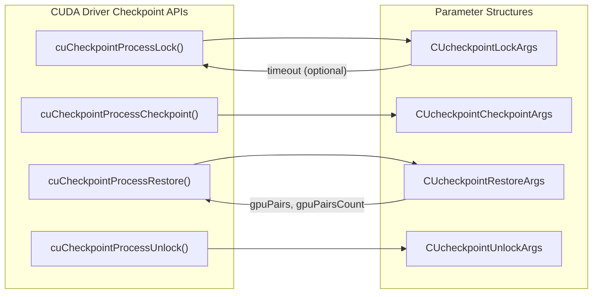
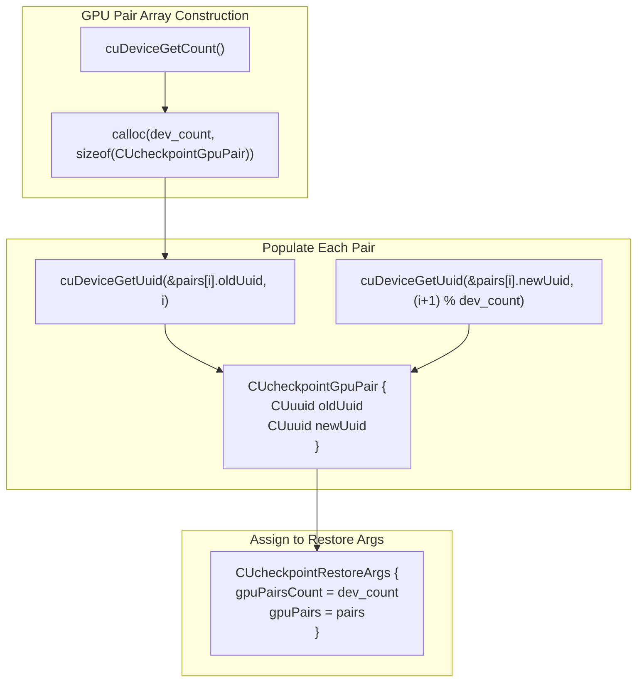
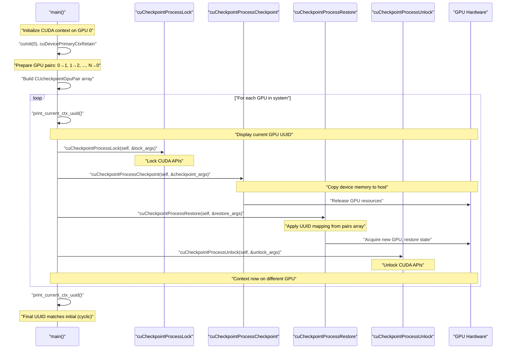
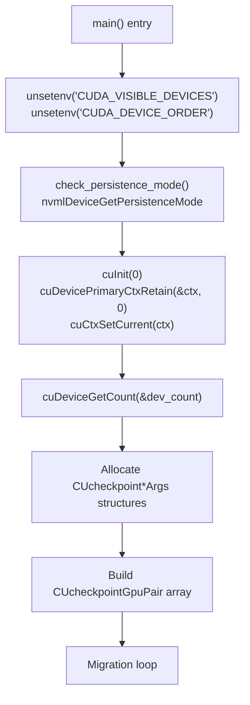
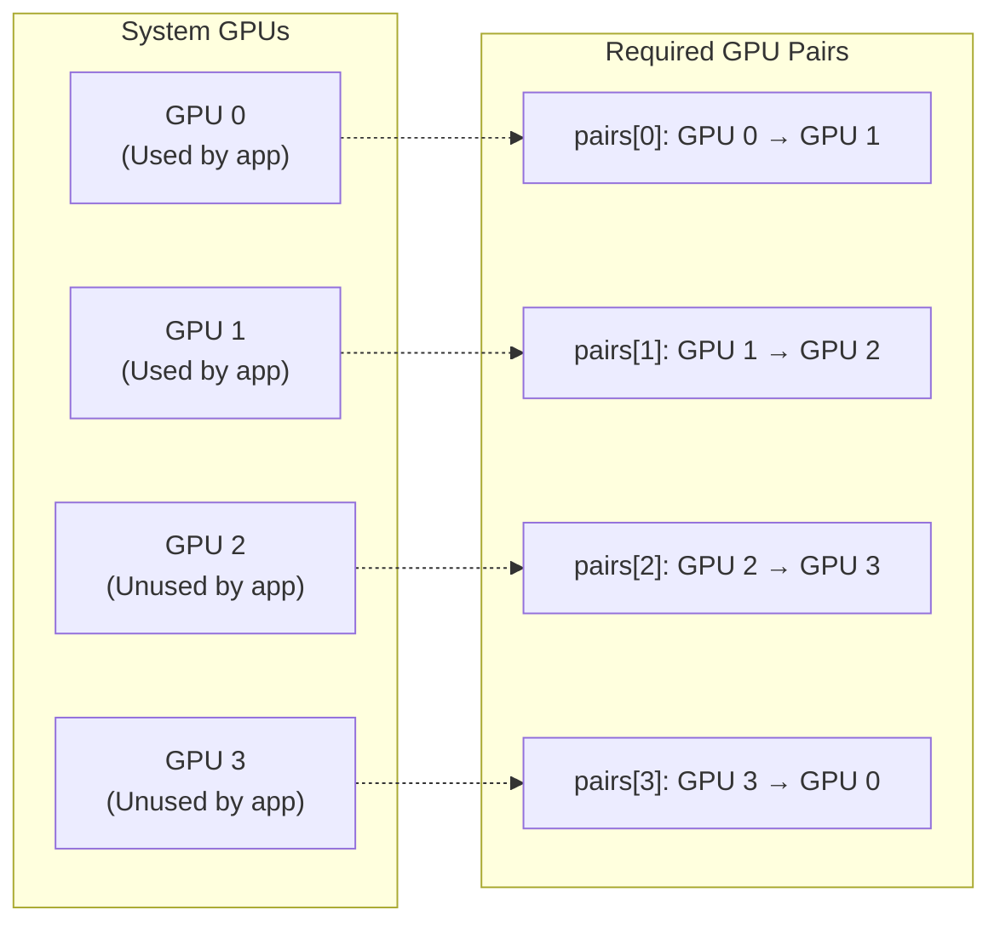

<!-- source: DeepWiki mcp.deepwiki.com · repo NVIDIA/cuda-checkpoint · extra page API-Based Migration · fetched 2026-10-26 -->

# API-Based Migration

<details>
<summary>Relevant source files</summary>

The following files were used as context for generating this wiki page:

- [README.md](README.md)
- [src/r580-migration-api.c](src/r580-migration-api.c)

</details>


## Purpose and Scope

This document describes the **r580-migration-api.c** demonstration program, which showcases GPU context migration using programmatic CUDA Driver APIs. The demo uses the `cuCheckpointProcess*` family of functions to migrate GPU contexts between physical devices without using the command-line `cuda-checkpoint` utility.

For migration using the command-line utility, see [CLI-Based Migration](#5.3.2). For the broader context of GPU migration features in driver 580+, see [GPU Migration Demos](#5.3).

**Sources:** [src/r580-migration-api.c:1-101](), [README.md:8-13]()

---

## Prerequisites and Requirements

The API-based migration demo requires:

| Requirement | Specification | Notes |
|------------|---------------|-------|
| **Display Driver** | Version 580 or higher | GPU migration APIs introduced in 580 |
| **CUDA Toolkit** | Version 13.0 or later | Provides checkpoint API headers |
| **GPU Persistence Mode** | Enabled | Required for stable device state during migration |
| **System Type** | x86_64 Linux | Current checkpoint functionality limitation |
| **Multiple GPUs** | 2+ recommended | Migration cycles through available devices |

The program verifies persistence mode at startup and will terminate if it is not enabled.

**Sources:** [src/r580-migration-api.c:14-18](), [src/r580-migration-api.c:32-41]()

---

## CUDA Driver Checkpoint APIs

The migration demo uses four core CUDA Driver API functions that provide programmatic control over checkpoint and restore operations. These APIs are documented in the [CUDA Driver API documentation](https://docs.nvidia.com/cuda/cuda-driver-api/group__CUDA__CHECKPOINT.html) and require driver 570 or higher (migration features require 580+).

### API Function Overview



**Diagram: CUDA Driver Checkpoint API Functions and Their Parameter Structures**

| Function | Purpose | Key Parameters |
|----------|---------|----------------|
| `cuCheckpointProcessLock` | Lock CUDA APIs in target process | `pid`, `CUcheckpointLockArgs*` (with optional timeout) |
| `cuCheckpointProcessCheckpoint` | Save GPU state to host memory | `pid`, `CUcheckpointCheckpointArgs*` |
| `cuCheckpointProcessRestore` | Restore GPU state to (potentially different) GPUs | `pid`, `CUcheckpointRestoreArgs*` (with GPU mapping) |
| `cuCheckpointProcessUnlock` | Unlock CUDA APIs in target process | `pid`, `CUcheckpointUnlockArgs*` |

All functions take a process ID (`pid_t`) as the first parameter and return `CUresult` status codes.

**Sources:** [src/r580-migration-api.c:72-75](), [src/r580-migration-api.c:93-96]()

---

## GPU Pair Mapping Structure

The key to GPU migration is the `CUcheckpointGpuPair` structure, which maps contexts from source GPUs (old UUIDs) to destination GPUs (new UUIDs). This structure is populated and passed to `cuCheckpointProcessRestore` via the `CUcheckpointRestoreArgs` structure.

### UUID-Based Device Mapping



**Diagram: GPU Pair Construction and Assignment to Restore Arguments**

### Structure Definition

The `CUcheckpointGpuPair` structure contains:
- `CUuuid oldUuid`: UUID of the source GPU (where context was checkpointed)
- `CUuuid newUuid`: UUID of the destination GPU (where context will be restored)

**Important:** Every GPU accessible to CUDA must be specified in the pairs array, even if the application doesn't actively use them. This ensures the driver can correctly handle all device references during restore.

**Sources:** [src/r580-migration-api.c:77-84](), [src/r580-migration-api.c:86-88]()

---

## Migration Workflow

The demo performs a cyclic migration pattern where GPU contexts rotate through all available devices. After `N` migrations (where `N` is the device count), each context returns to its original GPU.

### Complete Migration Sequence



**Diagram: API-Based Migration Workflow with Actual Function Calls**

### Cyclic Migration Pattern

For a system with 3 GPUs (0, 1, 2), the demo performs:

| Iteration | Before Migration | GPU Pair Mapping | After Migration |
|-----------|-----------------|------------------|-----------------|
| 0 | Context on GPU 0 | 0→1, 1→2, 2→0 | Context on GPU 1 |
| 1 | Context on GPU 1 | 0→1, 1→2, 2→0 | Context on GPU 2 |
| 2 | Context on GPU 2 | 0→1, 1→2, 2→0 | Context on GPU 0 |

The UUID is printed before and after the full cycle to verify correct migration behavior.

**Sources:** [src/r580-migration-api.c:90-99]()

---

## Building and Executing

### Build Command

The program requires the CUDA Driver API headers and must link against `libcuda` and `libnvidia-ml`:

```bash
gcc -I /usr/local/cuda-13.0/include r580-migration-api.c -o r580-migration-api -lcuda -lnvidia-ml
```

### Execution Requirements

1. **Enable persistence mode** (required):
   ```bash
   sudo nvidia-smi -pm 1
   ```

2. **Unset environment variables** (handled automatically by the program):
   - `CUDA_VISIBLE_DEVICES` and `CUDA_DEVICE_ORDER` are cleared at startup to ensure all GPUs are visible

3. **Run the demo**:
   ```bash
   ./r580-migration-api
   ```

### Expected Output

The program prints GPU UUIDs before and after the migration cycle. For a system with 2 GPUs, expected output:

```
<UUID of GPU 0>
<UUID of GPU 1>
<UUID of GPU 0>  # Back to original after 2 migrations
```

**Sources:** [src/r580-migration-api.c:17-18](), [src/r580-migration-api.c:59-60]()

---

## Program Structure and Flow

### Initialization Phase



**Diagram: Program Initialization Sequence**

### Key Code Sections

| Lines | Purpose | Key Functions/Structures |
|-------|---------|-------------------------|
| [src/r580-migration-api.c:32-41]() | Persistence mode verification | `nvmlDeviceGetPersistenceMode` |
| [src/r580-migration-api.c:43-55]() | UUID printing utility | `cuCtxGetDevice`, `cuDeviceGetUuid` |
| [src/r580-migration-api.c:59-60]() | Environment cleanup | `unsetenv` |
| [src/r580-migration-api.c:64-70]() | CUDA initialization | `cuInit`, `cuDevicePrimaryCtxRetain`, `cuDeviceGetCount` |
| [src/r580-migration-api.c:72-75]() | Args structure allocation | `CUcheckpointLockArgs`, `CUcheckpointCheckpointArgs`, etc. |
| [src/r580-migration-api.c:77-88]() | GPU pair construction | `CUcheckpointGpuPair` array, `cuDeviceGetUuid` |
| [src/r580-migration-api.c:90-97]() | Migration execution loop | All four checkpoint API functions |

**Sources:** [src/r580-migration-api.c:57-101]()

---

## GPU Pair Array Requirements

### Complete Device Coverage

The GPU pair array must include **all** GPUs accessible to CUDA, regardless of whether the application uses them:



**Diagram: GPU Pair Array Must Cover All System Devices**

This requirement is explicitly noted in the code comments and is critical for correct restore behavior.

**Sources:** [src/r580-migration-api.c:79-80]()

---

## UUID Format and Retrieval

### UUID Structure

CUDA device UUIDs (`CUuuid`) are 16-byte identifiers that uniquely identify GPU hardware. The demo prints UUIDs as 32 hexadecimal characters:

```c
for (int i = 0; i < sizeof uuid; i++) {
    printf("%02x", uuid.bytes[i] & 0xFF);
}
printf("\n");
```

### Retrieving UUIDs

The program uses two CUDA Driver API functions to work with UUIDs:

1. **Get current context's device UUID**:
   - `cuCtxGetDevice(&dev)` - Get CUdevice handle for current context
   - `cuDeviceGetUuid(&uuid, dev)` - Get UUID for that device

2. **Get UUID by device index**:
   - `cuDeviceGetUuid(&uuid, device_index)` - Direct lookup by ordinal

These are used in [src/r580-migration-api.c:43-55]() for printing and [src/r580-migration-api.c:82-83]() for building the GPU pair array.

**Sources:** [src/r580-migration-api.c:43-55](), [src/r580-migration-api.c:82-83]()

---

## Comparison with CLI Approach

The API-based approach provides programmatic control compared to the CLI-based approach:

| Aspect | API-Based (this demo) | CLI-Based ([5.3.2](#5.3.2)) |
|--------|----------------------|---------------------------|
| **Control Point** | Application code | External script/tool |
| **API Used** | `cuCheckpointProcess*` functions | `cuda-checkpoint` binary |
| **Integration** | Direct library calls | Shell invocation |
| **Dependencies** | CUDA Driver API, NVML | `cuda-checkpoint` utility |
| **Flexibility** | Full programmatic control | Script-based orchestration |
| **Use Case** | Embedded in application logic | External checkpoint management |

Both approaches use the same underlying driver functionality and support identical migration capabilities.

**Sources:** [src/r580-migration-api.c:1-101](), [README.md:13]()

---

