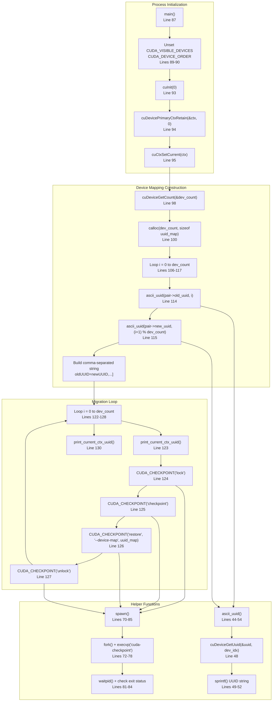
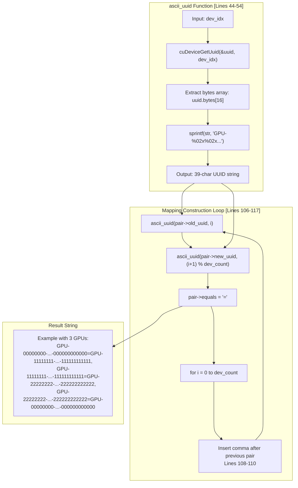
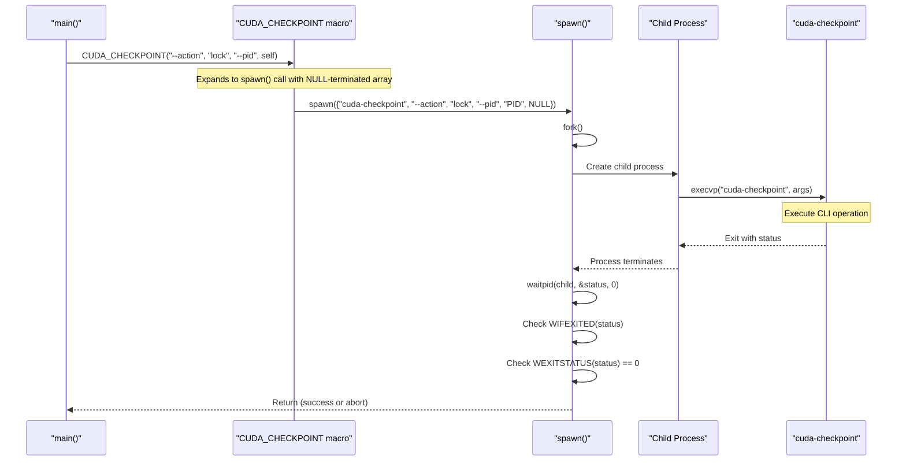
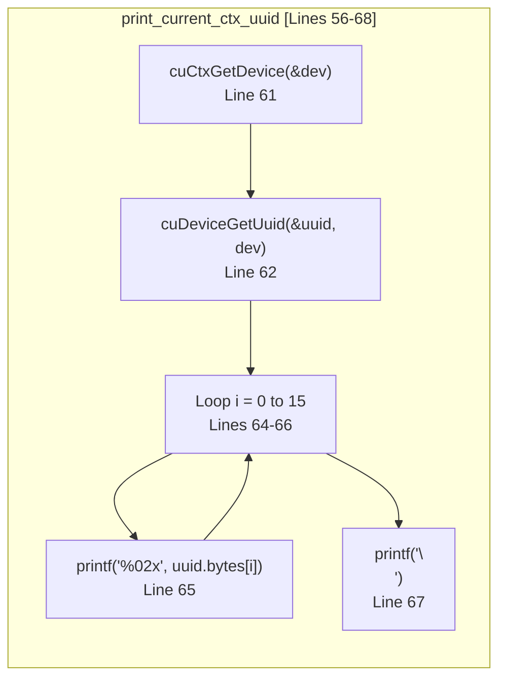

<!-- source: DeepWiki mcp.deepwiki.com · repo NVIDIA/cuda-checkpoint · extra page CLI-Based Migration · fetched 2026-10-26 -->

# CLI-Based Migration

<details>
<summary>Relevant source files</summary>

The following files were used as context for generating this wiki page:

- [README.md](README.md)
- [src/r580-migration-cli.c](src/r580-migration-cli.c)

</details>


## Purpose and Scope

This document describes the CLI-based GPU migration demonstration program located at [src/r580-migration-cli.c](). This program showcases how to perform GPU context migration using the `cuda-checkpoint` command-line utility with the `--device-map` parameter. For programmatic migration using CUDA Driver APIs directly, see [API-Based Migration](#5.3.1). For general information about GPU migration capabilities, see [GPU Migration Demos](#5.3).

The demonstration requires NVIDIA Display Driver 580 or higher and illustrates:
- Building ASCII UUID mapping strings for device migration
- Invoking `cuda-checkpoint` with device mapping parameters
- Cycling CUDA contexts through multiple GPUs using CLI operations
- Verifying successful migration by tracking context device UUIDs

**Sources**: [src/r580-migration-cli.c:1-18](), [README.md:8-13]()

---

## Overview

The `r580-migration-cli` program demonstrates GPU migration by creating a CUDA context on GPU 0, then repeatedly migrating it through all available GPUs in a round-robin fashion. Each migration cycle consists of:

1. Lock CUDA APIs in the current process
2. Checkpoint GPU state to host memory
3. Restore GPU state with UUID mapping (GPU `i` → GPU `(i+1) % device_count`)
4. Unlock CUDA APIs to resume execution

After `device_count` migrations, the context returns to its original GPU, completing the cycle. The program prints the current context's device UUID before and after each migration to verify correctness.

**Sources**: [src/r580-migration-cli.c:87-132](), [README.md:20-31]()

---

## Program Architecture



**Diagram: CLI Migration Program Flow and Code Entity Mapping**

This diagram maps the program's execution flow to specific functions and line numbers. The program follows three main phases: initialization (lines 89-95), device mapping construction (lines 98-117), and migration loop execution (lines 122-130).

**Sources**: [src/r580-migration-cli.c:44-132]()

---

## Device Mapping Format

The `--device-map` parameter accepts a comma-separated string of UUID pairs in the format:

```
oldUUID1=newUUID1,oldUUID2=newUUID2,...,oldUUIDN=newUUIDN
```

Each UUID follows the NVIDIA GPU UUID format:
```
GPU-XXXXXXXX-XXXX-XXXX-XXXX-XXXXXXXXXXXX
```

The program constructs this mapping using the `ascii_uuid_key_value_t` structure:

| Field | Type | Purpose | Line Reference |
|-------|------|---------|----------------|
| `old_uuid[40]` | `char[]` | Source GPU UUID string | [36-38]() |
| `equals` | `char` | Literal '=' separator | [39]() |
| `new_uuid[40]` | `char[]` | Target GPU UUID string | [40]() |
| `comma_or_null` | `char` | ',' separator or '\0' terminator | [41]() |

This structure guarantees contiguous memory layout, allowing the entire array to be cast to a single string and passed to `cuda-checkpoint`.

**Sources**: [src/r580-migration-cli.c:35-42](), [src/r580-migration-cli.c:100-117]()

---

## UUID Construction and Mapping



**Diagram: UUID String Construction Process**

The `ascii_uuid()` function [lines 44-54]() converts a CUDA device index to the standard GPU UUID format by calling `cuDeviceGetUuid()` and formatting the 16-byte UUID into ASCII. The main loop [lines 106-117]() builds a circular mapping where GPU `i` maps to GPU `(i+1) % device_count`, creating a rotation effect.

**Sources**: [src/r580-migration-cli.c:44-54](), [src/r580-migration-cli.c:106-117]()

---

## CLI Invocation via spawn()

The program invokes `cuda-checkpoint` through the `spawn()` helper function, which provides error-checked process spawning:



**Diagram: CLI Invocation Mechanism**

The `CUDA_CHECKPOINT` macro [line 32]() provides a convenient interface for invoking `cuda-checkpoint` with variable arguments. It automatically NULL-terminates the argument array and delegates to `spawn()` [lines 70-85](), which forks a child process, executes the CLI utility via `execvp()`, and verifies successful completion.

**Sources**: [src/r580-migration-cli.c:32](), [src/r580-migration-cli.c:70-85]()

---

## Migration Workflow

The migration loop [lines 122-128]() performs `device_count` complete migration cycles:

| Step | CLI Command | Line | Purpose |
|------|-------------|------|---------|
| 0 | N/A | 123 | Print current context device UUID |
| 1 | `cuda-checkpoint --action lock --pid <PID>` | 124 | Lock all CUDA APIs in process |
| 2 | `cuda-checkpoint --action checkpoint --pid <PID>` | 125 | Save GPU state to host memory |
| 3 | `cuda-checkpoint --action restore --pid <PID> --device-map <mapping>` | 126 | Restore GPU state with device remapping |
| 4 | `cuda-checkpoint --action unlock --pid <PID>` | 127 | Unlock CUDA APIs, resume execution |
| 5 | N/A | (next iteration) | Return to step 0 or exit |

Each iteration migrates all contexts to the next GPU in sequence. After `N` iterations (where `N` = number of GPUs), contexts return to their original devices.

**Sources**: [src/r580-migration-cli.c:122-128](), [README.md:70-73]()

---

## Context Verification

The program verifies migration correctness using `print_current_ctx_uuid()`:



**Diagram: Context UUID Verification Function**

This function prints the 16-byte device UUID as a 32-character hexadecimal string, allowing visual verification that the context has migrated to the expected GPU. The UUID format differs from the ASCII format used in device mapping (no dashes or "GPU-" prefix).

**Sources**: [src/r580-migration-cli.c:56-68]()

---

## Building and Running

### Build Command

```bash
gcc -I /usr/local/cuda-13.0/include r580-migration-cli.c -o r580-migration-cli -lcuda
```

The program requires:
- CUDA 13.0 or later toolkit headers
- `libcuda.so` driver library linkage
- Display driver 580 or higher installed

**Sources**: [src/r580-migration-cli.c:16-17]()

### Runtime Requirements

| Requirement | Details |
|-------------|---------|
| Driver Version | 580+ with GPU migration support |
| `cuda-checkpoint` | Must be in PATH |
| GPU Count | At least 2 GPUs for visible migration effect |
| Environment | `CUDA_VISIBLE_DEVICES` and `CUDA_DEVICE_ORDER` unset [lines 89-90]() |

### Expected Output

For a system with 3 GPUs, the program prints 4 UUID lines (initial + 3 migrations):

```
<hex-uuid-of-gpu-0>
<hex-uuid-of-gpu-1>
<hex-uuid-of-gpu-2>
<hex-uuid-of-gpu-0>
```

The final UUID matches the first, confirming successful round-robin migration.

**Sources**: [src/r580-migration-cli.c:89-90](), [src/r580-migration-cli.c:122-131]()

---

## Key Differences from API-Based Migration

| Aspect | CLI-Based (this demo) | API-Based ([page 5.3.1](#5.3.1)) |
|--------|----------------------|----------------------------------|
| Migration Interface | `cuda-checkpoint` CLI with `--device-map` | Direct `cuCheckpointProcessRestore()` API calls |
| Process Control | Must spawn child processes for CLI | In-process API calls |
| Device Mapping Format | ASCII string: `"UUID=UUID,..."` | Array of `CUcheckpointGpuDevicePair_v1` structures |
| Portability | Requires `cuda-checkpoint` binary in PATH | Requires linking against CUDA driver library |
| Complexity | Higher (process spawning, string formatting) | Lower (direct API, typed structures) |
| Error Handling | Exit status checking via `waitpid()` | Direct `CUresult` return codes |

The CLI approach is useful for scripting and integration with external tools, while the API approach is preferred for applications requiring programmatic control with lower overhead.

**Sources**: [src/r580-migration-cli.c:70-85](), [src/r580-migration-cli.c:100-117](), [README.md:70-73]()

---

