<!-- source: DeepWiki mcp.deepwiki.com · repo NVIDIA/cuda-gdb · page 1.1 Architecture · fetched 2026-10-26 -->

# Architecture

Relevant source files

The following files were used as context for generating this wiki page:

- [bfd/aout-target.h](bfd/aout-target.h)
- [bfd/elf-bfd.h](bfd/elf-bfd.h)
- [bfd/elf.c](bfd/elf.c)
- [bfd/elf32-i386.c](bfd/elf32-i386.c)
- [bfd/elf64-x86-64.c](bfd/elf64-x86-64.c)
- [bfd/elfcode.h](bfd/elfcode.h)
- [bfd/elflink.c](bfd/elflink.c)
- [bfd/elfxx-target.h](bfd/elfxx-target.h)
- [bfd/elfxx-x86.c](bfd/elfxx-x86.c)
- [bfd/elfxx-x86.h](bfd/elfxx-x86.h)
- [bfd/mach-o-target.c](bfd/mach-o-target.c)
- [bfd/plugin.c](bfd/plugin.c)
- [bfd/ppcboot.c](bfd/ppcboot.c)
- [gas/config/tc-aarch64-ginsn.c](gas/config/tc-aarch64-ginsn.c)
- [gas/config/tc-aarch64.h](gas/config/tc-aarch64.h)
- [gas/config/tc-i386-intel.c](gas/config/tc-i386-intel.c)
- [gas/config/tc-i386.h](gas/config/tc-i386.h)
- [gas/testsuite/gas/i386/x86-64-apx-egpr-inval.l](gas/testsuite/gas/i386/x86-64-apx-egpr-inval.l)
- [gas/testsuite/gas/i386/x86-64-apx-egpr-inval.s](gas/testsuite/gas/i386/x86-64-apx-egpr-inval.s)
- [gdb/compile/compile-loc2c.c](gdb/compile/compile-loc2c.c)
- [gdb/dwarf2/abbrev-table-cache.c](gdb/dwarf2/abbrev-table-cache.c)
- [gdb/dwarf2/abbrev-table-cache.h](gdb/dwarf2/abbrev-table-cache.h)
- [gdb/dwarf2/abbrev.c](gdb/dwarf2/abbrev.c)
- [gdb/dwarf2/abbrev.h](gdb/dwarf2/abbrev.h)
- [gdb/dwarf2/aranges.c](gdb/dwarf2/aranges.c)
- [gdb/dwarf2/aranges.h](gdb/dwarf2/aranges.h)
- [gdb/dwarf2/attribute.c](gdb/dwarf2/attribute.c)
- [gdb/dwarf2/attribute.h](gdb/dwarf2/attribute.h)
- [gdb/dwarf2/call-site.h](gdb/dwarf2/call-site.h)
- [gdb/dwarf2/comp-unit-head.c](gdb/dwarf2/comp-unit-head.c)
- [gdb/dwarf2/comp-unit-head.h](gdb/dwarf2/comp-unit-head.h)
- [gdb/dwarf2/cooked-index.c](gdb/dwarf2/cooked-index.c)
- [gdb/dwarf2/cooked-index.h](gdb/dwarf2/cooked-index.h)
- [gdb/dwarf2/cu.c](gdb/dwarf2/cu.c)
- [gdb/dwarf2/cu.h](gdb/dwarf2/cu.h)
- [gdb/dwarf2/die.c](gdb/dwarf2/die.c)
- [gdb/dwarf2/die.h](gdb/dwarf2/die.h)
- [gdb/dwarf2/dwz.c](gdb/dwarf2/dwz.c)
- [gdb/dwarf2/dwz.h](gdb/dwarf2/dwz.h)
- [gdb/dwarf2/index-cache.c](gdb/dwarf2/index-cache.c)
- [gdb/dwarf2/index-cache.h](gdb/dwarf2/index-cache.h)
- [gdb/dwarf2/index-common.h](gdb/dwarf2/index-common.h)
- [gdb/dwarf2/index-write.c](gdb/dwarf2/index-write.c)
- [gdb/dwarf2/line-header.h](gdb/dwarf2/line-header.h)
- [gdb/dwarf2/mapped-index.h](gdb/dwarf2/mapped-index.h)
- [gdb/dwarf2/read-debug-names.c](gdb/dwarf2/read-debug-names.c)
- [gdb/dwarf2/read-debug-names.h](gdb/dwarf2/read-debug-names.h)
- [gdb/dwarf2/read-gdb-index.c](gdb/dwarf2/read-gdb-index.c)
- [gdb/dwarf2/read.c](gdb/dwarf2/read.c)
- [gdb/dwarf2/read.h](gdb/dwarf2/read.h)
- [gdb/dwarf2/section.c](gdb/dwarf2/section.c)
- [gdb/gdb-gdb.gdb.in](gdb/gdb-gdb.gdb.in)
- [gdb/osdata.c](gdb/osdata.c)
- [gdb/regcache-dump.c](gdb/regcache-dump.c)
- [gdb/regcache.c](gdb/regcache.c)
- [gdb/regcache.h](gdb/regcache.h)
- [gdb/testsuite/gdb.dwarf2/gdb-index-cxx.exp](gdb/testsuite/gdb.dwarf2/gdb-index-cxx.exp)
- [gdb/testsuite/gdb.gdb/index-file.exp](gdb/testsuite/gdb.gdb/index-file.exp)
- [gdb/testsuite/gdb.linespec/cpcompletion.cc](gdb/testsuite/gdb.linespec/cpcompletion.cc)
- [gdb/testsuite/gdb.linespec/cpcompletion.exp](gdb/testsuite/gdb.linespec/cpcompletion.exp)
- [gdb/testsuite/gdb.linespec/cpls.cc](gdb/testsuite/gdb.linespec/cpls.cc)
- [gdb/testsuite/gdb.server/server-run.exp](gdb/testsuite/gdb.server/server-run.exp)
- [gdbserver/debug.cc](gdbserver/debug.cc)
- [gdbserver/debug.h](gdbserver/debug.h)
- [gdbserver/gdbthread.h](gdbserver/gdbthread.h)
- [gdbserver/inferiors.cc](gdbserver/inferiors.cc)
- [gdbserver/inferiors.h](gdbserver/inferiors.h)
- [gdbserver/linux-arm-low.cc](gdbserver/linux-arm-low.cc)
- [gdbserver/linux-low.cc](gdbserver/linux-low.cc)
- [gdbserver/linux-low.h](gdbserver/linux-low.h)
- [gdbserver/linux-mips-low.cc](gdbserver/linux-mips-low.cc)
- [gdbserver/linux-ppc-low.cc](gdbserver/linux-ppc-low.cc)
- [gdbserver/linux-s390-low.cc](gdbserver/linux-s390-low.cc)
- [gdbserver/mem-break.cc](gdbserver/mem-break.cc)
- [gdbserver/netbsd-low.cc](gdbserver/netbsd-low.cc)
- [gdbserver/netbsd-low.h](gdbserver/netbsd-low.h)
- [gdbserver/regcache.cc](gdbserver/regcache.cc)
- [gdbserver/regcache.h](gdbserver/regcache.h)
- [gdbserver/remote-utils.cc](gdbserver/remote-utils.cc)
- [gdbserver/server.cc](gdbserver/server.cc)
- [gdbserver/target.cc](gdbserver/target.cc)
- [gdbserver/target.h](gdbserver/target.h)
- [gdbserver/thread-db.cc](gdbserver/thread-db.cc)
- [gdbserver/tracepoint.cc](gdbserver/tracepoint.cc)
- [gdbserver/win32-low.cc](gdbserver/win32-low.cc)
- [gdbsupport/common-regcache.h](gdbsupport/common-regcache.h)
- [ld/testsuite/ld-i386/i386.exp](ld/testsuite/ld-i386/i386.exp)
- [ld/testsuite/ld-i386/start.s](ld/testsuite/ld-i386/start.s)
- [ld/testsuite/ld-x86-64/apx-load1.s](ld/testsuite/ld-x86-64/apx-load1.s)
- [ld/testsuite/ld-x86-64/apx-load1a.d](ld/testsuite/ld-x86-64/apx-load1a.d)
- [ld/testsuite/ld-x86-64/apx-load1b.d](ld/testsuite/ld-x86-64/apx-load1b.d)
- [ld/testsuite/ld-x86-64/apx-load1c.d](ld/testsuite/ld-x86-64/apx-load1c.d)
- [ld/testsuite/ld-x86-64/apx-load1d.d](ld/testsuite/ld-x86-64/apx-load1d.d)
- [ld/testsuite/ld-x86-64/load4.d](ld/testsuite/ld-x86-64/load4.d)
- [ld/testsuite/ld-x86-64/load4.s](ld/testsuite/ld-x86-64/load4.s)
- [ld/testsuite/ld-x86-64/pr19609-4c.d](ld/testsuite/ld-x86-64/pr19609-4c.d)
- [ld/testsuite/ld-x86-64/pr32067.s](ld/testsuite/ld-x86-64/pr32067.s)
- [ld/testsuite/ld-x86-64/tlsie5.d](ld/testsuite/ld-x86-64/tlsie5.d)
- [ld/testsuite/ld-x86-64/x86-64.exp](ld/testsuite/ld-x86-64/x86-64.exp)

This document explains the high-level architecture of CUDA-GDB, a specialized version of the GNU Debugger (GDB) that adds support for debugging NVIDIA CUDA applications. It provides an overview of the major components of the system and how they interact to enable debugging of GPU code.

## Overview of CUDA-GDB

CUDA-GDB extends the standard GNU Debugger with capabilities for debugging applications that use NVIDIA's CUDA platform. It integrates with the existing GDB architecture while adding specialized components for GPU debugging.

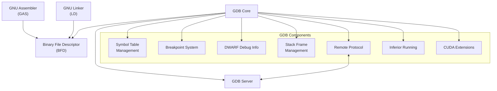

Sources: [gdb/dwarf2/read.c:1-100](). [bfd/elf.c:16-45](). [gdbserver/server.cc:19-50]().

## Major Subsystems

CUDA-GDB consists of several major subsystems that work together to provide debugging capabilities:

### 1. Core GDB

The GDB core provides the foundation for the debugger, with components handling symbols, breakpoints, stack frames, and process control.

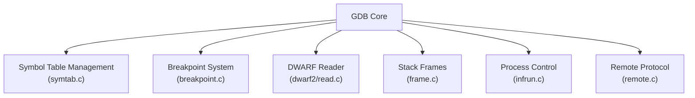

Sources: [gdb/dwarf2/read.c:500-750](). [gdb/regcache.c:5-20]().

### 2. Binary File Descriptor (BFD)

The BFD library provides a uniform interface to access various object file formats:

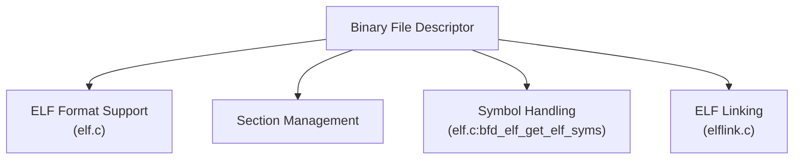

Sources: [bfd/elf.c:361-410](). [bfd/elflink.c:180-230](). [bfd/elf-bfd.h:65-85]().

### 3. DWARF Debug Information Processing

CUDA-GDB heavily relies on DWARF debug information for debugging both CPU and GPU code:

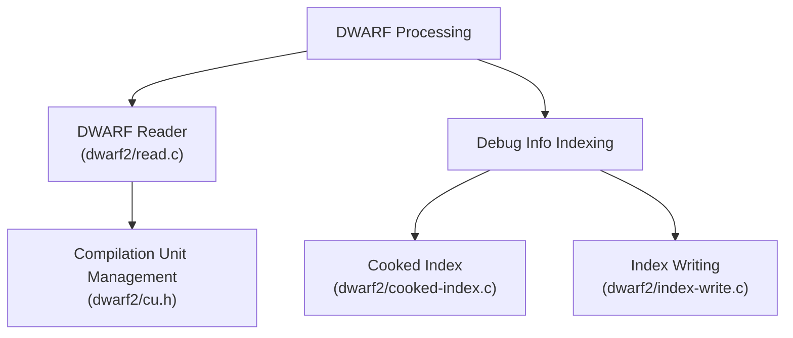

Sources: [gdb/dwarf2/read.c:27-100](). [gdb/dwarf2/cooked-index.c:1-100](). [gdb/dwarf2/cooked-index.h:19-100](). [gdb/dwarf2/index-write.c:19-70](). [gdb/dwarf2/cu.h:1-20]().

### 4. Remote Debugging

CUDA-GDB supports remote debugging through GDB Server:

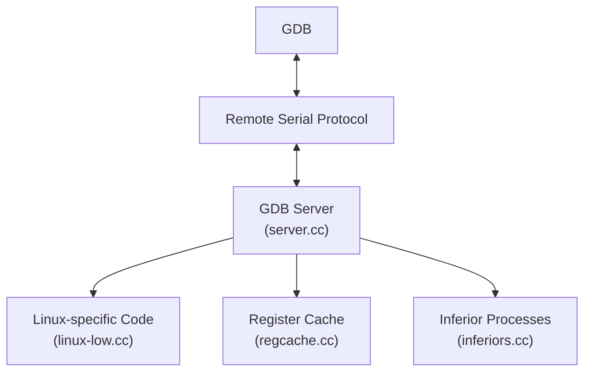

Sources: [gdbserver/server.cc:1-100](). [gdbserver/linux-low.cc:1-100](). [gdbserver/regcache.cc:1-50](). [gdbserver/inferiors.cc:1-20]().

### 5. Cooked Index System

The cooked index is an optimized index of debugging information that CUDA-GDB uses to efficiently locate symbols and types:

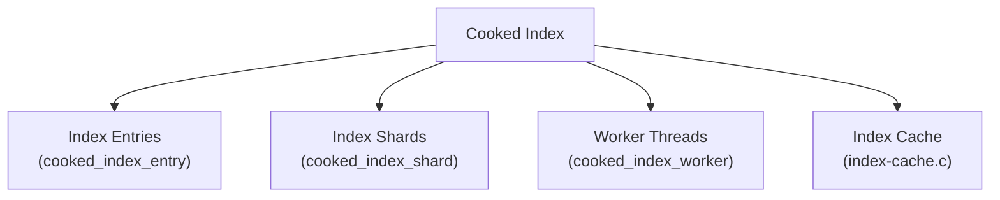

Sources: [gdb/dwarf2/cooked-index.h:102-259](). [gdb/dwarf2/cooked-index.c:449-560](). [gdb/dwarf2/index-cache.c:1-20]().

## Data Flow in CUDA-GDB

The following diagram illustrates how data flows through the different components during a debugging session:

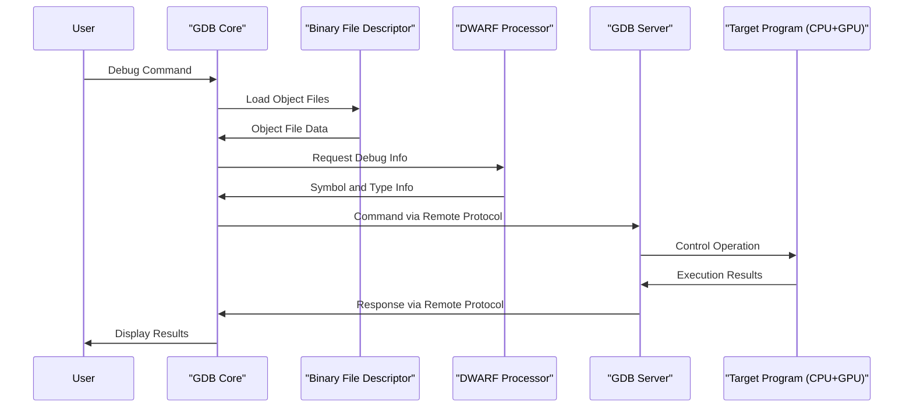

Sources: [gdbserver/server.cc:168-235](). [gdb/dwarf2/read.c:168-235]().

## Symbol Table Management

Symbol tables are a critical part of the debugging infrastructure:

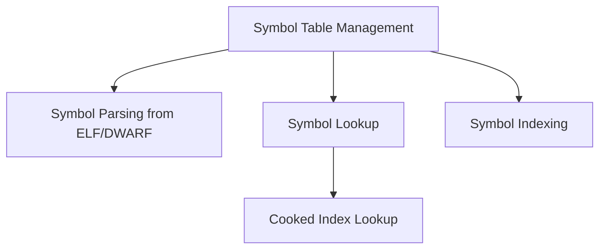

Symbol table management involves:

1. Parsing symbols from ELF sections and DWARF debug information
2. Creating efficient lookup structures
3. Supporting various symbol types (functions, variables, types)
4. Handling both static and dynamic symbols

Sources: [bfd/elf.c:525-560](). [gdb/dwarf2/cooked-index.c:210-250]().

## Architecture-Specific Support

CUDA-GDB includes support for various CPU architectures, with a focus on x86-64 as the primary host platform:

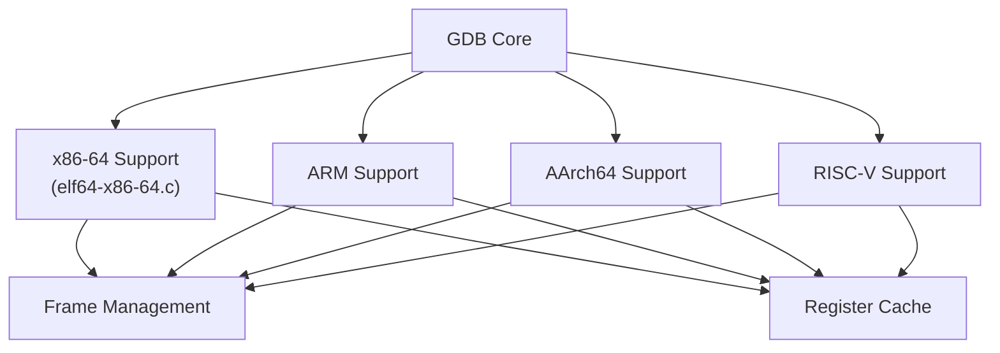

Each architecture has target-dependent code that implements architecture-specific aspects of debugging, such as frame unwinding and register handling.

Sources: [bfd/elf64-x86-64.c:1-70](). [gas/config/tc-i386.h:1-30](). [gas/config/tc-i386-intel.c:1-55]().

## Binary Format Handling

CUDA-GDB primarily deals with ELF binary formats:

| Component | Responsibility |
|-----------|----------------|
| BFD Library | Provides object file format abstraction |
| ELF Handling | Reads and interprets ELF headers, sections, and symbols |
| ELF Linking | Handles dynamic linking information in ELF files |
| Symbol Resolution | Resolves symbols from multiple object files |

Sources: [bfd/elf.c:50-100](). [bfd/elflink.c:100-150](). [bfd/elfxx-x86.c:1-40]().

## Register Cache System

The register cache system manages access to CPU and GPU registers:

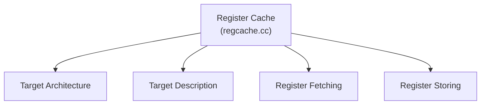

The register cache:
1. Stores current values of registers
2. Provides efficient access to register values
3. Handles architecture-specific register sets
4. Supports both CPU and GPU registers for CUDA applications

Sources: [gdbserver/regcache.cc:26-110](). [gdbserver/regcache.h:19-30]().

## GDB Server Architecture

GDB Server is a key component for remote debugging:

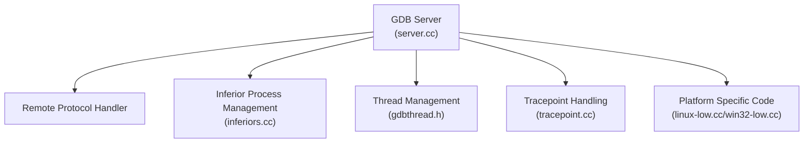

GDB Server provides:
1. Remote debugging capabilities
2. Process control and monitoring
3. Memory and register access
4. Support for breakpoints and watchpoints
5. CUDA-specific extensions for GPU debugging

Sources: [gdbserver/server.cc:78-147](). [gdbserver/tracepoint.cc:1-60](). [gdbserver/linux-low.cc:139-200](). [gdbserver/gdbthread.h:1-16]().

## Conclusion

CUDA-GDB's architecture extends the standard GDB architecture with specialized components for GPU debugging. It maintains compatibility with the GNU toolchain while adding capabilities for CUDA-specific debugging tasks. The system integrates multiple subsystems, including symbol handling, binary file reading, DWARF debug information processing, and remote debugging protocols, to provide a comprehensive debugging environment for CUDA applications.

The architecture enables developers to:
1. Debug both CPU and GPU code within a single environment
2. Set breakpoints in GPU code
3. Inspect GPU memory and registers
4. Monitor and control CUDA threads and blocks
5. Analyze the execution of CUDA kernels

Sources: [gdb/dwarf2/read.h:19-97](). [gdbserver/server.cc:16-50](). [bfd/elfxx-x86.c:32-37]().

---

