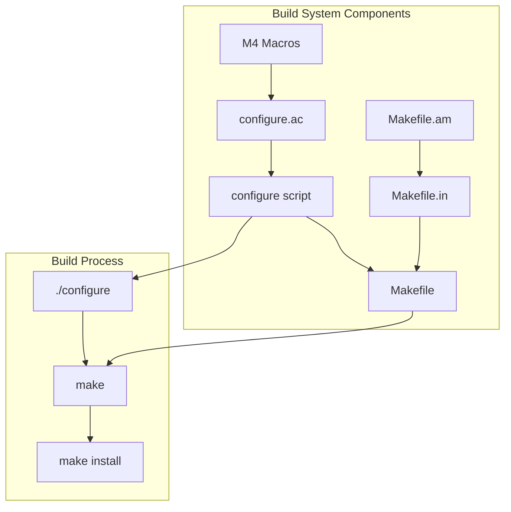
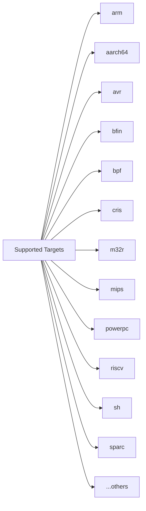
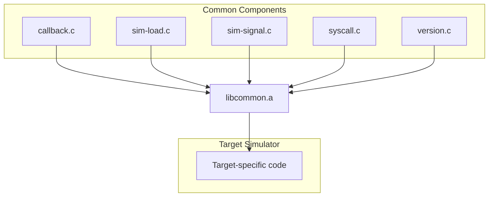
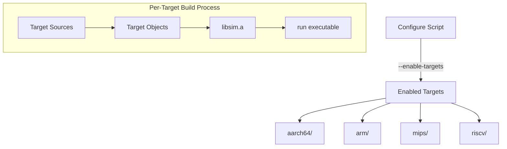
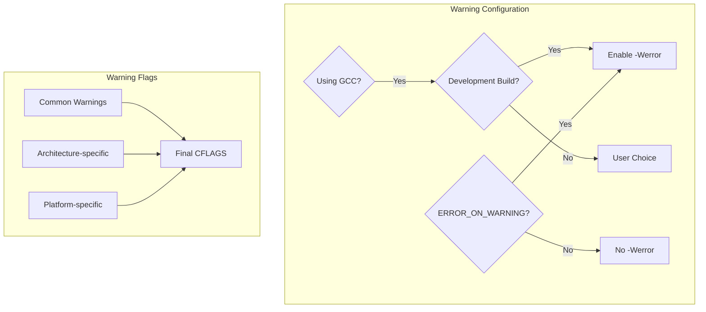
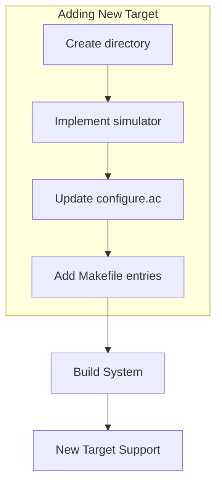

<!-- source: DeepWiki mcp.deepwiki.com · repo NVIDIA/cuda-gdb · page 1.2 Build System · fetched 2026-10-26 -->

# Build System

Relevant source files

The following files were used as context for generating this wiki page:

- [ChangeLog](ChangeLog)
- [bfd/ChangeLog](bfd/ChangeLog)
- [bfd/doc/chew.c](bfd/doc/chew.c)
- [bfd/doc/doc.str](bfd/doc/doc.str)
- [bfd/doc/proto.str](bfd/doc/proto.str)
- [binutils/ChangeLog](binutils/ChangeLog)
- [binutils/NEWS](binutils/NEWS)
- [binutils/dwarf.c](binutils/dwarf.c)
- [binutils/dwarf.h](binutils/dwarf.h)
- [binutils/elfcomm.c](binutils/elfcomm.c)
- [binutils/elfcomm.h](binutils/elfcomm.h)
- [binutils/readelf.c](binutils/readelf.c)
- [binutils/testsuite/binutils-all/display-section-0.r](binutils/testsuite/binutils-all/display-section-0.r)
- [binutils/testsuite/binutils-all/display-section-rel.r](binutils/testsuite/binutils-all/display-section-rel.r)
- [binutils/testsuite/binutils-all/dw5.W](binutils/testsuite/binutils-all/dw5.W)
- [binutils/testsuite/binutils-all/objdump.WL](binutils/testsuite/binutils-all/objdump.WL)
- [binutils/testsuite/binutils-all/pr26160.r](binutils/testsuite/binutils-all/pr26160.r)
- [binutils/testsuite/binutils-all/readelf-debug-str-offsets-dw4.d](binutils/testsuite/binutils-all/readelf-debug-str-offsets-dw4.d)
- [binutils/testsuite/binutils-all/readelf-debug-str-offsets-dw4.s](binutils/testsuite/binutils-all/readelf-debug-str-offsets-dw4.s)
- [binutils/testsuite/binutils-all/readelf.exp](binutils/testsuite/binutils-all/readelf.exp)
- [binutils/testsuite/binutils-all/relr.s](binutils/testsuite/binutils-all/relr.s)
- [cpu/ChangeLog](cpu/ChangeLog)
- [elfcpp/ChangeLog](elfcpp/ChangeLog)
- [gas/ChangeLog](gas/ChangeLog)
- [gas/doc/c-bpf.texi](gas/doc/c-bpf.texi)
- [gold/ChangeLog](gold/ChangeLog)
- [gprof/ChangeLog](gprof/ChangeLog)
- [include/ChangeLog](include/ChangeLog)
- [include/elf/common.h](include/elf/common.h)
- [include/opcode/bpf.h](include/opcode/bpf.h)
- [opcodes/ChangeLog](opcodes/ChangeLog)
- [opcodes/bpf-opc.c](opcodes/bpf-opc.c)
- [sim/Makefile.am](sim/Makefile.am)
- [sim/Makefile.in](sim/Makefile.in)
- [sim/aclocal.m4](sim/aclocal.m4)
- [sim/common/defs.h](sim/common/defs.h)
- [sim/common/local.mk](sim/common/local.mk)
- [sim/config.h.in](sim/config.h.in)
- [sim/configure](sim/configure)
- [sim/configure.ac](sim/configure.ac)
- [sim/igen/local.mk](sim/igen/local.mk)
- [sim/m4/sim_ac_option_smp.m4](sim/m4/sim_ac_option_smp.m4)
- [sim/m4/sim_ac_option_warnings.m4](sim/m4/sim_ac_option_warnings.m4)
- [sim/m4/sim_ac_platform.m4](sim/m4/sim_ac_platform.m4)
- [sim/m4/sim_ac_toolchain.m4](sim/m4/sim_ac_toolchain.m4)
- [sim/mips/acinclude.m4](sim/mips/acinclude.m4)
- [sim/ppc/emul_netbsd.c](sim/ppc/emul_netbsd.c)
- [sim/ppc/emul_unix.c](sim/ppc/emul_unix.c)
- [sim/ppc/hw_sem.c](sim/ppc/hw_sem.c)
- [sim/ppc/hw_shm.c](sim/ppc/hw_shm.c)
- [sim/ppc/mon.c](sim/ppc/mon.c)
- [sim/ppc/options.c](sim/ppc/options.c)
- [sim/ppc/pk.h](sim/ppc/pk.h)
- [sim/ppc/std-config.h](sim/ppc/std-config.h)

This page documents the build system for CUDA-GDB, explaining how to configure and build the toolchain from source. The build system is based on GNU Autotools and supports building simulators for various architectures.

## Overview

The CUDA-GDB build system uses GNU Autotools (Autoconf, Automake, and Libtool) to generate platform-specific build scripts from template files. This enables the codebase to be built on a wide variety of platforms while maintaining a consistent interface for developers and users.

Sources: [sim/configure:1-153](), [sim/Makefile.am:1-65](), [sim/Makefile.in:1-160]()

## Configuration Process

The configuration process is handled by the `configure` script, which is generated from `configure.ac`. Running this script performs platform detection, checks for required tools and libraries, and sets up the build environment according to the specified options.

### Key Configuration Options

The following options can be passed to the `configure` script to customize the build:

| Option | Description |
|--------|-------------|
| `--enable-sim` | Enable the GNU simulator |
| `--enable-example-sims` | Enable example GNU simulators |
| `--enable-targets=<list>` | Specify alternative target architectures (comma-separated) |
| `--enable-werror` | Treat compiler warnings as errors |
| `--with-system-zlib` | Use the system's zlib library |

Sources: [sim/configure.ac:30-49](), [sim/configure:136-162](), [sim/m4/sim_ac_option_warnings.m4:19-35]()

### Target Architecture Support

The simulator can be built for a variety of architectures. The list is defined in the configuration files and includes:

Sources: [sim/configure.ac:97-129](), [sim/Makefile.in:139-319]()

## Build Process

After configuration, the build process follows these steps:

1. Common components are built first
2. Target-specific components are built
3. Components are linked together to form the final binaries

### Common Components

The `common/` directory contains shared functionality used by all targets. This includes callback mechanisms, simulation control APIs, and other utilities.

Sources: [sim/common/local.mk:29-40](), [sim/Makefile.in:397-403]()

### Target-specific Build

Each supported architecture has its own directory containing target-specific code. The build system compiles these components based on the enabled targets.

Sources: [sim/Makefile.in:380-420](), [sim/configure.ac:61-82]()

## Environment Variables

Several environment variables can influence the build process:

| Variable | Description |
|----------|-------------|
| `CC` | Compiler to use for C code |
| `CFLAGS` | Flags for the C compiler |
| `LDFLAGS` | Flags for the linker |
| `SIM_WERROR_CFLAGS` | Additional warning flags |

Sources: [sim/m4/sim_ac_option_warnings.m4:32-35](), [sim/Makefile.am:48-58]()

## Compiler Warnings

The build system has extensive support for compiler warnings. The `sim_ac_option_warnings.m4` file defines a comprehensive set of warning flags that can be enabled. By default, warnings are treated as errors in development builds.

Sources: [sim/m4/sim_ac_option_warnings.m4:19-87](), [sim/Makefile.am:48-52]()

## Build Products

The main build products include:

1. Architecture-specific libraries (`libsim.a`)
2. Simulator runtime executables (`run`)
3. Test programs for validation

These are organized by architecture in the build directory.

Sources: [sim/Makefile.in:110-122](), [sim/Makefile.in:139-308]()

## Common Issues and Solutions

### Missing Dependencies

If the build fails due to missing dependencies, you may need to install development packages. Common requirements include:

- GNU development tools (gcc, make, etc.)
- zlib development files
- bison and flex for some targets

### Cross-compilation Issues

When cross-compiling, ensure that:

1. The appropriate cross-compiler toolchain is installed
2. The `--target` option is correctly specified for `configure`
3. Target-specific libraries are available

Sources: [sim/configure:157-159](), [sim/Makefile.in:103-109]()

## Adding a New Target

To add support for a new architecture:

1. Create a new directory for the target
2. Implement the required simulator interfaces
3. Add the target to the list in `configure.ac`
4. Create appropriate Makefile rules

Sources: [sim/configure.ac:97-129](), [sim/Makefile.in:380-420]()

## Advanced Configuration

The build system has several mechanisms for advanced configuration:

1. M4 macros for defining platform-specific behavior
2. Host/target/build triplet handling for cross-compilation
3. Endianness detection and word size configuration

These settings can be found in the `sim/m4/` directory macros and are used throughout the configuration process.

Sources: [sim/m4/sim_ac_platform.m4:1-14](), [sim/m4/sim_ac_option_warnings.m4:37-87]()

---

