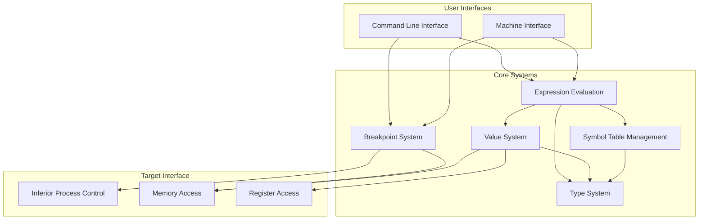
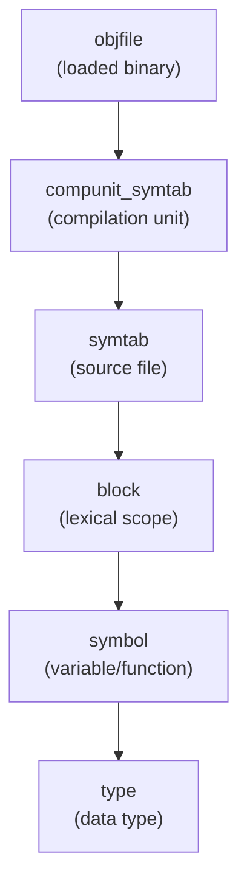
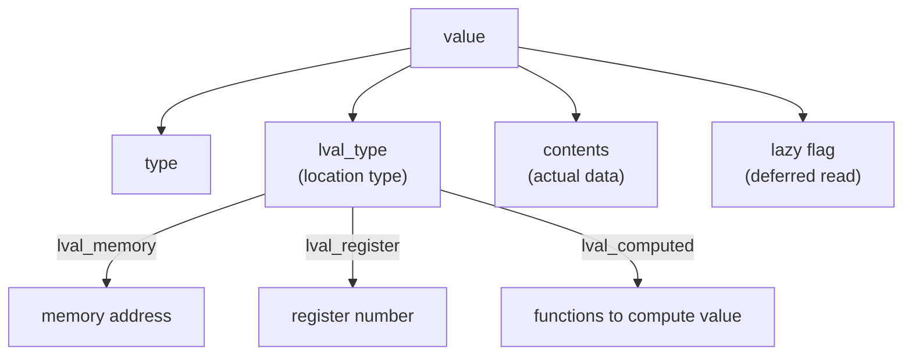
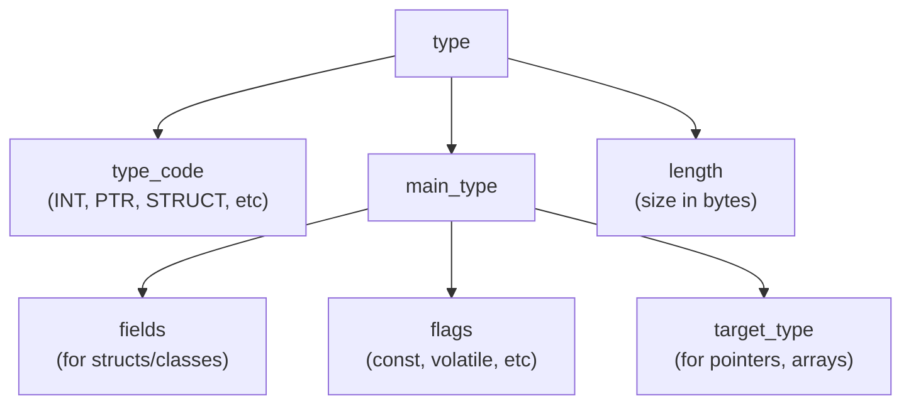
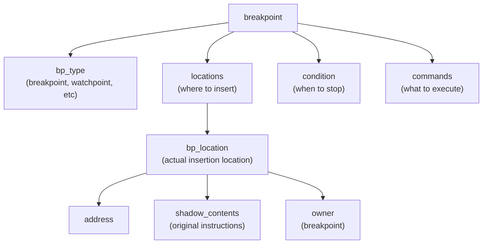
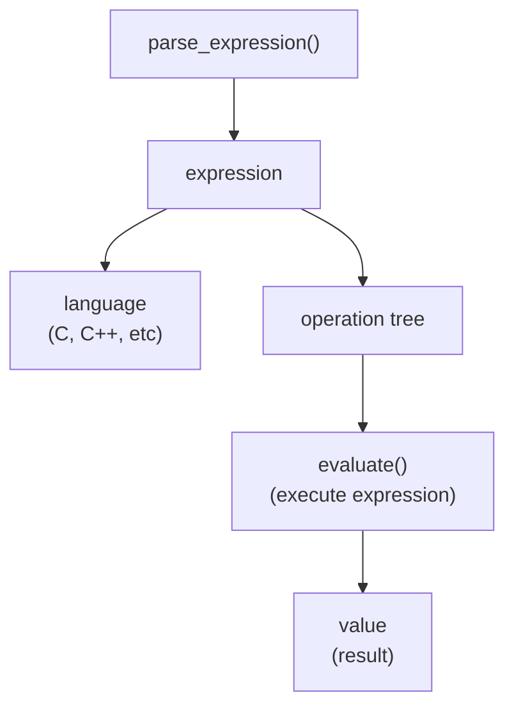
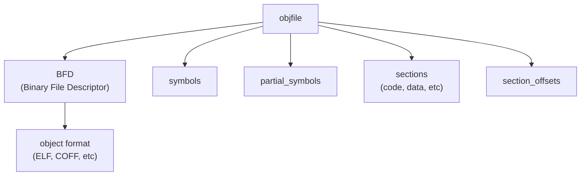

<!-- source: DeepWiki mcp.deepwiki.com · repo NVIDIA/cuda-gdb · page 2 GNU Debugger (GDB) · fetched 2026-10-26 -->

# GNU Debugger (GDB)

<details>
<summary>Relevant source files</summary>

The following files were used as context for generating this wiki page:

- [gdb/ada-lang.c](gdb/ada-lang.c)
- [gdb/ada-lang.h](gdb/ada-lang.h)
- [gdb/ada-valprint.c](gdb/ada-valprint.c)
- [gdb/breakpoint.c](gdb/breakpoint.c)
- [gdb/breakpoint.h](gdb/breakpoint.h)
- [gdb/c-valprint.c](gdb/c-valprint.c)
- [gdb/coff-pe-read.c](gdb/coff-pe-read.c)
- [gdb/coffread.c](gdb/coffread.c)
- [gdb/cp-valprint.c](gdb/cp-valprint.c)
- [gdb/ctfread.c](gdb/ctfread.c)
- [gdb/dbxread.c](gdb/dbxread.c)
- [gdb/debuginfod-support.h](gdb/debuginfod-support.h)
- [gdb/disasm.c](gdb/disasm.c)
- [gdb/disasm.h](gdb/disasm.h)
- [gdb/dwarf2/ada-imported.c](gdb/dwarf2/ada-imported.c)
- [gdb/dwarf2/expr.c](gdb/dwarf2/expr.c)
- [gdb/dwarf2/loc.c](gdb/dwarf2/loc.c)
- [gdb/elfread.c](gdb/elfread.c)
- [gdb/eval.c](gdb/eval.c)
- [gdb/f-lang.c](gdb/f-lang.c)
- [gdb/findvar.c](gdb/findvar.c)
- [gdb/gdb-stabs.h](gdb/gdb-stabs.h)
- [gdb/gdbtypes.c](gdb/gdbtypes.c)
- [gdb/gdbtypes.h](gdb/gdbtypes.h)
- [gdb/linespec.c](gdb/linespec.c)
- [gdb/machoread.c](gdb/machoread.c)
- [gdb/mdebugread.c](gdb/mdebugread.c)
- [gdb/minsyms.c](gdb/minsyms.c)
- [gdb/minsyms.h](gdb/minsyms.h)
- [gdb/objfiles.c](gdb/objfiles.c)
- [gdb/objfiles.h](gdb/objfiles.h)
- [gdb/opencl-lang.c](gdb/opencl-lang.c)
- [gdb/p-valprint.c](gdb/p-valprint.c)
- [gdb/psymtab.c](gdb/psymtab.c)
- [gdb/psymtab.h](gdb/psymtab.h)
- [gdb/quick-symbol.h](gdb/quick-symbol.h)
- [gdb/rust-lang.c](gdb/rust-lang.c)
- [gdb/source-cache.c](gdb/source-cache.c)
- [gdb/source-cache.h](gdb/source-cache.h)
- [gdb/source.c](gdb/source.c)
- [gdb/source.h](gdb/source.h)
- [gdb/stabsread.c](gdb/stabsread.c)
- [gdb/stabsread.h](gdb/stabsread.h)
- [gdb/symfile-debug.c](gdb/symfile-debug.c)
- [gdb/symfile.c](gdb/symfile.c)
- [gdb/symmisc.c](gdb/symmisc.c)
- [gdb/symtab.c](gdb/symtab.c)
- [gdb/symtab.h](gdb/symtab.h)
- [gdb/testsuite/gdb.multi/pending-bp-del-inferior.c](gdb/testsuite/gdb.multi/pending-bp-del-inferior.c)
- [gdb/testsuite/gdb.multi/pending-bp-del-inferior.exp](gdb/testsuite/gdb.multi/pending-bp-del-inferior.exp)
- [gdb/tracepoint.c](gdb/tracepoint.c)
- [gdb/valarith.c](gdb/valarith.c)
- [gdb/valops.c](gdb/valops.c)
- [gdb/valprint.c](gdb/valprint.c)
- [gdb/value.c](gdb/value.c)
- [gdb/value.h](gdb/value.h)
- [gdb/xcoffread.c](gdb/xcoffread.c)

</details>


This page describes the core architecture and internal components of the GNU Debugger (GDB). GDB allows programmers to see what's happening inside a program while it executes or what it was doing when it crashed. For information about specific debugging commands and usage patterns, see the user documentation.

## Overview

GDB is composed of several core subsystems that work together to provide debugging functionality. The main components include:

- Symbol table management - tracks functions, variables, and types from program debug information
- Breakpoint system - manages where and when to stop program execution
- Value system - represents and manipulates data from the debugged program
- Type system - represents types of variables and expressions
- Expression evaluator - parses and executes user expressions for inspection and modification

These systems interact with target interfaces (processes, threads, memory) to debug programs across various architectures and platforms.

## Architecture Overview



Sources: [breakpoint.c:1-500](), [symtab.c:1-400](), [value.c:1-200](), [gdbtypes.c:1-200](), [eval.c:1-100]()

## Symbol Table Management

The symbol table system is responsible for loading, organizing, and accessing debug information from executables. It allows GDB to map between source code elements (functions, variables) and memory addresses.



Key structures:
- `struct objfile`: Represents a loaded executable or shared library
- `struct compunit_symtab`: Represents a compilation unit within an objfile
- `struct symtab`: Represents a source file
- `struct block`: Represents a lexical scope (e.g., function, nested block)
- `struct symbol`: Represents a symbol like a variable or function

### Symbol Lookup

Symbol lookup is performed using functions like:
- `lookup_symbol`: Find a symbol in the current scope
- `lookup_block_symbol`: Find a symbol in a specific block
- `lookup_bound_symbol`: Find a fully qualified symbol

```
lookup_symbol
  ↳ lookup_symbol_in_objfile
    ↳ lookup_local_symbol
      ↳ block_lookup_symbol
```

The lookup process may use caching to improve performance, particularly with the symbol cache implemented in `symtab.c`.

Sources: [symtab.c:120-400](), [symtab.h:1-200](), [objfiles.c:250-300]()

## Value System

The value system represents and manipulates data from the debugged program. Values encapsulate both the data itself and metadata about the value, such as its type, location, and how to access it.



### Value Types and States

Values can be in several states:
- **Lazy**: Contents not yet read from target (loaded on demand)
- **Not Lazy**: Contents already loaded
- **Optimized Out**: Compiler optimized the value away
- **Unavailable**: Value exists but cannot be accessed

Values have different location types:
- `lval_memory`: Value stored in target's memory
- `lval_register`: Value stored in a register
- `lval_computed`: Value computed by callbacks
- `lval_not_lval`: Value is not a location (just a computed value)

### Key Operations

- `value::allocate`: Create a value of a specified type
- `value::fetch_lazy`: Load a lazy value's contents
- `value_cast`: Convert a value to a different type
- `value_assign`: Assign to a modifiable value

Sources: [value.c:150-400](), [value.h:100-400](), [findvar.c:50-60]()

## Type System

The type system represents the data types of program values, ranging from simple primitive types to complex compound types. Types are used for value representation, type checking, and debugging operations.



### Type Categories

Types are categorized by their `type_code`:
- Primitive types: `TYPE_CODE_INT`, `TYPE_CODE_FLT`, etc.
- Pointers and references: `TYPE_CODE_PTR`, `TYPE_CODE_REF`
- Compound types: `TYPE_CODE_STRUCT`, `TYPE_CODE_ARRAY`
- Functions: `TYPE_CODE_FUNC`
- And many more...

Types can have modifiers like `const`, `volatile`, or `restrict` as reflected in their instance flags.

### Type Operations

- `check_typedef`: Resolve typedefs to their actual types
- `lookup_pointer_type`: Get/create a pointer to a specific type
- `lookup_function_type`: Get/create a function type
- `create_range_type`: Create an array/range type

Sources: [gdbtypes.c:180-250](), [gdbtypes.h:65-120](), [gdbtypes.h:500-700]()

## Breakpoint System

The breakpoint system manages program execution stopping points. It supports various breakpoint types, conditions, and commands to be executed when breakpoints are hit.



### Breakpoint Types

- Regular breakpoints (`bp_breakpoint`)
- Hardware breakpoints (`bp_hardware_breakpoint`)
- Watchpoints (`bp_watchpoint`, `bp_hardware_watchpoint`)
- Catchpoints (`bp_catchpoint`)
- Tracepoints (`bp_tracepoint`)

### Key Operations

- `create_breakpoint`: Create a new breakpoint
- `delete_breakpoint`: Remove a breakpoint
- `update_global_location_list`: Update program memory with breakpoint instructions
- `bpstat_check`: Check if a breakpoint has been hit

Sources: [breakpoint.c:90-300](), [breakpoint.h:100-300](), [breakpoint.c:600-700]()

## Expression Evaluation

The expression evaluation system parses and executes expressions entered by users, allowing inspection and modification of program state.



### Expression Operations

- `parse_expression`: Parse a string into an expression tree
- `evaluate_expression`: Execute an expression and return a value
- `parse_and_eval`: Convenience function for both steps
- `value_assign`: Assign a value to a target location

### Implementation

Expression evaluation relies on language-specific parsers (C, C++, Ada, etc.) to convert text into operation trees. These trees are then evaluated to produce values by interacting with the target.

Sources: [eval.c:45-90](), [expression.h](), [expop.c]()

## Object File Management

The object file system manages the loading and inspection of program binaries, extracting symbols, debug information, and memory layouts.



### Object File Operations

- Symbol table loading from various formats (DWARF, STABS)
- Section mapping for code and data regions
- Address translation between file and memory addresses
- Symbol lookup across multiple loaded object files

Sources: [objfiles.c:250-300](), [objfiles.h:20-50]()

## Integration and Workflow

The various GDB subsystems work together during a debugging session. Here's a typical workflow:

1. User sets a breakpoint at a function:
   - Parser interprets the command
   - Symbol tables locate the function
   - Breakpoint system creates and installs breakpoint

2. Program hits the breakpoint:
   - Target system notifies GDB of the stop
   - Breakpoint system verifies the hit condition
   - Frame system captures the current execution context

3. User evaluates an expression:
   - Parser creates an expression tree
   - Evaluator traverses the tree
   - Symbol tables resolve variable names
   - Value system fetches and manipulates values
   - Type system ensures type correctness

This tight integration allows GDB to provide a seamless debugging experience across a wide range of programs, languages, and architectures.

Sources: [breakpoint.c:1095-1200](), [eval.c:100-120](), [symtab.c:700-750]()

---

