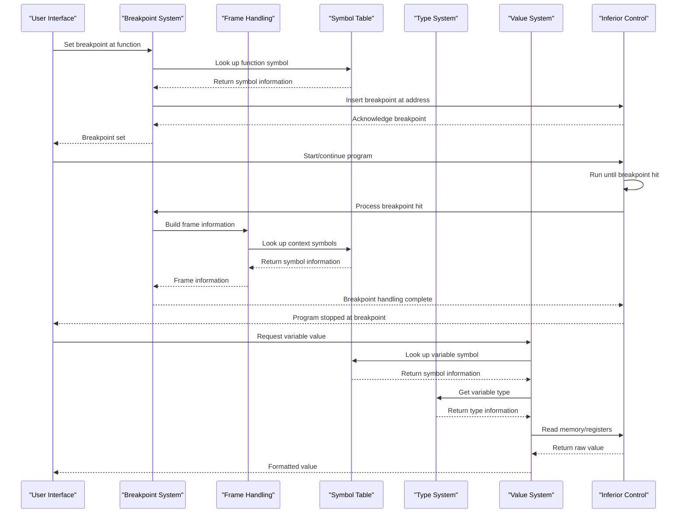

<!-- source: DeepWiki mcp.deepwiki.com · repo NVIDIA/cuda-gdb · page 2.1 Core Components · fetched 2026-10-26 -->

# Core Components

<details>
<summary>Relevant source files</summary>

The following files were used as context for generating this wiki page:

- [gdb/aarch64-linux-nat.c](gdb/aarch64-linux-nat.c)
- [gdb/aarch64-linux-tdep.c](gdb/aarch64-linux-tdep.c)
- [gdb/aarch64-tdep.c](gdb/aarch64-tdep.c)
- [gdb/aarch64-tdep.h](gdb/aarch64-tdep.h)
- [gdb/ada-lang.c](gdb/ada-lang.c)
- [gdb/ada-lang.h](gdb/ada-lang.h)
- [gdb/ada-valprint.c](gdb/ada-valprint.c)
- [gdb/alpha-tdep.c](gdb/alpha-tdep.c)
- [gdb/amd64-tdep.c](gdb/amd64-tdep.c)
- [gdb/amd64-windows-tdep.c](gdb/amd64-windows-tdep.c)
- [gdb/arch/aarch64-scalable-linux.c](gdb/arch/aarch64-scalable-linux.c)
- [gdb/arch/aarch64-scalable-linux.h](gdb/arch/aarch64-scalable-linux.h)
- [gdb/arch/aarch64.c](gdb/arch/aarch64.c)
- [gdb/arch/aarch64.h](gdb/arch/aarch64.h)
- [gdb/arm-tdep.c](gdb/arm-tdep.c)
- [gdb/breakpoint.c](gdb/breakpoint.c)
- [gdb/breakpoint.h](gdb/breakpoint.h)
- [gdb/c-valprint.c](gdb/c-valprint.c)
- [gdb/cli/cli-interp.c](gdb/cli/cli-interp.c)
- [gdb/cli/cli-interp.h](gdb/cli/cli-interp.h)
- [gdb/coff-pe-read.c](gdb/coff-pe-read.c)
- [gdb/coffread.c](gdb/coffread.c)
- [gdb/cp-valprint.c](gdb/cp-valprint.c)
- [gdb/ctfread.c](gdb/ctfread.c)
- [gdb/dbxread.c](gdb/dbxread.c)
- [gdb/debuginfod-support.h](gdb/debuginfod-support.h)
- [gdb/disasm.c](gdb/disasm.c)
- [gdb/disasm.h](gdb/disasm.h)
- [gdb/dwarf2/ada-imported.c](gdb/dwarf2/ada-imported.c)
- [gdb/dwarf2/expr.c](gdb/dwarf2/expr.c)
- [gdb/dwarf2/loc.c](gdb/dwarf2/loc.c)
- [gdb/elfread.c](gdb/elfread.c)
- [gdb/eval.c](gdb/eval.c)
- [gdb/f-lang.c](gdb/f-lang.c)
- [gdb/features/aarch64-sme.c](gdb/features/aarch64-sme.c)
- [gdb/features/aarch64-sme2.c](gdb/features/aarch64-sme2.c)
- [gdb/findvar.c](gdb/findvar.c)
- [gdb/frame.c](gdb/frame.c)
- [gdb/frame.h](gdb/frame.h)
- [gdb/gdb-stabs.h](gdb/gdb-stabs.h)
- [gdb/gdbtypes.c](gdb/gdbtypes.c)
- [gdb/gdbtypes.h](gdb/gdbtypes.h)
- [gdb/i386-tdep.c](gdb/i386-tdep.c)
- [gdb/i386-tdep.h](gdb/i386-tdep.h)
- [gdb/i387-tdep.c](gdb/i387-tdep.c)
- [gdb/i387-tdep.h](gdb/i387-tdep.h)
- [gdb/ia64-tdep.c](gdb/ia64-tdep.c)
- [gdb/infcall.c](gdb/infcall.c)
- [gdb/infcmd.c](gdb/infcmd.c)
- [gdb/infrun.c](gdb/infrun.c)
- [gdb/infrun.h](gdb/infrun.h)
- [gdb/interps.c](gdb/interps.c)
- [gdb/interps.h](gdb/interps.h)
- [gdb/linespec.c](gdb/linespec.c)
- [gdb/m68k-tdep.c](gdb/m68k-tdep.c)
- [gdb/machoread.c](gdb/machoread.c)
- [gdb/mdebugread.c](gdb/mdebugread.c)
- [gdb/mi/mi-cmd-stack.c](gdb/mi/mi-cmd-stack.c)
- [gdb/mi/mi-interp.c](gdb/mi/mi-interp.c)
- [gdb/mi/mi-interp.h](gdb/mi/mi-interp.h)
- [gdb/minsyms.c](gdb/minsyms.c)
- [gdb/minsyms.h](gdb/minsyms.h)
- [gdb/mips-tdep.c](gdb/mips-tdep.c)
- [gdb/nat/aarch64-scalable-linux-ptrace.c](gdb/nat/aarch64-scalable-linux-ptrace.c)
- [gdb/nat/aarch64-scalable-linux-ptrace.h](gdb/nat/aarch64-scalable-linux-ptrace.h)
- [gdb/nat/aarch64-scalable-linux-sigcontext.h](gdb/nat/aarch64-scalable-linux-sigcontext.h)
- [gdb/objfiles.c](gdb/objfiles.c)
- [gdb/objfiles.h](gdb/objfiles.h)
- [gdb/observable.c](gdb/observable.c)
- [gdb/observable.h](gdb/observable.h)
- [gdb/opencl-lang.c](gdb/opencl-lang.c)
- [gdb/p-valprint.c](gdb/p-valprint.c)
- [gdb/printcmd.c](gdb/printcmd.c)
- [gdb/psymtab.c](gdb/psymtab.c)
- [gdb/psymtab.h](gdb/psymtab.h)
- [gdb/python/py-framefilter.c](gdb/python/py-framefilter.c)
- [gdb/quick-symbol.h](gdb/quick-symbol.h)
- [gdb/riscv-tdep.c](gdb/riscv-tdep.c)
- [gdb/rust-lang.c](gdb/rust-lang.c)
- [gdb/s390-tdep.c](gdb/s390-tdep.c)
- [gdb/s390-tdep.h](gdb/s390-tdep.h)
- [gdb/source-cache.c](gdb/source-cache.c)
- [gdb/source-cache.h](gdb/source-cache.h)
- [gdb/source.c](gdb/source.c)
- [gdb/source.h](gdb/source.h)
- [gdb/sparc-nat.c](gdb/sparc-nat.c)
- [gdb/sparc-tdep.c](gdb/sparc-tdep.c)
- [gdb/sparc64-tdep.c](gdb/sparc64-tdep.c)
- [gdb/stabsread.c](gdb/stabsread.c)
- [gdb/stabsread.h](gdb/stabsread.h)
- [gdb/stack.c](gdb/stack.c)
- [gdb/symfile-debug.c](gdb/symfile-debug.c)
- [gdb/symfile.c](gdb/symfile.c)
- [gdb/symmisc.c](gdb/symmisc.c)
- [gdb/symtab.c](gdb/symtab.c)
- [gdb/symtab.h](gdb/symtab.h)
- [gdb/testsuite/gdb.base/infcall-failure.c](gdb/testsuite/gdb.base/infcall-failure.c)
- [gdb/testsuite/gdb.base/infcall-failure.exp](gdb/testsuite/gdb.base/infcall-failure.exp)
- [gdb/testsuite/gdb.base/inferior-clone.exp](gdb/testsuite/gdb.base/inferior-clone.exp)
- [gdb/testsuite/gdb.mi/mi-reverse.exp](gdb/testsuite/gdb.mi/mi-reverse.exp)
- [gdb/testsuite/gdb.multi/gdb-settings.c](gdb/testsuite/gdb.multi/gdb-settings.c)
- [gdb/testsuite/gdb.multi/gdb-settings.exp](gdb/testsuite/gdb.multi/gdb-settings.exp)
- [gdb/testsuite/gdb.multi/pending-bp-del-inferior.c](gdb/testsuite/gdb.multi/pending-bp-del-inferior.c)
- [gdb/testsuite/gdb.multi/pending-bp-del-inferior.exp](gdb/testsuite/gdb.multi/pending-bp-del-inferior.exp)
- [gdb/testsuite/gdb.reverse/amd64-tailcall-reverse.exp](gdb/testsuite/gdb.reverse/amd64-tailcall-reverse.exp)
- [gdb/testsuite/gdb.reverse/finish-reverse-next.c](gdb/testsuite/gdb.reverse/finish-reverse-next.c)
- [gdb/testsuite/gdb.reverse/finish-reverse-next.exp](gdb/testsuite/gdb.reverse/finish-reverse-next.exp)
- [gdb/testsuite/gdb.reverse/i386-avx-reverse.c](gdb/testsuite/gdb.reverse/i386-avx-reverse.c)
- [gdb/testsuite/gdb.reverse/i386-avx-reverse.exp](gdb/testsuite/gdb.reverse/i386-avx-reverse.exp)
- [gdb/testsuite/gdb.reverse/singlejmp-reverse.exp](gdb/testsuite/gdb.reverse/singlejmp-reverse.exp)
- [gdb/testsuite/gdb.reverse/step-indirect-call-thunk.exp](gdb/testsuite/gdb.reverse/step-indirect-call-thunk.exp)
- [gdb/testsuite/gdb.reverse/until-precsave.exp](gdb/testsuite/gdb.reverse/until-precsave.exp)
- [gdb/testsuite/gdb.reverse/until-reverse.exp](gdb/testsuite/gdb.reverse/until-reverse.exp)
- [gdb/tracepoint.c](gdb/tracepoint.c)
- [gdb/valarith.c](gdb/valarith.c)
- [gdb/valops.c](gdb/valops.c)
- [gdb/valprint.c](gdb/valprint.c)
- [gdb/value.c](gdb/value.c)
- [gdb/value.h](gdb/value.h)
- [gdb/xcoffread.c](gdb/xcoffread.c)
- [gdbserver/linux-aarch64-low.cc](gdbserver/linux-aarch64-low.cc)

</details>


This page provides an overview of the fundamental components that form the core of CUDA-GDB. These components work together to provide the basic functionality needed for debugging. This document focuses on explaining what these core components are and how they interact, while detailed documentation for specific components can be found in their respective wiki pages.

## Overview of the Core Components

CUDA-GDB is built upon several critical subsystems that collectively enable debugging functionality. The core components include:

- **Symbol Table Management**: Handles symbols from debugging information
- **Type System**: Represents and manages data types
- **Value System**: Represents and manipulates values in the debugged program
- **Breakpoint System**: Manages breakpoints, watchpoints, and catchpoints
- **Frame Handling**: Manages and navigates stack frames
- **Inferior Process Control**: Controls execution of the debugged program

```mermaid
graph TD
    classDef component fill:#f9f9f9,stroke:#333,stroke-width:1px
    
    A["GDB Core"] :::component
    B["Symbol Table Management"] :::component
    C["Type System"] :::component
    D["Value System"] :::component
    E["Breakpoint System"] :::component
    F["Frame Handling"] :::component
    G["Inferior Process Control"] :::component
    H["User Interface"] :::component
    
    A --> B
    A --> C
    A --> D
    A --> E
    A --> F
    A --> G
    A --> H
    
    B <--> C
    C <--> D
    E --> G
    F <--> G
    D <--> B
```

Sources: [gdb/symtab.c:1-100](), [gdb/gdbtypes.c:1-100](), [gdb/value.c:1-100](), [gdb/breakpoint.c:1-100](), [gdb/frame.c:1-100](), [gdb/infrun.c:1-100]()

## Symbol Table Management

Symbol Table Management handles the parsing, storage, and lookup of debug symbols. This component is crucial for:

- Mapping source code to machine code
- Looking up variable names
- Finding function definitions
- Supporting various debug formats

The central structures include:
- `struct symbol`: Represents a single debug symbol
- `struct symtab`: Symbol table for a single source file
- `struct objfile`: Container for symbols from an object file
- `struct block`: Lexical scope in the program

For detailed documentation on the Symbol Table Management, see [Symbol Table Management](#2.1.1).

Sources: [gdb/symtab.c:100-200](), [gdb/symtab.h:100-200]()

## Type System

The Type System represents data types of variables, functions, and expressions in the debugged program. It provides facilities for:

- Type creation and manipulation
- Type checking for expressions
- Type printing for user display

The central structure is `struct type` which represents a data type with its various attributes like size, code, name, and fields.

```mermaid
graph LR
    classDef structure fill:#f9f9f9,stroke:#333,stroke-width:1px
    
    T["struct type"] :::structure
    M["struct main_type"] :::structure
    C["type_code (enum)"] :::structure
    F["Fields"] :::structure
    
    T --> M
    M --> C
    M --> F
    
    subgraph "Type Codes"
        TC1["TYPE_CODE_INT"]
        TC2["TYPE_CODE_STRUCT"]
        TC3["TYPE_CODE_PTR"]
        TC4["TYPE_CODE_ARRAY"]
        TC5["..."]
    end
    
    C --- TC1
    C --- TC2
    C --- TC3
    C --- TC4
    C --- TC5
```

Sources: [gdb/gdbtypes.c:180-300](), [gdb/gdbtypes.h:60-100](), [gdb/gdbtypes.h:250-350]()

## Value System

The Value System represents actual values of variables and expressions in the debugged program. Values are intimately connected to types, as each value has an associated type that describes its structure.

The central structure is `struct value` which represents a typed value with attributes like:
- Type information
- Memory location (if applicable)
- Actual content
- Optimized-out status
- Unavailable status

Values can be:
- In memory (lval_memory)
- In registers (lval_register)
- Computed (lval_computed)
- Optimized out
- Not in memory/registers (not_lval)

```mermaid
graph TD
    classDef structure fill:#f9f9f9,stroke:#333,stroke-width:1px
    
    V["struct value"] :::structure
    T["struct type"] :::structure
    L["lval_type (enum)"] :::structure
    C["Contents (data)"] :::structure
    
    V --> T
    V --> L
    V --> C
    
    subgraph "lval types"
        L1["not_lval"]
        L2["lval_memory"]
        L3["lval_register"]
        L4["lval_computed"]
    end
    
    L --- L1
    L --- L2
    L --- L3
    L --- L4
```

Sources: [gdb/value.c:150-500](), [gdb/value.h:130-400]()

## Breakpoint System

The Breakpoint System manages breakpoints, watchpoints, and catchpoints that control program execution. It provides facilities for:

- Setting breakpoints at addresses, source lines, or functions
- Managing condition expressions for conditional breakpoints
- Tracking hit counts
- Printing break messages
- Executing commands when breakpoints are hit

The core structure is `struct breakpoint` which represents a breakpoint with its attributes like type, location, condition, and commands.

For detailed documentation on the Breakpoint System, see [Breakpoint System](#2.1.2).

Sources: [gdb/breakpoint.c:300-500](), [gdb/breakpoint.h:100-300]()

## Frame Handling

Frame Handling manages stack frames, which represent function calls in the program being debugged. This component provides:

- Navigation between frames (up/down)
- Access to local variables in each frame
- Information about function arguments
- Source location information

The core structure is `struct frame_info` which represents a stack frame with its attributes like level, address, function, and source location.

For detailed documentation on the Stack Frame Management, see [Stack Frame Management](#2.1.3).

Sources: [gdb/frame.c:100-300](), [gdb/frame.h:50-150]()

## Inferior Process Control

Inferior Process Control manages the execution of the debugged program (the "inferior"). This component provides:

- Starting and stopping the program
- Stepping through code
- Handling signals
- Managing threads
- Controlling execution modes (non-stop, all-stop)

The core structure is `struct inferior` which represents a debugged program with its attributes like pid, target, and state.

For detailed documentation on the Inferior Process Control, see [Inferior Process Control](#2.1.4).

Sources: [gdb/infrun.c:600-800](), [gdb/infcmd.c:100-300](), [gdb/inferior.h:50-150]()

## Core Components Interaction

The following diagram illustrates how the core components interact during typical debugging operations:



Sources: [gdb/breakpoint.c:900-1100](), [gdb/infrun.c:400-600](), [gdb/value.c:600-800](), [gdb/symtab.c:400-600]()

## Architecture-Specific Support

GDB supports multiple CPU architectures through architecture-specific code. The core components work with these architecture-specific modules to provide platform-specific debugging capabilities:

```mermaid
graph TD
    classDef component fill:#f9f9f9,stroke:#333,stroke-width:1px
    
    C["GDB Core Components"] :::component
    
    subgraph "Architecture-Specific Support"
        A1["i386-tdep.c"]
        A2["aarch64-tdep.c"]
        A3["arm-tdep.c"]
        A4["riscv-tdep.c"]
        A5["..."]
    end
    
    C <--> A1
    C <--> A2
    C <--> A3
    C <--> A4
    C <--> A5
```

Each architecture module provides implementations for:
- Register handling
- Frame unwinding
- Breakpoint insertion
- Instruction interpretation
- ABI compliance

Sources: [gdb/i386-tdep.c:70-150](), [gdb/aarch64-tdep.c:20-100](), [gdb/arm-tdep.c:20-100](), [gdb/riscv-tdep.c:1-100]()

## Language Support

The core components also interact with language-specific modules to support various programming languages:

```mermaid
graph TD
    classDef component fill:#f9f9f9,stroke:#333,stroke-width:1px
    
    C["GDB Core Components"] :::component
    
    subgraph "Language Support"
        L1["ada-lang.c"]
        L2["c-lang.c"]
        L3["cplus-lang.c"]
        L4["rust-lang.c"]
        L5["..."]
    end
    
    C <--> L1
    C <--> L2
    C <--> L3
    C <--> L4
    C <--> L5
```

Each language module provides:
- Language-specific symbol lookup
- Expression parsing
- Type printing
- Value formatting

Sources: [gdb/ada-lang.c:100-200]()

## CUDA-Specific Extensions

CUDA-GDB extends the core GDB components to support debugging CUDA applications. These extensions allow debugging of GPU code alongside CPU code:

- Extended symbol table handling for device code
- Special breakpoint types for CUDA kernels and device functions
- Value system extensions for device memory
- Frame handling for CUDA threads and blocks
- Special inferior control for CUDA devices

For CUDA-specific functionality, see the dedicated CUDA extensions pages.

---

