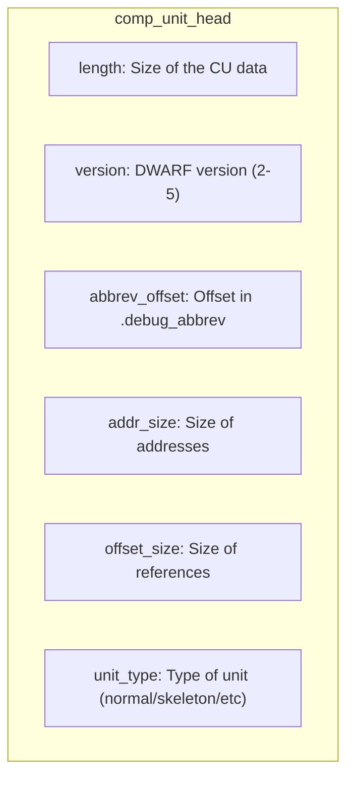
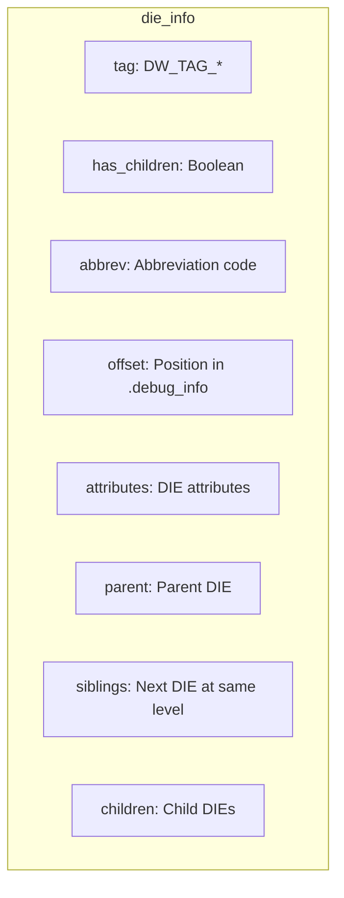
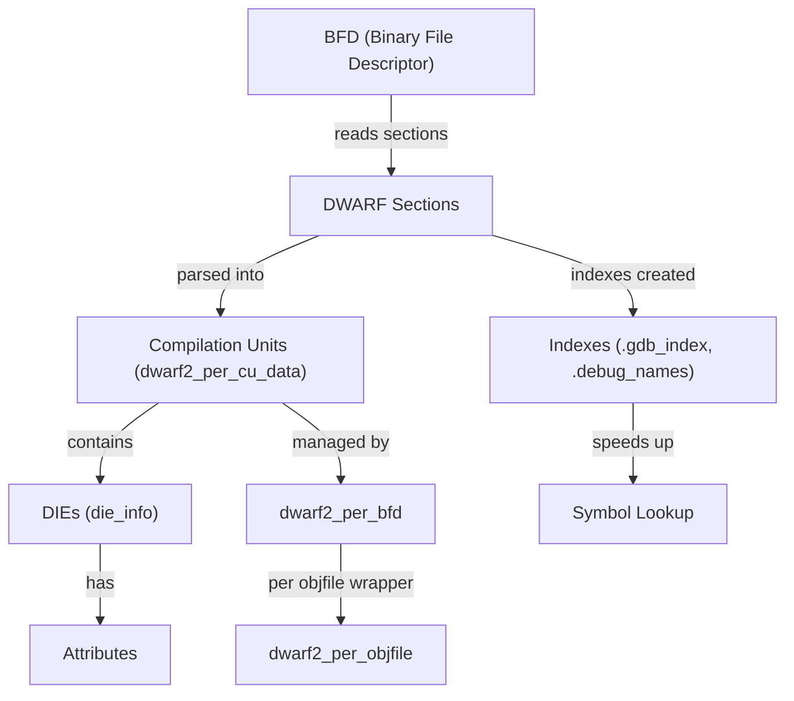
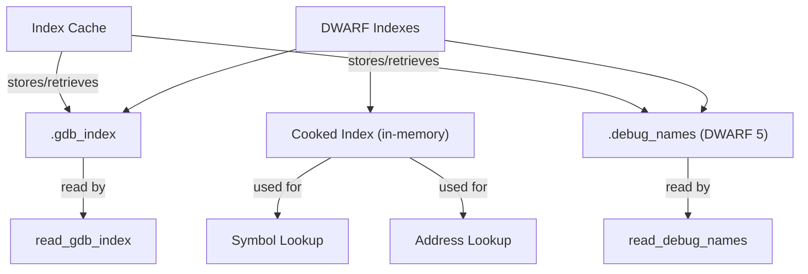
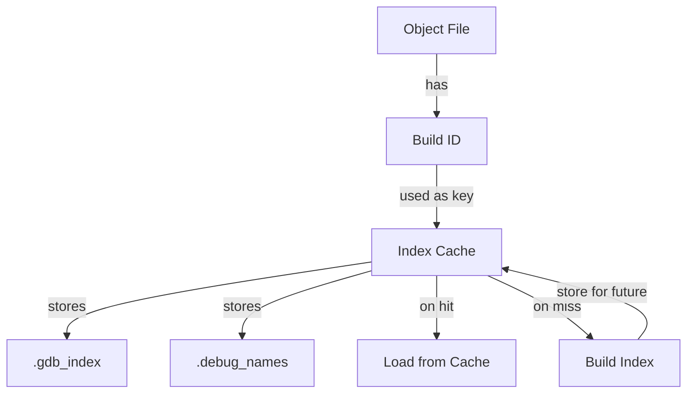
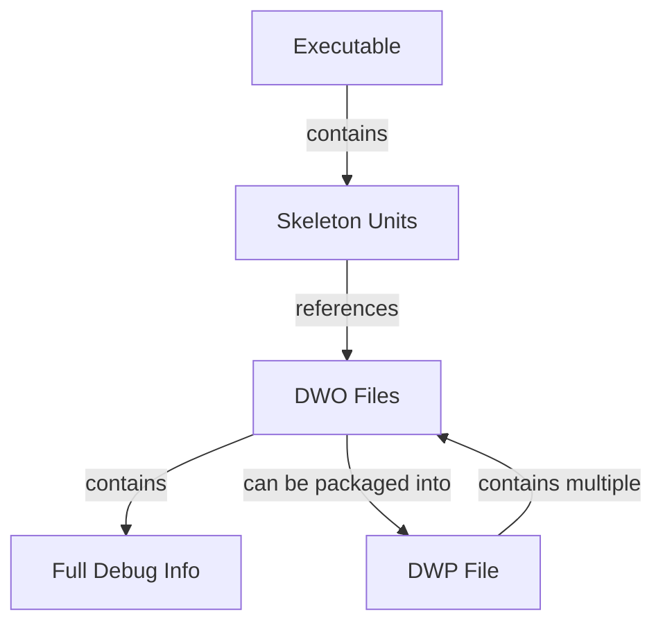

<!-- source: DeepWiki mcp.deepwiki.com · repo NVIDIA/cuda-gdb · page 2.2 DWARF Debug Information · fetched 2026-10-26 -->

# DWARF Debug Information

Relevant source files

The following files were used as context for generating this wiki page:

- [gdb/compile/compile-loc2c.c](gdb/compile/compile-loc2c.c)
- [gdb/dwarf2/abbrev-table-cache.c](gdb/dwarf2/abbrev-table-cache.c)
- [gdb/dwarf2/abbrev-table-cache.h](gdb/dwarf2/abbrev-table-cache.h)
- [gdb/dwarf2/abbrev.c](gdb/dwarf2/abbrev.c)
- [gdb/dwarf2/abbrev.h](gdb/dwarf2/abbrev.h)
- [gdb/dwarf2/aranges.c](gdb/dwarf2/aranges.c)
- [gdb/dwarf2/aranges.h](gdb/dwarf2/aranges.h)
- [gdb/dwarf2/attribute.c](gdb/dwarf2/attribute.c)
- [gdb/dwarf2/attribute.h](gdb/dwarf2/attribute.h)
- [gdb/dwarf2/call-site.h](gdb/dwarf2/call-site.h)
- [gdb/dwarf2/comp-unit-head.c](gdb/dwarf2/comp-unit-head.c)
- [gdb/dwarf2/comp-unit-head.h](gdb/dwarf2/comp-unit-head.h)
- [gdb/dwarf2/cooked-index.c](gdb/dwarf2/cooked-index.c)
- [gdb/dwarf2/cooked-index.h](gdb/dwarf2/cooked-index.h)
- [gdb/dwarf2/cu.c](gdb/dwarf2/cu.c)
- [gdb/dwarf2/cu.h](gdb/dwarf2/cu.h)
- [gdb/dwarf2/die.c](gdb/dwarf2/die.c)
- [gdb/dwarf2/die.h](gdb/dwarf2/die.h)
- [gdb/dwarf2/dwz.c](gdb/dwarf2/dwz.c)
- [gdb/dwarf2/dwz.h](gdb/dwarf2/dwz.h)
- [gdb/dwarf2/index-cache.c](gdb/dwarf2/index-cache.c)
- [gdb/dwarf2/index-cache.h](gdb/dwarf2/index-cache.h)
- [gdb/dwarf2/index-common.h](gdb/dwarf2/index-common.h)
- [gdb/dwarf2/index-write.c](gdb/dwarf2/index-write.c)
- [gdb/dwarf2/line-header.h](gdb/dwarf2/line-header.h)
- [gdb/dwarf2/mapped-index.h](gdb/dwarf2/mapped-index.h)
- [gdb/dwarf2/read-debug-names.c](gdb/dwarf2/read-debug-names.c)
- [gdb/dwarf2/read-debug-names.h](gdb/dwarf2/read-debug-names.h)
- [gdb/dwarf2/read-gdb-index.c](gdb/dwarf2/read-gdb-index.c)
- [gdb/dwarf2/read.c](gdb/dwarf2/read.c)
- [gdb/dwarf2/read.h](gdb/dwarf2/read.h)
- [gdb/dwarf2/section.c](gdb/dwarf2/section.c)
- [gdb/gdb-gdb.gdb.in](gdb/gdb-gdb.gdb.in)
- [gdb/osdata.c](gdb/osdata.c)
- [gdb/testsuite/gdb.dwarf2/gdb-index-cxx.exp](gdb/testsuite/gdb.dwarf2/gdb-index-cxx.exp)
- [gdb/testsuite/gdb.gdb/index-file.exp](gdb/testsuite/gdb.gdb/index-file.exp)
- [gdb/testsuite/gdb.linespec/cpcompletion.cc](gdb/testsuite/gdb.linespec/cpcompletion.cc)
- [gdb/testsuite/gdb.linespec/cpcompletion.exp](gdb/testsuite/gdb.linespec/cpcompletion.exp)
- [gdb/testsuite/gdb.linespec/cpls.cc](gdb/testsuite/gdb.linespec/cpls.cc)

This page explains how GDB uses DWARF debug information to enable source-level debugging. DWARF is a standardized debugging data format that provides information about the program structure, types, variables, and more to debuggers like GDB. This document focuses on how GDB reads, processes, and utilizes DWARF debug information, including indexing and caching mechanisms to improve performance.

For general information about the DWARF standard, see the DWARF specification. For information about how GDB uses other debugging formats, see the corresponding wiki pages.

## DWARF Data Structure Overview

DWARF organizes debugging information in a hierarchical structure of Debugging Information Entries (DIEs) grouped into Compilation Units (CUs).

### Compilation Units

Each Compilation Unit (CU) typically corresponds to a source file that was compiled. In GDB, CUs are represented by the `dwarf2_per_cu_data` structure, which contains metadata about the CU as well as references to its DIEs.

**Compilation Unit Header Structure**

Sources: [gdb/dwarf2/comp-unit-head.h:45-104](), [gdb/dwarf2/comp-unit-head.c:1-100]()

### Debugging Information Entries (DIEs)

DIEs are the fundamental elements in DWARF that describe program elements such as types, variables, functions, etc. Each DIE has a tag that identifies what kind of entity it represents (e.g., `DW_TAG_variable` for a variable) and a set of attributes that provide additional information.

**DIE Structure**

Sources: [gdb/dwarf2/die.h:37-126](), [gdb/dwarf2/die.c:1-100]()

## Reading DWARF Information in GDB

GDB reads DWARF debug information from several sections in the executable file, such as `.debug_info`, `.debug_abbrev`, `.debug_line`, etc. The reading process is designed to be efficient and uses lazy loading to avoid parsing data until it's needed.

### Main Components for DWARF Processing

Sources: [gdb/dwarf2/read.h:96-364](), [gdb/dwarf2/read.c:30-173]()

### Key Data Structures

- **`dwarf2_per_cu_data`**: Represents a compilation unit's persistent data.
- **`dwarf2_cu`**: Contains the parsed content of a compilation unit, including DIEs.
- **`dwarf2_per_bfd`**: Contains data shared across multiple object files using the same BFD.
- **`dwarf2_per_objfile`**: Contains data specific to a particular object file.

Sources: [gdb/dwarf2/read.h:96-364](), [gdb/dwarf2/cu.h:51-212]()

### Reading Process

1. GDB initially reads the minimal information needed to identify CUs in the object file.
2. As debugging proceeds, GU reads more information on demand.
3. Information is cached to avoid rereading the same data.

Sources: [gdb/dwarf2/read.c:1050-1070](), [gdb/dwarf2/read.c:1060-1083]()

## DWARF Indexing for Efficient Lookups

DWARF information can be very large, making linear searches for symbols impractical. GDB uses several types of indices to speed up lookups.

### Types of Indices

Sources: [gdb/dwarf2/read-gdb-index.c:1-120](), [gdb/dwarf2/read-debug-names.c:1-60](), [gdb/dwarf2/cooked-index.h:1-100]()

### GDB Index (.gdb_index)

The `.gdb_index` section is a custom index format created by GDB. It provides fast lookup for symbols and mapping between addresses and compilation units.

Components of a GDB index:
- Symbol table: Maps symbol names to compilation units
- Address table: Maps address ranges to compilation units
- Constant pool: Stores strings and other data
- Compilation unit list: Lists all compilation units

Sources: [gdb/dwarf2/read-gdb-index.c:107-189]()

### DWARF 5 Debug Names (.debug_names)

DWARF 5 introduced a standardized indexing format called `.debug_names`. This is similar in purpose to `.gdb_index` but follows the DWARF standard.

Sources: [gdb/dwarf2/read-debug-names.c:32-60]()

### Cooked Index

GDB also builds an in-memory index called the "cooked index" for efficient symbol lookups. This is created by scanning DIEs and building a searchable structure.

Key features:
- Name-based lookups with support for C++ namespaces
- Language-specific name canonicalization (e.g., for C++)
- Support for completion of partial names

Sources: [gdb/dwarf2/cooked-index.h:102-259](), [gdb/dwarf2/cooked-index.c:102-348]()

## Index Caching for Performance

GDB implements a caching system for index data to avoid reprocessing the same debug information repeatedly.

### Index Cache Mechanism

Sources: [gdb/dwarf2/index-cache.h:20-138](), [gdb/dwarf2/index-cache.c:92-155]()

### Cache Operations

The index cache works by:
1. Identifying an object file by its build ID
2. Checking if a cached index exists for that build ID
3. Using the cached index if it exists, or creating a new one if not
4. Storing newly created indices in the cache for future use

Sources: [gdb/dwarf2/index-cache.c:204-244]()

## DWARF Sections and Their Purpose

This table shows the main DWARF sections and their roles in debugging:

| Section Name | Purpose |
|-------------|---------|
| .debug_info | Contains DIEs describing program entities |
| .debug_abbrev | Contains abbreviation tables for DIEs |
| .debug_line | Maps between machine code and source code |
| .debug_str | Contains string data referenced by DIEs |
| .debug_loc | Contains location information for variables |
| .debug_ranges | Contains address ranges for entities |
| .debug_types | Contains type units (DWARF 4) |
| .debug_addr | Contains addresses referenced by DIEs (DWARF 5) |
| .debug_str_offsets | Contains offsets into .debug_str (DWARF 5) |
| .debug_loclists | Contains location lists (DWARF 5) |
| .debug_rnglists | Contains range lists (DWARF 5) |
| .gdb_index | Contains GDB's custom index |
| .debug_names | Contains DWARF 5 standard index |

Sources: [gdb/dwarf2/read.c:180-202]()

## Advanced Features

### Split DWARF (DWO/DWP)

Split DWARF separates debug information from the main binary, storing it in separate DWO (DWARF object) files or DWP (DWARF package) files. This reduces the size of the executable while maintaining full debugging capabilities.

Sources: [gdb/dwarf2/read.c:290-382](), [gdb/dwarf2/dwz.c:1-50]()

### Compressed Sections

DWARF sections can be compressed to save disk space. GDB supports compressed sections, which typically have names like `.zdebug_info` instead of `.debug_info`.

Sources: [gdb/dwarf2/read.c:180-202]()

### Address Maps

GDB builds maps between address ranges and compilation units to quickly identify which compilation unit contains information about code at a specific address. This is essential for setting breakpoints and displaying source code context.

Sources: [gdb/dwarf2/aranges.c:1-50]()

## Performance Considerations

DWARF debug information can be very large and complex, so GDB implements several strategies to maintain good performance:

1. **Lazy Loading**: Only load and parse information when needed
2. **Indexing**: Use pre-built or on-the-fly indices for fast lookups
3. **Caching**: Cache processed information to avoid reprocessing
4. **Parallel Processing**: Use worker threads to build indices in the background
5. **Memory Management**: Use efficient data structures and object pooling

Sources: [gdb/dwarf2/cooked-index.c:476-527](), [gdb/dwarf2/cooked-index.h:567-618]()

## DWARF Version Support

GDB supports DWARF versions 2 through 5, with each version introducing new features:

- **DWARF 2**: Basic DIE structure, attributes, and compilation units
- **DWARF 3**: Added type units, improved location descriptions
- **DWARF 4**: Improved type information, standardized data encoding
- **DWARF 5**: Added .debug_names index, improved location and range lists

GDB detects the DWARF version and adjusts its processing accordingly.

Sources: [gdb/dwarf2/comp-unit-head.c:90-98]()

## Summary

DWARF debug information provides GDB with the necessary information to map between the machine code and the source code, understand data types, display variables, and navigate the program structure. GDB's DWARF implementation includes sophisticated mechanisms for reading, indexing, and caching this information to provide a responsive debugging experience.

---

