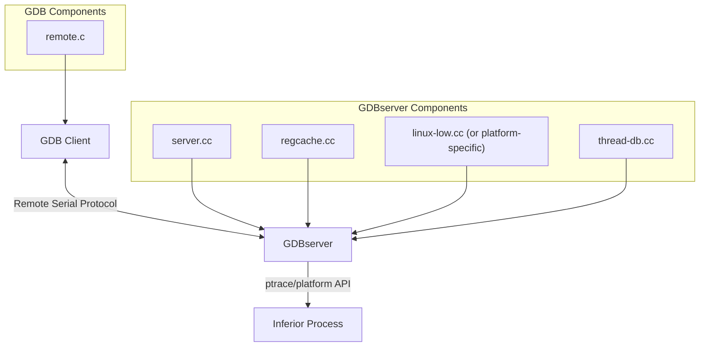
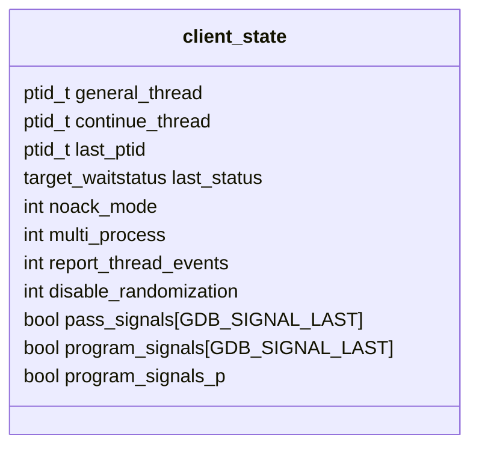
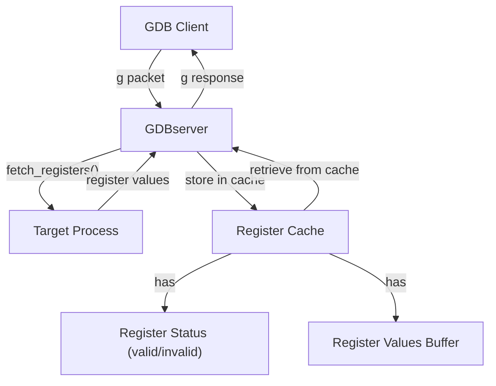
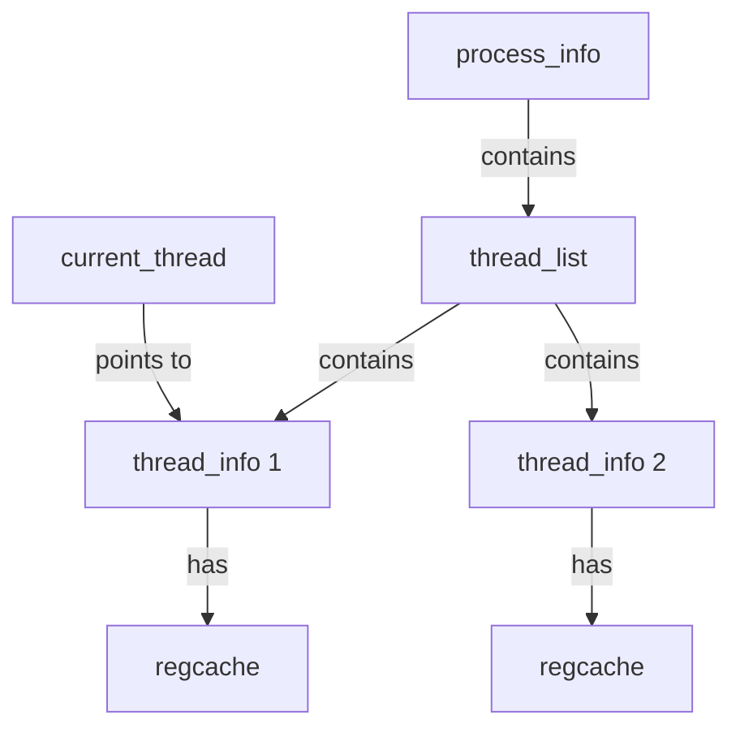
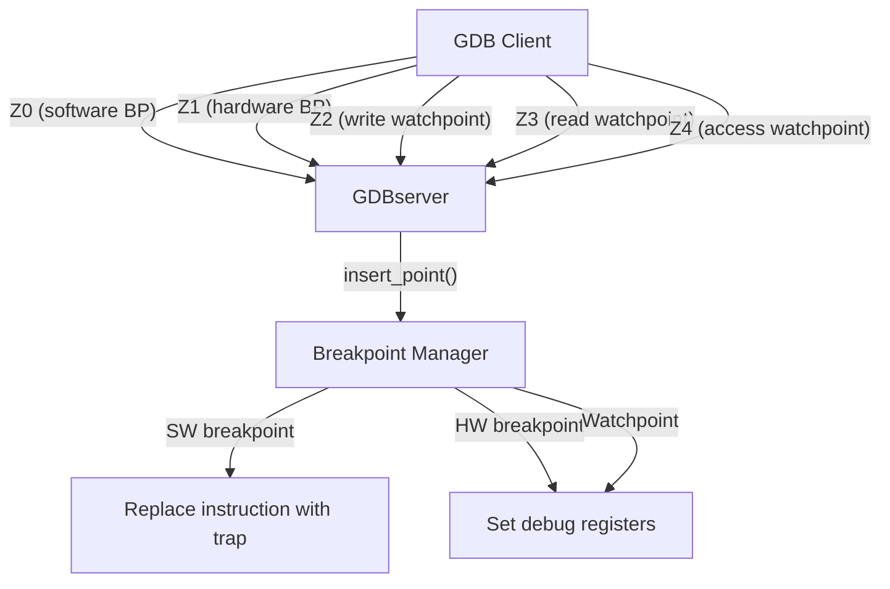
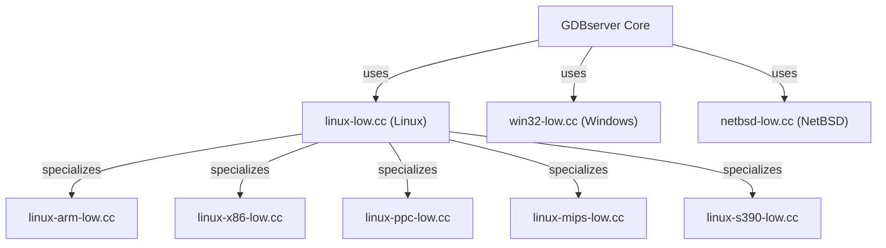

<!-- source: DeepWiki mcp.deepwiki.com · repo NVIDIA/cuda-gdb · page 2.3 Remote Debugging Protocol · fetched 2026-10-26 -->

# Remote Debugging Protocol

<details>
<summary>Relevant source files</summary>

The following files were used as context for generating this wiki page:

- [gdb/regcache-dump.c](gdb/regcache-dump.c)
- [gdb/regcache.c](gdb/regcache.c)
- [gdb/regcache.h](gdb/regcache.h)
- [gdb/testsuite/gdb.server/server-run.exp](gdb/testsuite/gdb.server/server-run.exp)
- [gdbserver/debug.cc](gdbserver/debug.cc)
- [gdbserver/debug.h](gdbserver/debug.h)
- [gdbserver/gdbthread.h](gdbserver/gdbthread.h)
- [gdbserver/inferiors.cc](gdbserver/inferiors.cc)
- [gdbserver/inferiors.h](gdbserver/inferiors.h)
- [gdbserver/linux-arm-low.cc](gdbserver/linux-arm-low.cc)
- [gdbserver/linux-low.cc](gdbserver/linux-low.cc)
- [gdbserver/linux-low.h](gdbserver/linux-low.h)
- [gdbserver/linux-mips-low.cc](gdbserver/linux-mips-low.cc)
- [gdbserver/linux-ppc-low.cc](gdbserver/linux-ppc-low.cc)
- [gdbserver/linux-s390-low.cc](gdbserver/linux-s390-low.cc)
- [gdbserver/mem-break.cc](gdbserver/mem-break.cc)
- [gdbserver/netbsd-low.cc](gdbserver/netbsd-low.cc)
- [gdbserver/netbsd-low.h](gdbserver/netbsd-low.h)
- [gdbserver/regcache.cc](gdbserver/regcache.cc)
- [gdbserver/regcache.h](gdbserver/regcache.h)
- [gdbserver/remote-utils.cc](gdbserver/remote-utils.cc)
- [gdbserver/server.cc](gdbserver/server.cc)
- [gdbserver/target.cc](gdbserver/target.cc)
- [gdbserver/target.h](gdbserver/target.h)
- [gdbserver/thread-db.cc](gdbserver/thread-db.cc)
- [gdbserver/tracepoint.cc](gdbserver/tracepoint.cc)
- [gdbserver/win32-low.cc](gdbserver/win32-low.cc)
- [gdbsupport/common-regcache.h](gdbsupport/common-regcache.h)

</details>


The Remote Debugging Protocol enables communication between a GDB client and a remote target running GDBserver. This protocol enables users to debug programs on remote systems where GDB itself cannot run natively, or in specialized environments like embedded systems or multi-architecture setups. This document explains how GDBserver implements the protocol, its packet formats, and the overall architecture of the remote debugging system.

For information about the GDB server implementation specifically, see [GDB Server](#2.5). For information on the machine interface, see [Machine Interface (MI)](#2.4).

## Protocol Overview

The GDB Remote Serial Protocol (RSP) is a text-based, packet-oriented protocol. It allows GDB to control program execution, access memory, set breakpoints, and inspect registers on a remote target. The protocol works by exchanging command and response packets over a communication channel (typically TCP/IP or serial).

### Communication Architecture



Sources: [gdbserver/server.cc:1-150](), [gdbserver/regcache.cc:1-50](), [gdbserver/linux-low.cc:1-50]()

### Packet Format

The protocol uses packets with the following format:

1. `$` - Marks the start of a packet
2. Packet content - Command and parameters
3. `#` - Marks the end of the packet
4. Two-digit hex checksum - Sum of all bytes in packet content modulo 256

For example: `$m800,4#12` (Read 4 bytes of memory starting at address 0x800)

Responses follow similar format. A reply might be:
- `$00112233#56` - Data from memory
- `+` - Acknowledgment (if using acknowledgment mode)
- `-` - Request retransmission (if checksum error)

Sources: [gdbserver/server.cc:300-400](), [gdbserver/remote-utils.cc:100-200]()

## Protocol Implementation

### Client State Management

GDBserver maintains a client state structure to track the current debugging session:



Sources: [gdbserver/server.cc:150-200]()

### Protocol Command Handling

GDBserver processes various command packets received from GDB. Key packet types include:

| Packet Type | Example | Description |
|-------------|---------|-------------|
| g | `$g#67` | Read all registers |
| G | `$G...#xx` | Write all registers |
| m | `$m800,4#12` | Read memory |
| M | `$M800,4:00112233#ab` | Write memory |
| c | `$c#63` | Continue execution |
| s | `$s#73` | Single step |
| ? | `$?#3f` | Request stop reason |
| H | `$Hc1#b1` | Set thread for subsequent operations |
| q | `$qC#b4` | Query current thread |
| Q | `$QStartNoAckMode#b0` | Set parameters |
| v | `$vCont;c#a8` | Extended commands |
| Z | `$Z0,800,1#fb` | Insert breakpoint |
| z | `$z0,800,1#eb` | Remove breakpoint |

Sources: [gdbserver/server.cc:600-800](), [gdbserver/server.cc:800-1000]()

## Register Management

Register values are a fundamental part of the remote debugging protocol. GDBserver uses a register cache mechanism to efficiently handle register operations.

### Register Cache Architecture



Sources: [gdbserver/regcache.cc:1-100](), [gdbserver/regcache.h:1-50]()

### Register Operations

The protocol supports various register operations:

1. **Read all registers** (g packet):
   - GDBserver receives `g` packet
   - Calls `registers_to_string()` to convert register values to hex string
   - Sends response with all register values

2. **Write all registers** (G packet):
   - GDBserver receives `G` packet with register values
   - Calls `registers_from_string()` to update register cache
   - Writes values to target with `regcache_invalidate()`

3. **Read/Write individual registers** (p/P packets)

Sources: [gdbserver/regcache.cc:150-200](), [gdbserver/regcache.cc:200-250]()

## Thread Management

The remote protocol supports multi-threaded debugging through thread-specific commands and thread tracking.

### Thread Data Structures



Sources: [gdbserver/gdbthread.h:1-50](), [gdbserver/inferiors.h:1-50]()

### Thread Operations

Thread-related operations in the protocol:

1. **Set current thread** (`H` packet):
   - `$Hg1` - Set general operations thread to 1
   - `$Hc1` - Set continue/step operations thread to 1

2. **Query thread info** (`qfThreadInfo` packet):
   - Returns a list of all thread IDs

3. **Thread-specific continue** (`vCont` packet):
   - `$vCont;c:1;s:2` - Continue thread 1, step thread 2

Sources: [gdbserver/server.cc:300-350](), [gdbserver/inferiors.cc:1-100]()

## Process Control

GDBserver provides process control operations through various protocol commands.

### Execution Control Flow

```mermaid
sequenceDiagram
    participant GDB as GDB Client
    participant Server as GDBserver
    participant Inferior as Inferior Process
    
    GDB->>Server: Continue ($c)
    Server->>Inferior: resume()
    Note over Inferior: Running...
    Inferior->>Server: Breakpoint hit (SIGTRAP)
    Server->>GDB: Stop reply ($T05thread:01;)
    
    GDB->>Server: Step ($s)
    Server->>Inferior: single_step()
    Inferior->>Server: Step complete
    Server->>GDB: Stop reply
    
    GDB->>Server: Attach to process ($vAttach;1234)
    Server->>Inferior: attach(1234)
    Server->>GDB: Stop reply
    
    GDB->>Server: Detach ($D)
    Server->>Inferior: detach()
    Server->>GDB: OK
```

Sources: [gdbserver/server.cc:250-350](), [gdbserver/linux-low.cc:900-1000]()

### Process Creation and Attachment

The protocol allows:

1. **Creating new processes**:
   - Using `vRun` packet
   - GDBserver creates process with `fork()` and `exec()`

2. **Attaching to existing processes**:
   - Using `vAttach` packet
   - GDBserver attaches using `ptrace(PTRACE_ATTACH,...)`

Sources: [gdbserver/server.cc:300-350](), [gdbserver/linux-low.cc:900-1000]()

## Breakpoint and Watchpoint Management

The protocol provides commands for managing breakpoints and watchpoints on the remote target.

### Breakpoint Types



Sources: [gdbserver/linux-low.cc:300-400](), [gdbserver/mem-break.cc:1-100]()

### Breakpoint Implementation

1. **Software breakpoints**:
   - Replace instruction with trap instruction (e.g., INT3 on x86)
   - Save original instruction
   - Restore original instruction when single-stepping

2. **Hardware breakpoints and watchpoints**:
   - Use platform-specific debug registers
   - Limited by architecture (typically 4 on x86)

Sources: [gdbserver/linux-low.cc:300-400](), [gdbserver/mem-break.cc:1-100]()

## Advanced Protocol Features

### Non-Stop Mode

Non-stop mode allows some threads to run while others are stopped:

1. GDB enables with `QNonStop:1` packet
2. GDBserver processes with `start_non_stop()`
3. Stop events sent asynchronously with `vStopped` notification

Sources: [gdbserver/server.cc:818-852]()

### Extended Features

The protocol supports various extended features through query packets:

1. **Target description** (`qXfer:features:read`):
   - XML descriptions of target architecture
   - Register information
   - Available features

2. **Memory map** (`qXfer:memory-map:read`):
   - Memory regions and their attributes

3. **Thread-specific options** (`QThreadOptions`):
   - Enable/disable event reporting for specific threads

4. **Tracepoint support** (`QTStart`, `QTStop`):
   - Trace data collection without stopping execution

Sources: [gdbserver/server.cc:1100-1200](), [gdbserver/tracepoint.cc:1-100]()

## Platform-Specific Implementations

The remote protocol implementation in GDBserver has platform-specific adaptations:



Sources: [gdbserver/linux-low.cc:1-50](), [gdbserver/linux-arm-low.cc:1-50](), [gdbserver/win32-low.cc:1-50](), [gdbserver/netbsd-low.cc:1-50]()

Each platform implementation provides:
- Register definitions specific to the architecture
- Memory access methods
- Process control operations
- Debug register support for hardware breakpoints/watchpoints

## Protocol Extensions

GDBserver includes several protocol extensions beyond the base GDB Remote Serial Protocol:

1. **QStartNoAckMode** - Disables packet acknowledgments for better performance
2. **QNonStop** - Enables non-stop debugging mode
3. **QThreadEvents** - Controls reporting of thread creation/exit events
4. **QDisableRandomization** - Controls ASLR for target processes
5. **vCont** - Enhanced continue/step commands with thread specificity

Sources: [gdbserver/server.cc:800-900]()

## Limitations and Considerations

1. **Platform support varies** - Not all features available on all platforms
2. **Performance overhead** - Remote protocol adds communication latency
3. **Security considerations** - Protocol has limited authentication mechanisms
4. **Resource limitations** - Hardware breakpoints/watchpoints limited by architecture

By understanding the Remote Debugging Protocol, developers can effectively debug applications across different environments and platforms using GDB and GDBserver.

---

