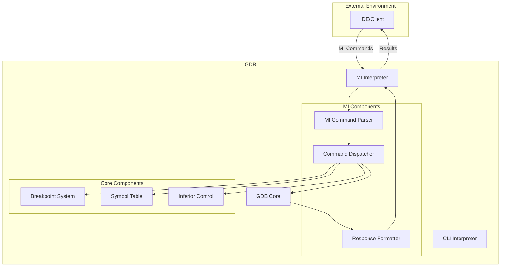
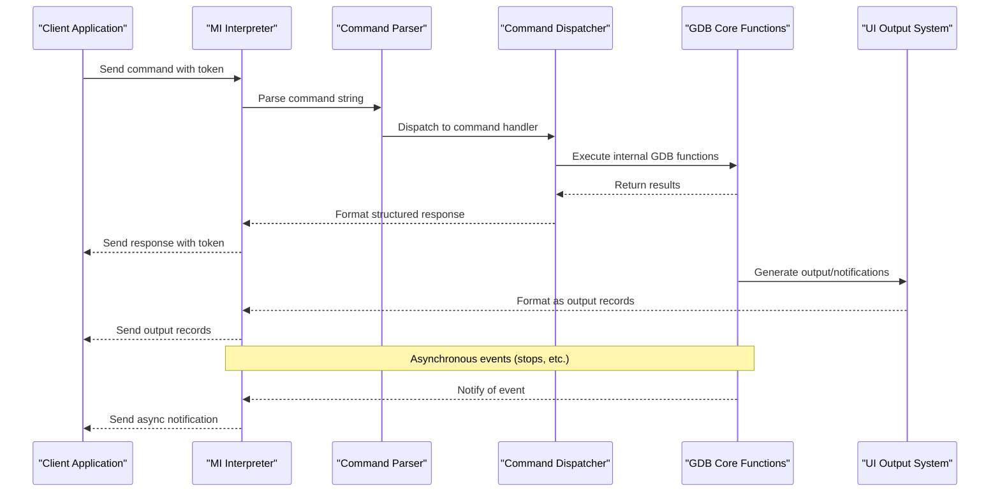
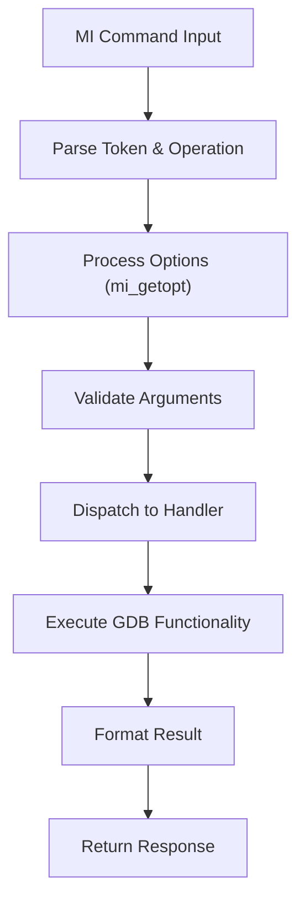

<!-- source: DeepWiki mcp.deepwiki.com · repo NVIDIA/cuda-gdb · page 2.4 Machine Interface (MI) · fetched 2026-10-26 -->

# Machine Interface (MI)

<details>
<summary>Relevant source files</summary>

The following files were used as context for generating this wiki page:

- [gdb/mi/mi-cmd-disas.c](gdb/mi/mi-cmd-disas.c)
- [gdb/mi/mi-symbol-cmds.c](gdb/mi/mi-symbol-cmds.c)
- [gdb/testsuite/gdb.ada/call-no-debug.exp](gdb/testsuite/gdb.ada/call-no-debug.exp)
- [gdb/testsuite/gdb.ada/call-no-debug/pck.adb](gdb/testsuite/gdb.ada/call-no-debug/pck.adb)
- [gdb/testsuite/gdb.ada/call-no-debug/pck.ads](gdb/testsuite/gdb.ada/call-no-debug/pck.ads)
- [gdb/testsuite/gdb.ada/call-no-debug/prog.adb](gdb/testsuite/gdb.ada/call-no-debug/prog.adb)
- [gdb/testsuite/gdb.base/hbreak-unmapped.exp](gdb/testsuite/gdb.base/hbreak-unmapped.exp)
- [gdb/testsuite/gdb.mi/mi-break-qualified.exp](gdb/testsuite/gdb.mi/mi-break-qualified.exp)
- [gdb/testsuite/gdb.mi/mi-break.exp](gdb/testsuite/gdb.mi/mi-break.exp)
- [gdb/testsuite/gdb.mi/mi-disassemble.exp](gdb/testsuite/gdb.mi/mi-disassemble.exp)
- [gdb/testsuite/gdb.mi/mi-nsmoribund.exp](gdb/testsuite/gdb.mi/mi-nsmoribund.exp)
- [gdb/testsuite/gdb.mi/mi-nsthrexec.exp](gdb/testsuite/gdb.mi/mi-nsthrexec.exp)
- [gdb/testsuite/gdb.mi/mi-pending.exp](gdb/testsuite/gdb.mi/mi-pending.exp)
- [gdb/testsuite/gdb.mi/mi-vla-c99.exp](gdb/testsuite/gdb.mi/mi-vla-c99.exp)
- [gdb/testsuite/gdb.mi/mi-vla-fortran.exp](gdb/testsuite/gdb.mi/mi-vla-fortran.exp)
- [gdb/testsuite/gdb.mi/mi-watch.exp](gdb/testsuite/gdb.mi/mi-watch.exp)
- [gdb/testsuite/gdb.testsuite/gdb-test.exp](gdb/testsuite/gdb.testsuite/gdb-test.exp)
- [gdb/testsuite/gdb.testsuite/parse_options_args.exp](gdb/testsuite/gdb.testsuite/parse_options_args.exp)
- [gdb/testsuite/lib/gdb.exp](gdb/testsuite/lib/gdb.exp)
- [gdb/testsuite/lib/mi-support.exp](gdb/testsuite/lib/mi-support.exp)

</details>


The Machine Interface (MI) is GDB's structured protocol for programmatic control, designed for integrated development environments (IDEs) and other tools to interact with GDB. Unlike GDB's command-line interface (CLI), MI provides a consistent machine-parseable output format, making it ideal for automated tools rather than direct human interaction.

## Purpose and Scope

This document describes the GDB Machine Interface architecture, command/response protocol, and key functionality areas. It covers how MI works internally, the format of commands and responses, and how to interact with GDB programmatically.

For information about using MI from client applications, see the official GDB documentation on MI.

## Architecture Overview

MI is implemented as an interpreter within GDB. When a client communicates with GDB using MI, the commands are processed through the MI subsystem which parses them, dispatches them to the appropriate internal GDB functions, and returns structured responses.



Sources: [gdb/testsuite/lib/mi-support.exp:1-100](), [gdb/mi/mi-cmd-disas.c:1-20]()

## Command Protocol

### Command Format

MI commands follow this general syntax:

```
[token-]operation [options] [arguments]
```

- **token**: An optional integer that is echoed back in the response, allowing clients to match responses to requests
- **operation**: The command name (always prefixed with a hyphen)
- **options**: Optional flags that modify the command behavior
- **arguments**: Command-specific parameters

Example command:
```
123-break-insert -t main
```

This sets a temporary breakpoint at the `main` function with token 123.

### Response Format

MI responses consist of several types of records:

1. **Result records**: Begin with `^` and indicate command completion
   - `^done`: Command succeeded
   - `^error`: Command failed
   - `^running`: Program execution started
   - `^exit`: GDB is exiting

2. **Output records**: Various types of textual output
   - `~"text"`: Console output (what would appear on CLI)
   - `@"text"`: Target output (program output)
   - `&"text"`: Log output (GDB's internal messages)

3. **Asynchronous records**: Status notifications
   - `*stopped`: Execution stopped (breakpoint hit, etc.)
   - `=thread-created`: A new thread was created
   - Other events like breakpoint creation, library loading, etc.

Example response:
```
123^done,breakpoint={number="1",type="breakpoint",disp="del",enabled="y",addr="0x08048564",func="main",file="main.c",line="68",times="0"}
```

This response indicates the command with token 123 succeeded and created a breakpoint with the specified attributes.

Sources: [gdb/testsuite/lib/mi-support.exp:677-887](), [gdb/testsuite/gdb.mi/mi-break.exp:65-95]()

## MI Command Processing Flow



Sources: [gdb/testsuite/lib/mi-support.exp:200-336](), [gdb/mi/mi-cmd-disas.c:52-100]()

## Key Command Categories

MI commands are organized into functional categories:

### Execution Control

Commands to control program execution:
- `-exec-run`: Start program execution
- `-exec-continue`: Continue program execution
- `-exec-step`: Step program by one line
- `-exec-next`: Step over function calls

Sources: [gdb/testsuite/lib/mi-support.exp:932-1007]()

### Breakpoint Management

Commands for managing breakpoints:
- `-break-insert`: Set a breakpoint
- `-break-delete`: Remove a breakpoint
- `-break-enable`/`-break-disable`: Enable/disable a breakpoint
- `-break-list`: List all breakpoints

MI breakpoints support features like conditions, ignore counts, and commands to execute when hit.

Sources: [gdb/testsuite/gdb.mi/mi-break.exp:49-95](), [gdb/testsuite/gdb.mi/mi-pending.exp:54-62]()

### Stack and Frame Manipulation

Commands for examining the call stack:
- `-stack-list-frames`: List stack frames
- `-stack-select-frame`: Select a frame
- `-stack-list-variables`: List variables in current frame

### Variable Objects

MI provides a specialized "variable object" (varobj) system for efficiently examining variables:
- `-var-create`: Create a variable object
- `-var-update`: Check if variables have changed
- `-var-delete`: Delete a variable object
- `-var-evaluate-expression`: Get a variable's value

Sources: [gdb/testsuite/gdb.mi/mi-watch.exp:61-82](), [gdb/testsuite/gdb.mi/mi-vla-c99.exp:60-73]()

### Disassembly

Commands for disassembling code:
- `-data-disassemble`: Disassemble specified functions or address ranges

Sources: [gdb/mi/mi-cmd-disas.c:52-268](), [gdb/testsuite/gdb.mi/mi-disassemble.exp:33-72]()

### Symbol Information

Commands for examining symbols:
- `-symbol-list-lines`: List all line numbers and addresses for a source file
- `-symbol-info-functions`: List all functions
- `-symbol-info-variables`: List all variables
- `-symbol-info-types`: List all types

Sources: [gdb/mi/mi-symbol-cmds.c:30-65](), [gdb/mi/mi-symbol-cmds.c:385-492]()

## MI Implementation Details

### Command Parsing

MI commands go through a three-stage process:
1. Lexical analysis: Split into token, operation, and arguments
2. Option parsing: Process command-specific options
3. Validation and execution: Verify arguments and call appropriate handlers

Many MI commands use a common option parsing infrastructure to handle flags:



Sources: [gdb/mi/mi-cmd-disas.c:92-121](), [gdb/mi/mi-symbol-cmds.c:177-240]()

### Asynchronous Operation

MI can operate in two modes:
1. **Synchronous mode**: Commands block until completion
2. **Asynchronous mode**: Commands return immediately, with results delivered later

Asynchronous mode is particularly important for long-running operations like program execution. In this mode, the client receives a `^running` response immediately, followed by an asynchronous `*stopped` notification when execution stops.

Sources: [gdb/testsuite/lib/mi-support.exp:329-336](), [gdb/testsuite/gdb.mi/mi-nsmoribund.exp:36-37]()

## Testing MI Commands

The GDB test suite includes comprehensive tests for MI functionality. These tests demonstrate proper MI usage patterns and verify the correct behavior of all MI commands.

Key testing utilities include:
- `mi_gdb_test`: Send a command and verify the response
- `mi_create_breakpoint`: Create a breakpoint and verify the result
- `mi_run_cmd`: Run the program and check the result

Sources: [gdb/testsuite/lib/mi-support.exp:678-887](), [gdb/testsuite/gdb.mi/mi-disassemble.exp:33-72]()

## Best Practices for MI Clients

When developing applications that use the MI interface:

1. **Always use tokens** for commands to match responses to requests
2. **Handle asynchronous notifications** for events like program stops
3. **Parse responses robustly**, as the exact format may evolve
4. **Use the variable object system** for efficient variable tracking
5. **Consider non-stop debugging mode** for advanced debugging scenarios

Sources: [gdb/testsuite/gdb.mi/mi-nsmoribund.exp:36-37]()

## Limitations and Considerations

- Not all GDB functionality is exposed through MI
- Some commands behave differently in MI than in CLI
- The response format is stable but may be enhanced in newer versions
- Complex operations may require sequences of MI commands

Sources: [gdb/testsuite/gdb.mi/mi-break.exp:162-167]()

## Example MI Session

A typical MI session flow:

1. Start GDB with MI enabled (`gdb -i=mi`)
2. Load a program (`-file-exec-and-symbols program`)
3. Set breakpoints (`-break-insert main`)
4. Run the program (`-exec-run`)
5. When program stops, examine stack (`-stack-list-frames`)
6. Examine variables (`-var-create`, `-var-evaluate-expression`)
7. Continue execution (`-exec-continue`)
8. Handle program exit or further stops

This pattern is demonstrated in many of the MI test cases in the GDB test suite.

Sources: [gdb/testsuite/lib/mi-support.exp:148-187](), [gdb/testsuite/gdb.mi/mi-watch.exp:100-176]()

---

