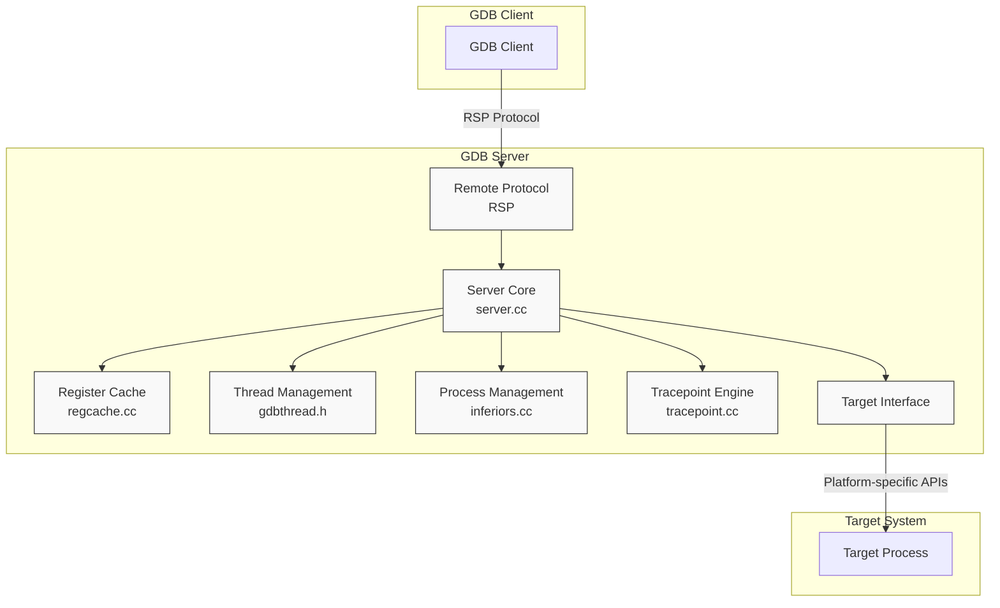
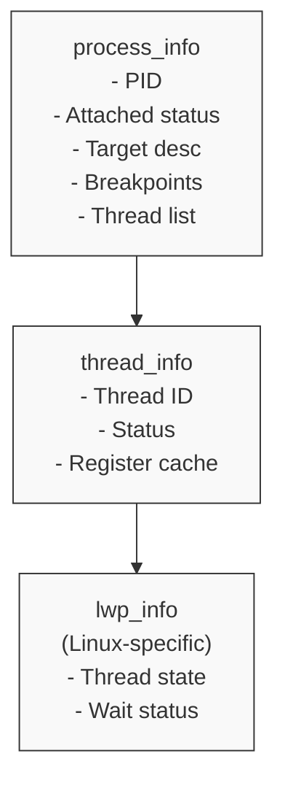
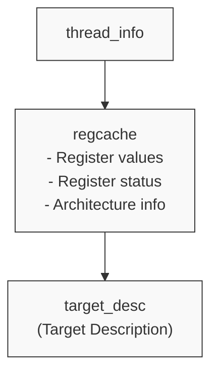
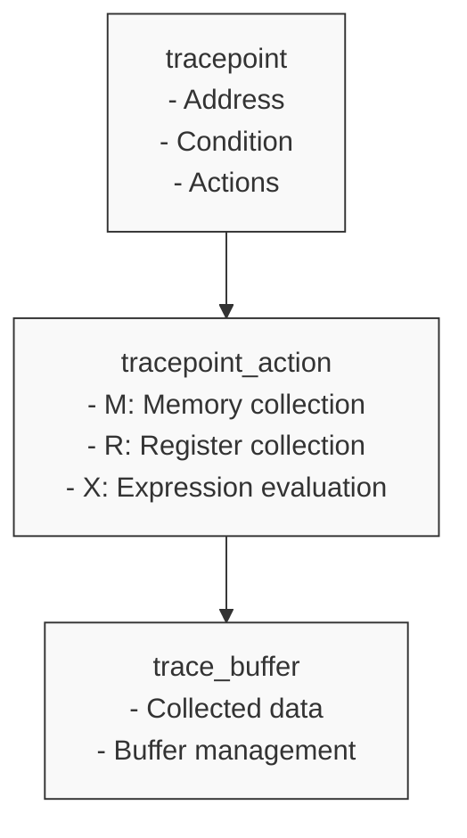
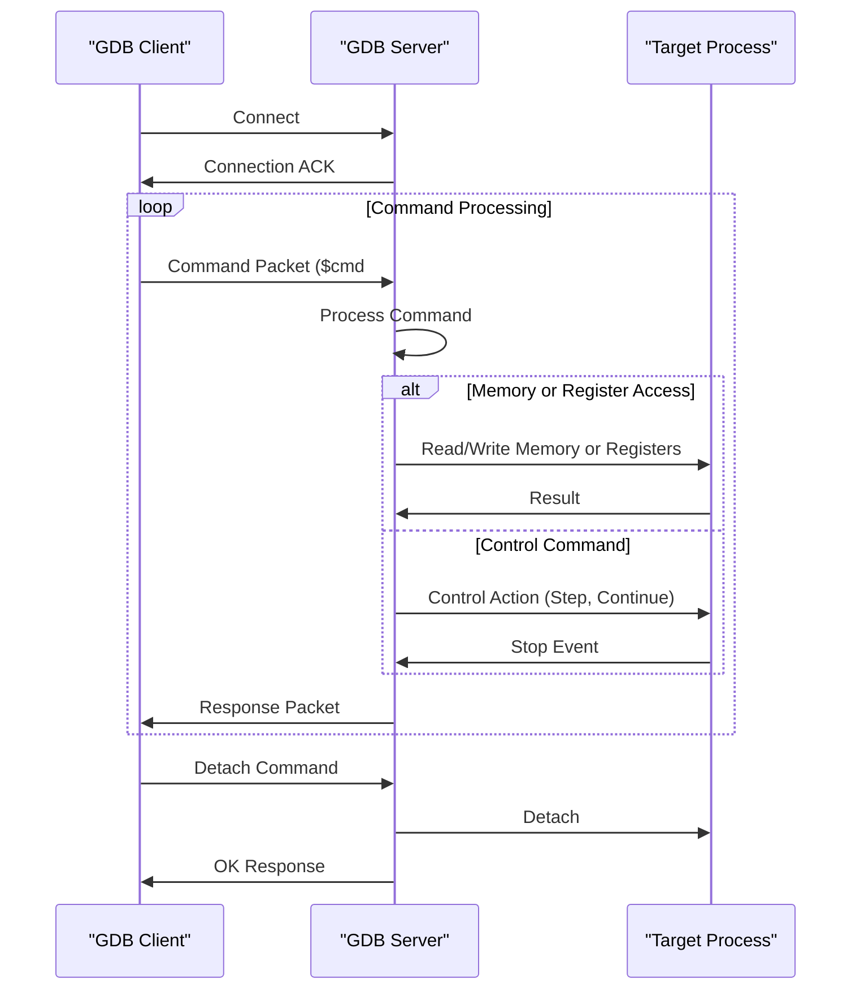

<!-- source: DeepWiki mcp.deepwiki.com · repo NVIDIA/cuda-gdb · page 2.5 GDB Server · fetched 2026-10-26 -->

# GDB Server

<details>
<summary>Relevant source files</summary>

The following files were used as context for generating this wiki page:

- [gdb/regcache-dump.c](gdb/regcache-dump.c)
- [gdb/regcache.c](gdb/regcache.c)
- [gdb/regcache.h](gdb/regcache.h)
- [gdb/testsuite/gdb.server/server-run.exp](gdb/testsuite/gdb.server/server-run.exp)
- [gdbserver/debug.cc](gdbserver/debug.cc)
- [gdbserver/debug.h](gdbserver/debug.h)
- [gdbserver/gdbthread.h](gdbserver/gdbthread.h)
- [gdbserver/inferiors.cc](gdbserver/inferiors.cc)
- [gdbserver/inferiors.h](gdbserver/inferiors.h)
- [gdbserver/linux-arm-low.cc](gdbserver/linux-arm-low.cc)
- [gdbserver/linux-low.cc](gdbserver/linux-low.cc)
- [gdbserver/linux-low.h](gdbserver/linux-low.h)
- [gdbserver/linux-mips-low.cc](gdbserver/linux-mips-low.cc)
- [gdbserver/linux-ppc-low.cc](gdbserver/linux-ppc-low.cc)
- [gdbserver/linux-s390-low.cc](gdbserver/linux-s390-low.cc)
- [gdbserver/mem-break.cc](gdbserver/mem-break.cc)
- [gdbserver/netbsd-low.cc](gdbserver/netbsd-low.cc)
- [gdbserver/netbsd-low.h](gdbserver/netbsd-low.h)
- [gdbserver/regcache.cc](gdbserver/regcache.cc)
- [gdbserver/regcache.h](gdbserver/regcache.h)
- [gdbserver/remote-utils.cc](gdbserver/remote-utils.cc)
- [gdbserver/server.cc](gdbserver/server.cc)
- [gdbserver/target.cc](gdbserver/target.cc)
- [gdbserver/target.h](gdbserver/target.h)
- [gdbserver/thread-db.cc](gdbserver/thread-db.cc)
- [gdbserver/tracepoint.cc](gdbserver/tracepoint.cc)
- [gdbserver/win32-low.cc](gdbserver/win32-low.cc)
- [gdbsupport/common-regcache.h](gdbsupport/common-regcache.h)

</details>


GDB Server is a component of the remote debugging architecture in the CUDA-GDB toolkit. It acts as an intermediary between a GDB client (debugger frontend) and a target program, allowing developers to debug applications running on a different machine or system than the one running the debugger. For information about GDB client functionality, see [GNU Debugger (GDB)](#2).

## Purpose and Functionality

GDB Server provides the following key capabilities:

- Remote debugging of applications over a network or serial connection
- Support for multiple connection types including TCP/IP and stdio
- Process control (start, stop, step)
- Memory inspection and modification
- Register access
- Breakpoint/watchpoint management
- Multi-threaded debugging support
- Tracepoint functionality for collecting execution data

Sources: [gdbserver/server.cc:1-19](), [gdbserver/tracepoint.cc:19-61]()

## Architecture Overview

GDB Server operates using a client-server architecture with the following components:



Sources: [gdbserver/server.cc](), [gdbserver/regcache.cc](), [gdbserver/gdbthread.h](), [gdbserver/inferiors.cc](), [gdbserver/tracepoint.cc]()

## Core Components

### Remote Protocol Handler

GDB Server communicates with GDB clients using the GDB Remote Serial Protocol (RSP). The protocol consists of ASCII-based packets that follow this general format:

```
$<packet-data>#<checksum>
```

The server receives commands from the client, processes them, and sends back responses. Key protocol handling functions include:

- Packet processing and validation
- Command interpretation
- Response generation
- Connection management

Common RSP packets include:
- `g` - Read registers
- `G` - Write registers
- `m` - Read memory
- `M` - Write memory  
- `c` - Continue execution
- `s` - Step instruction
- `Z` - Insert breakpoint
- `z` - Remove breakpoint

Sources: [gdbserver/server.cc:279-392](), [gdbserver/remote-utils.cc:84-127]()

### Process and Thread Management

GDB Server maintains data structures to track target processes and their threads:



Key functionality:
- Process creation with `create_inferior`
- Process attachment with `attach_inferior`
- Thread tracking and management
- Switching between threads
- State tracking for threads and processes

Sources: [gdbserver/inferiors.h:40-126](), [gdbserver/gdbthread.h:29-95](), [gdbserver/linux-low.cc:922-933]()

### Register Cache

The register cache component maintains the state of CPU registers for debugging:



Key operations:
- Fetching registers from the target with `fetch_registers`
- Storing registers to the target with `store_registers`
- Caching register values to reduce target interactions
- Tracking register status (valid, invalid, unavailable)
- Converting between raw and cooked register formats

Sources: [gdbserver/regcache.h:32-98](), [gdbserver/regcache.cc:114-153]()

### Breakpoint Handling

GDB Server supports multiple types of breakpoints:

- Software breakpoints (instruction replacement)
- Hardware breakpoints (using debug registers)
- Watchpoints (memory access breakpoints)

Breakpoint implementation varies by platform but generally involves:
1. Inserting a trap instruction or debug register configuration
2. Detecting when the breakpoint is hit
3. Stopping execution and notifying the client
4. Restoring original instructions for stepping

Sources: [gdbserver/linux-low.cc:799-919](), [gdbserver/mem-break.cc]()

### Tracepoint Subsystem

Tracepoints are similar to breakpoints but collect data without stopping execution:



Fast tracepoints use jump instructions instead of traps for better performance:
- A jump instruction is placed at the tracepoint location
- The jump redirects to a "trampoline" function
- The trampoline collects data and returns to original execution

Sources: [gdbserver/tracepoint.cc:405-437](), [gdbserver/tracepoint.cc:605-696]()

## Platform-Specific Implementations

GDB Server supports multiple platforms through target-specific implementations:

```mermaid
graph TD
    target["process_stratum_target<br>(Abstract Interface)"]
    
    linux["linux_process_target<br>linux-low.cc"]
    win32["win32_process_target<br>win32-low.cc"]
    netbsd["netbsd_process_target<br>netbsd-low.cc"]
    
    arm["arm_target<br>linux-arm-low.cc"]
    mips["mips_target<br>linux-mips-low.cc"]
    ppc["ppc_target<br>linux-ppc-low.cc"]
    s390["s390_target<br>linux-s390-low.cc"]
    
    target --> linux
    target --> win32
    target --> netbsd
    
    linux --> arm
    linux --> mips
    linux --> ppc
    linux --> s390
    
    classDef class fill:#f9f9f9,stroke:#333,stroke-width:1px;
    class target,linux,win32,netbsd,arm,mips,ppc,s390 class;
```

### Linux Implementation

The Linux implementation (`linux_process_target`) uses ptrace for process control:

- Process creation and attachment
- Memory reading/writing
- Register access
- Signal handling
- Thread enumeration and control

Key methods:
- `create_inferior` - Creates a new process
- `attach` - Attaches to an existing process
- `wait` - Waits for process events
- `fetch_registers` - Reads process registers
- `store_registers` - Writes process registers

Sources: [gdbserver/linux-low.cc:975-1011](), [gdbserver/linux-low.h:138-317]()

### Architecture-Specific Extensions

For each supported architecture (ARM, MIPS, PPC, etc.), there are extensions to handle:

- Architecture-specific registers
- Breakpoint implementations
- Single-stepping behavior
- Register format conversions
- Hardware-specific features

Sources: [gdbserver/linux-arm-low.cc:59-120](), [gdbserver/linux-mips-low.cc:28-55]()

## Operation Flow

### Server Initialization and Connection

1. GDB Server starts and initializes
2. It either creates or attaches to a target process
3. Waits for a connection from a GDB client
4. Establishes communication using the RSP protocol

Sources: [gdbserver/server.cc:3747-3770]()

### Command Processing Loop



Sources: [gdbserver/server.cc:4180-4350]()

### Remote Protocol Packet Handling

Each RSP packet is handled by specialized functions:

- `handle_*` functions for different commands
- Packet parsing and validation
- Response formatting
- Error handling

Key packet handlers include:
- Memory read/write (`handle_m`, `handle_M`)
- Register read/write (`handle_g`, `handle_G`)
- Breakpoint control (`handle_z`, `handle_Z`)
- Execution control (`handle_c`, `handle_s`)
- Extended operations (`handle_v*` functions)

Sources: [gdbserver/server.cc:4180-4350](), [gdbserver/server.cc:3190-3390]()

## Performance Considerations

### Fast Tracepoints

Fast tracepoints use jump instructions instead of breakpoint traps:
- Much lower overhead (microseconds vs milliseconds)
- Support for high-frequency tracing
- Uses in-process agent (IPA) for faster data collection

Sources: [gdbserver/tracepoint.cc:62-116]()

### Register Caching

The register cache minimizes interactions with the target:
- Registers fetched only when needed
- Status tracking for changed registers
- Batch operations when possible

Sources: [gdbserver/regcache.cc:28-61](), [gdbserver/regcache.h:28-54]()

## Configuration and Usage

GDB Server can be launched with various options:

```
gdbserver [OPTIONS] COMM PROG [ARGS...]
gdbserver [OPTIONS] --attach COMM PID
```

Where:
- `COMM` is the communication method (e.g., `localhost:2000`)
- `PROG` is the program to debug
- `PID` is the process ID to attach to
- `OPTIONS` include debug level settings and behavior flags

Common options:
- `--debug` - Enable debug output
- `--remote-debug` - Log all packets
- `--multi` - Allow multiple debugging sessions
- `--once` - Exit after a single debugging session

Sources: [gdbserver/server.cc:3747-3770]()

## Summary

GDB Server provides a bridge between GDB clients and target programs, enabling remote debugging capabilities. It implements the GDB Remote Serial Protocol (RSP) and uses platform-specific mechanisms to control and inspect target processes. The architecture supports multiple platforms and processor types while providing a unified interface to GDB clients.

Sources: [gdbserver/server.cc:1-19](), [gdbserver/regcache.cc:1-17](), [gdbserver/linux-low.cc:1-17]()

---

