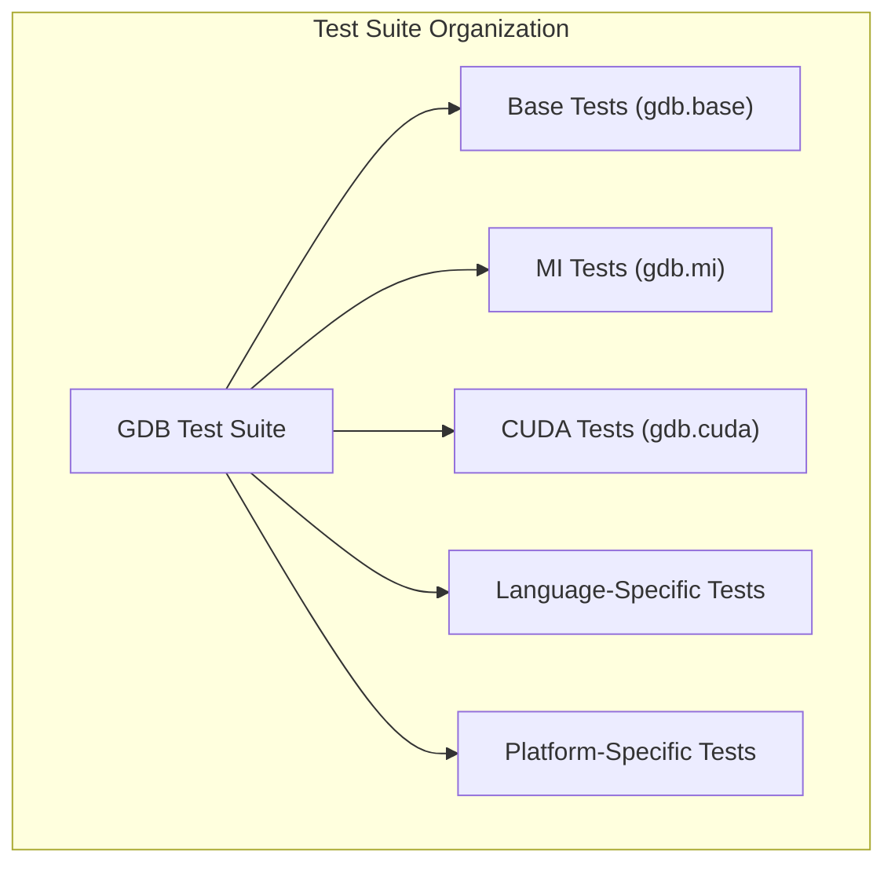
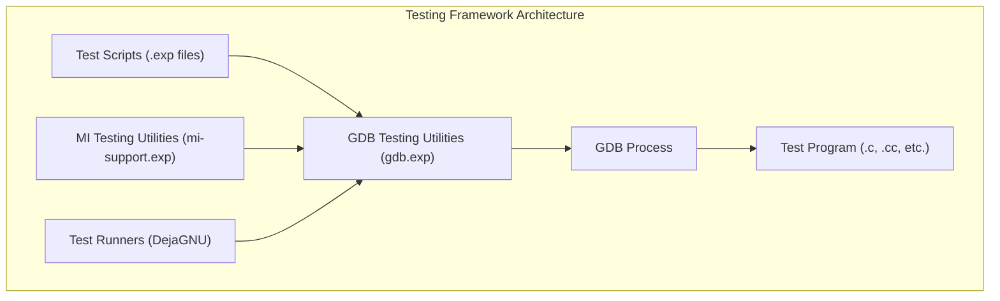
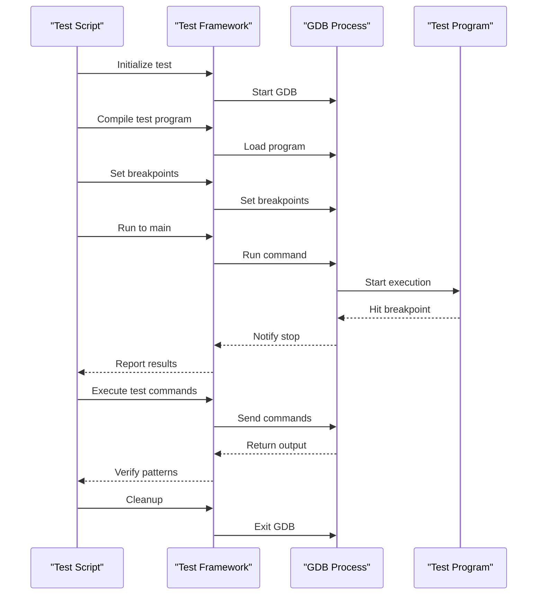
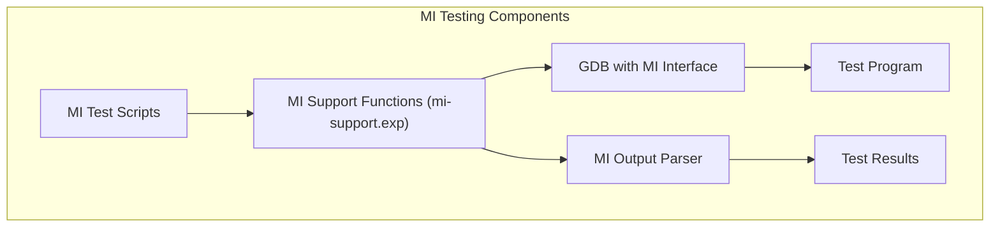
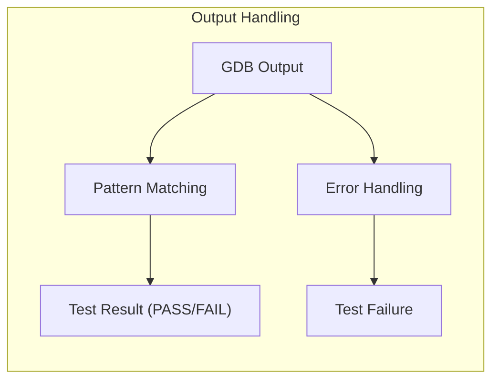

<!-- source: DeepWiki mcp.deepwiki.com · repo NVIDIA/cuda-gdb · page 2.6 Testing Framework · fetched 2026-10-26 -->

# Testing Framework

<details>
<summary>Relevant source files</summary>

The following files were used as context for generating this wiki page:

- [gdb/mi/mi-cmd-disas.c](gdb/mi/mi-cmd-disas.c)
- [gdb/mi/mi-symbol-cmds.c](gdb/mi/mi-symbol-cmds.c)
- [gdb/testsuite/gdb.ada/call-no-debug.exp](gdb/testsuite/gdb.ada/call-no-debug.exp)
- [gdb/testsuite/gdb.ada/call-no-debug/pck.adb](gdb/testsuite/gdb.ada/call-no-debug/pck.adb)
- [gdb/testsuite/gdb.ada/call-no-debug/pck.ads](gdb/testsuite/gdb.ada/call-no-debug/pck.ads)
- [gdb/testsuite/gdb.ada/call-no-debug/prog.adb](gdb/testsuite/gdb.ada/call-no-debug/prog.adb)
- [gdb/testsuite/gdb.base/hbreak-unmapped.exp](gdb/testsuite/gdb.base/hbreak-unmapped.exp)
- [gdb/testsuite/gdb.mi/mi-break-qualified.exp](gdb/testsuite/gdb.mi/mi-break-qualified.exp)
- [gdb/testsuite/gdb.mi/mi-break.exp](gdb/testsuite/gdb.mi/mi-break.exp)
- [gdb/testsuite/gdb.mi/mi-disassemble.exp](gdb/testsuite/gdb.mi/mi-disassemble.exp)
- [gdb/testsuite/gdb.mi/mi-nsmoribund.exp](gdb/testsuite/gdb.mi/mi-nsmoribund.exp)
- [gdb/testsuite/gdb.mi/mi-nsthrexec.exp](gdb/testsuite/gdb.mi/mi-nsthrexec.exp)
- [gdb/testsuite/gdb.mi/mi-pending.exp](gdb/testsuite/gdb.mi/mi-pending.exp)
- [gdb/testsuite/gdb.mi/mi-vla-c99.exp](gdb/testsuite/gdb.mi/mi-vla-c99.exp)
- [gdb/testsuite/gdb.mi/mi-vla-fortran.exp](gdb/testsuite/gdb.mi/mi-vla-fortran.exp)
- [gdb/testsuite/gdb.mi/mi-watch.exp](gdb/testsuite/gdb.mi/mi-watch.exp)
- [gdb/testsuite/gdb.testsuite/gdb-test.exp](gdb/testsuite/gdb.testsuite/gdb-test.exp)
- [gdb/testsuite/gdb.testsuite/parse_options_args.exp](gdb/testsuite/gdb.testsuite/parse_options_args.exp)
- [gdb/testsuite/lib/gdb.exp](gdb/testsuite/lib/gdb.exp)
- [gdb/testsuite/lib/mi-support.exp](gdb/testsuite/lib/mi-support.exp)

</details>


This page describes the testing framework used by CUDA-GDB, which is based on the GDB test suite. The testing framework allows developers to write and run automated tests to verify the correctness of CUDA-GDB functionality. It provides various utilities for controlling GDB, setting up test environments, and verifying expected behaviors.

## Overview

GDB's testing framework is built on top of DejaGNU, which provides a standardized way to write and execute regression tests. The framework includes a rich set of utility functions to interact with GDB, set breakpoints, execute commands, and verify the output.

The tests are organized into directories by domain:
- `gdb.base`: Basic GDB functionality tests
- `gdb.mi`: Tests for the Machine Interface (MI)
- `gdb.cuda`: CUDA-specific tests
- And others for specific language support (Ada, C++, etc.)



Sources: [gdb/testsuite/lib/gdb.exp:1-27]()

## Architecture

The GDB testing framework consists of several key components:



Each test file (`.exp`) typically performs the following steps:
1. Set up the environment
2. Compile the test program
3. Start GDB with appropriate flags
4. Run tests using utility functions
5. Clean up

Sources: [gdb/testsuite/lib/gdb.exp:338-470](), [gdb/testsuite/lib/mi-support.exp:196-336]()

## Core Testing Utilities

The framework provides a comprehensive set of utility functions for interacting with GDB:

| Function | Purpose |
|----------|---------|
| `gdb_test` | Executes a command and verifies the output matches a pattern |
| `gdb_test_multiple` | Executes a command with multiple possible output patterns |
| `runto` | Sets a breakpoint and runs until it's hit |
| `delete_breakpoints` | Removes all breakpoints |
| `gdb_breakpoint` | Sets a breakpoint at a specified location |
| `gdb_continue_to_breakpoint` | Continues execution until a breakpoint is hit |

Sources: [gdb/testsuite/lib/gdb.exp:671-744](), [gdb/testsuite/lib/gdb.exp:746-852](), [gdb/testsuite/lib/gdb.exp:399-437]()

### Test Execution Flow



Sources: [gdb/testsuite/lib/gdb.exp:472-586](), [gdb/testsuite/lib/mi-support.exp:49-109]()

## Writing Tests

Tests are written as Tcl scripts with the `.exp` extension. A typical test file follows this structure:

1. Load required libraries
2. Define the test file and compile it
3. Start GDB with the test binary
4. Execute test cases
5. Verify results
6. Clean up resources

Example of a basic test file structure:

```
# Load the common test utilities
load_lib gdb.exp

# Define the test source file
standard_testfile example.c

# Compile the test program
if {[gdb_compile "${srcdir}/${subdir}/${srcfile}" "${binfile}" executable debug] != ""} {
    untested "failed to compile"
    return -1
}

# Start GDB and load the binary
clean_restart ${binfile}

# Run to main
if ![runto_main] {
    return -1
}

# Execute tests
gdb_test "print 1+1" "= 2" "basic addition test"

# Clean up
gdb_exit
```

Sources: [gdb/testsuite/gdb.ada/call-no-debug.exp:16-45](), [gdb/testsuite/gdb.mi/mi-break.exp:22-65]()

## Machine Interface (MI) Testing

The framework provides special support for testing GDB's Machine Interface (MI), which is a structured interface for tools like IDEs to interact with GDB.



MI tests use specialized functions to interact with the MI interface:

| Function | Purpose |
|----------|---------|
| `mi_gdb_test` | Sends a command and verifies the MI output |
| `mi_create_breakpoint` | Creates a breakpoint and verifies the MI output |
| `mi_run_cmd` | Runs the program and handles MI notifications |
| `mi_expect_stop` | Waits for the program to stop and verifies the reason |

Sources: [gdb/testsuite/lib/mi-support.exp:677-887](), [gdb/testsuite/lib/mi-support.exp:919-1007](), [gdb/testsuite/gdb.mi/mi-break.exp:48-65]()

## Specialized Tests

### Hardware Breakpoint Tests

For testing hardware breakpoints, the framework provides specialized functions:

```
require allow_hw_watchpoint_tests
```

This checks if the target supports hardware watchpoints before running the tests.

Sources: [gdb/testsuite/gdb.base/hbreak-unmapped.exp:16-56](), [gdb/testsuite/gdb.mi/mi-watch.exp:29-146]()

### Multi-threaded Program Tests

Tests for multi-threaded programs often use specific patterns to verify thread behavior:

```
mi_check_thread_states {"running" "stopped"} "thread state check"
```

Sources: [gdb/testsuite/gdb.mi/mi-nsmoribund.exp:57-65](), [gdb/testsuite/gdb.mi/mi-nsthrexec.exp:60-65]()

## Running Tests

The DejaGNU framework provides a standardized way to run tests. Tests can be run individually or as groups:

```
make check RUNTESTFLAGS="gdb.mi/mi-break.exp"  # Run a specific test
make check                                      # Run all tests
```

Test results are categorized as:
- PASS: Test succeeded
- FAIL: Test failed
- XFAIL: Expected failure
- KFAIL: Known failure
- UNSUPPORTED: Test not supported on this platform

Sources: [gdb/testsuite/lib/gdb.exp:220-230]()

## Extending the Framework

Custom test utilities can be added to the framework by creating new Tcl procedures. These can be added to existing library files or new library files that are then loaded by tests:

```
load_lib mi-support.exp
load_lib fortran.exp
```

Sources: [gdb/testsuite/gdb.mi/mi-vla-fortran.exp:19-24](), [gdb/testsuite/lib/gdb.exp:155-159]()

## Handling Test Output

The framework provides utilities for handling various types of output from GDB:



The `gdb_test` function handles most of the output parsing and pattern matching:

Sources: [gdb/testsuite/lib/gdb.exp:1116-1169](), [gdb/testsuite/lib/mi-support.exp:677-887]()

## Summary

The GDB/CUDA-GDB testing framework provides a comprehensive environment for testing debugger functionality. It supports both traditional command-line interface tests and structured Machine Interface tests. The framework includes utilities for all aspects of testing, from setting up environments to verifying complex behavior patterns.

Understanding this testing framework is essential for developing robust features in CUDA-GDB and ensuring that changes don't break existing functionality.

---

