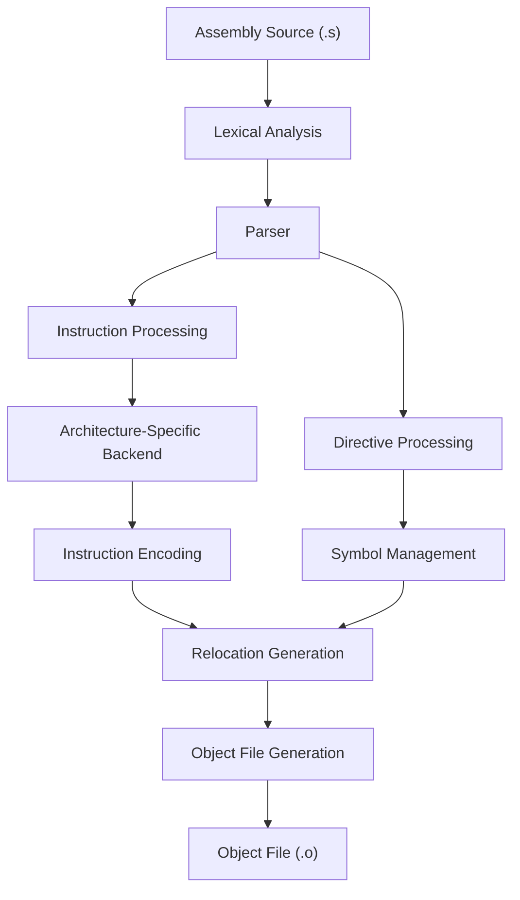
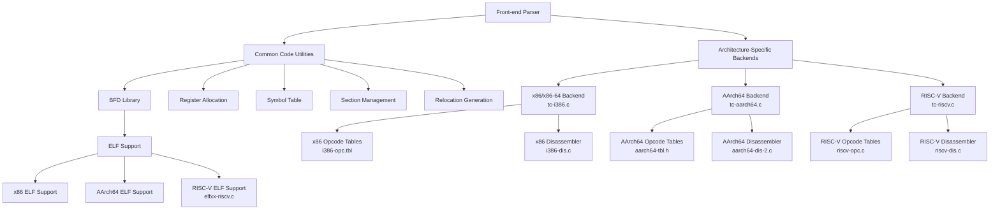
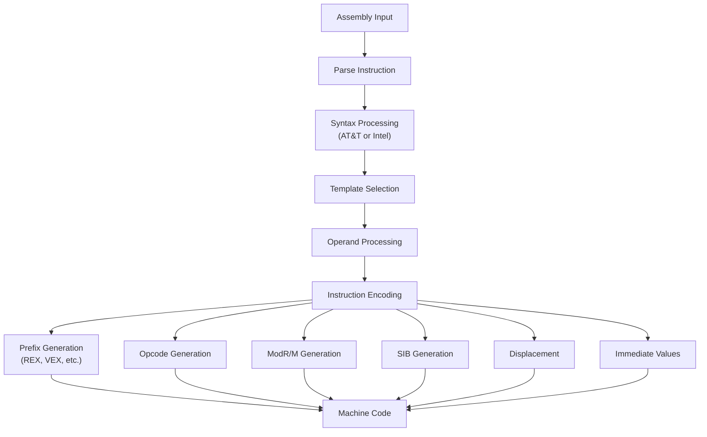
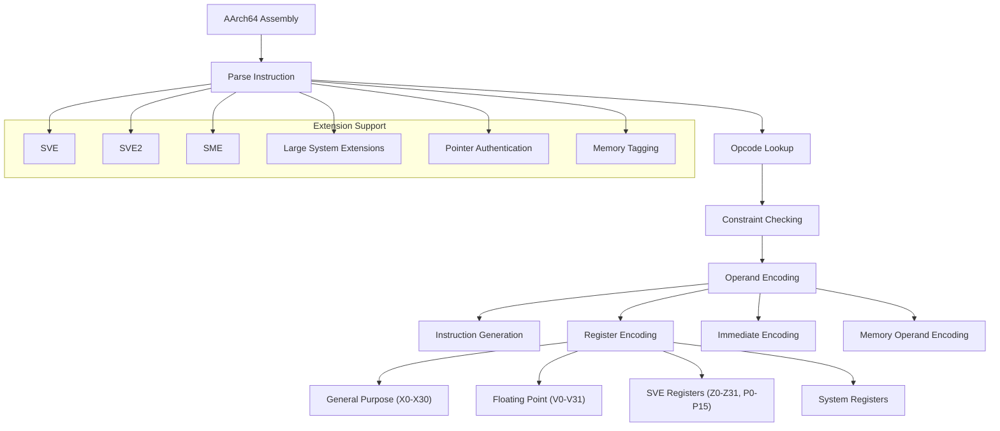
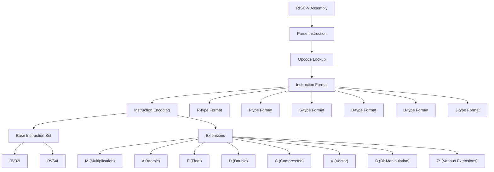
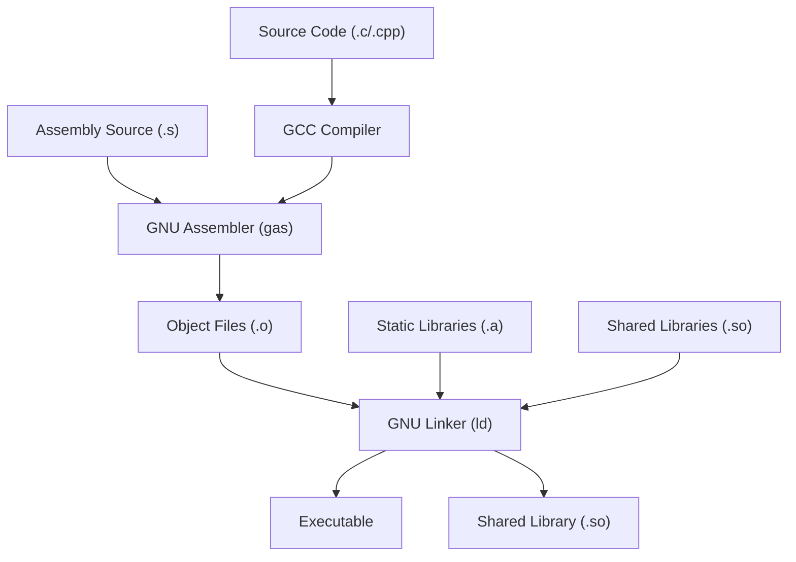

<!-- source: DeepWiki mcp.deepwiki.com · repo NVIDIA/cuda-gdb · page 3 GNU Assembler (GAS) · fetched 2026-10-26 -->

# GNU Assembler (GAS)

<details>
<summary>Relevant source files</summary>

The following files were used as context for generating this wiki page:

- [bfd/cpu-riscv.c](bfd/cpu-riscv.c)
- [bfd/elfxx-riscv.c](bfd/elfxx-riscv.c)
- [gas/NEWS](gas/NEWS)
- [gas/config/tc-aarch64.c](gas/config/tc-aarch64.c)
- [gas/config/tc-i386.c](gas/config/tc-i386.c)
- [gas/config/tc-riscv.c](gas/config/tc-riscv.c)
- [gas/doc/c-aarch64.texi](gas/doc/c-aarch64.texi)
- [gas/doc/c-i386.texi](gas/doc/c-i386.texi)
- [gas/doc/c-riscv.texi](gas/doc/c-riscv.texi)
- [gas/testsuite/gas/elf/dwarf2-6.d](gas/testsuite/gas/elf/dwarf2-6.d)
- [gas/testsuite/gas/i386/i386.exp](gas/testsuite/gas/i386/i386.exp)
- [gas/testsuite/gas/i386/x86-64.exp](gas/testsuite/gas/i386/x86-64.exp)
- [gas/testsuite/gas/riscv/csr-version-1p10.d](gas/testsuite/gas/riscv/csr-version-1p10.d)
- [gas/testsuite/gas/riscv/csr-version-1p10.l](gas/testsuite/gas/riscv/csr-version-1p10.l)
- [gas/testsuite/gas/riscv/csr-version-1p11.d](gas/testsuite/gas/riscv/csr-version-1p11.d)
- [gas/testsuite/gas/riscv/csr-version-1p11.l](gas/testsuite/gas/riscv/csr-version-1p11.l)
- [gas/testsuite/gas/riscv/csr-version-1p12.d](gas/testsuite/gas/riscv/csr-version-1p12.d)
- [gas/testsuite/gas/riscv/csr-version-1p12.l](gas/testsuite/gas/riscv/csr-version-1p12.l)
- [gas/testsuite/gas/riscv/csr.s](gas/testsuite/gas/riscv/csr.s)
- [gas/testsuite/gas/riscv/imply.d](gas/testsuite/gas/riscv/imply.d)
- [gas/testsuite/gas/riscv/imply.s](gas/testsuite/gas/riscv/imply.s)
- [gas/testsuite/gas/riscv/march-help.l](gas/testsuite/gas/riscv/march-help.l)
- [gas/testsuite/gas/riscv/sifive-insns.d](gas/testsuite/gas/riscv/sifive-insns.d)
- [gas/testsuite/gas/riscv/sifive-insns.s](gas/testsuite/gas/riscv/sifive-insns.s)
- [gas/testsuite/gas/riscv/x-thead-vector-fail.d](gas/testsuite/gas/riscv/x-thead-vector-fail.d)
- [gas/testsuite/gas/riscv/x-thead-vector-fail.l](gas/testsuite/gas/riscv/x-thead-vector-fail.l)
- [gas/testsuite/gas/riscv/x-thead-vector.d](gas/testsuite/gas/riscv/x-thead-vector.d)
- [gas/testsuite/gas/riscv/x-thead-vector.s](gas/testsuite/gas/riscv/x-thead-vector.s)
- [include/opcode/aarch64.h](include/opcode/aarch64.h)
- [include/opcode/riscv-opc.h](include/opcode/riscv-opc.h)
- [include/opcode/riscv.h](include/opcode/riscv.h)
- [opcodes/aarch64-asm-2.c](opcodes/aarch64-asm-2.c)
- [opcodes/aarch64-asm.c](opcodes/aarch64-asm.c)
- [opcodes/aarch64-asm.h](opcodes/aarch64-asm.h)
- [opcodes/aarch64-dis-2.c](opcodes/aarch64-dis-2.c)
- [opcodes/aarch64-dis.c](opcodes/aarch64-dis.c)
- [opcodes/aarch64-dis.h](opcodes/aarch64-dis.h)
- [opcodes/aarch64-opc-2.c](opcodes/aarch64-opc-2.c)
- [opcodes/aarch64-opc.c](opcodes/aarch64-opc.c)
- [opcodes/aarch64-opc.h](opcodes/aarch64-opc.h)
- [opcodes/aarch64-tbl.h](opcodes/aarch64-tbl.h)
- [opcodes/i386-dis.c](opcodes/i386-dis.c)
- [opcodes/i386-gen.c](opcodes/i386-gen.c)
- [opcodes/i386-init.h](opcodes/i386-init.h)
- [opcodes/i386-mnem.h](opcodes/i386-mnem.h)
- [opcodes/i386-opc.h](opcodes/i386-opc.h)
- [opcodes/i386-opc.tbl](opcodes/i386-opc.tbl)
- [opcodes/i386-tbl.h](opcodes/i386-tbl.h)
- [opcodes/riscv-dis.c](opcodes/riscv-dis.c)
- [opcodes/riscv-opc.c](opcodes/riscv-opc.c)

</details>


The GNU Assembler (GAS) is a key component of the GNU Binutils toolchain that translates assembly language source code into machine code object files. This document provides an overview of GAS architecture, components, and how it processes assembly code across different CPU architectures, primarily focusing on x86/x86-64, AArch64, and RISC-V.

## Architecture Overview

GAS provides a modular architecture that supports multiple target processors through a common front-end and architecture-specific backends. The assembler processes assembly source files through multiple stages, including lexical analysis, parsing, instruction encoding, and object file generation.



Sources: [gas/config/tc-i386.c:28-47](). [opcodes/i386-opc.tbl:1-20]().

## Core Components

### Front-End Processing

The front-end of GAS handles the common aspects of assembly processing regardless of the target architecture, including:

1. **Lexical Analysis**: Tokenizing assembly source code
2. **Parsing**: Interpreting assembly statements and directives
3. **Symbol Table Management**: Tracking labels and symbol definitions
4. **Directive Processing**: Handling assembly directives like `.global`, `.section`, etc.

### Backend Architecture

GAS implements architecture-specific support through separate backend modules:



Sources: [gas/config/tc-i386.c:28-68](). [gas/config/tc-aarch64.c:1-40](). [gas/config/tc-riscv.c:1-50](). [bfd/elfxx-riscv.c:1-45]().

## Instruction Processing

GAS processes assembly instructions through the following steps:

1. **Mnemonic Matching**: Identifying the instruction name
2. **Operand Parsing**: Interpreting instruction operands
3. **Template Selection**: Finding the correct instruction template
4. **Encoding**: Converting the instruction to machine code
5. **Relocation Generation**: Creating relocation entries for external references

### Instruction Templates

Each architecture defines instruction templates that specify the opcode, operands, encoding format, and CPU requirements for each instruction:

#### x86/x86-64 Example (simplified):

```
mov, 0xa0, No64, D|W|CheckOperandSize|No_sSuf|No_qSuf, { Disp16|Disp32|Unspecified|Byte|Word|Dword, Acc|Byte|Word|Dword }
```

This template entry specifies the `mov` instruction with opcode `0xa0` that is not available in 64-bit mode, with operand validation and suffix restrictions.

Sources: [opcodes/i386-opc.tbl:185-206](). [opcodes/i386-tbl.h:25-85]().

## Architecture-Specific Backends

### x86/x86-64 Backend

The x86/x86-64 backend is one of the most complex due to the architecture's long history and numerous extensions:

- **Instruction Formats**: ModR/M, SIB, numerous prefix bytes
- **Addressing Modes**: Register indirect, displacement, scaled index
- **Syntax Support**: Both AT&T (default) and Intel syntax
- **Extension Support**: MMX, SSE, AVX, AVX-512, AMX, MPX, and more

The backend handles various x86-specific complexities including:
- REX prefixes for 64-bit register access
- VEX/EVEX/MVEX encoding for vector instructions
- Segment override prefixes
- Complex addressing modes with base+index+scale+displacement



Sources: [gas/config/tc-i386.c:60-150](). [gas/config/tc-i386.c:285-470]().

### AArch64 Backend

The AArch64 backend supports the ARM 64-bit architecture:

- **Instruction Format**: Fixed 32-bit width instructions
- **Operand Types**: Registers, immediates, memory operands
- **Register Sets**: General-purpose, NEON/FP, SVE, and system registers
- **Extensions**: SVE, SME, pointer authentication, memory tagging

The backend includes support for various ARM architecture versions and extensions:



Sources: [gas/config/tc-aarch64.c:35-100](). [include/opcode/aarch64.h:22-80](). [opcodes/aarch64-tbl.h:20-100]().

### RISC-V Backend

The RISC-V backend supports the open RISC-V ISA:

- **Instruction Formats**: R, I, S, B, U, J-type instructions
- **Base ISA Support**: RV32I, RV64I
- **Extension Support**: M, A, F, D, C, V, and various others
- **ABI Support**: ILP32, LP64



Sources: [gas/config/tc-riscv.c:22-60](). [opcodes/riscv-opc.c:1-35](). [include/opcode/riscv.h:1-20](). [include/opcode/riscv-opc.h:1-40]().

## Object File Generation

The final stage of assembly involves generating object files:

1. **Section Organization**: Placing machine code and data in appropriate sections
2. **Symbol Table Generation**: Creating symbol table entries
3. **Relocation Table Generation**: Recording locations that need fixups during linking
4. **ELF Header Generation**: Creating the ELF file header and section headers

The object file format used by GAS is primarily ELF (Executable and Linkable Format), though other formats can be supported depending on the target.

## Integration with GNU Toolchain

GAS works as part of the larger GNU toolchain:



Sources: [bfd/elfxx-riscv.c:45-100]().

## Command-Line Interface

GAS provides various command-line options for controlling assembly:

- **Architecture Selection**: `-march=<arch>` specifies the target architecture
- **Output Format Control**: `-o <file>` specifies the output file
- **Listing Control**: `-a[cdhlns]` controls assembly listings
- **Debug Information**: `--gdwarf-<version>` enables DWARF debug info
- **Architecture-specific options**: Various options specific to each target

## Syntax Differences

GAS traditionally uses AT&T syntax for x86 assembly, which differs from Intel syntax:

| Feature | AT&T Syntax | Intel Syntax |
|---------|-------------|--------------|
| Register naming | `%eax` | `eax` |
| Operand order | `movl $1, %eax` (src, dest) | `mov eax, 1` (dest, src) |
| Immediate values | `$1234` | `1234` |
| Memory references | `disp(%base,%index,scale)` | `[base + index*scale + disp]` |
| Instruction suffixes | `movl`, `movw`, `movb` | `mov` (size inferred) |

Sources: [gas/config/tc-i386.c:673-700](). [gas/doc/c-i386.texi:1-50]().

## Architecture Extensions

Each backend supports CPU-specific extensions through feature flags and instruction templates:

### x86/x86-64 Extensions
- SSE, SSE2, SSE3, SSSE3, SSE4.1, SSE4.2
- AVX, AVX2, AVX-512
- BMI, BMI2
- FMA, AES, SHA
- MPX, SGX, CET
- APX

### AArch64 Extensions
- SVE, SVE2
- SME
- MTE (Memory Tagging)
- BTI (Branch Target Identification)
- TM (Transactional Memory)
- FEAT_LPA (Large Physical Addressing)

### RISC-V Extensions
- M (Integer Multiplication and Division)
- A (Atomic Operations)
- F (Single-Precision Floating-Point)
- D (Double-Precision Floating-Point)
- C (Compressed Instructions)
- V (Vector Operations)
- B (Bit Manipulation)
- Zicsr, Zifencei, and other Z-extensions

Sources: [gas/config/tc-i386.c:1036-1175](). [gas/doc/c-aarch64.texi:1-40](). [gas/doc/c-riscv.texi:1-30]().

## Documentation and Resources

GAS documentation is available through:
- `man as` - Man page
- `info as` - Info documentation
- Architecture-specific documentation in the gas/doc directory:
  - `c-i386.texi` - x86/x86-64 assembly documentation
  - `c-aarch64.texi` - AArch64 assembly documentation
  - `c-riscv.texi` - RISC-V assembly documentation

Sources: [gas/doc/c-i386.texi:1-50](). [gas/doc/c-aarch64.texi:1-30](). [gas/doc/c-riscv.texi:1-20]().

## Recent Changes

Recent enhancements to GAS include:
- Support for x86 Intel Diamond Rapids AMX instructions
- Intel AVX10.2 instructions
- Support for RISC-V extensions like Zicfiss, Zicfilp, Zcmp, and Zcmt
- Enhanced AArch64 SME and SVE support
- x86 APX (Advanced Performance Extensions) support including CCMP and CTEST features

Sources: [gas/NEWS:1-50]().

---

