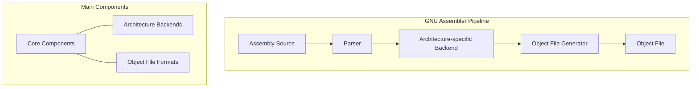
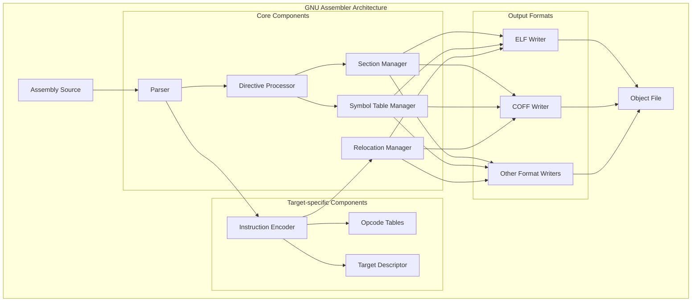
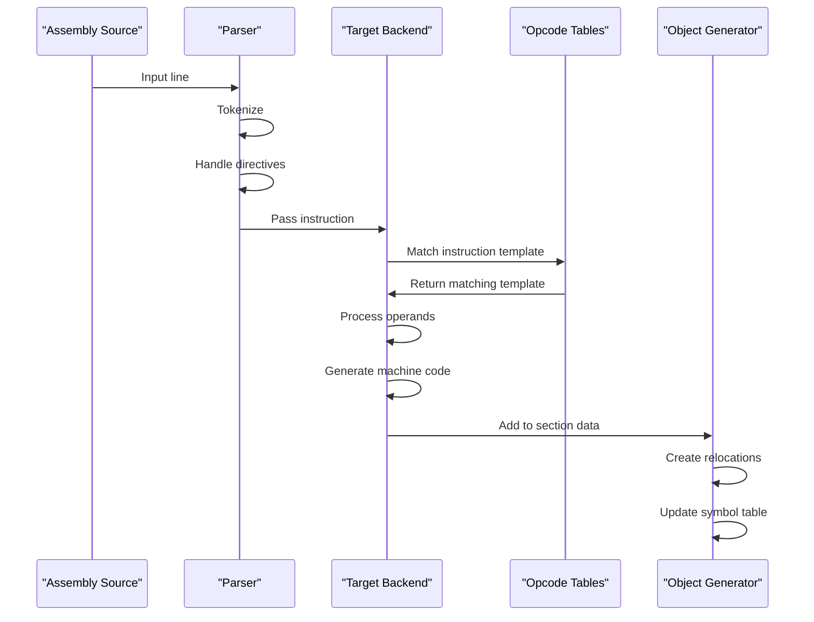
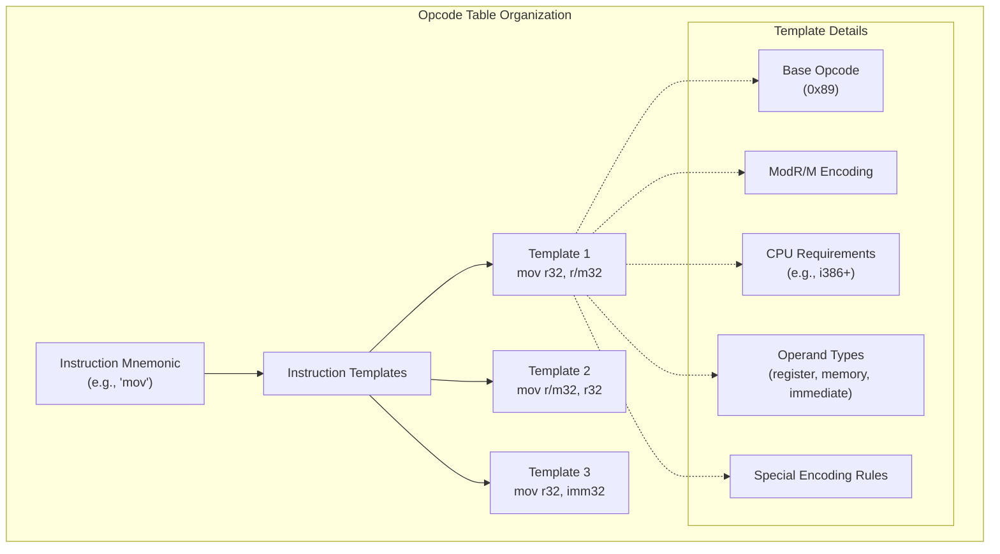
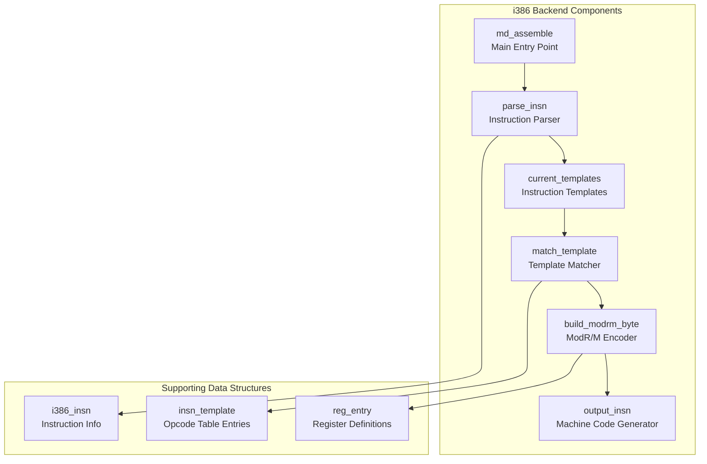
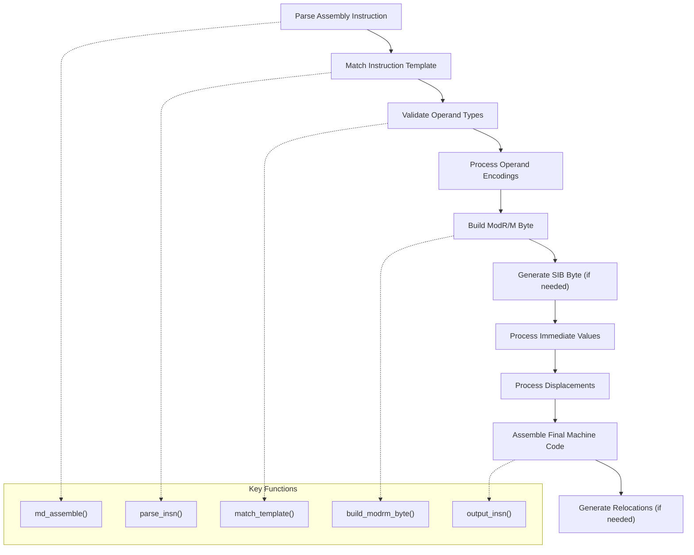
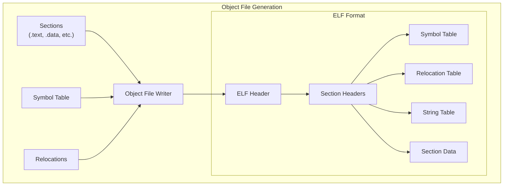
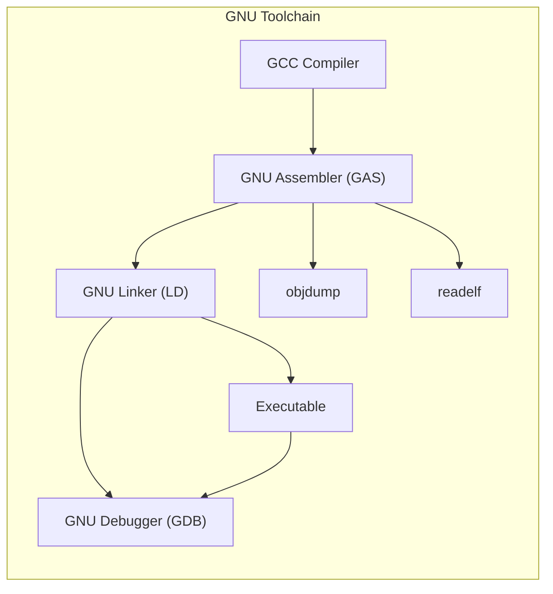

<!-- source: DeepWiki mcp.deepwiki.com · repo NVIDIA/cuda-gdb · page 3.1 Architecture Overview · fetched 2026-10-26 -->

# Architecture Overview

Relevant source files

The following files were used as context for generating this wiki page:

- [ChangeLog](ChangeLog)
- [bfd/ChangeLog](bfd/ChangeLog)
- [bfd/doc/chew.c](bfd/doc/chew.c)
- [bfd/doc/doc.str](bfd/doc/doc.str)
- [bfd/doc/proto.str](bfd/doc/proto.str)
- [binutils/ChangeLog](binutils/ChangeLog)
- [binutils/NEWS](binutils/NEWS)
- [binutils/dwarf.c](binutils/dwarf.c)
- [binutils/dwarf.h](binutils/dwarf.h)
- [binutils/elfcomm.c](binutils/elfcomm.c)
- [binutils/elfcomm.h](binutils/elfcomm.h)
- [binutils/readelf.c](binutils/readelf.c)
- [binutils/testsuite/binutils-all/display-section-0.r](binutils/testsuite/binutils-all/display-section-0.r)
- [binutils/testsuite/binutils-all/display-section-rel.r](binutils/testsuite/binutils-all/display-section-rel.r)
- [binutils/testsuite/binutils-all/dw5.W](binutils/testsuite/binutils-all/dw5.W)
- [binutils/testsuite/binutils-all/objdump.WL](binutils/testsuite/binutils-all/objdump.WL)
- [binutils/testsuite/binutils-all/pr26160.r](binutils/testsuite/binutils-all/pr26160.r)
- [binutils/testsuite/binutils-all/readelf-debug-str-offsets-dw4.d](binutils/testsuite/binutils-all/readelf-debug-str-offsets-dw4.d)
- [binutils/testsuite/binutils-all/readelf-debug-str-offsets-dw4.s](binutils/testsuite/binutils-all/readelf-debug-str-offsets-dw4.s)
- [binutils/testsuite/binutils-all/readelf.exp](binutils/testsuite/binutils-all/readelf.exp)
- [binutils/testsuite/binutils-all/relr.s](binutils/testsuite/binutils-all/relr.s)
- [cpu/ChangeLog](cpu/ChangeLog)
- [elfcpp/ChangeLog](elfcpp/ChangeLog)
- [gas/ChangeLog](gas/ChangeLog)
- [gas/NEWS](gas/NEWS)
- [gas/config/tc-i386.c](gas/config/tc-i386.c)
- [gas/doc/c-bpf.texi](gas/doc/c-bpf.texi)
- [gas/doc/c-i386.texi](gas/doc/c-i386.texi)
- [gas/testsuite/gas/i386/i386.exp](gas/testsuite/gas/i386/i386.exp)
- [gas/testsuite/gas/i386/x86-64.exp](gas/testsuite/gas/i386/x86-64.exp)
- [gold/ChangeLog](gold/ChangeLog)
- [gprof/ChangeLog](gprof/ChangeLog)
- [include/ChangeLog](include/ChangeLog)
- [include/elf/common.h](include/elf/common.h)
- [include/opcode/bpf.h](include/opcode/bpf.h)
- [opcodes/ChangeLog](opcodes/ChangeLog)
- [opcodes/bpf-opc.c](opcodes/bpf-opc.c)
- [opcodes/i386-dis.c](opcodes/i386-dis.c)
- [opcodes/i386-gen.c](opcodes/i386-gen.c)
- [opcodes/i386-init.h](opcodes/i386-init.h)
- [opcodes/i386-mnem.h](opcodes/i386-mnem.h)
- [opcodes/i386-opc.h](opcodes/i386-opc.h)
- [opcodes/i386-opc.tbl](opcodes/i386-opc.tbl)
- [opcodes/i386-tbl.h](opcodes/i386-tbl.h)

This page describes the high-level architecture of the GNU Assembler (GAS), focusing on its main components, processing flow, and internal organization. The GNU Assembler is a key component in the GNU toolchain that translates assembly language source code into machine code object files for various processor architectures.

## Purpose and Components

The GNU Assembler provides a unified framework for assembly across different architectures while allowing architecture-specific customization. Understanding its architecture is essential for working with the debugger system, as GAS produces the object files that contain debugging information.

Sources:
- [gas/config/tc-i386.c:21-27]()
- [gas/NEWS:1-6]()

## Core Architecture

GAS follows a modular architecture with clear separation between generic assembly handling and architecture-specific code. This design allows it to support many target architectures while maintaining a consistent interface.

Sources:
- [gas/config/tc-i386.c:28-56]()
- [opcodes/i386-gen.c:30-45]()

## Instruction Processing

The core of GAS is its instruction processing system. Assembly instructions go through multiple phases:

1. **Parsing**: The source is tokenized and converted to an internal representation
2. **Template Matching**: Finding the appropriate instruction template in the opcode table
3. **Operand Processing**: Validating and encoding instruction operands
4. **Encoding**: Converting to machine code based on architecture rules
5. **Relocation**: Creating relocation entries for addresses to be resolved by the linker

Sources:
- [gas/config/tc-i386.c:132-202]()
- [gas/config/tc-i386.c:304-486]()

## Opcode Tables

The opcode tables are critical data structures that define the mapping between assembly mnemonics and their machine code representations. For x86, these tables are defined in `i386-opc.tbl` and processed into C structures by the `i386-gen.c` code generator.

### Table Structure

Each instruction in the opcode table typically contains:

| Component | Description |
|-----------|-------------|
| Mnemonic | Assembly instruction name (e.g., `mov`, `add`) |
| Opcode | Base machine code byte(s) |
| CPU Requirements | Processor features needed for this instruction |
| Operand Types | Valid types for each operand (registers, immediates, memory) |
| Encoding Flags | Special encoding rules for the instruction |

Sources:
- [opcodes/i386-opc.tbl:185-520]()
- [opcodes/i386-tbl.h:20-100]()

## Architecture-Specific Backend

The architecture-specific part of GAS handles the unique aspects of each processor architecture. For x86, this is implemented in `tc-i386.c`.

### i386 Backend Components

The i386 backend architecture revolves around these key data structures:

1. **i386_insn**: Represents a parsed instruction with all its components
2. **insn_template**: Defines the encoding rules for each instruction variant
3. **reg_entry**: Contains information about registers (name, size, encoding)

The backend contains specialized handling for:
- Vector instructions (SSE, AVX)
- Addressing modes
- Operand size determination
- Instruction prefixes
- REX prefix generation (for x86-64)
- Optimizations for shorter encodings

Sources:
- [gas/config/tc-i386.c:304-486]()
- [gas/config/tc-i386.c:132-202]()

## Instruction Encoding Process

The instruction encoding process in GAS for x86 architectures follows these steps:

Sources:
- [gas/config/tc-i386.c:148-202]()
- [gas/config/tc-i386.c:1035-1128]()

## Opcode Tables and Instruction Template Matching

The heart of the instruction encoding system is the opcode table, which maps assembly mnemonics to their machine code representations. The tables are generated from `i386-opc.tbl` and processed into C structures.

### Instruction Template Structure

Each instruction template in the opcode table contains:

| Field | Description |
|-------|-------------|
| Mnemonic | Instruction name (index into string table) |
| Opcode | Base opcode byte(s) |
| Extension | Opcode extension (for ModR/M.reg or /digit) |
| Operand Count | Number of operands |
| CPU Requirements | Processor features needed for the instruction |
| Operand Types | Valid types for each operand |
| Flags | Special encoding rules |

The template matching process tries to find the best match for the given instruction and operands, considering:
- Operand sizes and types
- CPU feature requirements
- Encoding optimizations
- Addressing modes

Sources:
- [opcodes/i386-opc.tbl:185-250]()
- [opcodes/i386-tbl.h:20-90]()
- [opcodes/i386-gen.c:30-45]()

## Object File Generation

After encoding instructions, GAS organizes them into sections and produces an object file. This process handles:

1. Section management
2. Symbol table generation
3. Relocation processing
4. Output format generation (ELF, COFF, etc.)

Sources:
- [bfd/ChangeLog:1-20]()
- [binutils/readelf.c:1-40]()

## Integration with Other Components

GAS is part of the larger GNU toolchain and interacts with other components:

GAS generates object files that:
1. Can be linked by the GNU Linker
2. Contain debug information used by debuggers like GDB and CUDA-GDB
3. Can be analyzed by tools like objdump and readelf

Sources:
- [binutils/ChangeLog:1-20]()
- [bfd/ChangeLog:1-20]()

## Conclusion

The GNU Assembler is a sophisticated system with a modular architecture that separates generic and architecture-specific components. Its design enables support for numerous architectures while providing consistent behavior and output formats. The key to understanding GAS is recognizing how the frontend parser, architecture-specific backends, and object file generation components work together to transform assembly code into executable machine code.

Understanding the GAS architecture is particularly important for working with the debugging system, as it produces the object files that contain debugging information used by tools like CUDA-GDB.

Sources:
- [gas/config/tc-i386.c:21-27]()
- [opcodes/i386-gen.c:20-30]()

---

