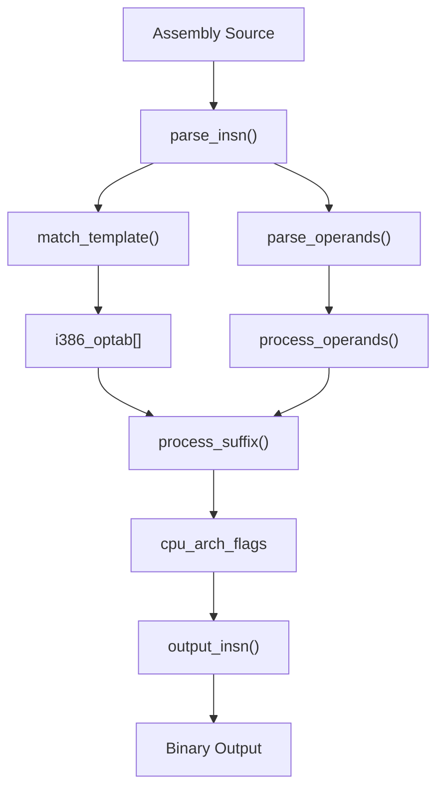
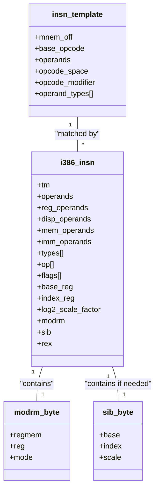
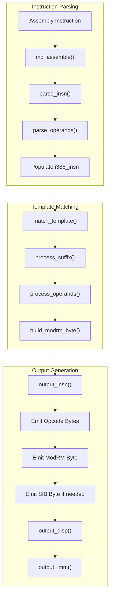
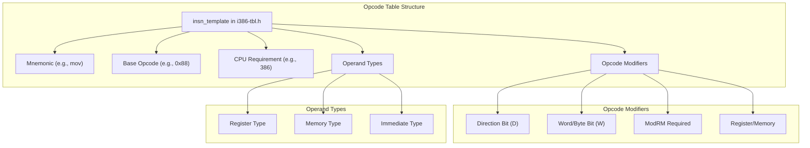

<!-- source: DeepWiki mcp.deepwiki.com · repo NVIDIA/cuda-gdb · page 3.2 x86 Backend · fetched 2026-10-26 -->

# x86 Backend

<details>
<summary>Relevant source files</summary>

The following files were used as context for generating this wiki page:

- [gas/NEWS](gas/NEWS)
- [gas/config/tc-i386.c](gas/config/tc-i386.c)
- [gas/doc/c-i386.texi](gas/doc/c-i386.texi)
- [gas/testsuite/gas/i386/i386.exp](gas/testsuite/gas/i386/i386.exp)
- [gas/testsuite/gas/i386/x86-64.exp](gas/testsuite/gas/i386/x86-64.exp)
- [opcodes/i386-dis.c](opcodes/i386-dis.c)
- [opcodes/i386-gen.c](opcodes/i386-gen.c)
- [opcodes/i386-init.h](opcodes/i386-init.h)
- [opcodes/i386-mnem.h](opcodes/i386-mnem.h)
- [opcodes/i386-opc.h](opcodes/i386-opc.h)
- [opcodes/i386-opc.tbl](opcodes/i386-opc.tbl)
- [opcodes/i386-tbl.h](opcodes/i386-tbl.h)

</details>


## Purpose and Scope

This document provides an overview of the x86 backend component in the CUDA-GDB repository, specifically focusing on the GNU Assembler (GAS) implementation for x86 architectures. The x86 backend is responsible for translating x86 assembly language into machine code, supporting various processor variants including i386, x86-64, and different instruction sets like SSE, AVX, etc. This document covers the architecture, key components, and processing flow of the x86 backend.

## Architecture Overview

The x86 backend consists of several interconnected components that work together to translate assembly language into machine code. This section covers the high-level architecture and how these components interact.

### X86 Backend Component Architecture



Sources: [gas/config/tc-i386.c:144-170](), [gas/config/tc-i386.c:173-196](), [gas/config/tc-i386.c:303-486]()

The diagram above illustrates the flow from assembly source to binary output:

1. The assembly source is parsed using `parse_insn()` which separates the instruction into mnemonic and operands
2. The mnemonic is used to look up potential instruction templates in `i386_optab[]`
3. Operands are parsed by `parse_operands()` and processed by `process_operands()`
4. `match_template()` and `process_suffix()` find the correct template for the instruction
5. The instruction is validated against CPU feature flags in `cpu_arch_flags`
6. Finally, `output_insn()` generates the binary encoding

## Key Data Structures

The x86 backend relies on several important data structures for instruction representation and processing.

### Core Data Structures



Sources: [gas/config/tc-i386.c:100-106](), [gas/config/tc-i386.c:107-127](), [gas/config/tc-i386.c:304-486]()

The key data structures include:

1. `insn_template`: Represents a potential instruction form defined in the opcode table
2. `i386_insn`: The internal representation of an x86 instruction being processed
3. `modrm_byte`: Represents the ModR/M byte used in many x86 instructions for operand encoding
4. `sib_byte`: Represents the SIB (Scale, Index, Base) byte used for complex addressing modes

## Instruction Processing Flow

The x86 backend follows a specific process for translating assembly instructions into machine code.

### Instruction Translation Pipeline



Sources: [gas/config/tc-i386.c:173-196](), [gas/config/tc-i386.c:690-750](), [gas/config/tc-i386.c:1190-1230]()

The processing flow is divided into three main stages:

1. **Instruction Parsing**: The assembly instruction is parsed to identify the mnemonic and operands
2. **Template Matching**: The instruction is matched against templates in the opcode table
3. **Output Generation**: The matched instruction is encoded into binary form

## Opcode Table Structure

The opcode table is a critical component of the x86 backend, defining all supported instructions and their encoding details.

### Opcode Table Organization



Sources: [opcodes/i386-opc.tbl:186-535](), [opcodes/i386-tbl.h:25-215]()

The opcode table (defined in `i386-opc.tbl` and generated into `i386-tbl.h`) is structured as follows:

1. Each entry defines an instruction template with a mnemonic, base opcode, and CPU requirement
2. Opcode modifiers specify how the opcode should be adjusted (direction bit, size bit, etc.)
3. Operand types define the valid operand combinations for the instruction

The template for a MOV instruction in the opcode table looks like:

```
mov, 0x88, 0, D|W|CheckOperandSize|Modrm|No_sSuf|HLEPrefixRelease, { Reg8|Reg16|Reg32|Reg64, Reg8|Reg16|Reg32|Reg64|Unspecified|BaseIndex }
```

This defines a MOV instruction with:
- Base opcode: 0x88
- No specific CPU requirement (0)
- Modifiers: Direction bit, Word/Byte bit, operand size checking, ModRM encoding
- Operand types: First operand can be any register size, second can be register or memory

## CPU Feature Support

The x86 backend implements a comprehensive system for tracking CPU features and ensuring instructions are valid for the target CPU.

### CPU Feature Flags

CPU features are represented using bitfields defined in `i386-opc.h` and initialized in `i386-init.h`. Each supported CPU feature (like SSE, AVX, etc.) has a corresponding flag that can be checked when processing instructions.

```
#define CPU_386_FLAGS \
  { { 1, 1, 1, 0, 0, 0, 0, 0, 0, 0, 0, 0, 0, 0, 0, 0, 0, 0, 0, 0, \
      /* ... many more zeros ... */ } }
```

Sources: [opcodes/i386-opc.h:29-462](), [opcodes/i386-init.h:21-70](), [gas/config/tc-i386.c:856-871]()

The backend uses these flags to:
1. Validate instructions against the current CPU architecture setting
2. Generate appropriate error messages for unsupported instructions
3. Implement CPU-specific behavior for certain instructions

## Instruction Encoding

Once an instruction is matched and validated, it must be encoded into the binary machine code format.

### Encoding Components

The x86 instruction encoding can include several components:

1. **Prefixes**: Optional bytes that modify the instruction (REP, LOCK, segment overrides)
2. **Opcode**: The main instruction code (1-3 bytes)
3. **ModR/M byte**: Encodes operand types and registers (if needed)
4. **SIB byte**: Scale-Index-Base addressing (if needed)
5. **Displacement**: Address displacement value (1, 2, or 4 bytes)
6. **Immediate**: Immediate operand value (1, 2, or 4 bytes)

The `output_insn()` function in `tc-i386.c` handles this encoding process, emitting each component in the correct order and with the correct values.

Sources: [gas/config/tc-i386.c:1190-1230](), [gas/config/tc-i386.c:1231-1270]()

## Syntax Support

The x86 backend supports both AT&T and Intel assembly syntax styles, which differ in several important ways.

### AT&T vs. Intel Syntax

| Feature | AT&T Syntax | Intel Syntax |
|---------|-------------|--------------|
| Operand Order | Source, Destination | Destination, Source |
| Register Names | Prefixed with % (%eax) | No prefix (eax) |
| Immediate Values | Prefixed with $ ($10) | No prefix (10) |
| Memory References | Disp(base,index,scale) | [base+index*scale+disp] |
| Instruction Suffixes | Uses size suffixes (movl) | No size suffixes (mov) |

The syntax handling is controlled by settings in the `i386_insn` structure, particularly the `intel_syntax` and `intel_mnemonic` flags. When Intel syntax is used, the operand parsing and processing functions adapt their behavior accordingly.

Sources: [gas/config/tc-i386.c:686-695](), [gas/config/tc-i386.c:380-385]()

## Special Features

The x86 backend implements several special features to handle the complexity of the x86 architecture.

### Instruction Relaxation

For conditional and unconditional jumps, the backend implements "relaxation" which allows it to automatically select between short and long jump forms based on the displacement needed. This is handled by the relaxation logic in the assembler.

### Addressing Modes

The x86 architecture supports complex addressing modes, which the backend must parse and encode correctly:

1. **Register direct**: The operand is in a register (MOV EAX, EBX)
2. **Immediate**: The operand is a constant value (MOV EAX, 10)
3. **Memory direct**: The operand is at a specific memory address (MOV EAX, [1000])
4. **Register indirect**: The operand is at the address in a register (MOV EAX, [EBX])
5. **Based indexed**: The operand uses base and index registers (MOV EAX, [EBX+ECX*4])
6. **Based indexed with displacement**: Adds a displacement value (MOV EAX, [EBX+ECX*4+10])

These addressing modes are handled by the `parse_operands()` and `build_modrm_byte()` functions.

Sources: [gas/config/tc-i386.c:949-1000](), [gas/config/tc-i386.c:1020-1060]()

## Conclusion

The x86 backend in the GNU Assembler is a sophisticated system for translating x86 assembly language into machine code. It handles the complexities of the x86 instruction set, including multiple syntax styles, various addressing modes, and CPU feature validation. The backend is built around a comprehensive opcode table and a well-defined instruction processing pipeline that ensures correct and efficient encoding of assembly instructions.

---

