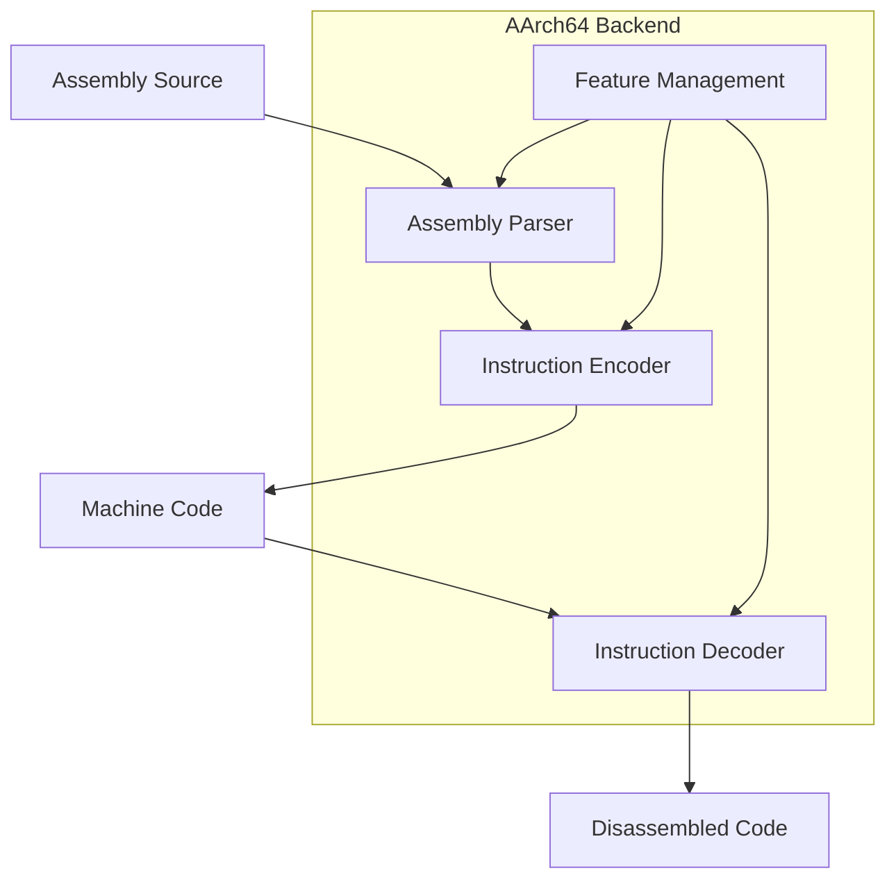
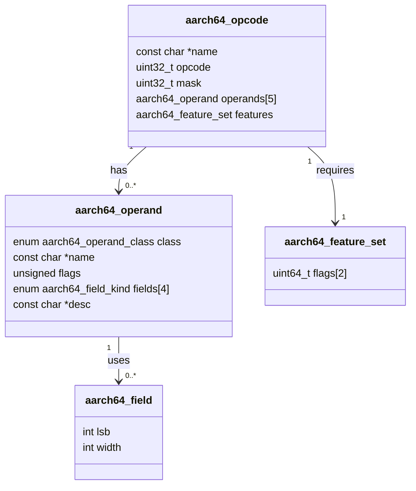
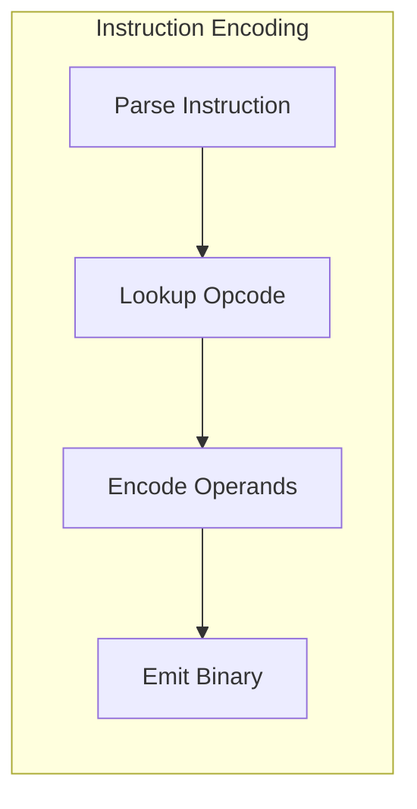
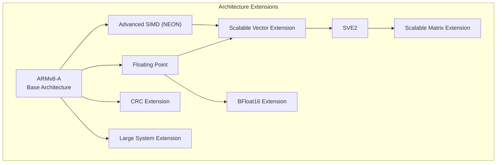
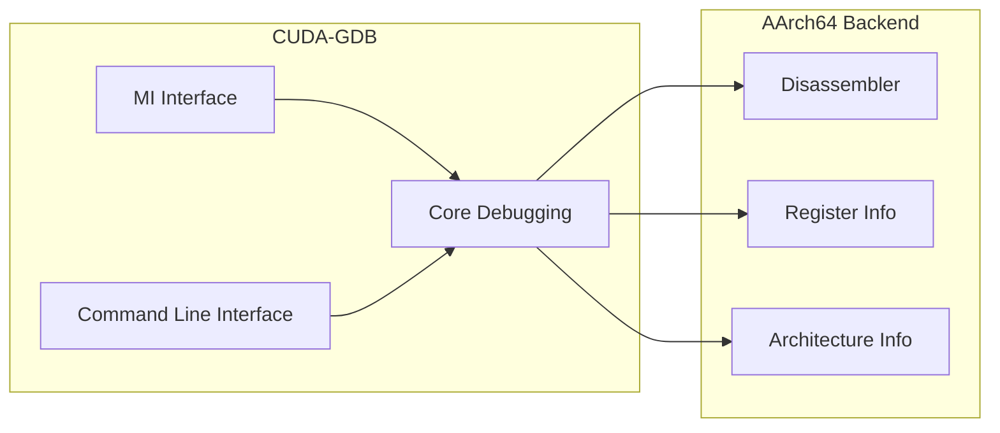

<!-- source: DeepWiki mcp.deepwiki.com · repo NVIDIA/cuda-gdb · page 3.3 AArch64 Backend · fetched 2026-10-26 -->

# AArch64 Backend

Relevant source files

The following files were used as context for generating this wiki page:

- [gas/config/tc-aarch64.c](gas/config/tc-aarch64.c)
- [gas/doc/c-aarch64.texi](gas/doc/c-aarch64.texi)
- [include/opcode/aarch64.h](include/opcode/aarch64.h)
- [opcodes/aarch64-asm-2.c](opcodes/aarch64-asm-2.c)
- [opcodes/aarch64-asm.c](opcodes/aarch64-asm.c)
- [opcodes/aarch64-asm.h](opcodes/aarch64-asm.h)
- [opcodes/aarch64-dis-2.c](opcodes/aarch64-dis-2.c)
- [opcodes/aarch64-dis.c](opcodes/aarch64-dis.c)
- [opcodes/aarch64-dis.h](opcodes/aarch64-dis.h)
- [opcodes/aarch64-opc-2.c](opcodes/aarch64-opc-2.c)
- [opcodes/aarch64-opc.c](opcodes/aarch64-opc.c)
- [opcodes/aarch64-opc.h](opcodes/aarch64-opc.h)
- [opcodes/aarch64-tbl.h](opcodes/aarch64-tbl.h)

## Purpose and Scope

This document describes the AArch64 backend of the GNU Assembler (GAS) component within the CUDA-GDB repository. The backend enables assembly and disassembly of instructions for the AArch64 architecture. It covers the parsing of AArch64 assembly syntax, encoding of instructions into machine code, and handling of AArch64-specific features.

This document focuses on the internal implementation details of the backend. For information about using AArch64-specific assembler directives, see [AArch64 Directives](#2.5). For information about AArch64 opcodes, see [AArch64 Opcodes](#2.6).

Sources: [gas/config/tc-aarch64.c:1-31]()

## Architecture Overview

The AArch64 backend consists of several interrelated components that work together to process AArch64 assembly code.

The backend follows a modular design where different components handle specific aspects of the assembly/disassembly process. The main components are:

1. **Assembly Parser**: Parses AArch64 assembly syntax, including operands, registers, and immediate values.
2. **Instruction Encoder**: Maps parsed instructions to their binary representation based on opcode tables and encoding rules.
3. **Instruction Decoder**: Converts binary machine code back to human-readable assembly.
4. **Feature Management**: Handles architecture variants, extensions, and feature flags.

Sources: [gas/config/tc-aarch64.c:40-263](), [opcodes/aarch64-opc.c:21-36]()

## Core Data Structures

The AArch64 backend relies on several key data structures to represent instructions, operands, and encoding information.

### Key Structures

1. **aarch64_opcode**: Represents an instruction, including its name, binary encoding (opcode and mask), operand descriptors, and feature requirements.

2. **aarch64_operand**: Describes an instruction operand, including its class (register, immediate, etc.), name, flags, fields within the instruction encoding, and a description for error messages.

3. **aarch64_field**: Defines a bit field within an instruction encoding, specifying its position (lsb) and width.

4. **aarch64_feature_set**: Represents a set of architecture features that may be required by an instruction.

Sources: [include/opcode/aarch64.h:433-452](), [opcodes/aarch64-opc.h:242-246]()

## Instruction Encoding and Decoding

The encoding and decoding processes involve mapping between assembly syntax and binary representation.

### Opcode Tables

The instruction set is defined in tables of `aarch64_opcode` structures that specify the binary pattern for each instruction and its operands. These tables are used for both assembly (encoding) and disassembly (decoding).

The encoding process:
1. Parses the mnemonic and operands from the assembly text
2. Looks up the opcode in the tables based on the mnemonic
3. Validates and encodes each operand according to its type
4. Inserts the encoded values into the appropriate fields of the instruction

Sources: [opcodes/aarch64-tbl.h:22-46](), [opcodes/aarch64-opc-2.c:25-89]()

### Field Extraction and Insertion

Bit fields within instructions are managed through the `aarch64_field` structure and associated utility functions:

- **insert_field**: Inserts a value into a specific field in an instruction
- **extract_field**: Extracts a value from a specific field in an instruction
- **insert_fields/extract_fields**: Handle multiple fields at once

The field definitions are stored in an array indexed by `enum aarch64_field_kind`.

Sources: [opcodes/aarch64-opc.c:224-387](), [opcodes/aarch64-asm.c:38-58](), [opcodes/aarch64-dis.c:147-169]()

## Assembly Syntax Handling

### Operand Parsing

The backend supports a variety of operand types:

| Operand Type | Description | Handling Functions |
|-------------|-------------|-------------------|
| Registers | General-purpose, SIMD, floating-point | parse_reg, aarch64_reg_parse_32_64 |
| Immediate values | Constants, bit masks, shifts | aarch64_get_expression |
| Memory references | Address expressions | parse_address, parse_address_offset_or_pc_rel |
| Register lists | For load/store multiple | parse_reglist |
| Vector elements | For SIMD instructions | parse_vector_type_for_operand |

Complex operands, such as shifted registers or memory addresses with pre/post-indexing, are handled by specialized parsing functions that validate the syntax and extract the relevant components.

Sources: [gas/config/tc-aarch64.c:876-1227]()

### Register Handling

The AArch64 architecture has multiple register classes:

| Register Class | Examples | Description |
|---------------|----------|-------------|
| General-purpose (X) | X0-X30, XZR, SP | 64-bit integer registers |
| General-purpose (W) | W0-W30, WZR, WSP | 32-bit integer registers |
| SIMD/FP (V) | V0-V31 | Vector/floating-point registers |
| SIMD scalar (S/D) | S0-S31, D0-D31 | Scalar SIMD elements |
| Predicate (P) | P0-P15 | SVE predicate registers |
| ZA | ZA0-ZA15 | SME ZA registers |

Each register class has specific encoding rules and can only be used with compatible instructions. The backend validates register usage and applies the appropriate constraints.

Sources: [gas/config/tc-aarch64.c:282-390]()

## AArch64-specific Features

### Architecture Extensions

The AArch64 backend supports various architecture extensions that add new instructions and capabilities:

The backend handles these extensions through feature flags that control which instructions are available. The `-march` and `-mcpu` command-line options enable specific extensions.

Sources: [include/opcode/aarch64.h:43-291](), [gas/doc/c-aarch64.texi:141-416]()

### Feature Management

Features are represented using the `aarch64_feature_set` structure, which contains bitfields for each feature. The backend:

1. Initializes the feature set based on command-line options
2. Validates instructions against the active feature set
3. Reports errors for instructions that require unavailable features

This allows the assembler to support different architecture versions and CPU implementations with varying feature sets.

Sources: [include/opcode/aarch64.h:432-487](), [gas/config/tc-aarch64.c:40-60]()

## Command-line Options

The AArch64 backend provides several command-line options to control its behavior:

| Option | Description |
|--------|-------------|
| -EB | Generate big-endian code |
| -EL | Generate little-endian code (default) |
| -mabi=ilp32/lp64 | Select the ABI (32-bit or 64-bit) |
| -mcpu=processor | Specify the target processor (e.g., cortex-a53) |
| -march=architecture | Specify the architecture version (e.g., armv8.2-a) |
| -mverbose-error | Enable verbose error messages |

These options allow fine-grained control over the generated code and ensure compatibility with specific hardware targets.

Sources: [gas/doc/c-aarch64.texi:34-139]()

## Integration with GDB

The AArch64 backend integrates with CUDA-GDB by providing:

1. **Disassembly capabilities**: Converts binary code to human-readable assembly during debugging
2. **Address computation**: Helps resolve symbol addresses and offsets
3. **Register information**: Provides register names, sizes, and groups for debugging
4. **Architecture feature detection**: Identifies available CPU features

This integration enables CUDA-GDB to properly support debugging of AArch64 code, including correct interpretation of instructions, registers, and memory layouts.

Sources: [opcodes/aarch64-dis.c:47-57](), [opcodes/aarch64-dis.c:660-735]()

## Error Handling

The backend provides comprehensive error detection and reporting for assembly errors, including:

1. **Syntax errors**: Invalid instruction syntax or operand formats
2. **Constraint violations**: Register or immediate values outside allowed ranges
3. **Feature requirements**: Instructions requiring unavailable architecture features
4. **Encoding limitations**: Values that cannot be encoded in the available instruction formats

Error messages include contextual information to help identify and fix the issues.

Sources: [gas/config/tc-aarch64.c:203-283]()

## Conclusion

The AArch64 backend is a critical component of the GNU Assembler in the CUDA-GDB repository. It provides comprehensive support for the AArch64 architecture, enabling assembly and disassembly of instructions for debugging and analysis. The modular design and extensive feature support make it adaptable to various AArch64 implementations and extensions.

---

