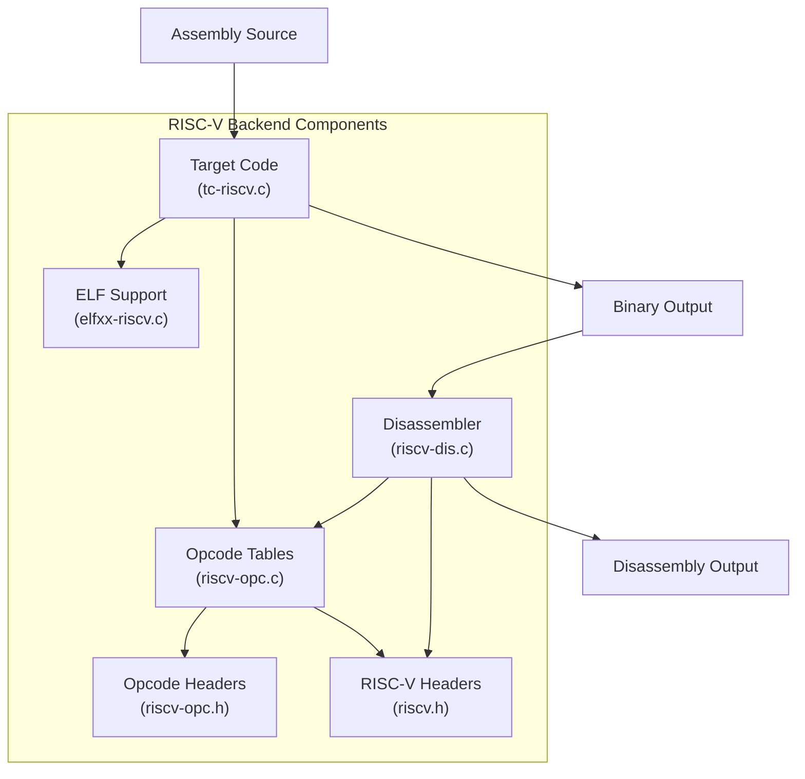
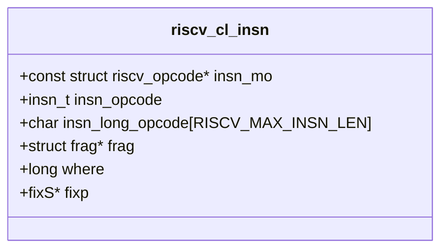
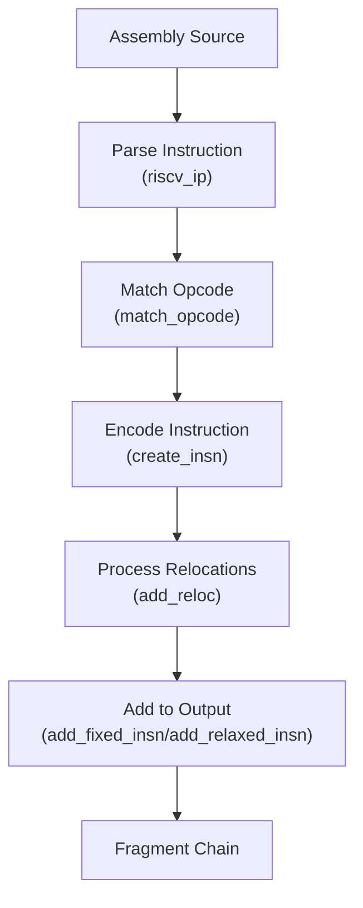
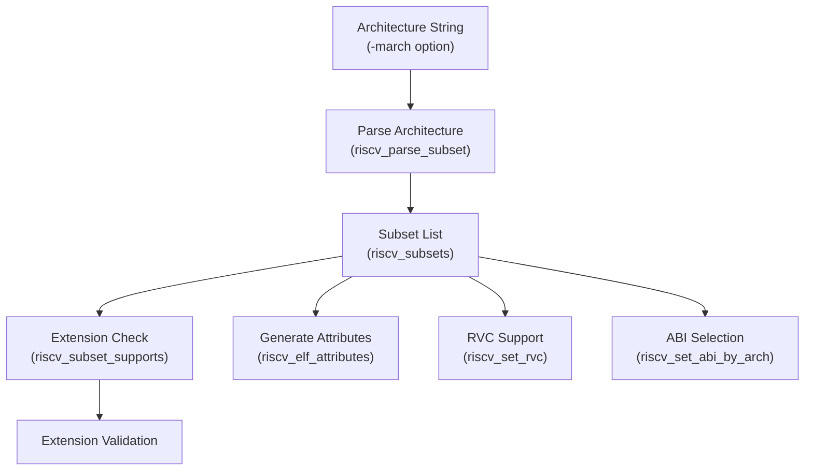
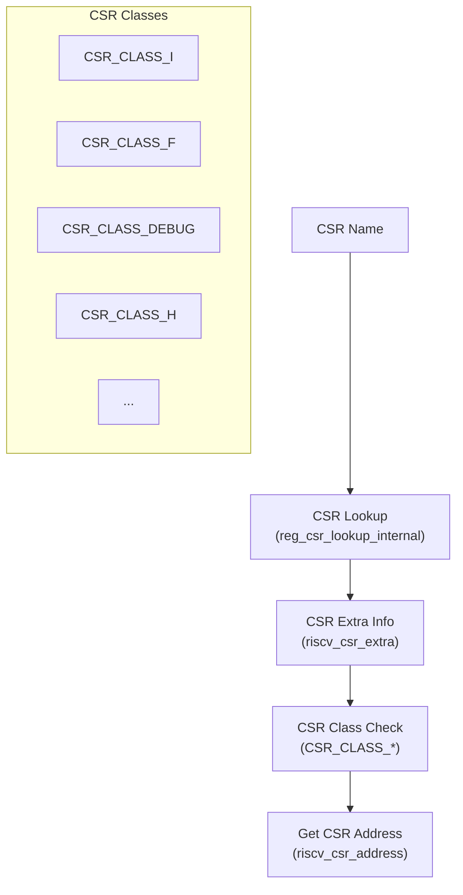
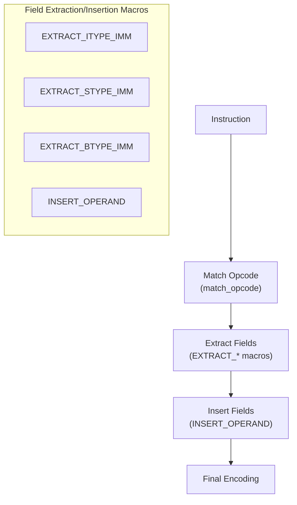
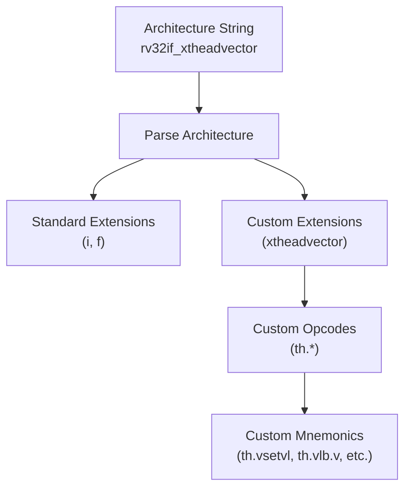
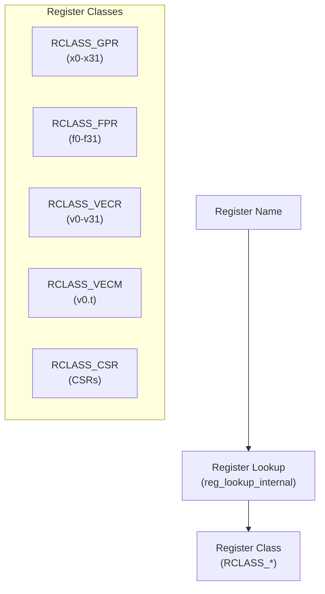

<!-- source: DeepWiki mcp.deepwiki.com · repo NVIDIA/cuda-gdb · page 3.4 RISC-V Backend · fetched 2026-10-26 -->

# RISC-V Backend

<details>
<summary>Relevant source files</summary>

The following files were used as context for generating this wiki page:

- [bfd/cpu-riscv.c](bfd/cpu-riscv.c)
- [bfd/elfxx-riscv.c](bfd/elfxx-riscv.c)
- [gas/config/tc-riscv.c](gas/config/tc-riscv.c)
- [gas/doc/c-riscv.texi](gas/doc/c-riscv.texi)
- [gas/testsuite/gas/elf/dwarf2-6.d](gas/testsuite/gas/elf/dwarf2-6.d)
- [gas/testsuite/gas/riscv/csr-version-1p10.d](gas/testsuite/gas/riscv/csr-version-1p10.d)
- [gas/testsuite/gas/riscv/csr-version-1p10.l](gas/testsuite/gas/riscv/csr-version-1p10.l)
- [gas/testsuite/gas/riscv/csr-version-1p11.d](gas/testsuite/gas/riscv/csr-version-1p11.d)
- [gas/testsuite/gas/riscv/csr-version-1p11.l](gas/testsuite/gas/riscv/csr-version-1p11.l)
- [gas/testsuite/gas/riscv/csr-version-1p12.d](gas/testsuite/gas/riscv/csr-version-1p12.d)
- [gas/testsuite/gas/riscv/csr-version-1p12.l](gas/testsuite/gas/riscv/csr-version-1p12.l)
- [gas/testsuite/gas/riscv/csr.s](gas/testsuite/gas/riscv/csr.s)
- [gas/testsuite/gas/riscv/imply.d](gas/testsuite/gas/riscv/imply.d)
- [gas/testsuite/gas/riscv/imply.s](gas/testsuite/gas/riscv/imply.s)
- [gas/testsuite/gas/riscv/march-help.l](gas/testsuite/gas/riscv/march-help.l)
- [gas/testsuite/gas/riscv/sifive-insns.d](gas/testsuite/gas/riscv/sifive-insns.d)
- [gas/testsuite/gas/riscv/sifive-insns.s](gas/testsuite/gas/riscv/sifive-insns.s)
- [gas/testsuite/gas/riscv/x-thead-vector-fail.d](gas/testsuite/gas/riscv/x-thead-vector-fail.d)
- [gas/testsuite/gas/riscv/x-thead-vector-fail.l](gas/testsuite/gas/riscv/x-thead-vector-fail.l)
- [gas/testsuite/gas/riscv/x-thead-vector.d](gas/testsuite/gas/riscv/x-thead-vector.d)
- [gas/testsuite/gas/riscv/x-thead-vector.s](gas/testsuite/gas/riscv/x-thead-vector.s)
- [include/opcode/riscv-opc.h](include/opcode/riscv-opc.h)
- [include/opcode/riscv.h](include/opcode/riscv.h)
- [opcodes/riscv-dis.c](opcodes/riscv-dis.c)
- [opcodes/riscv-opc.c](opcodes/riscv-opc.c)

</details>


## Purpose and Scope

This document details the RISC-V backend for the GNU Assembler (GAS) in CUDA-GDB. It explains how RISC-V instructions are processed, encoded, and assembled, as well as how various RISC-V architecture extensions are handled. This backend enables GAS to assemble RISC-V assembly code into machine code and create proper object files. For information about architecture-specific support in BFD (Binary File Descriptor library), see [Architecture-Specific Support](#4.2).

## Architecture Overview

The RISC-V backend consists of several key components that work together to process RISC-V assembly code. The following diagram shows the main components and their relationships:



Sources: [gas/config/tc-riscv.c](gas/config/tc-riscv.c), [opcodes/riscv-opc.c](opcodes/riscv-opc.c), [opcodes/riscv-dis.c](opcodes/riscv-dis.c), [bfd/elfxx-riscv.c](bfd/elfxx-riscv.c), [include/opcode/riscv-opc.h](include/opcode/riscv-opc.h), [include/opcode/riscv.h](include/opcode/riscv.h)

## Core Data Structures

The RISC-V backend uses several key data structures to represent and process RISC-V instructions:

### Instruction Representation

The main structure for representing RISC-V instructions during assembly is `riscv_cl_insn`:



This structure holds:
- A pointer to the opcode entry (`insn_mo`)
- The encoded instruction bits (`insn_opcode`)
- Extended instruction bits for long opcodes (`insn_long_opcode`)
- Fragment and fixup information for linking

Sources: [gas/config/tc-riscv.c:40-60](gas/config/tc-riscv.c:40-60)

### Opcode Table

The opcode table is defined as an array of `riscv_opcode` structures in `riscv-opc.c`. Each entry describes a RISC-V instruction:

```
const struct riscv_opcode riscv_opcodes[] = {
  /* name, xlen, isa, operands, match, mask, match_func, pinfo */
  {"prefetch.i",  0, INSN_CLASS_ZICBOP, "Wif(s)", MATCH_PREFETCH_I, MASK_PREFETCH_I, match_opcode, 0 },
  ...
}
```

Sources: [opcodes/riscv-opc.c:418-421](opcodes/riscv-opc.c:418-421)

## Instruction Processing Flow

The assembly process for RISC-V instructions follows these steps:



1. **Parsing**: The assembler parses the instruction mnemonic and operands
2. **Matching**: Finds the corresponding opcode entry in the opcode table
3. **Encoding**: Encodes the instruction with immediate values and registers
4. **Relocations**: Adds necessary relocations for addresses
5. **Output**: Adds the encoded instruction to the output fragment

Sources: [gas/config/tc-riscv.c:749-766](gas/config/tc-riscv.c:749-766), [gas/config/tc-riscv.c:799-812](gas/config/tc-riscv.c:799-812)

## RISC-V Architecture Extension Handling

The RISC-V backend supports a wide range of standard and custom extensions through a modular architecture management system:



The RISC-V backend maintains a list of enabled extensions parsed from the architecture string. This list is used to:

1. Check if specific extensions are supported (`riscv_subset_supports`)
2. Generate ELF attributes in the output
3. Enable or disable specific features (like compressed instructions)
4. Determine the appropriate ABI

Sources: [gas/config/tc-riscv.c:350-379](gas/config/tc-riscv.c:350-379), [gas/config/tc-riscv.c:398-442](gas/config/tc-riscv.c:398-442)

## CSR (Control and Status Register) Handling

The RISC-V backend has special handling for CSRs, which are privileged registers in RISC-V:



CSRs are classified into different categories (user, machine, supervisor level, etc.) and are version-dependent. The backend checks CSR validity based on:

1. The current architecture extensions
2. The privilege specification version
3. The bit width (some CSRs are only valid in RV32 or RV64)

Sources: [gas/config/tc-riscv.c:1000-1207](gas/config/tc-riscv.c:1000-1207)

## Relocation Types

RISC-V uses a variety of relocation types to handle different addressing modes and instruction formats:

| Relocation Type | Description | Usage |
|-----------------|-------------|-------|
| R_RISCV_HI20 | High 20 bits of 32-bit address | Used for lui instructions |
| R_RISCV_LO12_I | Low 12 bits for I-type instructions | Used for load/immediate instructions |
| R_RISCV_LO12_S | Low 12 bits for S-type instructions | Used for store instructions |
| R_RISCV_PCREL_HI20 | PC-relative high 20 bits | Used for auipc instructions |
| R_RISCV_PCREL_LO12_I | PC-relative low 12 bits (I-type) | Used for PC-relative loads |
| R_RISCV_CALL | 32-bit PC-relative function call | Used for function calls |
| R_RISCV_BRANCH | 12-bit PC-relative branch offset | Used for conditional branches |
| R_RISCV_JAL | 20-bit PC-relative jump offset | Used for jal instructions |

These relocations are processed by the linker to resolve final addresses.

Sources: [bfd/elfxx-riscv.c:46-238](bfd/elfxx-riscv.c:46-238)

## Command Line Options and Assembler Directives

The RISC-V backend provides several command-line options and assembler directives:

### Command-line Options

- `-march=ISA`: Specifies the base ISA and extensions
- `-mabi=ABI`: Selects the ABI (ilp32/lp64 with optional f/d/q)
- `-mrelax`/`-mno-relax`: Controls linker relaxation
- `-mpriv-spec=PRIVspec`: Selects the privileged spec version
- `-mcsr-check`/`-mno-csr-check`: Enables/disables CSR validation
- `-march-attr`/`-mno-arch-attr`: Controls ELF attribute generation

### Directives

The `.option` directive allows controlling assembler features inline:

```assembly
.option push            # Save current options
.option norelax         # Disable relaxation
la gp, __global_pointer$
.option pop             # Restore saved options
```

Other directives include:
- `.attribute`: Set ELF attributes
- `.insn`: Define a custom instruction
- `.half`, `.word`, `.dword`: Generate data

Sources: [gas/doc/c-riscv.texi:30-111](gas/doc/c-riscv.texi:30-111), [gas/doc/c-riscv.texi:150-178](gas/doc/c-riscv.texi:150-178)

## Instruction Encoding Process

The RISC-V backend uses a set of macros to extract and insert fields during instruction encoding:



For example, to encode an immediate value in an I-type instruction:

1. The assembler parses the immediate value
2. It uses macros like `ENCODE_ITYPE_IMM` to position the bits correctly
3. It inserts the encoded value using `INSERT_OPERAND`

Sources: [include/opcode/riscv.h:60-77](include/opcode/riscv.h:60-77), [include/opcode/riscv.h:136-157](include/opcode/riscv.h:136-157), [gas/config/tc-riscv.c:508-509](gas/config/tc-riscv.c:508-509)

## Extension Support

The RISC-V backend has extensive support for both standard and custom extensions. The following table shows some of the key extensions supported:

| Extension | Description | Support Files |
|-----------|-------------|--------------|
| I | Base Integer | riscv-opc.c, tc-riscv.c |
| M | Integer Multiplication/Division | riscv-opc.c |
| A | Atomic Operations | riscv-opc.c |
| F | Single-precision Floating-point | riscv-opc.c |
| D | Double-precision Floating-point | riscv-opc.c |
| C | Compressed Instructions | riscv-opc.c, tc-riscv.c |
| V | Vector Operations | riscv-opc.c |
| Zicsr | Control and Status Register | riscv-opc.c, tc-riscv.c |
| Zifencei | Instruction-Fetch Fence | riscv-opc.c |
| ZihintXXX | Hints | riscv-opc.c |

Custom extensions like `xtheadvector` are also supported through the extension mechanism:



Sources: [gas/testsuite/gas/riscv/march-help.l](gas/testsuite/gas/riscv/march-help.l), [gas/testsuite/gas/riscv/x-thead-vector.s](gas/testsuite/gas/riscv/x-thead-vector.s)

## Register Handling

The RISC-V backend manages different register sets, including general-purpose registers (GPRs), floating-point registers (FPRs), and vector registers:



Register names are stored in tables and can be represented in different formats (numeric or ABI names):

```c
// Numeric format
const char riscv_gpr_names_numeric[NGPR][NRC] = {
  "x0",   "x1",   "x2",   "x3",   /* ... */
};

// ABI format
const char riscv_gpr_names_abi[NGPR][NRC] = {
  "zero", "ra",   "sp",   "gp",   /* ... */
};
```

Sources: [opcodes/riscv-opc.c:29-59](opcodes/riscv-opc.c:29-59), [gas/config/tc-riscv.c:967-986](gas/config/tc-riscv.c:967-986)

## Conclusion

The RISC-V backend in CUDA-GDB provides comprehensive support for the RISC-V architecture, handling standard and custom extensions, different instruction formats, and various architectural features like CSRs. It processes assembly code through a well-defined pipeline from parsing to encoding and generates appropriate relocations for the linker. The modular design allows for easy addition of new extensions and features as the RISC-V specification evolves.

---

