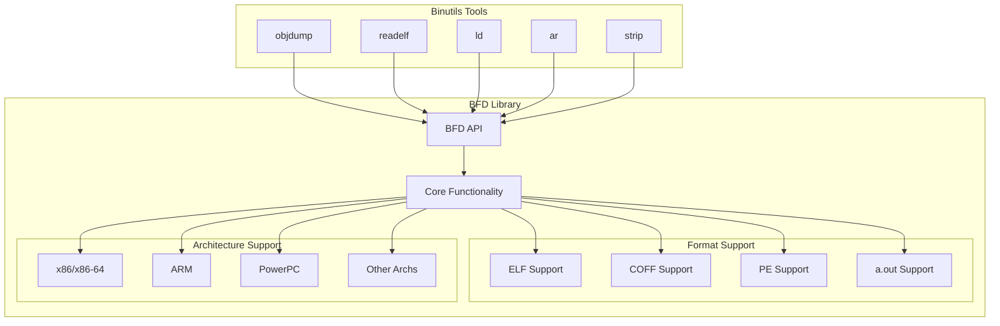
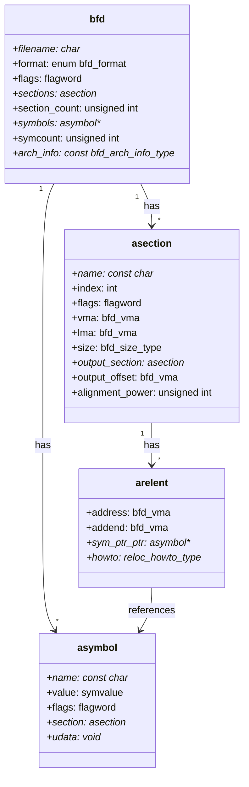
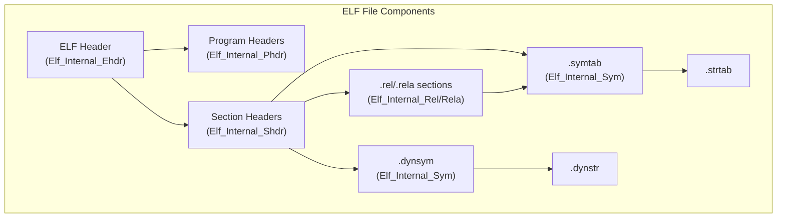
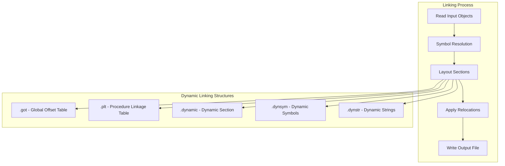
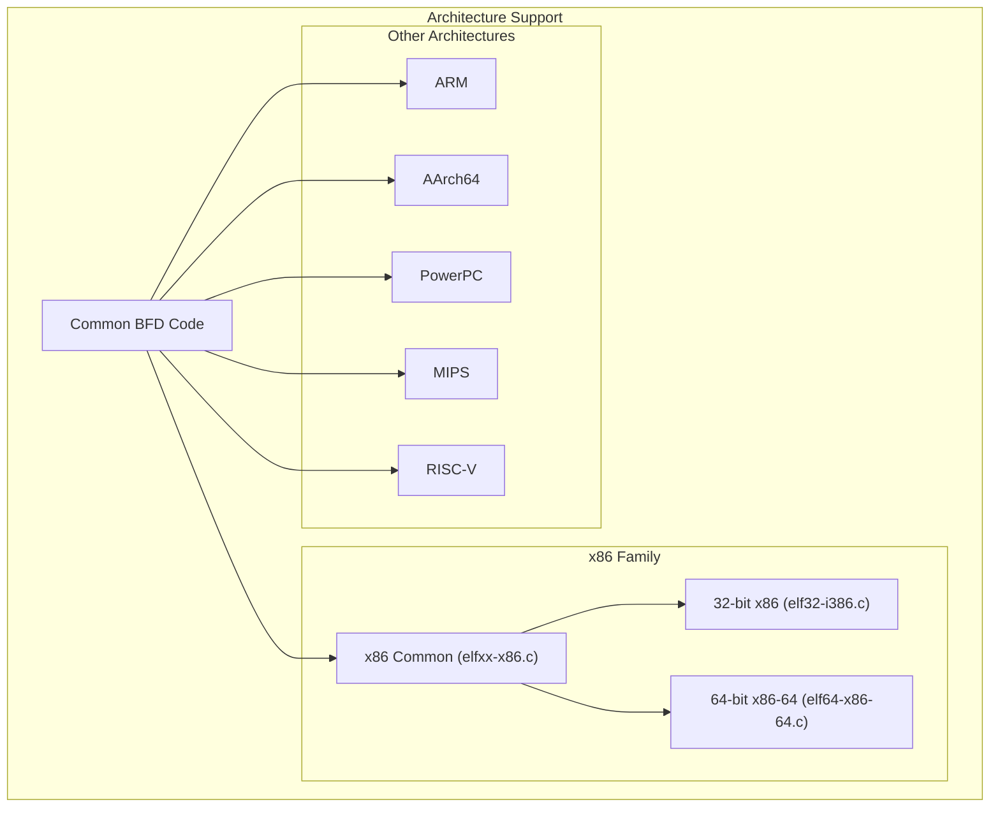

<!-- source: DeepWiki mcp.deepwiki.com · repo NVIDIA/cuda-gdb · page 4 Binary File Descriptor (BFD) · fetched 2026-10-26 -->

# Binary File Descriptor (BFD)

<details>
<summary>Relevant source files</summary>

The following files were used as context for generating this wiki page:

- [ChangeLog](ChangeLog)
- [bfd/ChangeLog](bfd/ChangeLog)
- [bfd/aout-target.h](bfd/aout-target.h)
- [bfd/doc/chew.c](bfd/doc/chew.c)
- [bfd/doc/doc.str](bfd/doc/doc.str)
- [bfd/doc/proto.str](bfd/doc/proto.str)
- [bfd/elf-bfd.h](bfd/elf-bfd.h)
- [bfd/elf.c](bfd/elf.c)
- [bfd/elf32-i386.c](bfd/elf32-i386.c)
- [bfd/elf64-x86-64.c](bfd/elf64-x86-64.c)
- [bfd/elfcode.h](bfd/elfcode.h)
- [bfd/elflink.c](bfd/elflink.c)
- [bfd/elfxx-target.h](bfd/elfxx-target.h)
- [bfd/elfxx-x86.c](bfd/elfxx-x86.c)
- [bfd/elfxx-x86.h](bfd/elfxx-x86.h)
- [bfd/mach-o-target.c](bfd/mach-o-target.c)
- [bfd/plugin.c](bfd/plugin.c)
- [bfd/ppcboot.c](bfd/ppcboot.c)
- [binutils/ChangeLog](binutils/ChangeLog)
- [binutils/NEWS](binutils/NEWS)
- [binutils/dwarf.c](binutils/dwarf.c)
- [binutils/dwarf.h](binutils/dwarf.h)
- [binutils/elfcomm.c](binutils/elfcomm.c)
- [binutils/elfcomm.h](binutils/elfcomm.h)
- [binutils/readelf.c](binutils/readelf.c)
- [binutils/testsuite/binutils-all/display-section-0.r](binutils/testsuite/binutils-all/display-section-0.r)
- [binutils/testsuite/binutils-all/display-section-rel.r](binutils/testsuite/binutils-all/display-section-rel.r)
- [binutils/testsuite/binutils-all/dw5.W](binutils/testsuite/binutils-all/dw5.W)
- [binutils/testsuite/binutils-all/objdump.WL](binutils/testsuite/binutils-all/objdump.WL)
- [binutils/testsuite/binutils-all/pr26160.r](binutils/testsuite/binutils-all/pr26160.r)
- [binutils/testsuite/binutils-all/readelf-debug-str-offsets-dw4.d](binutils/testsuite/binutils-all/readelf-debug-str-offsets-dw4.d)
- [binutils/testsuite/binutils-all/readelf-debug-str-offsets-dw4.s](binutils/testsuite/binutils-all/readelf-debug-str-offsets-dw4.s)
- [binutils/testsuite/binutils-all/readelf.exp](binutils/testsuite/binutils-all/readelf.exp)
- [binutils/testsuite/binutils-all/relr.s](binutils/testsuite/binutils-all/relr.s)
- [cpu/ChangeLog](cpu/ChangeLog)
- [elfcpp/ChangeLog](elfcpp/ChangeLog)
- [gas/ChangeLog](gas/ChangeLog)
- [gas/config/tc-aarch64-ginsn.c](gas/config/tc-aarch64-ginsn.c)
- [gas/config/tc-aarch64.h](gas/config/tc-aarch64.h)
- [gas/config/tc-i386-intel.c](gas/config/tc-i386-intel.c)
- [gas/config/tc-i386.h](gas/config/tc-i386.h)
- [gas/doc/c-bpf.texi](gas/doc/c-bpf.texi)
- [gas/testsuite/gas/i386/x86-64-apx-egpr-inval.l](gas/testsuite/gas/i386/x86-64-apx-egpr-inval.l)
- [gas/testsuite/gas/i386/x86-64-apx-egpr-inval.s](gas/testsuite/gas/i386/x86-64-apx-egpr-inval.s)
- [gold/ChangeLog](gold/ChangeLog)
- [gprof/ChangeLog](gprof/ChangeLog)
- [include/ChangeLog](include/ChangeLog)
- [include/elf/common.h](include/elf/common.h)
- [include/opcode/bpf.h](include/opcode/bpf.h)
- [ld/testsuite/ld-i386/i386.exp](ld/testsuite/ld-i386/i386.exp)
- [ld/testsuite/ld-i386/start.s](ld/testsuite/ld-i386/start.s)
- [ld/testsuite/ld-x86-64/apx-load1.s](ld/testsuite/ld-x86-64/apx-load1.s)
- [ld/testsuite/ld-x86-64/apx-load1a.d](ld/testsuite/ld-x86-64/apx-load1a.d)
- [ld/testsuite/ld-x86-64/apx-load1b.d](ld/testsuite/ld-x86-64/apx-load1b.d)
- [ld/testsuite/ld-x86-64/apx-load1c.d](ld/testsuite/ld-x86-64/apx-load1c.d)
- [ld/testsuite/ld-x86-64/apx-load1d.d](ld/testsuite/ld-x86-64/apx-load1d.d)
- [ld/testsuite/ld-x86-64/load4.d](ld/testsuite/ld-x86-64/load4.d)
- [ld/testsuite/ld-x86-64/load4.s](ld/testsuite/ld-x86-64/load4.s)
- [ld/testsuite/ld-x86-64/pr19609-4c.d](ld/testsuite/ld-x86-64/pr19609-4c.d)
- [ld/testsuite/ld-x86-64/pr32067.s](ld/testsuite/ld-x86-64/pr32067.s)
- [ld/testsuite/ld-x86-64/tlsie5.d](ld/testsuite/ld-x86-64/tlsie5.d)
- [ld/testsuite/ld-x86-64/x86-64.exp](ld/testsuite/ld-x86-64/x86-64.exp)
- [opcodes/ChangeLog](opcodes/ChangeLog)
- [opcodes/bpf-opc.c](opcodes/bpf-opc.c)

</details>


The Binary File Descriptor (BFD) library is a core component of the GNU Binutils suite that provides a uniform interface for manipulating object files, archive files, and executables across different architectures and file formats. BFD serves as an abstraction layer between the various file formats (such as ELF, COFF, PE) and the tools that need to work with these files (like `objdump`, `readelf`, and `ld`).

BFD allows binutils tools to focus on their specific functions without needing to understand the details of different object file formats. This makes it easier to add support for new architectures or file formats, as only the BFD layer needs to be updated rather than modifying each tool separately.

## Architecture Overview



Sources: 
- [bfd/elf.c:1-22]()
- [bfd/elflink.c:1-21]()
- [ChangeLog:1-21]()

## BFD Object Model

BFD uses an object-oriented model to represent binary files and their components. The key abstractions include:



Sources:
- [bfd/elf-bfd.h:69-90]()
- [bfd/elflink.c:127-179]()

## Core Components

### Core Data Structures

The BFD library defines several key data structures for representing different aspects of object files:

1. **bfd** - The main data structure representing an open file
2. **asection** - Represents a section in an object file
3. **asymbol** - Represents a symbol within a file
4. **arelent** - Represents a relocation entry

### File Format Handling

BFD supports multiple object file formats, with ELF (Executable and Linkable Format) being the most commonly used on modern Unix-like systems. Each format has specific backend implementations:

- **ELF** - Implemented in `bfd/elf.c`, with format-specific routines
- **COFF** - Common Object File Format, used historically and in Windows systems
- **PE** - Portable Executable, Microsoft's executable format
- **a.out** - An older Unix object file format

For each format, BFD provides functions for reading and writing file headers, sections, symbols, and relocations.

Sources:
- [bfd/elf.c:63-191]()
- [bfd/elfcode.h:1-5]()

## ELF Support

ELF (Executable and Linkable Format) is the primary object file format on modern Unix-like systems. BFD provides comprehensive support for working with ELF files.

### ELF Data Structures

BFD defines numerous data structures for handling ELF files:

- `Elf_Internal_Ehdr` - ELF file header
- `Elf_Internal_Phdr` - Program header
- `Elf_Internal_Shdr` - Section header
- `Elf_Internal_Sym` - Symbol table entry
- `Elf_Internal_Rel/Rela` - Relocation entries

### ELF-Specific Operations

BFD provides various functions for ELF-specific operations:

- `bfd_elf_hash` and `bfd_elf_gnu_hash` - Hash functions for symbol lookup
- `bfd_elf_get_elf_syms` - Read and convert symbols to internal format
- `bfd_elf_string_from_elf_section` - Extract strings from string tables
- `_bfd_elf_make_section_from_shdr` - Create BFD sections from ELF section headers



Sources:
- [bfd/elf.c:372-526]() - Symbol table handling
- [bfd/elf.c:195-208]() - ELF hash function
- [bfd/elf.c:213-222]() - GNU hash function
- [bfd/elf.c:795-1073]() - Section creation

## Linking Support

The BFD library provides extensive support for linking object files, particularly through the ELF format. The linking functionality is primarily implemented in `elflink.c`.

### Link Hash Tables

BFD uses hash tables to track symbols during linking. The primary structures are:

- `struct elf_link_hash_entry` - An entry in the hash table for a symbol
- `struct elf_link_hash_table` - The hash table itself

### Dynamic Linking

BFD supports creating dynamically linked executables and shared libraries with functions like:

- `_bfd_elf_create_got_section` - Create Global Offset Table (GOT) sections
- `_bfd_elf_create_dynamic_sections` - Create sections needed for dynamic linking
- `_bfd_elf_link_create_dynstrtab` - Create dynamic string tables



Sources:
- [bfd/elflink.c:330-457]() - Dynamic section creation
- [bfd/elflink.c:224-280]() - GOT section creation
- [bfd/elflink.c:283-321]() - Dynamic string table creation

## Architecture-Specific Support

BFD includes support for various processor architectures, with specific implementations for each. For the x86 architecture family, which includes both 32-bit (i386) and 64-bit (x86-64) variants, support is provided in files like `elfxx-x86.c`, `elf32-i386.c`, and `elf64-x86-64.c`.

Key aspects of architecture-specific support include:

1. Relocation handling specific to the architecture
2. Architecture-specific section handling (e.g., for TLS, GOT)
3. Instruction set specific features



Sources:
- [bfd/elfxx-x86.c:32-44]() - x86 object creation
- [bfd/elf64-x86-64.c:45-189]() - x86-64 relocation handling
- [bfd/elf32-i386.c:1-3]() - i386 support

## Key APIs and Usage Patterns

### Opening and Closing BFD Files

To work with a file using BFD, you first open it using the appropriate function, then close it when done:

```c
bfd *abfd = bfd_openr(filename, target);
if (abfd != NULL) {
    if (bfd_check_format(abfd, bfd_object)) {
        // Process the file
    }
    bfd_close(abfd);
}
```

### Section Handling

BFD provides numerous functions for working with sections:

```c
// Get a section by name
asection *sect = bfd_get_section_by_name(abfd, ".text");

// Iterate through all sections
for (asection *sect = abfd->sections; sect != NULL; sect = sect->next) {
    // Process each section
}

// Get section contents
bfd_byte *contents;
bfd_get_section_contents(abfd, sect, contents, 0, sect->size);
```

### Symbol Handling

Symbols represent named entities in the binary (functions, variables, etc.):

```c
// Get number of symbols
long symcount = bfd_get_symtab_upper_bound(abfd);

// Read symbols
asymbol **symtab = malloc(symcount);
bfd_canonicalize_symtab(abfd, symtab);

// Find a symbol by name
for (int i = 0; i < symcount; i++) {
    if (strcmp(symtab[i]->name, "main") == 0) {
        // Found main symbol
    }
}
```

Sources:
- [bfd/elf.c:237-262]() - Object creation
- [bfd/elf.c:547-562]() - Symbol naming
- [bfd/elf.c:794-986]() - Section handling

## Integration with Binutils

BFD is the foundation for various tools in the GNU Binutils suite:

1. **objdump** - Uses BFD to read object files and display their contents
2. **readelf** - Displays information about ELF files (though it uses its own ELF parser, not BFD)
3. **ld** - The GNU linker, uses BFD for object file manipulation during linking
4. **as** - The GNU assembler, uses BFD to create object files
5. **ar** - Uses BFD to manipulate archive files
6. **strip** - Uses BFD to remove symbols and sections from binaries

Each of these tools leverages BFD's capabilities to perform their specific functions while maintaining compatibility across different architectures and object file formats.

Sources:
- [binutils/readelf.c:1-41]() - Explains BFD vs. readelf approach
- [binutils/dwarf.c:1-20]() - DWARF debug info in binutils tools

## Conclusion

The Binary File Descriptor (BFD) library serves as the backbone of the GNU Binutils suite, providing a unified interface for working with various binary file formats. By abstracting away the details of specific formats like ELF, COFF, and PE, BFD allows toolchain developers to focus on implementing functionality rather than handling the complexities of different object file formats.

BFD's modular design, with its clear separation between core functionality, format-specific code, and architecture-specific code, makes it extensible and maintainable. This architecture has allowed it to evolve over time to support new file formats and processor architectures while maintaining backward compatibility.

---

