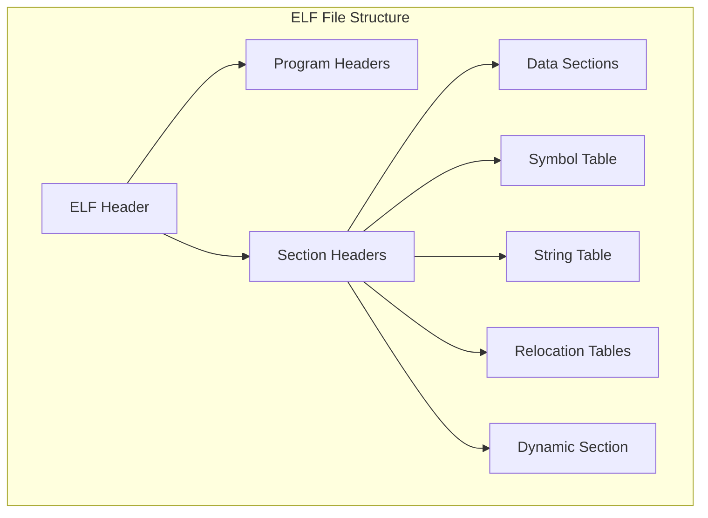
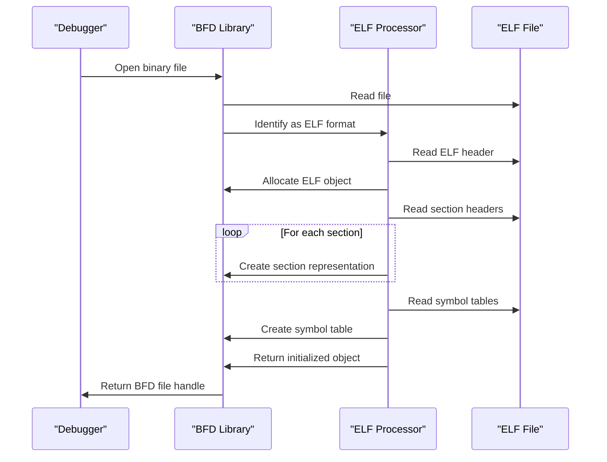
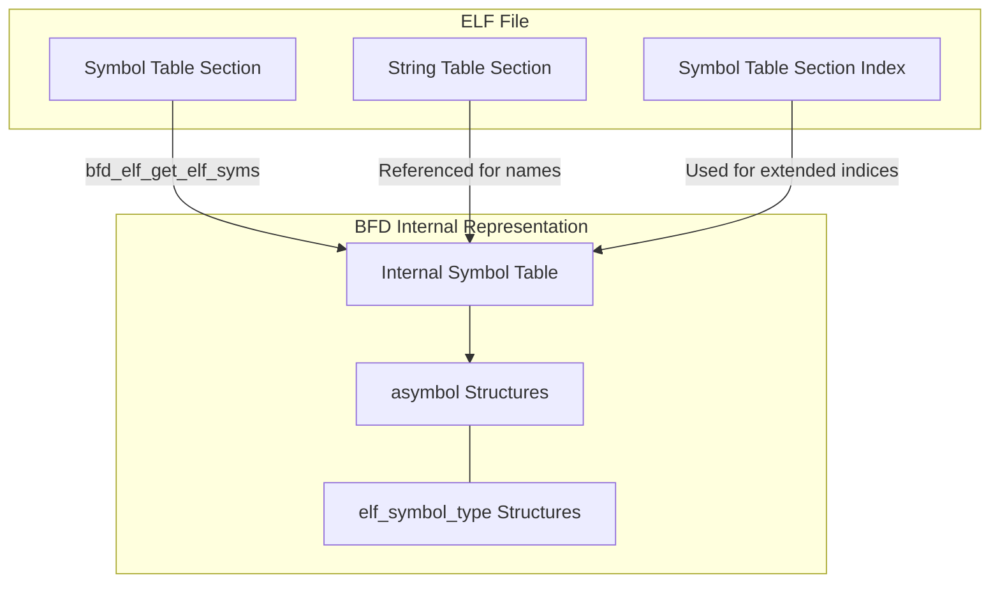
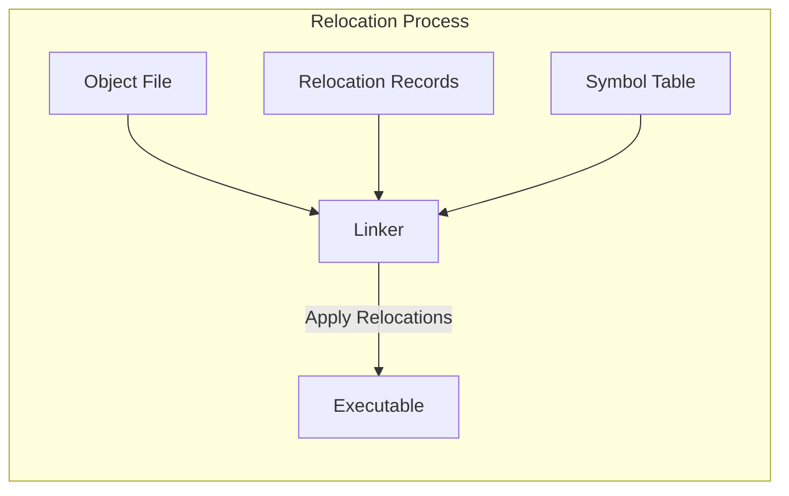
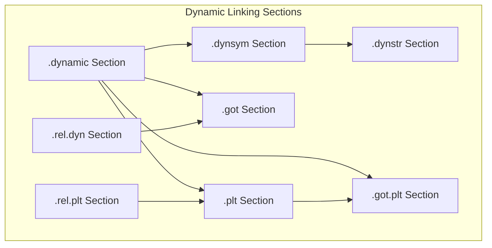
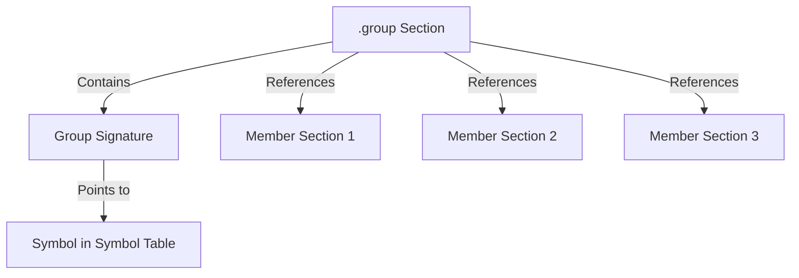
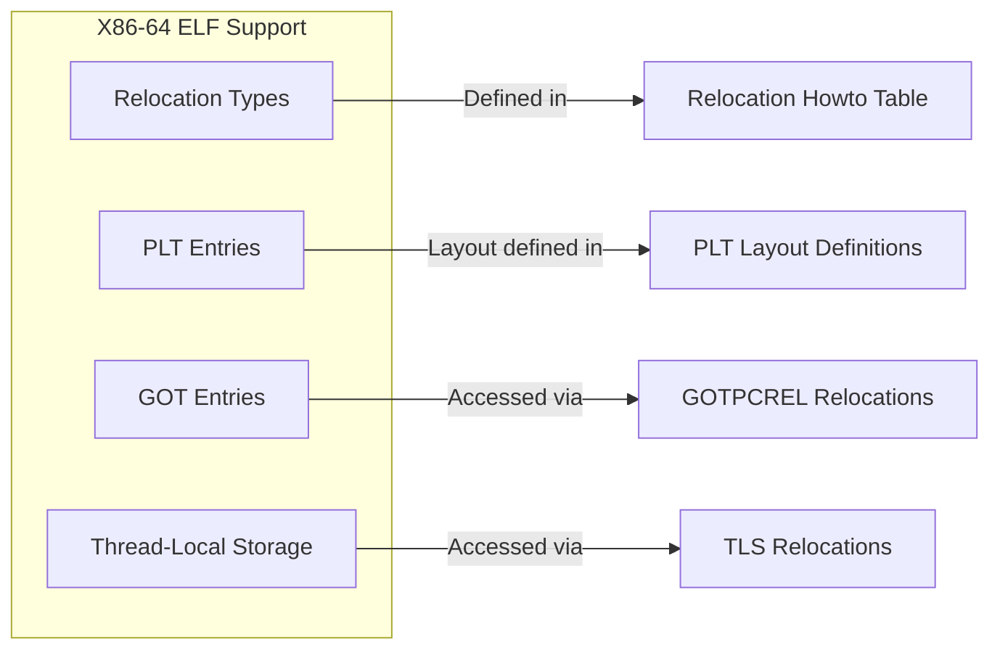
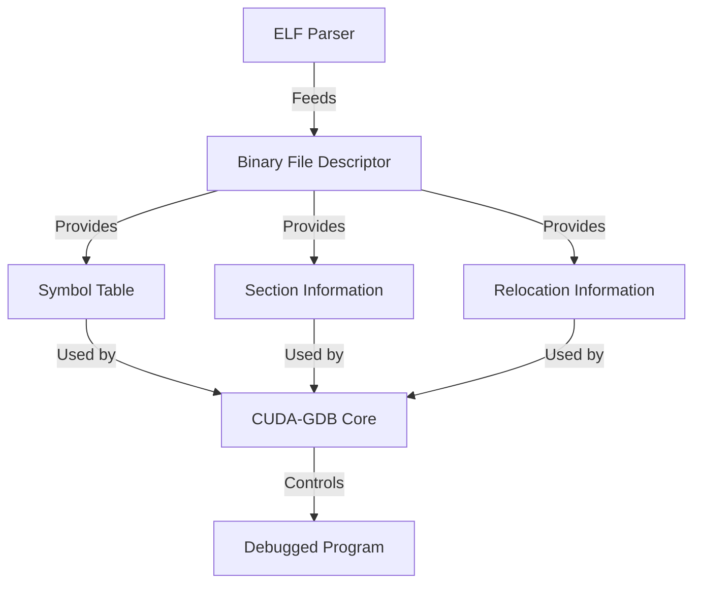

<!-- source: DeepWiki mcp.deepwiki.com · repo NVIDIA/cuda-gdb · page 4.1 ELF File Format Support · fetched 2026-10-26 -->

# ELF File Format Support

Relevant source files

The following files were used as context for generating this wiki page:

- [bfd/aout-target.h](bfd/aout-target.h)
- [bfd/elf-bfd.h](bfd/elf-bfd.h)
- [bfd/elf.c](bfd/elf.c)
- [bfd/elf32-i386.c](bfd/elf32-i386.c)
- [bfd/elf64-x86-64.c](bfd/elf64-x86-64.c)
- [bfd/elfcode.h](bfd/elfcode.h)
- [bfd/elflink.c](bfd/elflink.c)
- [bfd/elfxx-target.h](bfd/elfxx-target.h)
- [bfd/elfxx-x86.c](bfd/elfxx-x86.c)
- [bfd/elfxx-x86.h](bfd/elfxx-x86.h)
- [bfd/mach-o-target.c](bfd/mach-o-target.c)
- [bfd/plugin.c](bfd/plugin.c)
- [bfd/ppcboot.c](bfd/ppcboot.c)
- [gas/config/tc-aarch64-ginsn.c](gas/config/tc-aarch64-ginsn.c)
- [gas/config/tc-aarch64.h](gas/config/tc-aarch64.h)
- [gas/config/tc-i386-intel.c](gas/config/tc-i386-intel.c)
- [gas/config/tc-i386.h](gas/config/tc-i386.h)
- [gas/testsuite/gas/i386/x86-64-apx-egpr-inval.l](gas/testsuite/gas/i386/x86-64-apx-egpr-inval.l)
- [gas/testsuite/gas/i386/x86-64-apx-egpr-inval.s](gas/testsuite/gas/i386/x86-64-apx-egpr-inval.s)
- [ld/testsuite/ld-i386/i386.exp](ld/testsuite/ld-i386/i386.exp)
- [ld/testsuite/ld-i386/start.s](ld/testsuite/ld-i386/start.s)
- [ld/testsuite/ld-x86-64/apx-load1.s](ld/testsuite/ld-x86-64/apx-load1.s)
- [ld/testsuite/ld-x86-64/apx-load1a.d](ld/testsuite/ld-x86-64/apx-load1a.d)
- [ld/testsuite/ld-x86-64/apx-load1b.d](ld/testsuite/ld-x86-64/apx-load1b.d)
- [ld/testsuite/ld-x86-64/apx-load1c.d](ld/testsuite/ld-x86-64/apx-load1c.d)
- [ld/testsuite/ld-x86-64/apx-load1d.d](ld/testsuite/ld-x86-64/apx-load1d.d)
- [ld/testsuite/ld-x86-64/load4.d](ld/testsuite/ld-x86-64/load4.d)
- [ld/testsuite/ld-x86-64/load4.s](ld/testsuite/ld-x86-64/load4.s)
- [ld/testsuite/ld-x86-64/pr19609-4c.d](ld/testsuite/ld-x86-64/pr19609-4c.d)
- [ld/testsuite/ld-x86-64/pr32067.s](ld/testsuite/ld-x86-64/pr32067.s)
- [ld/testsuite/ld-x86-64/tlsie5.d](ld/testsuite/ld-x86-64/tlsie5.d)
- [ld/testsuite/ld-x86-64/x86-64.exp](ld/testsuite/ld-x86-64/x86-64.exp)

This page documents the Executable and Linkable Format (ELF) file format support in CUDA-GDB. It covers how the system parses, interprets, and manipulates ELF files during the debugging process. This infrastructure serves as the foundation for loading and analyzing executable files, shared libraries, and core dumps.

For information about specific platform implementations of ELF, see [Architecture-Specific Support](#4.2).

## Overview of ELF Format

ELF (Executable and Linkable Format) is the standard binary file format used for executables, object files, shared libraries, and core dumps on Linux, BSD, and similar operating systems. CUDA-GDB uses the BFD (Binary File Descriptor) library to handle ELF files and provide a consistent interface for accessing binary file contents regardless of their specific format.

The ELF format consists of several key components:

- **ELF Header**: Contains metadata about the file, including its type, target architecture, entry point, and the locations of other parts of the file.
- **Program Headers**: Define segments used at runtime by the program loader.
- **Section Headers**: Define sections containing code, data, symbols, and other information used for linking and debugging.
- **Data**: The actual contents of sections, including code, data, symbol tables, string tables, and relocation information.

Sources: [bfd/elf.c:1-39](), [bfd/elf-bfd.h:1-116]()

## ELF Processing in CUDA-GDB

CUDA-GDB processes ELF files through a series of stages, starting with parsing the ELF header, examining the section headers, and loading the necessary sections into memory. The BFD library abstracts the details of different file formats and provides a common interface for accessing binary files.

### ELF Object Creation and Initialization

When an ELF file is opened, CUDA-GDB allocates and initializes an ELF object representation. This involves:

1. Allocating the ELF object data structure
2. Reading the ELF header and section headers
3. Creating internal representations of sections
4. Processing symbols and relocations

The key functions involved in this process include:

- `bfd_elf_allocate_object`: Allocates the ELF object structure
- `bfd_elf_make_object`: Initializes the ELF object
- `_bfd_elf_make_section_from_shdr`: Creates BFD sections from ELF section headers

Sources: [bfd/elf.c:226-252](), [bfd/elf.c:795-920]()

### Section and String Handling

ELF files organize information into sections, each with a specific purpose. String tables are special sections that store names of symbols, sections, and other strings. CUDA-GDB includes utilities to extract and manage these string tables:

- `bfd_elf_get_str_section`: Retrieves a string table section
- `bfd_elf_string_from_elf_section`: Extracts a string from a string table

Sources: [bfd/elf.c:264-362]()

## Symbol Table Management

Symbol tables are central to debugging, providing information about functions, variables, and other named entities in the program. The ELF format defines symbols in a structured way, with each symbol entry containing information about its name, type, binding, and value.

### Symbol Reading and Processing

CUDA-GDB reads symbols from ELF files and creates an internal representation that can be used for debugging. This involves:

1. Reading the symbol table sections
2. Converting each symbol from the ELF format to the internal format
3. Resolving symbol names using string tables
4. Organizing symbols for efficient lookup

The following diagram illustrates the relationship between ELF symbols and CUDA-GDB's internal representation:

Key functions for symbol management include:
- `bfd_elf_get_elf_syms`: Reads and converts ELF symbols to internal format
- `bfd_elf_sym_name`: Retrieves the name of a symbol

Sources: [bfd/elf.c:372-525](), [bfd/elf.c:547-560](), [bfd/elf-bfd.h:69-90]()

## Relocation Support

Relocations specify how references in the code should be modified when sections are loaded at different addresses than those assumed during compilation. ELF supports various types of relocations, each with specific semantics and processing requirements.

### Relocation Types and Processing

The ELF format defines architecture-specific relocation types. For example, x86-64 has relocation types for 64-bit absolute addresses, 32-bit relative addresses, GOT entries, and more.

In CUDA-GDB, relocations are handled by architecture-specific code. For x86-64, this is defined in `bfd/elf64-x86-64.c`. The relocation handling includes:

1. Defining the relocation types and their properties
2. Implementing functions to apply relocations
3. Managing dynamic relocations for shared libraries

Sources: [bfd/elf64-x86-64.c:45-223](), [bfd/elflink.c:1089-1123]()

## Dynamic Linking Support

ELF provides robust support for dynamic linking, allowing programs to use shared libraries loaded at runtime. CUDA-GDB includes functionality to handle dynamic linking constructs like the Global Offset Table (GOT) and Procedure Linkage Table (PLT).

### Dynamic Sections and Symbols

When a program uses dynamic linking, several specialized sections are created:

- `.dynamic`: Contains information needed by the dynamic linker
- `.dynsym`: A symbol table for dynamic linking
- `.dynstr`: String table for dynamic symbols
- `.got`: Global Offset Table for accessing external variables
- `.plt`: Procedure Linkage Table for calling external functions

Key functions for dynamic linking support include:
- `_bfd_elf_create_dynamic_sections`: Creates the dynamic sections needed
- `bfd_elf_link_record_dynamic_symbol`: Records a symbol in the dynamic symbol table
- `_bfd_elf_create_got_section`: Creates the Global Offset Table

Sources: [bfd/elflink.c:224-280](), [bfd/elflink.c:330-457](), [bfd/elflink.c:587-664]()

## ELF Section Groups

ELF section groups are a feature that allows grouping related sections together. This is particularly useful for supporting C++ with its inline functions and templates, where multiple copies of the same code might exist in different object files.

Section groups ensure that only one copy of the grouped sections is included in the final linked executable. CUDA-GDB provides support for handling section groups through functions like `process_sht_group_entries`.

Sources: [bfd/elf.c:565-700](), [bfd/elf.c:778-794]()

## ELF Core File Support

ELF core files are generated when a program crashes and contain a snapshot of the program's memory and state at the time of the crash. CUDA-GDB can analyze these core files to help determine what caused the program to crash.

The core file support in CUDA-GDB includes:
- Parsing core file notes sections
- Extracting register state and memory contents
- Identifying the program that generated the core file
- Displaying information about the process that crashed

Sources: [bfd/elf.c:254-262](), [bfd/elf64-x86-64.c:374-471]()

## Architecture-Specific ELF Support

While the basic ELF format is standard, there are architecture-specific extensions and variations. CUDA-GDB includes specialized support for various architectures, with a particular focus on x86-64 for CUDA applications.

### X86-64 ELF Support

The x86-64 architecture has specific relocation types and handling requirements. CUDA-GDB includes dedicated support for x86-64 in `bfd/elf64-x86-64.c`, which defines:

- X86-64 specific relocation types
- How to handle these relocations during linking and loading
- X86-64 specific ELF extensions

Sources: [bfd/elf64-x86-64.c:45-223](), [bfd/elf64-x86-64.c:587-644]()

## Integration with Debugging Process

ELF file format support is a fundamental component of CUDA-GDB's debugging capabilities. By understanding the ELF format and interpreting its contents, CUDA-GDB can:

1. Load executable files and shared libraries
2. Set breakpoints at specific locations in the code
3. Examine variables and memory
4. Analyze stack traces
5. Interpret core dumps after crashes

Sources: [bfd/elf.c](), [bfd/elflink.c](), [bfd/elf-bfd.h]()

## Conclusion

ELF File Format support in CUDA-GDB provides the essential foundation for debugging CUDA applications. The robust handling of ELF files, including their sections, symbols, relocations, and dynamic linking information, enables CUDA-GDB to provide detailed insight into program execution.

The implementation leverages the BFD library's abstraction of file formats while providing specialized support for architecture-specific ELF features, particularly for x86-64, which is commonly used for CUDA development.

This thorough support for the ELF format ensures that CUDA-GDB can effectively debug applications across various platforms and configurations, making it a powerful tool for CUDA developers.

Sources: [bfd/elf.c](), [bfd/elflink.c](), [bfd/elf64-x86-64.c](), [bfd/elf-bfd.h]()

---

