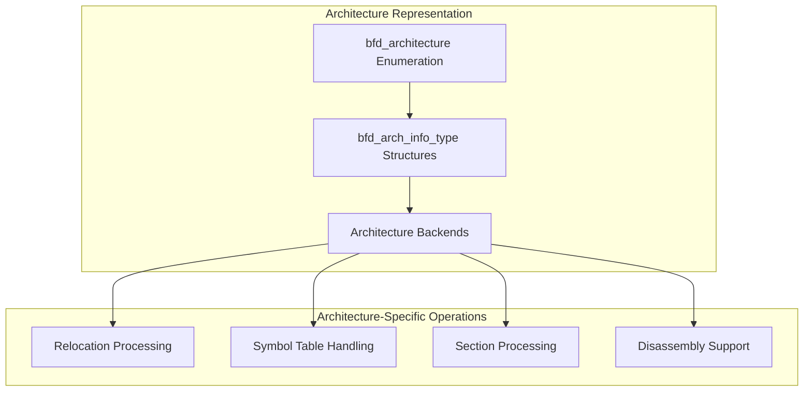
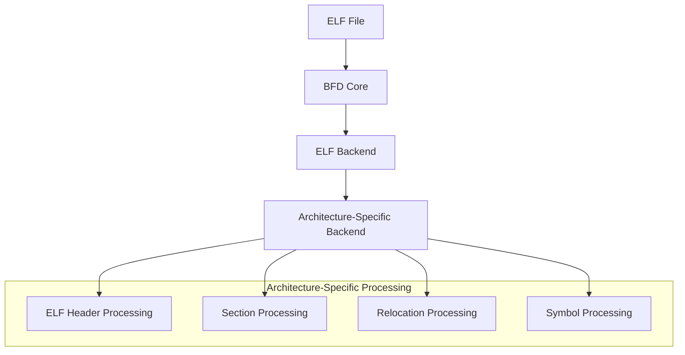
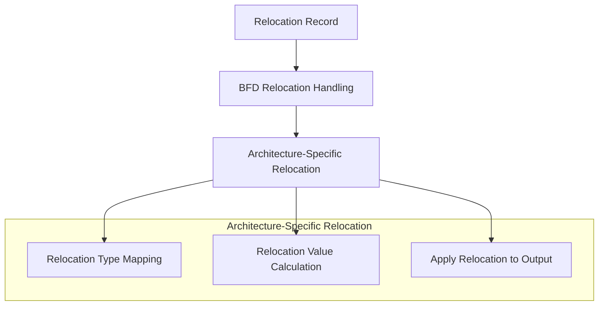
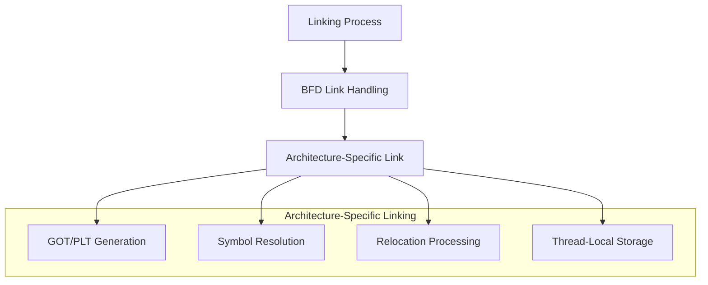
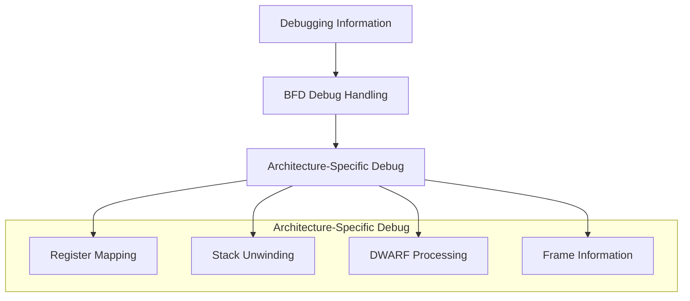
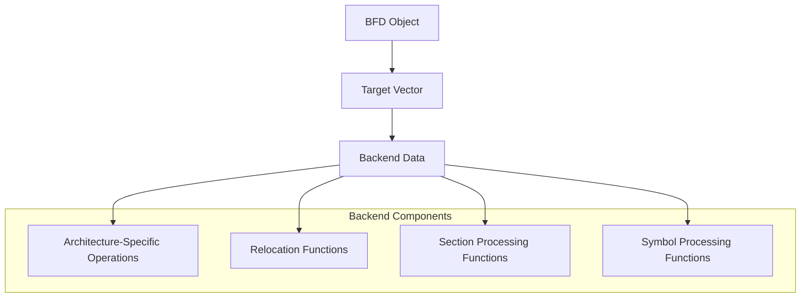

<!-- source: DeepWiki mcp.deepwiki.com · repo NVIDIA/cuda-gdb · page 4.2 Architecture-Specific Support · fetched 2026-10-26 -->

# Architecture-Specific Support

Relevant source files

The following files were used as context for generating this wiki page:

- [ChangeLog](ChangeLog)
- [bfd/ChangeLog](bfd/ChangeLog)
- [bfd/aout-target.h](bfd/aout-target.h)
- [bfd/doc/chew.c](bfd/doc/chew.c)
- [bfd/doc/doc.str](bfd/doc/doc.str)
- [bfd/doc/proto.str](bfd/doc/proto.str)
- [bfd/elf-bfd.h](bfd/elf-bfd.h)
- [bfd/elf.c](bfd/elf.c)
- [bfd/elf32-i386.c](bfd/elf32-i386.c)
- [bfd/elf64-x86-64.c](bfd/elf64-x86-64.c)
- [bfd/elfcode.h](bfd/elfcode.h)
- [bfd/elflink.c](bfd/elflink.c)
- [bfd/elfxx-target.h](bfd/elfxx-target.h)
- [bfd/elfxx-x86.c](bfd/elfxx-x86.c)
- [bfd/elfxx-x86.h](bfd/elfxx-x86.h)
- [bfd/mach-o-target.c](bfd/mach-o-target.c)
- [bfd/plugin.c](bfd/plugin.c)
- [bfd/ppcboot.c](bfd/ppcboot.c)
- [binutils/ChangeLog](binutils/ChangeLog)
- [binutils/NEWS](binutils/NEWS)
- [binutils/dwarf.c](binutils/dwarf.c)
- [binutils/dwarf.h](binutils/dwarf.h)
- [binutils/elfcomm.c](binutils/elfcomm.c)
- [binutils/elfcomm.h](binutils/elfcomm.h)
- [binutils/readelf.c](binutils/readelf.c)
- [binutils/testsuite/binutils-all/display-section-0.r](binutils/testsuite/binutils-all/display-section-0.r)
- [binutils/testsuite/binutils-all/display-section-rel.r](binutils/testsuite/binutils-all/display-section-rel.r)
- [binutils/testsuite/binutils-all/dw5.W](binutils/testsuite/binutils-all/dw5.W)
- [binutils/testsuite/binutils-all/objdump.WL](binutils/testsuite/binutils-all/objdump.WL)
- [binutils/testsuite/binutils-all/pr26160.r](binutils/testsuite/binutils-all/pr26160.r)
- [binutils/testsuite/binutils-all/readelf-debug-str-offsets-dw4.d](binutils/testsuite/binutils-all/readelf-debug-str-offsets-dw4.d)
- [binutils/testsuite/binutils-all/readelf-debug-str-offsets-dw4.s](binutils/testsuite/binutils-all/readelf-debug-str-offsets-dw4.s)
- [binutils/testsuite/binutils-all/readelf.exp](binutils/testsuite/binutils-all/readelf.exp)
- [binutils/testsuite/binutils-all/relr.s](binutils/testsuite/binutils-all/relr.s)
- [cpu/ChangeLog](cpu/ChangeLog)
- [elfcpp/ChangeLog](elfcpp/ChangeLog)
- [gas/ChangeLog](gas/ChangeLog)
- [gas/config/tc-aarch64-ginsn.c](gas/config/tc-aarch64-ginsn.c)
- [gas/config/tc-aarch64.h](gas/config/tc-aarch64.h)
- [gas/config/tc-i386-intel.c](gas/config/tc-i386-intel.c)
- [gas/config/tc-i386.h](gas/config/tc-i386.h)
- [gas/doc/c-bpf.texi](gas/doc/c-bpf.texi)
- [gas/testsuite/gas/i386/x86-64-apx-egpr-inval.l](gas/testsuite/gas/i386/x86-64-apx-egpr-inval.l)
- [gas/testsuite/gas/i386/x86-64-apx-egpr-inval.s](gas/testsuite/gas/i386/x86-64-apx-egpr-inval.s)
- [gold/ChangeLog](gold/ChangeLog)
- [gprof/ChangeLog](gprof/ChangeLog)
- [include/ChangeLog](include/ChangeLog)
- [include/elf/common.h](include/elf/common.h)
- [include/opcode/bpf.h](include/opcode/bpf.h)
- [ld/testsuite/ld-i386/i386.exp](ld/testsuite/ld-i386/i386.exp)
- [ld/testsuite/ld-i386/start.s](ld/testsuite/ld-i386/start.s)
- [ld/testsuite/ld-x86-64/apx-load1.s](ld/testsuite/ld-x86-64/apx-load1.s)
- [ld/testsuite/ld-x86-64/apx-load1a.d](ld/testsuite/ld-x86-64/apx-load1a.d)
- [ld/testsuite/ld-x86-64/apx-load1b.d](ld/testsuite/ld-x86-64/apx-load1b.d)
- [ld/testsuite/ld-x86-64/apx-load1c.d](ld/testsuite/ld-x86-64/apx-load1c.d)
- [ld/testsuite/ld-x86-64/apx-load1d.d](ld/testsuite/ld-x86-64/apx-load1d.d)
- [ld/testsuite/ld-x86-64/load4.d](ld/testsuite/ld-x86-64/load4.d)
- [ld/testsuite/ld-x86-64/load4.s](ld/testsuite/ld-x86-64/load4.s)
- [ld/testsuite/ld-x86-64/pr19609-4c.d](ld/testsuite/ld-x86-64/pr19609-4c.d)
- [ld/testsuite/ld-x86-64/pr32067.s](ld/testsuite/ld-x86-64/pr32067.s)
- [ld/testsuite/ld-x86-64/tlsie5.d](ld/testsuite/ld-x86-64/tlsie5.d)
- [ld/testsuite/ld-x86-64/x86-64.exp](ld/testsuite/ld-x86-64/x86-64.exp)
- [opcodes/ChangeLog](opcodes/ChangeLog)
- [opcodes/bpf-opc.c](opcodes/bpf-opc.c)

This page describes how Binary File Descriptor (BFD) library within CUDA-GDB provides support for different CPU architectures through a flexible backend system. Architecture-specific support is critical for binary file manipulation as different CPU architectures have unique instruction sets, relocation types, and register models that must be handled appropriately.

## Architecture Representation in BFD

BFD maintains an internal representation of CPU architectures through an enumeration and associated data structures. Each supported architecture has a corresponding backend that implements architecture-specific operations such as relocation processing, symbol handling, and section interpretation.

BFD defines the supported architectures in `archures.c` through the `bfd_architecture` enumeration. Each architecture has an associated `bfd_arch_info_type` structure that contains information such as the machine type, default flags, and a string representation.

Sources: [bfd/archures.c], [bfd/bfd-in2.h]

## ELF Architecture-Specific Handling

The ELF (Executable and Linkable Format) file format requires special handling for architecture-specific details. BFD uses backend-specific hooks to process architecture-specific ELF headers, sections, and relocations.

### ELF Header Processing

Architecture-specific fields in the ELF header, such as `e_machine`, `e_flags`, and architecture-specific ELF extensions are processed by the corresponding backend. Each architecture may have unique requirements for these fields.

For example, the x86-64 backend in `elf64-x86-64.c` processes specific flags and extensions for x86-64 architecture ELF files.

Sources: [bfd/elf.c:800-900], [bfd/elf64-x86-64.c], [bfd/elfxx-x86.c]

### Section Processing

Architecture-specific sections, such as `.got`, `.plt`, `.eh_frame`, and architecture-specific debug sections, are handled by the corresponding backend. The backend is responsible for interpreting the contents of these sections correctly.

For example, x86-64 specific sections are processed by functions in `elf64-x86-64.c` that understand the x86-64 specific layout and semantics of these sections.

Sources: [bfd/elf.c:700-800], [bfd/elf64-x86-64.c], [bfd/elfxx-x86.c]

### Relocation Processing

Different architectures have different relocation types and processing requirements. BFD's architecture-specific backends implement relocation processing functions that understand the semantics of architecture-specific relocations.

For example, the x86-64 backend in `elf64-x86-64.c` implements a relocation processing function that understands x86-64 specific relocations such as `R_X86_64_PC32`, `R_X86_64_PLT32`, and many others. Each relocation type has specific semantics and processing requirements.

Sources: [bfd/elf.c:1000-1100], [bfd/elf64-x86-64.c:45-190], [bfd/elfxx-x86.c]

## Architecture-Specific Linking

During linking, BFD needs to handle architecture-specific requirements such as GOT (Global Offset Table) and PLT (Procedure Linkage Table) generation, architecture-specific symbol resolution, and other architecture-specific linking behavior.

### GOT and PLT Generation

The Global Offset Table (GOT) and Procedure Linkage Table (PLT) are architecture-specific mechanisms used for position-independent code and dynamic linking. Each architecture has specific requirements for GOT and PLT generation.

For example, the x86-64 backend in `elf64-x86-64.c` implements functions to create and populate GOT and PLT sections according to x86-64 specific requirements.

Sources: [bfd/elflink.c:200-300], [bfd/elf64-x86-64.c], [bfd/elfxx-x86.c]

### Symbol Resolution

Architecture-specific symbol resolution rules, such as special handling for architecture-specific symbols or symbol versions, are implemented by the corresponding backend.

Sources: [bfd/elflink.c:500-600], [bfd/elf64-x86-64.c]

### Thread-Local Storage (TLS)

Thread-Local Storage (TLS) is a mechanism for allocating variables that are local to each thread. Different architectures have different TLS models and implementations. BFD's architecture-specific backends handle TLS relocation types and TLS model-specific processing.

For example, the x86-64 backend supports TLS relocations like `R_X86_64_DTPMOD64`, `R_X86_64_DTPOFF64`, and `R_X86_64_TPOFF64` for different TLS models (General Dynamic, Local Dynamic, Initial Exec, Local Exec).

Sources: [bfd/elflink.c:700-800], [bfd/elf64-x86-64.c:95-110]

## Supported Architectures

BFD supports a wide range of architectures, including:

| Architecture | Description | Key Files |
|--------------|-------------|-----------|
| x86 | 32-bit Intel IA-32 architecture | `bfd/elf32-i386.c`, `gas/config/tc-i386.h` |
| x86-64 | 64-bit AMD64/Intel EM64T architecture | `bfd/elf64-x86-64.c`, `gas/config/tc-i386.h` |
| ARM | 32-bit ARM architecture | `bfd/elf32-arm.c` |
| AArch64 | 64-bit ARM architecture | `bfd/elf64-aarch64.c` |
| RISC-V | RISC-V architecture | `bfd/elfnn-riscv.c` |
| PowerPC | PowerPC architecture | `bfd/elf32-ppc.c`, `bfd/elf64-ppc.c` |
| MIPS | MIPS architecture | `bfd/elf32-mips.c`, `bfd/elf64-mips.c` |
| BPF | Berkeley Packet Filter | `bfd/elf64-bpf.c`, `opcodes/bpf-opc.c` |

Each architecture has specific features and limitations. The architecture-specific backend implements the necessary functions to handle these specifics.

Sources: [bfd/archures.c], [bfd/config.bfd], [include/elf/common.h]

## Architecture-Specific Debugging Information

Debugging information, such as DWARF data, requires architecture-specific processing for register mapping, stack unwinding, and other architecture-specific debugging features.

### Register Mapping

Different architectures have different register sets and naming conventions. BFD's architecture-specific backends provide register mapping information to translate between register numbers in ELF/DWARF and the corresponding register names.

For example, the x86-64 backend provides mapping for registers like `%rax`, `%rbx`, etc., to their corresponding DWARF register numbers.

Sources: [binutils/dwarf.c:50-70]

### Stack Unwinding and Frame Information

Stack unwinding and frame information are architecture-specific as different architectures have different calling conventions and stack frame layouts. BFD's architecture-specific backends provide functions to interpret frame information and unwind the stack according to architecture-specific rules.

For example, x86-64 has a specific calling convention and stack frame layout that affects how stack unwinding is performed.

Sources: [bfd/dwarf2.c], [binutils/dwarf.c]

## Implementation in BFD

BFD implements architecture-specific support through a system of target vectors and backend data structures. Each supported architecture has a corresponding target vector that contains function pointers for architecture-specific operations.

The architecture-specific backend data structure (`elf_backend_data` for ELF files) contains function pointers and data for architecture-specific operations. These operations include relocation processing, section handling, symbol processing, and many others.

For example, the x86-64 backend in `elf64-x86-64.c` defines an `elf_backend_data` structure that contains function pointers for x86-64 specific operations.

Sources: [bfd/elf-bfd.h:400-500], [bfd/elf64-x86-64.c], [bfd/elfxx-x86.c]

## Conclusion

BFD's architecture-specific support is a critical component that enables it to handle binary files for a wide range of CPU architectures. The flexible backend system allows for adding support for new architectures without modifying the core BFD code. Each architecture-specific backend implements the necessary functions to handle the unique requirements of that architecture, including ELF processing, linking, and debugging information interpretation.

This architecture-specific support is what makes BFD a powerful library for binary file manipulation across different platforms and architectures.

Sources: [bfd/elf-bfd.h], [bfd/elf.c], [bfd/elflink.c], [bfd/elf64-x86-64.c], [bfd/elfxx-x86.c]

---

