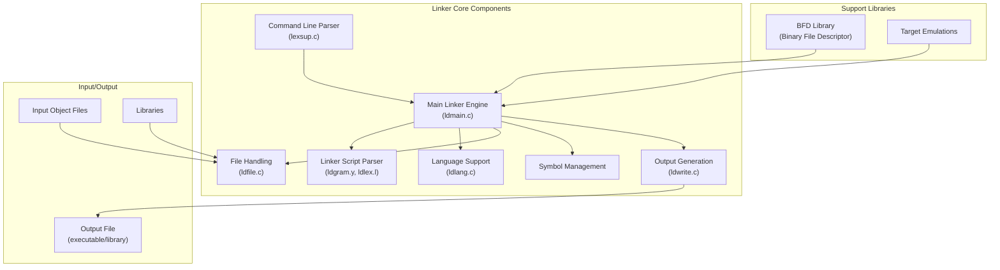
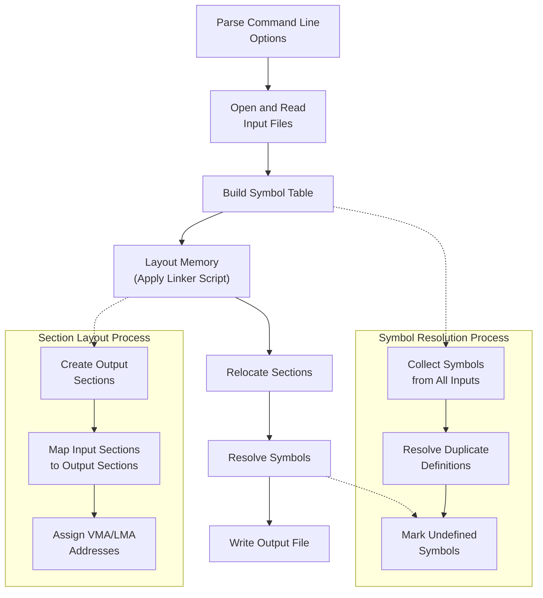
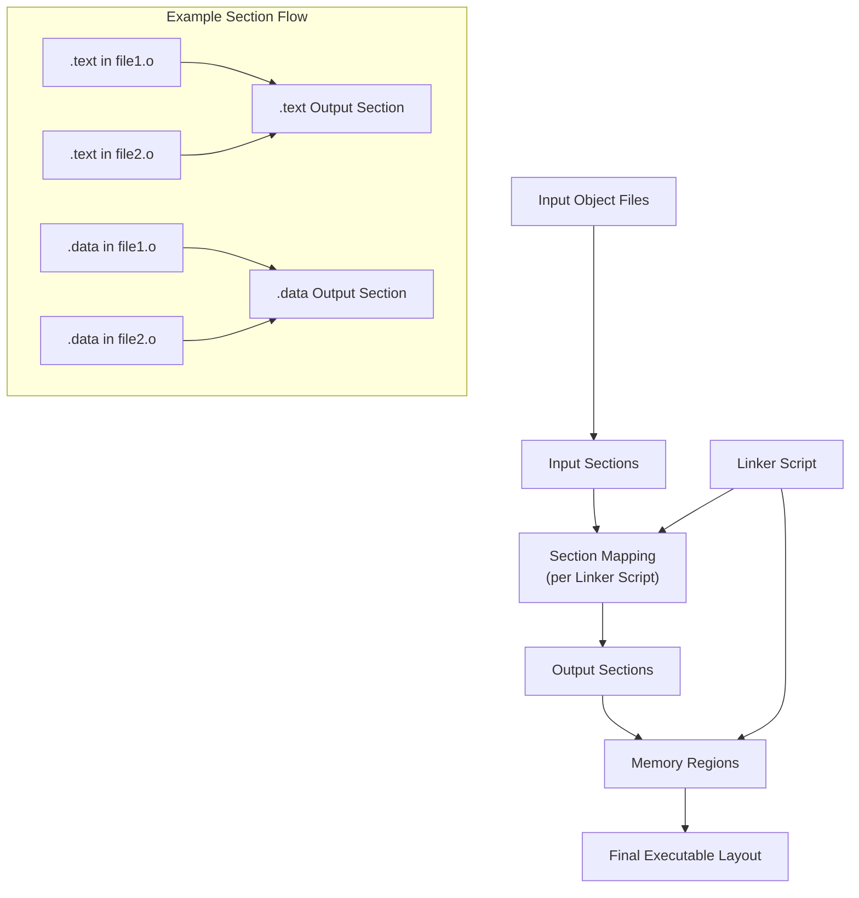
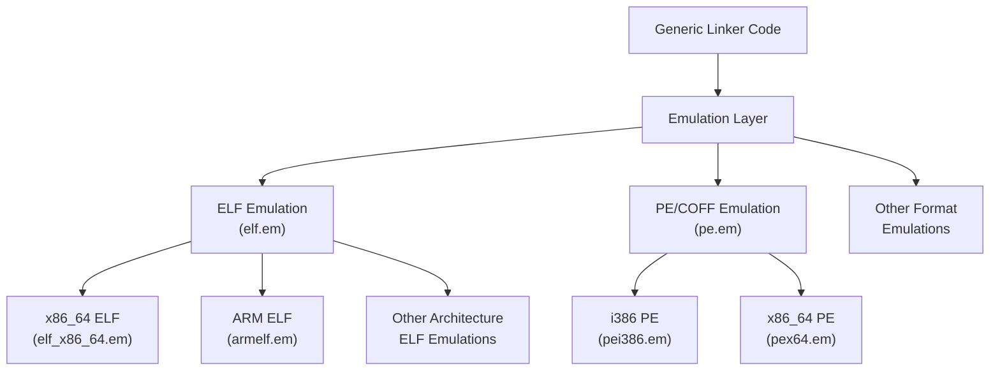
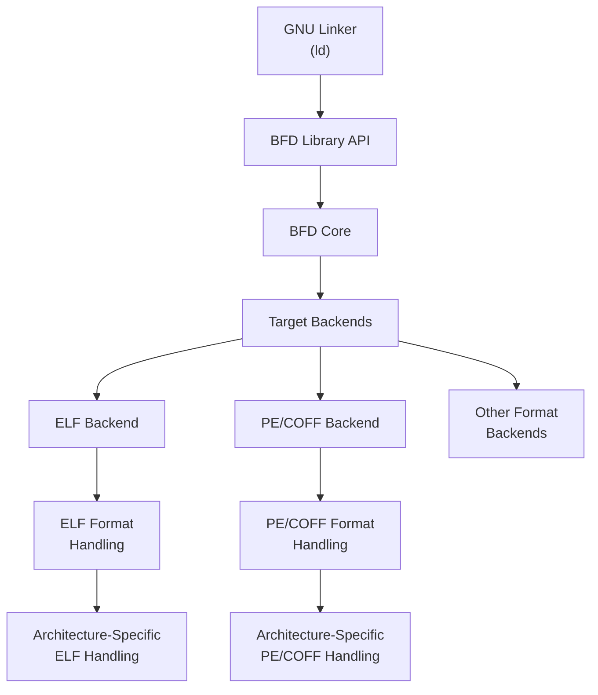

<!-- source: DeepWiki mcp.deepwiki.com · repo NVIDIA/cuda-gdb · page 5 GNU Linker (LD) · fetched 2026-10-26 -->

# GNU Linker (LD)

Relevant source files

The following files were used as context for generating this wiki page:

- [bfd/aout-target.h](bfd/aout-target.h)
- [bfd/elf-bfd.h](bfd/elf-bfd.h)
- [bfd/elf.c](bfd/elf.c)
- [bfd/elf32-i386.c](bfd/elf32-i386.c)
- [bfd/elf32-pru.c](bfd/elf32-pru.c)
- [bfd/elf64-x86-64.c](bfd/elf64-x86-64.c)
- [bfd/elfcode.h](bfd/elfcode.h)
- [bfd/elflink.c](bfd/elflink.c)
- [bfd/elfxx-target.h](bfd/elfxx-target.h)
- [bfd/elfxx-x86.c](bfd/elfxx-x86.c)
- [bfd/elfxx-x86.h](bfd/elfxx-x86.h)
- [bfd/mach-o-target.c](bfd/mach-o-target.c)
- [bfd/plugin.c](bfd/plugin.c)
- [bfd/ppcboot.c](bfd/ppcboot.c)
- [gas/config/tc-aarch64-ginsn.c](gas/config/tc-aarch64-ginsn.c)
- [gas/config/tc-aarch64.h](gas/config/tc-aarch64.h)
- [gas/config/tc-i386-intel.c](gas/config/tc-i386-intel.c)
- [gas/config/tc-i386.h](gas/config/tc-i386.h)
- [gas/testsuite/gas/i386/x86-64-apx-egpr-inval.l](gas/testsuite/gas/i386/x86-64-apx-egpr-inval.l)
- [gas/testsuite/gas/i386/x86-64-apx-egpr-inval.s](gas/testsuite/gas/i386/x86-64-apx-egpr-inval.s)
- [include/bfdlink.h](include/bfdlink.h)
- [ld/ChangeLog](ld/ChangeLog)
- [ld/NEWS](ld/NEWS)
- [ld/emultempl/elf.em](ld/emultempl/elf.em)
- [ld/ld.h](ld/ld.h)
- [ld/ld.texi](ld/ld.texi)
- [ld/ldelf.c](ld/ldelf.c)
- [ld/ldelf.h](ld/ldelf.h)
- [ld/ldexp.c](ld/ldexp.c)
- [ld/ldexp.h](ld/ldexp.h)
- [ld/ldfile.c](ld/ldfile.c)
- [ld/ldfile.h](ld/ldfile.h)
- [ld/ldgram.y](ld/ldgram.y)
- [ld/ldlang.c](ld/ldlang.c)
- [ld/ldlang.h](ld/ldlang.h)
- [ld/ldlex.h](ld/ldlex.h)
- [ld/ldlex.l](ld/ldlex.l)
- [ld/lexsup.c](ld/lexsup.c)
- [ld/plugin.c](ld/plugin.c)
- [ld/testsuite/ld-elf/elf.exp](ld/testsuite/ld-elf/elf.exp)
- [ld/testsuite/ld-elf/merge4.out](ld/testsuite/ld-elf/merge4.out)
- [ld/testsuite/ld-elf/merge4a.c](ld/testsuite/ld-elf/merge4a.c)
- [ld/testsuite/ld-elf/merge4b.s](ld/testsuite/ld-elf/merge4b.s)
- [ld/testsuite/ld-i386/i386.exp](ld/testsuite/ld-i386/i386.exp)
- [ld/testsuite/ld-i386/start.s](ld/testsuite/ld-i386/start.s)
- [ld/testsuite/ld-scripts/asciz.d](ld/testsuite/ld-scripts/asciz.d)
- [ld/testsuite/ld-scripts/asciz.t](ld/testsuite/ld-scripts/asciz.t)
- [ld/testsuite/ld-scripts/script.exp](ld/testsuite/ld-scripts/script.exp)
- [ld/testsuite/ld-x86-64/apx-load1.s](ld/testsuite/ld-x86-64/apx-load1.s)
- [ld/testsuite/ld-x86-64/apx-load1a.d](ld/testsuite/ld-x86-64/apx-load1a.d)
- [ld/testsuite/ld-x86-64/apx-load1b.d](ld/testsuite/ld-x86-64/apx-load1b.d)
- [ld/testsuite/ld-x86-64/apx-load1c.d](ld/testsuite/ld-x86-64/apx-load1c.d)
- [ld/testsuite/ld-x86-64/apx-load1d.d](ld/testsuite/ld-x86-64/apx-load1d.d)
- [ld/testsuite/ld-x86-64/load4.d](ld/testsuite/ld-x86-64/load4.d)
- [ld/testsuite/ld-x86-64/load4.s](ld/testsuite/ld-x86-64/load4.s)
- [ld/testsuite/ld-x86-64/pr19609-4c.d](ld/testsuite/ld-x86-64/pr19609-4c.d)
- [ld/testsuite/ld-x86-64/pr32067.s](ld/testsuite/ld-x86-64/pr32067.s)
- [ld/testsuite/ld-x86-64/tlsie5.d](ld/testsuite/ld-x86-64/tlsie5.d)
- [ld/testsuite/ld-x86-64/x86-64.exp](ld/testsuite/ld-x86-64/x86-64.exp)

The GNU Linker (LD) is a component of the GNU Binutils suite that combines multiple object files and libraries into a single executable, library, or object file. It performs critical functions in the compilation process such as symbol resolution, memory layout management, and relocation processing. This page provides an overview of the GNU Linker's architecture, operation, and key components.

## Purpose and Role

The GNU Linker serves as the final stage in the compilation process, taking compiled object files (.o files) created by a compiler or assembler and transforming them into executable programs, libraries, or relocatable object files. During this process, the linker:

- Resolves external symbol references between object files
- Assigns memory addresses to various code and data sections
- Performs relocations to adjust address references
- Applies memory layout as defined in linker scripts
- Creates the final output file in the appropriate format (e.g., ELF, PE/COFF)

Sources: [ld/ld.texi:189-238](), [bfd/elflink.c:122-221]()

## Architecture Overview

The GNU Linker has a modular architecture that separates core functionality from target-specific implementations.

Sources: [ld/ldmain.c](), [ld/ldlang.c:63-153](), [ld/lexsup.c](), [ld/ldfile.c]()

## Linking Process

The GNU Linker follows a multi-stage process to transform input files into the output executable or library.

Sources: [ld/ldmain.c](), [ld/ldlang.c:455-776](), [bfd/elflink.c:579-664]()

## Component Descriptions

### Command Line Interface

The linker's command line interface is handled primarily by `lexsup.c`, which parses options and sets corresponding internal flags. Command line options can control virtually every aspect of the linking process, from search paths for libraries to the final memory layout.

Key option groups include:
- File and path options (-L, -l, etc.)
- Output format control (-r, -shared, etc.)
- Symbol handling (--export-dynamic, --undefined, etc.)
- Section handling (--section-start, --gc-sections, etc.)
- Architecture-specific options

Sources: [ld/lexsup.c](), [ld/ld.texi:240-360]()

### Object File Handling

The GNU Linker uses the Binary File Descriptor (BFD) library to read and write object files in various formats. This abstraction layer allows the linker to support multiple object file formats and target architectures without changing the core linking logic.

The linker identifies and processes these object file types:
- Regular object files (typically .o files)
- Archive libraries (.a files)
- Shared libraries (.so files on Unix-like systems)
- Linker scripts

Sources: [ld/ldfile.c:79-130](), [bfd/elf.c:795-882]()

### Memory Layout and Sections

The linker organizes the output file into sections, which are contiguous blocks of memory with specific properties (executable, read-only, initialized data, etc.). Section handling is one of the linker's most complex tasks, involving:

1. Creating output sections based on input sections and linker scripts
2. Determining the order and alignment of sections
3. Assigning virtual memory addresses (VMA) and load memory addresses (LMA)
4. Handling special sections like .text, .data, .bss, .got, .plt, etc.

Sources: [ld/ldlang.c:455-776](), [ld/emultempl/elf.em]()

### Symbol Resolution

Symbol resolution maps symbol references to their definitions across multiple input files. The linker builds a global symbol table and resolves symbols according to language-specific and user-provided rules. Key aspects include:

- Symbol definition: where a symbol is defined with its value
- Symbol reference: where a symbol is used
- Weak symbols: symbols that can be overridden by strong definitions
- Common symbols: symbols with size but not allocated yet
- Undefined symbols: referenced but not defined symbols

The linker follows specific rules to resolve duplicates and handle undefined symbols, which can be modified by command-line options like `--allow-multiple-definition` or `--unresolved-symbols`.

Sources: [bfd/elflink.c:579-664](), [ld/ldexp.c]()

### Relocation Processing

Relocation is the process of adjusting references to symbols based on their final assigned addresses. When a compiler generates code, it cannot know the final address of external symbols, so it creates relocations—markers indicating where addresses need to be filled in or adjusted by the linker.

The relocation process involves:
1. Reading relocation entries from input files
2. Finding the target symbol's final address
3. Calculating the appropriate value based on the relocation type
4. Modifying the code or data at the relocation site

Different architectures have different relocation types, handled by architecture-specific code.

Sources: [bfd/elf.c:1077-1123](), [bfd/elf64-x86-64.c:45-203](), [bfd/elf32-i386.c]()

### Target Emulations

The GNU Linker supports multiple target architectures and operating systems through "emulations"—modules that customize the linker's behavior for specific targets. Emulations handle target-specific aspects like:

- Default memory layouts
- Special section handling
- Target-specific relocations
- Format-specific output generation

Sources: [ld/emultempl/elf.em](), [ld/ldmain.c]()

## Command Line Options

The GNU Linker provides a comprehensive set of command line options to control the linking process. Some of the most commonly used options include:

| Option | Description |
|--------|-------------|
| `-o file` | Set output file name |
| `-l library` | Search for library when linking |
| `-L dir` | Add directory to library search path |
| `-shared` | Create a shared library |
| `-r` | Generate relocatable output |
| `-s` | Strip all symbols |
| `-T script` | Use script as the linker script |
| `--entry=symbol` | Set entry point address |
| `--gc-sections` | Remove unused sections |
| `--print-map` | Print a link map |

A complete list of options and their descriptions is available in the GNU Linker documentation.

Sources: [ld/ld.texi:261-360](), [ld/lexsup.c:370-685]()

## Linker Scripts

Linker scripts control how input sections are mapped to output sections and how the sections are placed in memory. They provide fine-grained control over the linking process. A linker script defines:

- Memory layout
- Output section composition
- Symbol assignments
- Overlay structures
- Other special processing

The linker script language has its own syntax and semantics, interpreted by the linker script parser (`ldgram.y` and `ldlex.l`). For detailed information on linker scripts, see [Linker Scripts](#5.1).

Sources: [ld/ldgram.y](), [ld/ldlex.l](), [ld/ld.texi:429-450]()

## Interaction with Binary File Descriptor (BFD)

The GNU Linker heavily relies on the Binary File Descriptor (BFD) library for handling object files. BFD provides an abstraction layer that allows the linker to work with multiple object file formats (ELF, PE/COFF, etc.) using a consistent interface.

Key BFD functions used by the linker include:
- Opening and parsing object files
- Reading symbol tables
- Processing relocations
- Writing output files

Sources: [bfd/elf.c](), [bfd/elflink.c](), [bfd/elfxx-target.h]()

## Architecture-Specific Handling

While the core linking algorithms are architecture-independent, many aspects of linking are specific to particular architectures. Architecture-specific code handles:

- Relocation types and processing
- Special section requirements
- Architecture-specific optimizations
- Platform-specific conventions

The GNU Linker includes specialized code for many architectures, including:
- x86 and x86-64
- ARM and AArch64
- MIPS
- PowerPC
- RISC-V
- Many others

Sources: [bfd/elf64-x86-64.c](), [bfd/elf32-i386.c](), [bfd/elfxx-x86.c](), [gas/config/tc-i386.h]()

This overview provides a high-level understanding of the GNU Linker, its architecture, components, and operation. For more detailed information on specific aspects like linker scripts and symbol resolution, refer to their dedicated wiki pages.

---

