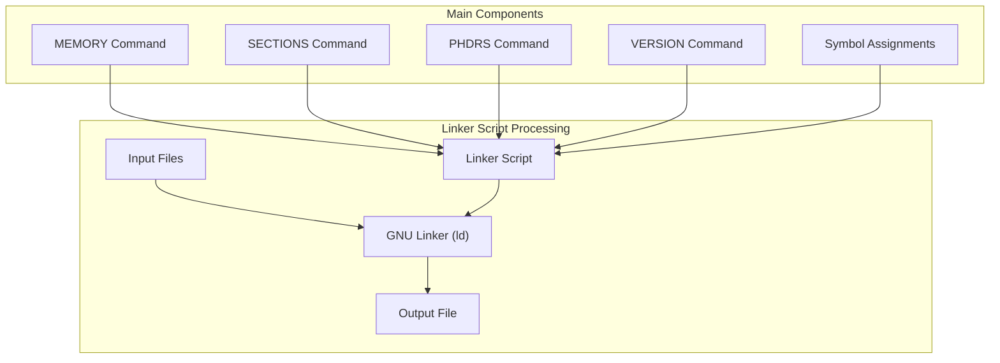
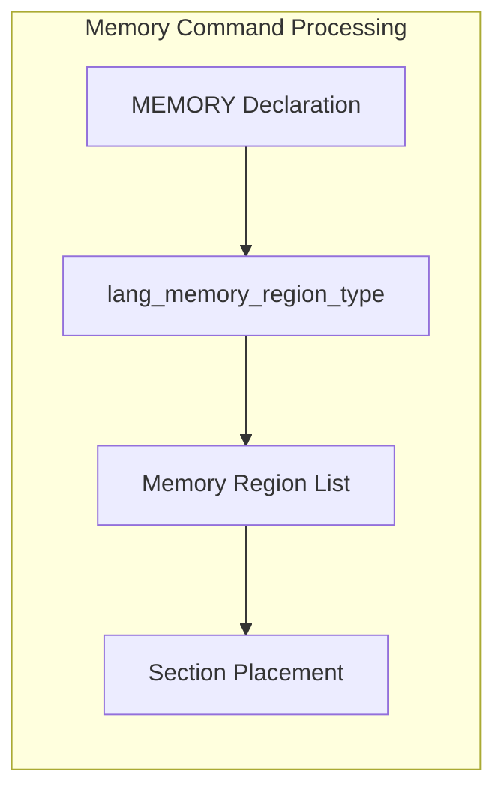
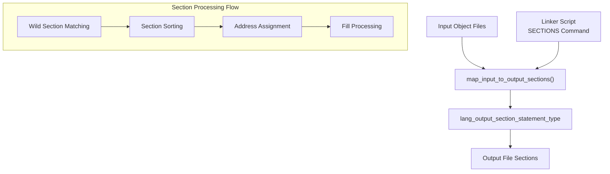
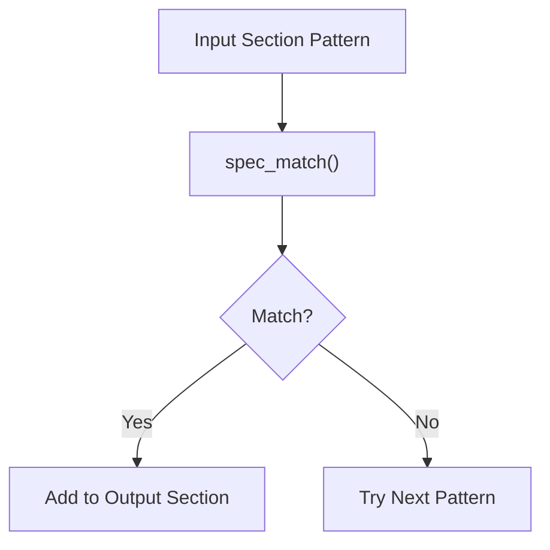
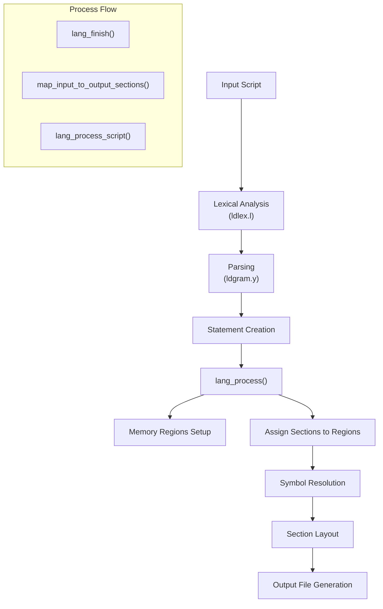

<!-- source: DeepWiki mcp.deepwiki.com · repo NVIDIA/cuda-gdb · page 5.1 Linker Scripts · fetched 2026-10-26 -->

# Linker Scripts

<details>
<summary>Relevant source files</summary>

The following files were used as context for generating this wiki page:

- [bfd/elf32-pru.c](bfd/elf32-pru.c)
- [include/bfdlink.h](include/bfdlink.h)
- [ld/ChangeLog](ld/ChangeLog)
- [ld/NEWS](ld/NEWS)
- [ld/emultempl/elf.em](ld/emultempl/elf.em)
- [ld/ld.h](ld/ld.h)
- [ld/ld.texi](ld/ld.texi)
- [ld/ldelf.c](ld/ldelf.c)
- [ld/ldelf.h](ld/ldelf.h)
- [ld/ldexp.c](ld/ldexp.c)
- [ld/ldexp.h](ld/ldexp.h)
- [ld/ldfile.c](ld/ldfile.c)
- [ld/ldfile.h](ld/ldfile.h)
- [ld/ldgram.y](ld/ldgram.y)
- [ld/ldlang.c](ld/ldlang.c)
- [ld/ldlang.h](ld/ldlang.h)
- [ld/ldlex.h](ld/ldlex.h)
- [ld/ldlex.l](ld/ldlex.l)
- [ld/lexsup.c](ld/lexsup.c)
- [ld/plugin.c](ld/plugin.c)
- [ld/testsuite/ld-elf/elf.exp](ld/testsuite/ld-elf/elf.exp)
- [ld/testsuite/ld-elf/merge4.out](ld/testsuite/ld-elf/merge4.out)
- [ld/testsuite/ld-elf/merge4a.c](ld/testsuite/ld-elf/merge4a.c)
- [ld/testsuite/ld-elf/merge4b.s](ld/testsuite/ld-elf/merge4b.s)
- [ld/testsuite/ld-scripts/asciz.d](ld/testsuite/ld-scripts/asciz.d)
- [ld/testsuite/ld-scripts/asciz.t](ld/testsuite/ld-scripts/asciz.t)
- [ld/testsuite/ld-scripts/script.exp](ld/testsuite/ld-scripts/script.exp)

</details>


This page documents the linker script functionality in the CUDA-GDB repository, explaining how linker scripts control the layout and organization of linked programs. For related functionality regarding plugin support, see [Plugins](#4).

## Introduction to Linker Scripts

Linker scripts are text files that provide explicit control over how the GNU linker (ld) combines input files into an output file. They're used to control memory layout, section arrangement, and symbol placement in the final executable or library.

In the context of CUDA debugging, linker scripts help ensure proper organization of both host and device code sections, facilitating accurate debugging information.



Sources: [ld/ld.texi:187-189](), [ld/ldlang.c:21-45]()

## Linker Script Commands

Linker scripts contain a series of commands that define how the linker should construct the output file. The most commonly used commands include:

| Command | Purpose |
|---------|---------|
| ENTRY | Specifies the entry point (first instruction executed) |
| MEMORY | Defines memory regions with addresses and sizes |
| SECTIONS | Specifies how input sections map to output sections |
| PHDRS | Defines program headers for ELF files |
| VERSION | Controls symbol versioning in shared libraries |
| INCLUDE | Includes another linker script file |

Each command follows a specific syntax defined by the linker's command language parser.

Sources: [ld/ldgram.y:130-140](), [ld/ldlex.l:260-267]()

## MEMORY Command

The MEMORY command defines the memory layout of the target system, specifying regions with their addresses, sizes, and attributes:

```
MEMORY
{
  name [(attr)] : ORIGIN = origin, LENGTH = len
  ...
}
```

- `name`: Identifier for the memory region
- `attr`: Optional attributes (r=read, w=write, x=execute, a=allocate)
- `origin`: Starting address of the region
- `length`: Size of the region

The linker uses these definitions to place sections in appropriate memory regions.



Sources: [ld/ldlang.c:50-69](), [ld/ldlang.h:50-69]()

## SECTIONS Command

The SECTIONS command is the core of most linker scripts. It defines how input sections from object files are combined into output sections in the final executable:

```
SECTIONS
{
  output-section-name [address] [(type)] : 
  {
    input-section-description
    ...
  } [>region] [AT>lma_region] [=fill]
  ...
}
```

- `output-section-name`: Name of the output section
- `address`: Optional VMA (Virtual Memory Address)
- `type`: Optional section type
- `input-section-description`: Specifies which input sections to include
- `region`: Memory region for this section
- `fill`: Pattern to fill gaps

The section mapping is implemented in the `map_input_to_output_sections` function in the linker.



Sources: [ld/ldlang.c:89-232](), [ld/ldlang.h:131-178]()

## Input Section Wildcards

Input section descriptions in the SECTIONS command can use wildcards to match sections from input files:

```
*(.text)        /* All .text sections from all files */
file.o(.data)   /* .data section from file.o */
*(COMMON)       /* All common symbols */
*(.text.*)      /* All .text and subsections */
```

Wildcard matching is implemented through pattern matching functions like `spec_match`.



Sources: [ld/ldlang.c:242-322](), [ld/ldlang.c:452-464]()

## Section Sorting

Sections can be sorted within an output section using SORT directives:

```
SORT_BY_NAME(input-sections)
SORT_BY_ALIGNMENT(input-sections)
SORT_BY_INIT_PRIORITY(input-sections)
REVERSE(input-sections)
```

Sorting is implemented in the `wild_sort` function, which determines the ordering of sections within an output section.

Sources: [ld/ldlang.c:599-737](), [ld/NEWS:67-72]()

## Symbol Assignments

Linker scripts can define symbols using assignment statements:

```
symbol = expression;
symbol += expression;
symbol -= expression;
```

The expressions can reference other symbols, constants, the location counter (.), or use operators. Symbol assignment is processed by the expression evaluation subsystem.

Sources: [ld/ldexp.c:1-50](), [ld/ldlang.c:98-103](), [ld/ldgram.y:1076-1100]()

## The Location Counter

The special symbol "." (period) represents the current address during linking. It can be both read and assigned:

```
. = 0x1000;           /* Set current address to 0x1000 */
symbol = .;           /* Assign current address to symbol */
. = ALIGN(4);         /* Align current address to 4-byte boundary */
```

The location counter is fundamental to controlling addresses in the output file.

Sources: [ld/ld.texi:3000-3100]()

## PHDRS Command

For ELF output files, the PHDRS command defines program headers:

```
PHDRS
{
  name type [FILEHDR] [PHDRS] [AT(address)] [FLAGS(flags)];
  ...
}
```

- `name`: Name of the program header
- `type`: Type (PT_LOAD, PT_DYNAMIC, etc.)
- `FILEHDR`: Include the ELF file header
- `PHDRS`: Include the program headers themselves

Program headers are used by the system loader and are especially important for shared libraries and PIE executables.

Sources: [ld/ldgram.y:812-848](), [ld/ldlang.h:134-140]()

## VERSION Command

For shared libraries, the VERSION command controls symbol versioning:

```
VERSION
{
  version-name {
    global-symbol;
    ...
  };
  ...
}
```

Versioning allows multiple versions of a symbol to coexist in a shared library, supporting backward compatibility.

Sources: [ld/ldgram.y:853-895](), [ld/ldlang.c:105-106]()

## Advanced Features

### OVERLAY Directive

The OVERLAY directive creates memory overlays, useful for memory-constrained systems:

```
OVERLAY start : AT(ldaddr)
{
  .section1 { ... }
  .section2 { ... }
} = fill
```

Overlays allow multiple sections to occupy the same memory at different times.

### ASSERT Function

The ASSERT function adds validation to linker scripts:

```
ASSERT(expression, message)
```

This causes the linker to exit with an error if the expression evaluates to zero.

Sources: [ld/ldgram.y:1400-1410](), [ld/ldlang.c:279]()

## Linker Script Processing



Sources: [ld/ldlang.c:89-106](), [ld/ldlang.c:1000-1100]()

## Example Linker Script

Below is a basic example of a linker script with common elements:

```
/* Define the entry point */
ENTRY(_start)

/* Define memory regions */
MEMORY
{
  FLASH (rx) : ORIGIN = 0x00000000, LENGTH = 64K
  RAM (rwx)  : ORIGIN = 0x20000000, LENGTH = 16K
}

/* Define program headers */
PHDRS
{
  text PT_LOAD;
  data PT_LOAD;
}

/* Define sections */
SECTIONS
{
  .text : {
    *(.text)
    *(.text.*)
  } >FLASH :text
  
  .data : {
    *(.data)
    *(.data.*)
  } >RAM AT>FLASH :data
  
  .bss : {
    *(.bss)
    *(COMMON)
  } >RAM
  
  /* Define symbols */
  __data_start = ADDR(.data);
  __data_end = __data_start + SIZEOF(.data);
  __data_load = LOADADDR(.data);
  __bss_start = ADDR(.bss);
  __bss_end = __bss_start + SIZEOF(.bss);
}
```

This example defines memory regions, sections with appropriate placement, and symbols that can be used by the program.

Sources: [ld/ld.texi:3200-3300]()

## Linker Script Integration with CUDA-GDB

In the CUDA-GDB context, linker scripts help organize both host and device code sections, ensuring proper debug information is available during debugging sessions. This is particularly important for CUDA applications where code executes across both CPU and GPU.

The linker ensures that debug information sections (.debug_*) are properly linked to facilitate source-level debugging. For CUDA applications, this includes maintaining the relationship between host and device code sections.

Sources: [ld/ldelf.c:153-170]()

---

