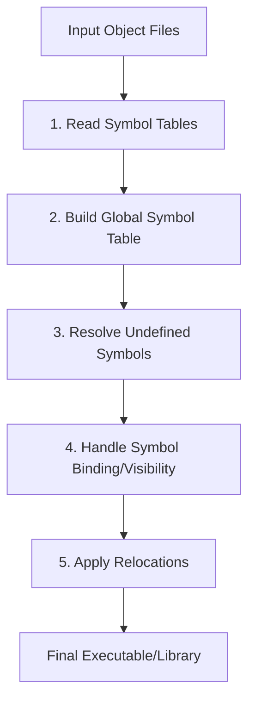
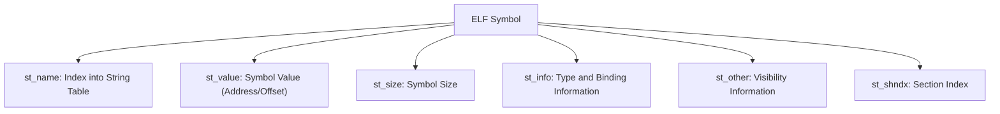
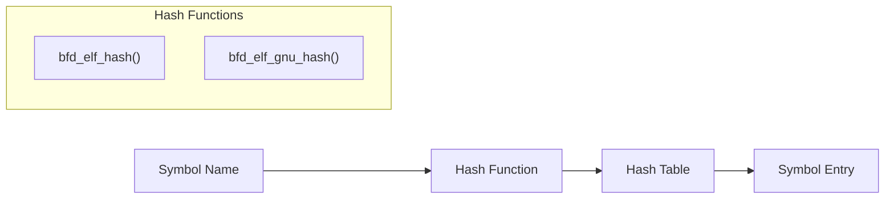
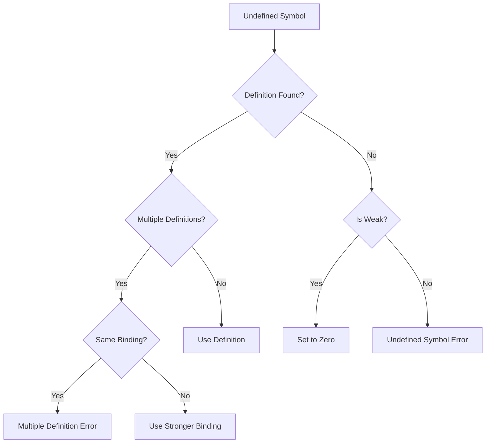
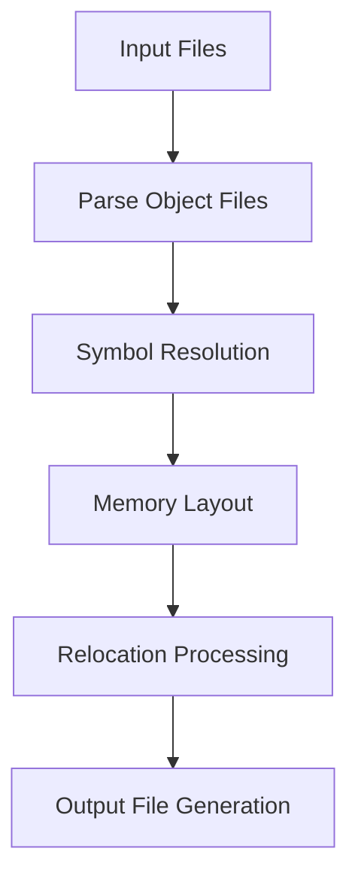

<!-- source: DeepWiki mcp.deepwiki.com · repo NVIDIA/cuda-gdb · page 5.2 Symbol Resolution · fetched 2026-10-26 -->

# Symbol Resolution

<details>
<summary>Relevant source files</summary>

The following files were used as context for generating this wiki page:

- [bfd/aout-target.h](bfd/aout-target.h)
- [bfd/elf-bfd.h](bfd/elf-bfd.h)
- [bfd/elf.c](bfd/elf.c)
- [bfd/elf32-i386.c](bfd/elf32-i386.c)
- [bfd/elf32-pru.c](bfd/elf32-pru.c)
- [bfd/elf64-x86-64.c](bfd/elf64-x86-64.c)
- [bfd/elfcode.h](bfd/elfcode.h)
- [bfd/elflink.c](bfd/elflink.c)
- [bfd/elfxx-target.h](bfd/elfxx-target.h)
- [bfd/elfxx-x86.c](bfd/elfxx-x86.c)
- [bfd/elfxx-x86.h](bfd/elfxx-x86.h)
- [bfd/mach-o-target.c](bfd/mach-o-target.c)
- [bfd/plugin.c](bfd/plugin.c)
- [bfd/ppcboot.c](bfd/ppcboot.c)
- [gas/config/tc-aarch64-ginsn.c](gas/config/tc-aarch64-ginsn.c)
- [gas/config/tc-aarch64.h](gas/config/tc-aarch64.h)
- [gas/config/tc-i386-intel.c](gas/config/tc-i386-intel.c)
- [gas/config/tc-i386.h](gas/config/tc-i386.h)
- [gas/testsuite/gas/i386/x86-64-apx-egpr-inval.l](gas/testsuite/gas/i386/x86-64-apx-egpr-inval.l)
- [gas/testsuite/gas/i386/x86-64-apx-egpr-inval.s](gas/testsuite/gas/i386/x86-64-apx-egpr-inval.s)
- [include/bfdlink.h](include/bfdlink.h)
- [ld/ChangeLog](ld/ChangeLog)
- [ld/NEWS](ld/NEWS)
- [ld/emultempl/elf.em](ld/emultempl/elf.em)
- [ld/ld.h](ld/ld.h)
- [ld/ld.texi](ld/ld.texi)
- [ld/ldelf.c](ld/ldelf.c)
- [ld/ldelf.h](ld/ldelf.h)
- [ld/ldexp.c](ld/ldexp.c)
- [ld/ldexp.h](ld/ldexp.h)
- [ld/ldfile.c](ld/ldfile.c)
- [ld/ldfile.h](ld/ldfile.h)
- [ld/ldgram.y](ld/ldgram.y)
- [ld/ldlang.c](ld/ldlang.c)
- [ld/ldlang.h](ld/ldlang.h)
- [ld/ldlex.h](ld/ldlex.h)
- [ld/ldlex.l](ld/ldlex.l)
- [ld/lexsup.c](ld/lexsup.c)
- [ld/plugin.c](ld/plugin.c)
- [ld/testsuite/ld-elf/elf.exp](ld/testsuite/ld-elf/elf.exp)
- [ld/testsuite/ld-elf/merge4.out](ld/testsuite/ld-elf/merge4.out)
- [ld/testsuite/ld-elf/merge4a.c](ld/testsuite/ld-elf/merge4a.c)
- [ld/testsuite/ld-elf/merge4b.s](ld/testsuite/ld-elf/merge4b.s)
- [ld/testsuite/ld-i386/i386.exp](ld/testsuite/ld-i386/i386.exp)
- [ld/testsuite/ld-i386/start.s](ld/testsuite/ld-i386/start.s)
- [ld/testsuite/ld-scripts/asciz.d](ld/testsuite/ld-scripts/asciz.d)
- [ld/testsuite/ld-scripts/asciz.t](ld/testsuite/ld-scripts/asciz.t)
- [ld/testsuite/ld-scripts/script.exp](ld/testsuite/ld-scripts/script.exp)
- [ld/testsuite/ld-x86-64/apx-load1.s](ld/testsuite/ld-x86-64/apx-load1.s)
- [ld/testsuite/ld-x86-64/apx-load1a.d](ld/testsuite/ld-x86-64/apx-load1a.d)
- [ld/testsuite/ld-x86-64/apx-load1b.d](ld/testsuite/ld-x86-64/apx-load1b.d)
- [ld/testsuite/ld-x86-64/apx-load1c.d](ld/testsuite/ld-x86-64/apx-load1c.d)
- [ld/testsuite/ld-x86-64/apx-load1d.d](ld/testsuite/ld-x86-64/apx-load1d.d)
- [ld/testsuite/ld-x86-64/load4.d](ld/testsuite/ld-x86-64/load4.d)
- [ld/testsuite/ld-x86-64/load4.s](ld/testsuite/ld-x86-64/load4.s)
- [ld/testsuite/ld-x86-64/pr19609-4c.d](ld/testsuite/ld-x86-64/pr19609-4c.d)
- [ld/testsuite/ld-x86-64/pr32067.s](ld/testsuite/ld-x86-64/pr32067.s)
- [ld/testsuite/ld-x86-64/tlsie5.d](ld/testsuite/ld-x86-64/tlsie5.d)
- [ld/testsuite/ld-x86-64/x86-64.exp](ld/testsuite/ld-x86-64/x86-64.exp)

</details>


Symbol resolution is the process by which the GNU linker resolves symbolic references (such as function names and variable references) to their actual definitions during the linking process. This page explains how symbol resolution works in the CUDA-GDB codebase, focusing on the mechanisms used to match symbol references in one object file with their definitions in other object files or libraries.

## Overview of Symbol Resolution Process

When linking object files, the linker must resolve all symbolic references to create a functional executable or library. The symbol resolution process involves several key stages:



Sources: [bfd/elf.c:372-525](), [bfd/elflink.c:587-664](), [ld/ldlang.c]()

## ELF Symbol Structure

In ELF files, symbols are stored in symbol tables (typically in `.symtab` and `.dynsym` sections). The structure of an ELF symbol is defined in the codebase as `Elf_Internal_Sym`:



Each symbol entry in an ELF file contains this information, which the linker uses during symbol resolution.

Sources: [bfd/elf-bfd.h](), [bfd/elf.c:547-560]()

## Symbol Table Management

Symbol tables are crucial for the linking process. The linker reads symbol tables from input files and builds a global symbol table.

### Reading Symbol Tables

The function `bfd_elf_get_elf_syms` in `bfd/elf.c` reads symbols from an ELF section:

```
Elf_Internal_Sym *
bfd_elf_get_elf_syms (bfd *ibfd,
                      Elf_Internal_Shdr *symtab_hdr,
                      size_t symcount,
                      size_t symoffset,
                      Elf_Internal_Sym *intsym_buf,
                      void *extsym_buf,
                      Elf_External_Sym_Shndx *extshndx_buf)
```

This function converts external symbol representations to internal form, which the linker can process more efficiently.

Sources: [bfd/elf.c:372-525]()

### Symbol Name Resolution

The function `bfd_elf_sym_name` retrieves a symbol's name:

```
const char *
bfd_elf_sym_name (bfd *abfd,
                  Elf_Internal_Shdr *symtab_hdr,
                  Elf_Internal_Sym *isym,
                  asection *sym_sec)
```

Symbol names are stored in string tables, and `bfd_elf_string_from_elf_section` is used to retrieve them:

```
char *
bfd_elf_string_from_elf_section (bfd *abfd,
                                 unsigned int shindex,
                                 unsigned int strindex)
```

Sources: [bfd/elf.c:308-362](), [bfd/elf.c:547-560]()

## Symbol Hashing and Lookup

To efficiently look up symbols, the linker uses hash tables. Two hash functions are implemented:

1. **Standard ELF Hash** (`bfd_elf_hash`): The traditional ELF hash function
2. **GNU Hash** (`bfd_elf_gnu_hash`): An optimized hash function introduced by GNU



### Symbol Hash Computation

The standard ELF hash function is implemented in `bfd_elf_hash`:

```c
unsigned long
bfd_elf_hash (const char *namearg)
{
  uint32_t h = 0;

  for (const unsigned char *name = (const unsigned char *) namearg;
       *name; name++)
    {
      h = (h << 4) + *name;
      h ^= (h >> 24) & 0xf0;
    }
  return h & 0x0fffffff;
}
```

The GNU hash function is implemented in `bfd_elf_gnu_hash`:

```c
unsigned long
bfd_elf_gnu_hash (const char *namearg)
{
  uint32_t h = 5381;

  for (const unsigned char *name = (const unsigned char *) namearg;
       *name; name++)
    h = (h << 5) + h + *name;
  return h;
}
```

Sources: [bfd/elf.c:196-208](), [bfd/elf.c:213-222]()

### Symbol Lookup Functions

Functions for looking up symbols in hash tables include:

- `get_link_hash_entry`: Retrieves a hash entry for a symbol
- `_bfd_elf_get_link_hash_entry`: Wrapper around `get_link_hash_entry`

Sources: [bfd/elflink.c:100-131]()

## Symbol Binding and Visibility

Symbols can have different binding types, which affect how they are resolved:

- **Local (STB_LOCAL)**: Visible only within the file where defined
- **Global (STB_GLOBAL)**: Visible to all files being linked
- **Weak (STB_WEAK)**: Similar to global, but can be overridden

Symbol visibility attributes control the visibility of symbols in shared libraries:

- **Default (STV_DEFAULT)**: Symbol is visible outside the shared object
- **Hidden (STV_HIDDEN)**: Symbol is not visible outside the shared object
- **Protected (STV_PROTECTED)**: Symbol is visible but not preemptible

The function `bfd_elf_link_record_dynamic_symbol` handles symbol visibility and binding:

```c
bool
bfd_elf_link_record_dynamic_symbol (struct bfd_link_info *info,
                                   struct elf_link_hash_entry *h)
{
  // ...
  /* XXX: The ABI draft says the linker must turn hidden and
     internal symbols into STB_LOCAL symbols when producing the
     DSO. However, if ld.so honors st_other in the dynamic table,
     this would not be necessary.  */
  switch (ELF_ST_VISIBILITY (h->other))
    {
    case STV_INTERNAL:
    case STV_HIDDEN:
      if (h->root.type != bfd_link_hash_undefined
          && h->root.type != bfd_link_hash_undefweak)
        {
          h->forced_local = 1;
          return true;
        }
    // ...
    }
  // ...
}
```

Sources: [bfd/elflink.c:587-664](), [bfd/elf-bfd.h:127-217]()

## Symbol Resolution in Action

When resolving symbols, the linker follows these general rules:

1. For each undefined symbol, the linker searches for a definition in the global symbol table
2. If multiple definitions exist, binding rules determine which one is used:
   - Global symbols take precedence over weak symbols
   - If multiple global symbols exist, the linker reports a multiple definition error
3. If no definition is found for a symbol that isn't weak, the linker reports an undefined symbol error
4. For weak undefined symbols with no definition, the value is typically set to zero



Sources: [bfd/elflink.c](), [ld/ldlang.c]()

## Managing Dynamic Symbols

For dynamic linking, the linker needs to record symbols in the dynamic symbol table:

```c
bool
bfd_elf_link_record_dynamic_symbol (struct bfd_link_info *info,
                                   struct elf_link_hash_entry *h)
{
  if (h->dynindx == -1)
    {
      struct elf_strtab_hash *dynstr;
      char *p;
      const char *name;
      size_t indx;
      
      // Add symbol to dynamic symbol table
      h->dynindx = elf_hash_table (info)->dynsymcount;
      ++elf_hash_table (info)->dynsymcount;
      
      // Handle symbol name in string table
      // ...
    }
  return true;
}
```

Sources: [bfd/elflink.c:587-664]()

## Common Symbol Resolution Issues

Common issues in symbol resolution include:

1. **Undefined Symbols**: When a symbol is referenced but not defined in any input file
2. **Multiple Definitions**: When the same symbol is defined in multiple input files
3. **Weak Symbol Resolution**: How weak symbols are handled when conflicts arise

The linker has specific rules for handling these cases, which are implemented in functions throughout the codebase.

Sources: [ld/ldlang.c](), [bfd/elflink.c]()

## Integration with the Overall Linking Process

Symbol resolution is a crucial part of the overall linking process, which includes:



Symbol resolution feeds into the relocation process, where the linker updates addresses based on the resolved symbols.

Sources: [ld/ldlang.c](), [ld/ldelf.c]()

## Conclusion

Symbol resolution is a fundamental part of the linking process in the GNU linker. It involves reading symbols from input files, managing a global symbol table, resolving symbol references according to binding and visibility rules, and supporting dynamic linking when necessary. Understanding this process is crucial for debugging linking issues and comprehending how the linker combines multiple object files into a cohesive executable or library.

---

