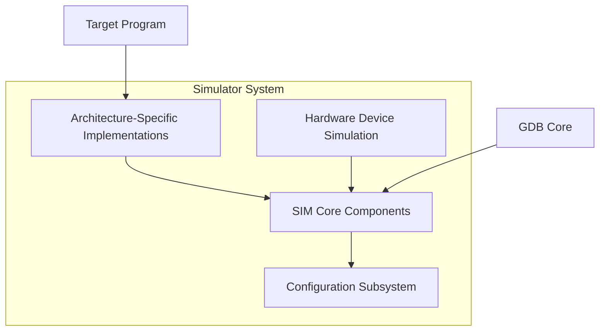
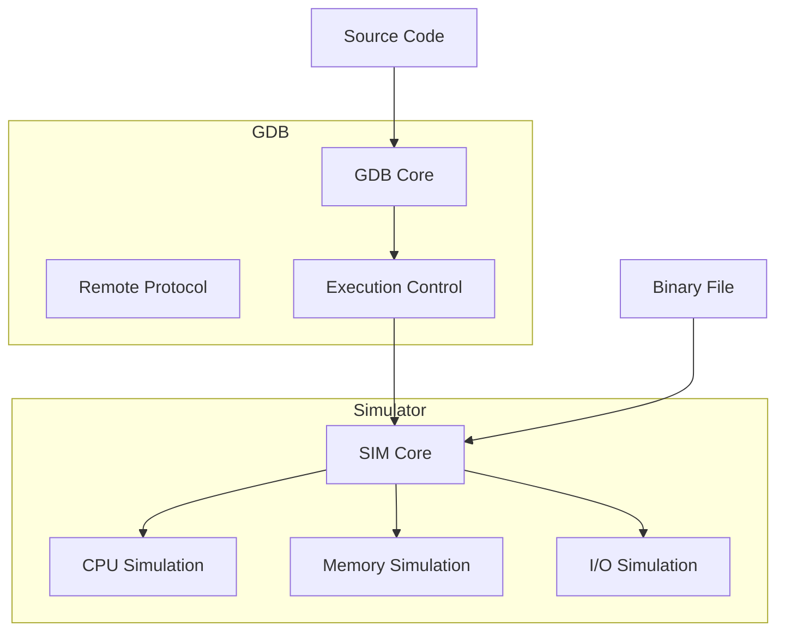
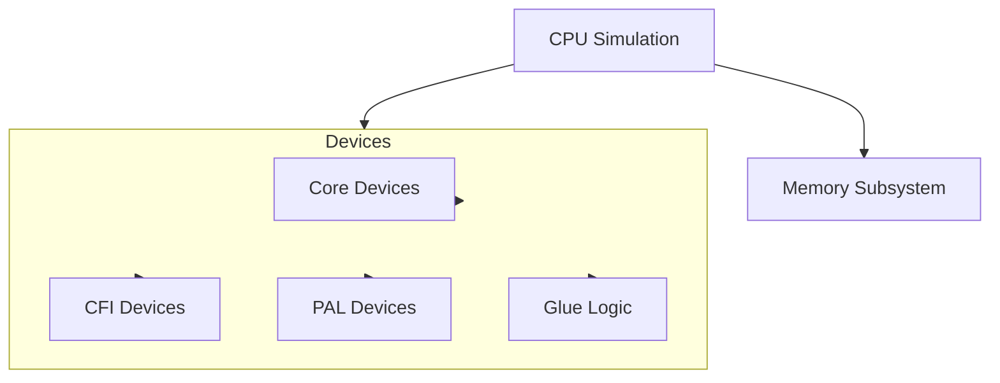
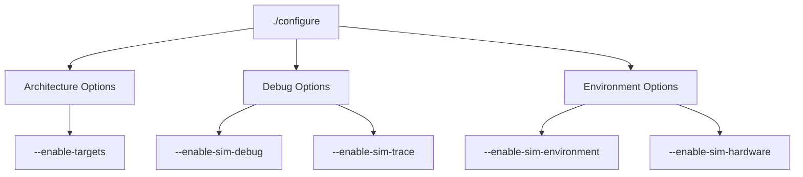
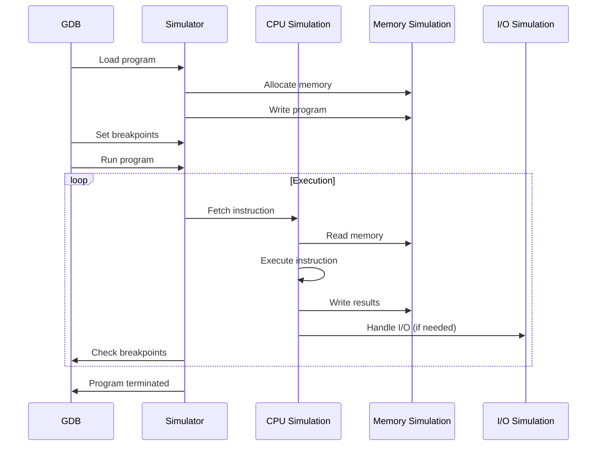
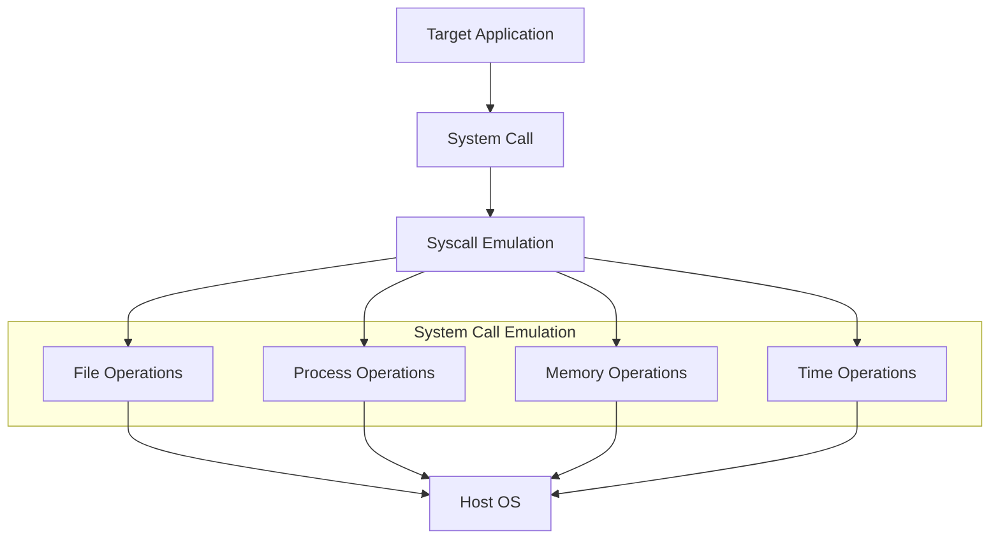
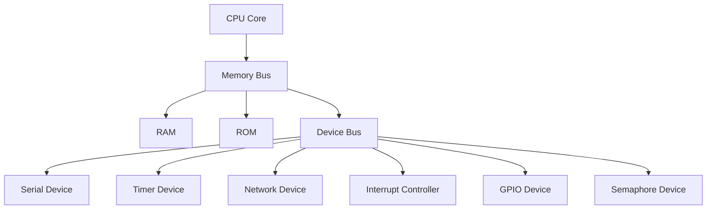

<!-- source: DeepWiki mcp.deepwiki.com · repo NVIDIA/cuda-gdb · page 6 Simulator (SIM) · fetched 2026-10-26 -->

# Simulator (SIM)

<details>
<summary>Relevant source files</summary>

The following files were used as context for generating this wiki page:

- [sim/Makefile.am](sim/Makefile.am)
- [sim/Makefile.in](sim/Makefile.in)
- [sim/aclocal.m4](sim/aclocal.m4)
- [sim/common/defs.h](sim/common/defs.h)
- [sim/common/local.mk](sim/common/local.mk)
- [sim/config.h.in](sim/config.h.in)
- [sim/configure](sim/configure)
- [sim/configure.ac](sim/configure.ac)
- [sim/igen/local.mk](sim/igen/local.mk)
- [sim/m4/sim_ac_option_smp.m4](sim/m4/sim_ac_option_smp.m4)
- [sim/m4/sim_ac_option_warnings.m4](sim/m4/sim_ac_option_warnings.m4)
- [sim/m4/sim_ac_platform.m4](sim/m4/sim_ac_platform.m4)
- [sim/m4/sim_ac_toolchain.m4](sim/m4/sim_ac_toolchain.m4)
- [sim/mips/acinclude.m4](sim/mips/acinclude.m4)
- [sim/ppc/emul_netbsd.c](sim/ppc/emul_netbsd.c)
- [sim/ppc/emul_unix.c](sim/ppc/emul_unix.c)
- [sim/ppc/hw_sem.c](sim/ppc/hw_sem.c)
- [sim/ppc/hw_shm.c](sim/ppc/hw_shm.c)
- [sim/ppc/mon.c](sim/ppc/mon.c)
- [sim/ppc/options.c](sim/ppc/options.c)
- [sim/ppc/pk.h](sim/ppc/pk.h)
- [sim/ppc/std-config.h](sim/ppc/std-config.h)

</details>


The Simulator (SIM) component in CUDA-GDB provides a software-based simulation environment for executing programs on various target architectures. It allows for debugging and testing programs without requiring physical hardware by accurately simulating the behavior of different CPUs. This document covers the architecture, components, and usage of the simulator framework within the CUDA-GDB project.

## Overview

The simulator is designed as a modular framework that supports multiple CPU architectures. It acts as an execution environment for target programs, providing detailed control and introspection capabilities needed for debugging. The simulator can be used both as a standalone application and as part of the GDB debugging environment.

When used with GDB, the simulator provides an alternative to hardware-based debugging or remote debugging via GDB Server. It's particularly useful for development scenarios where hardware is unavailable or when testing code that might crash physical hardware.

### Architecture Overview

The simulator framework follows a modular design with common core components shared across different CPU architecture implementations.



Sources: [sim/common/local.mk:76-175](). [sim/configure.ac:14-167]()

### Relationship with GDB

The simulator integrates with GDB through a well-defined interface, allowing GDB to control program execution, inspect memory and registers, and handle breakpoints.



Sources: [sim/configure.ac:32-41]()

## Core Components

The simulator consists of several key subsystems that work together to provide simulation functionality.

### Common Subsystems

The core components are shared across all architecture implementations and provide common functionality:

| Component | Purpose |
|-----------|---------|
| sim-arange | Address range management |
| sim-bits | Bit manipulation utilities |
| sim-command | Command processing |
| sim-config | Configuration handling |
| sim-core | Core simulation engine |
| sim-cpu | CPU state management |
| sim-endian | Endianness handling |
| sim-engine | Instruction execution engine |
| sim-events | Event scheduling system |
| sim-io | Input/output simulation |
| sim-module | Module loading and management |
| sim-syscall | System call handling |
| sim-trace | Execution tracing |

Sources: [sim/common/local.mk:76-103]()

### Hardware Simulation

The simulator includes components for simulating hardware devices that interact with the CPU:



Sources: [sim/common/local.mk:105-111]()

## Architecture Support

The simulator supports a wide range of processor architectures. Each architecture has its own implementation directory containing specific simulation code.

| Architecture | Directory | Description |
|--------------|-----------|-------------|
| AArch64 | aarch64/ | 64-bit ARM architecture |
| ARM | arm/ | 32-bit ARM architecture |
| AVR | avr/ | Atmel AVR microcontrollers |
| Blackfin | bfin/ | Analog Devices Blackfin DSPs |
| BPF | bpf/ | Berkeley Packet Filter |
| CRIS | cris/ | Axis Communications ETRAX CRIS |
| MIPS | mips/ | MIPS architecture |
| PowerPC | ppc/ | IBM PowerPC architecture |
| RISC-V | riscv/ | RISC-V architecture |
| ... | ... | Additional architectures |

Sources: [sim/configure.ac:94-128](), [sim/Makefile.am:106-201]()

## Build System and Configuration

The simulator uses the autoconf/automake build system with extensive configuration options.

### Build-time Configuration Options

The simulator can be configured with various options at build time:



Sources: [sim/configure.ac:140-156](), [sim/m4/sim_ac_option_warnings.m4:18-95]()

Key configuration options include:

| Option | Purpose |
|--------|---------|
| --enable-sim | Enable the simulator |
| --enable-targets | Specify which target architectures to build |
| --enable-sim-debug | Enable debugging features |
| --enable-sim-trace | Enable execution tracing |
| --enable-sim-hardware | Enable hardware device simulation |
| --enable-sim-alignment | Set alignment handling |
| --enable-sim-endian | Set endianness handling |
| --enable-sim-smp | Enable multi-processor simulation |

Sources: [sim/configure.ac:32-41](), [sim/m4/sim_ac_option_smp.m4:15-38]()

### Runtime Features

The simulator supports various runtime features:

1. **Environment Simulation**: Can simulate user, virtual, or operating system environments
2. **Multi-processor Support**: Can simulate multiple processors for SMP architectures
3. **Hardware Device Simulation**: Simulates peripheral devices and system components
4. **Tracing and Debugging**: Detailed execution tracing and debugging facilities

Sources: [sim/ppc/std-config.h:102-123](), [sim/m4/sim_ac_option_smp.m4:15-38]()

## Execution Model

The simulator executes programs by:

1. Loading the binary into simulated memory
2. Setting up the initial CPU state
3. Executing instructions one by one
4. Handling events (interrupts, exceptions, etc.)
5. Managing I/O and system calls



Sources: [sim/common/local.mk:76-103]()

## System Call Emulation

The simulator provides emulation of system calls to allow programs to interact with the host system:



Sources: [sim/ppc/emul_unix.c:139-200](), [sim/ppc/emul_netbsd.c:130-163]()

## Usage

The simulator can be used in several ways:

1. **From GDB**: Launch with `target sim` command inside GDB
2. **Standalone**: Run directly with appropriate options
3. **As a library**: Integrated into other applications

Example GDB session:
```
$ gdb program
(gdb) target sim
(gdb) load
(gdb) run
```

The simulator provides executables named `run` or `run-<arch>` for standalone usage:
```
$ ./run-ppc program [options]
```

Sources: [sim/Makefile.am:213-222]()

## Architecture-Specific Features

Each supported architecture may have unique features and capabilities. For example:

### MIPS Simulator

The MIPS simulator supports multiple variants of the MIPS architecture and can be configured for different instruction set versions.

Sources: [sim/mips/acinclude.m4:17-85]()

### PowerPC Simulator

The PowerPC simulator includes extensive options for different PowerPC variants, floating-point support, and SMP capabilities.

Sources: [sim/ppc/options.c:110-148]()

## Hardware Device Simulation

The simulator includes a hardware device framework for simulating peripherals and system components:



Sources: [sim/ppc/hw_sem.c:32-85](), [sim/common/local.mk:105-127]()

## Conclusion

The Simulator (SIM) in CUDA-GDB provides a powerful and flexible framework for simulating various processor architectures. It enables debugging and testing of programs without physical hardware, with detailed control over execution and extensive configuration options. The modular design allows for adding new architectures and features while maintaining a consistent interface with GDB.