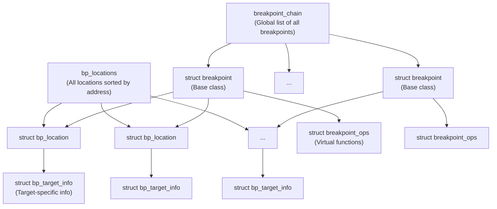
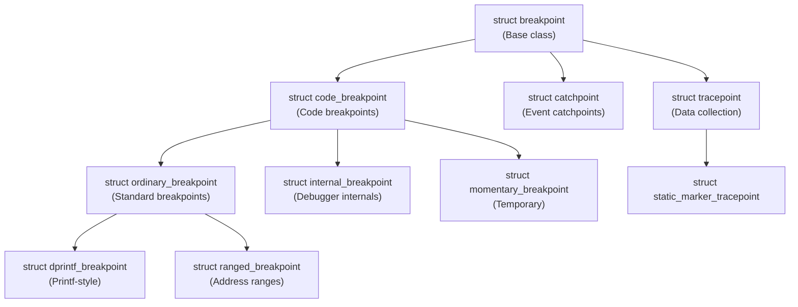

<!-- source: DeepWiki mcp.deepwiki.com · repo NVIDIA/cuda-gdb · extra page Breakpoint System · fetched 2026-10-26 -->

# Breakpoint System

<details>
<summary>Relevant source files</summary>

The following files were used as context for generating this wiki page:

- [gdb/ada-lang.c](gdb/ada-lang.c)
- [gdb/ada-lang.h](gdb/ada-lang.h)
- [gdb/ada-valprint.c](gdb/ada-valprint.c)
- [gdb/breakpoint.c](gdb/breakpoint.c)
- [gdb/breakpoint.h](gdb/breakpoint.h)
- [gdb/c-valprint.c](gdb/c-valprint.c)
- [gdb/cp-valprint.c](gdb/cp-valprint.c)
- [gdb/dwarf2/expr.c](gdb/dwarf2/expr.c)
- [gdb/dwarf2/loc.c](gdb/dwarf2/loc.c)
- [gdb/eval.c](gdb/eval.c)
- [gdb/findvar.c](gdb/findvar.c)
- [gdb/opencl-lang.c](gdb/opencl-lang.c)
- [gdb/p-valprint.c](gdb/p-valprint.c)
- [gdb/testsuite/gdb.multi/pending-bp-del-inferior.c](gdb/testsuite/gdb.multi/pending-bp-del-inferior.c)
- [gdb/testsuite/gdb.multi/pending-bp-del-inferior.exp](gdb/testsuite/gdb.multi/pending-bp-del-inferior.exp)
- [gdb/tracepoint.c](gdb/tracepoint.c)
- [gdb/valarith.c](gdb/valarith.c)
- [gdb/valops.c](gdb/valops.c)
- [gdb/valprint.c](gdb/valprint.c)
- [gdb/value.c](gdb/value.c)
- [gdb/value.h](gdb/value.h)

</details>


The Breakpoint System in GDB provides mechanisms for setting, managing, and handling breakpoints, watchpoints, catchpoints, and other stop-related events during debugging. This page documents the architecture, key data structures, and operation of the breakpoint system in CUDA-GDB.

## Overview

The breakpoint system is one of the core components of a debugger. It allows users to:

- Pause program execution at specific points in code
- Monitor memory for changes (watchpoints)
- Trap on specific events like exceptions (catchpoints)
- Conditionally stop based on expressions
- Execute commands when a breakpoint is hit

This system maintains the state of all breakpoints, handles their insertion and removal from the target program, and processes breakpoint hits during debugging.

Sources: [gdb/breakpoint.c:1-100](), [gdb/breakpoint.h:1-50]()

## Architecture

The breakpoint system has the following key components:



The system's core components include:

- **breakpoint_chain**: An intrusive list that stores all breakpoints
- **bp_locations**: A vector of locations where breakpoints are placed in the target
- **breakpoint**: The base class for all breakpoint types
- **bp_location**: Represents a specific location where a breakpoint is inserted
- **breakpoint_ops**: Interface defining operations (virtual functions) for breakpoints
- **bp_target_info**: Contains information needed to insert breakpoints in the target

Sources: [gdb/breakpoint.c:698-735](), [gdb/breakpoint.h:260-305]()

## Class Hierarchy

The breakpoint system uses inheritance to implement different types of breakpoints:



Key breakpoint types include:

- **ordinary_breakpoint**: Standard code breakpoints
- **internal_breakpoint**: Used internally by the debugger
- **momentary_breakpoint**: Temporary breakpoints (removed after being hit)
- **dprintf_breakpoint**: Printf-style breakpoints (print without stopping)
- **catchpoint**: Trigger on events like exceptions or syscalls
- **tracepoint**: Collect data without stopping execution

Sources: [gdb/breakpoint.c:330-450](), [gdb/breakpoint.h:89-217]()

## State and Disposition

Breakpoints have both a state (enabled/disabled) and a disposition (what to do after being hit):

| State | Description |
|-------|-------------|
| `bp_enabled` | Active and can trigger |
| `bp_disabled` | Inactive, cannot trigger |
| `bp_call_disabled` | Temporarily disabled during a function call |

| Disposition | Description |
|-------------|-------------|
| `disp_del` | Delete after being hit |
| `disp_del_at_next_stop` | Delete at next stop (hit or not) |
| `disp_disable` | Disable after being hit |
| `disp_donttouch` | Leave unchanged after being hit |

Sources: [gdb/breakpoint.h:221-248]()

## Breakpoint Lifecycle

### Creation

1. The user specifies a location (file:line, function name, or address)
2. The location is parsed via `parse_breakpoint_sals()`
3. A breakpoint object is created via `create_breakpoints_sal()`
4. The new breakpoint is added to `breakpoint_chain` via `add_to_breakpoint_chain()`
5. Locations are inserted into the target via `update_global_location_list()`

Sources: [gdb/breakpoint.c:95-120](), [gdb/breakpoint.c:116-124]()

### Location Management

A single logical breakpoint can have multiple locations. For example:

- Breakpoints in template functions
- Breakpoints in inlined functions
- Breakpoints in shared libraries loaded multiple times

The system manages these locations through:

- **update_global_location_list()**: Updates the global location list with one of three insert modes:
  - `UGLL_DONT_INSERT`: Don't insert locations, only remove
  - `UGLL_MAY_INSERT`: Insert if breakpoints should be inserted now
  - `UGLL_INSERT`: Always insert, regardless of current state

Sources: [gdb/breakpoint.c:176-207](), [gdb/breakpoint.c:271-275]()

### Condition Evaluation

Breakpoints can have associated conditions:

```c
// Example of setting a condition
set_breakpoint_condition(b, "i == 10", 0, false);
```

Conditions can be evaluated by:
- The host (GDB)
- The target (if supported)
- Automatically choosing based on capabilities

The condition evaluation mode is controlled by the `condition_evaluation_mode` setting, which can be:
- `auto`: Choose best option
- `host`: Evaluate on host only
- `target`: Evaluate on target when possible

Sources: [gdb/breakpoint.c:629-685](), [gdb/breakpoint.c:1106-1198]()

### Breakpoint Hit Processing

When a breakpoint is hit, the system:

1. Determines which breakpoint was hit
2. Evaluates any condition
3. Executes any associated commands
4. Updates hit count
5. Applies the disposition (delete, disable, etc.)
6. Decides whether to report the stop to the user

If conditions are false or commands include a "continue" directive, execution may resume without the user being notified.

Sources: [gdb/breakpoint.c:140-170]()

## API Examples

### Creating a Breakpoint

```c
// Creating a breakpoint at a specific address
struct symtab_and_line sal;
sal.pc = address;
sal.section = find_pc_overlay(sal.pc);
sal.pspace = current_program_space;
breakpoint *b = create_breakpoint(gdbarch, bp_breakpoint, 0, &sal, 
                                 0, 0, 0, 1, AUTO_BOOLEAN_TRUE);

// Creating a watchpoint
std::vector<value_ref_ptr> vals;
vals.push_back(value_ref_ptr::new_reference(value_from_expression(expr)));
create_watchpoint(NULL, vals, 0, bp_hardware_watchpoint);
```

### Modifying Breakpoints

```c
// Setting a condition
set_breakpoint_condition(b, "i == 10", 0, false);

// Enabling/disabling
enable_breakpoint(b);
disable_breakpoint(b);

// Deleting
delete_breakpoint(b);
```

## Optimizations and Special Features

### Hardware Breakpoints

When software breakpoints can't be used (e.g., in ROM), hardware breakpoints are employed:

```c
// Check if hardware breakpoints are supported and available
static int hw_breakpoint_used_count(void);
```

### Always-Inserted Mode

For performance reasons, GDB can keep breakpoints inserted even when the program is stopped:

```c
// Global variable controlling always-inserted mode
static bool always_inserted_mode = false;
```

### Target-Side Condition Evaluation

Conditions can be evaluated on the target to improve performance:

```c
// For target-side condition evaluation
static bool gdb_evaluates_breakpoint_condition_p(void);
```

## Conclusion

The breakpoint system is a core component of GDB, providing a flexible and powerful infrastructure for stopping program execution based on various criteria. It handles the complexities of setting breakpoints, managing their locations, evaluating conditions, and processing breakpoint hits.

Understanding this system is essential for extending GDB with new breakpoint types or for debugging issues related to breakpoints.

Sources: [gdb/breakpoint.c:500-1200](), [gdb/breakpoint.h:318-400]()

---

