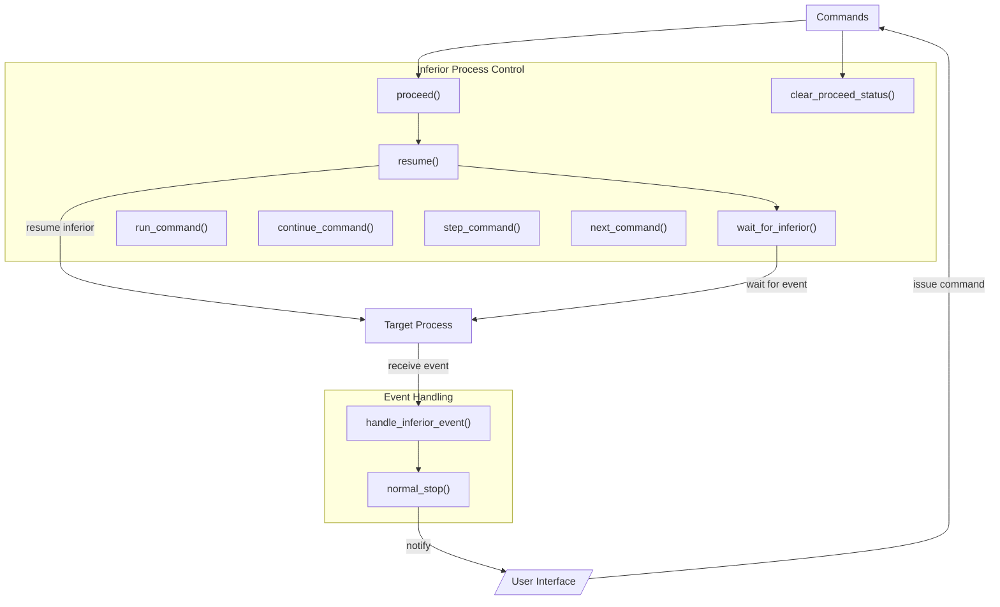
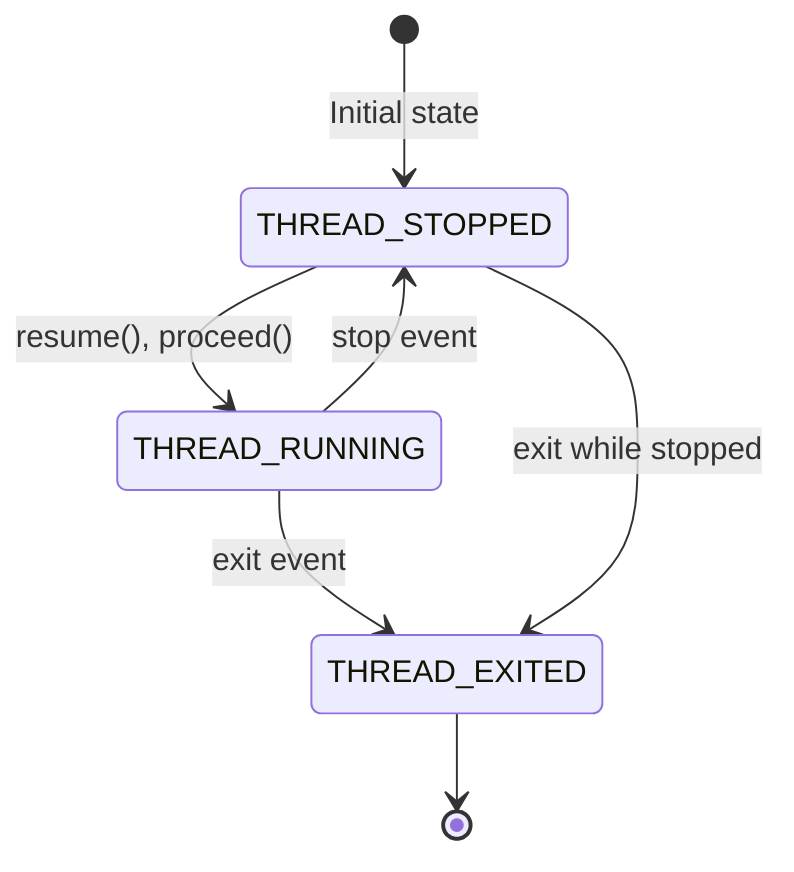
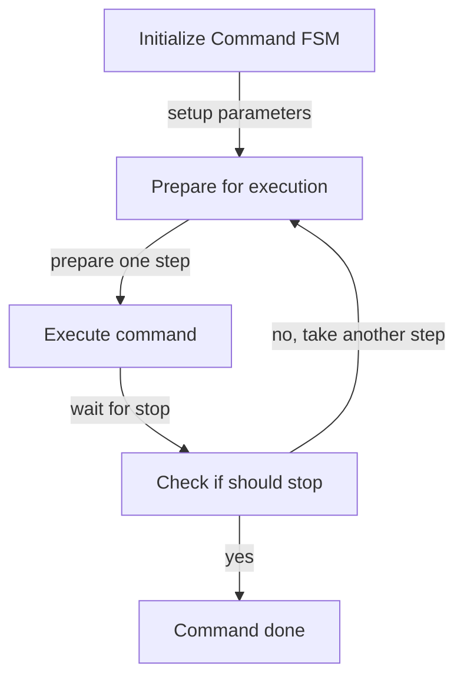
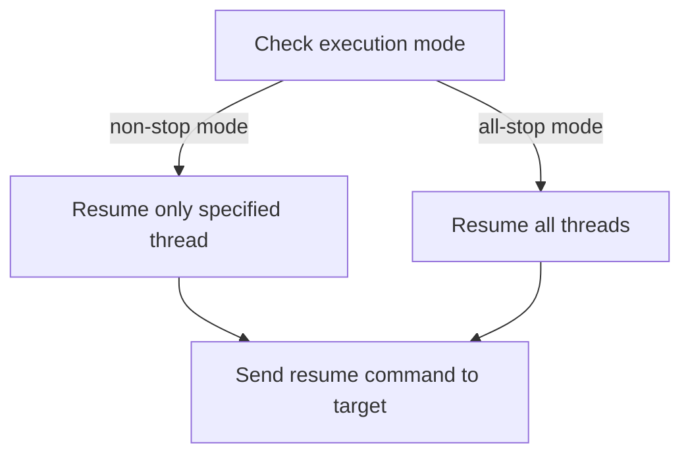
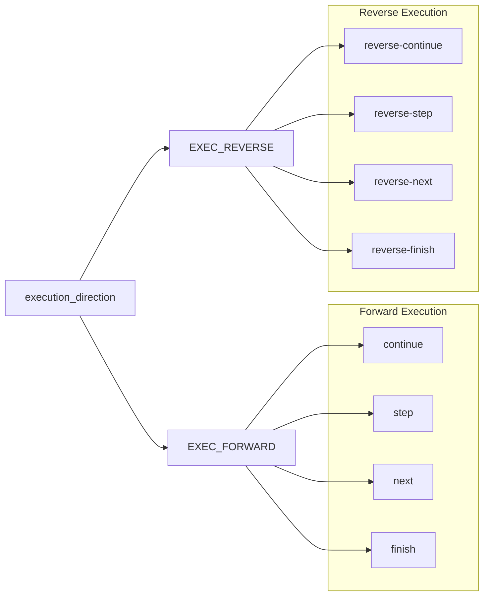
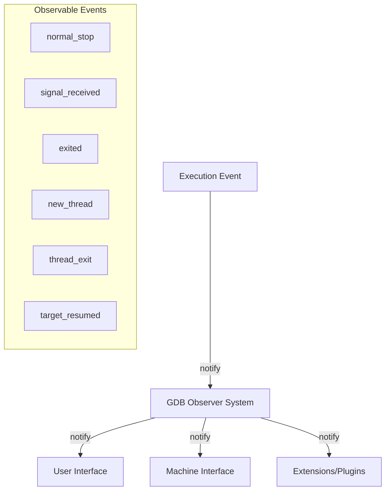
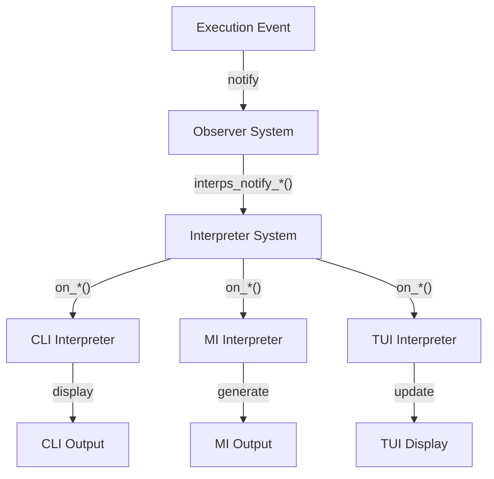
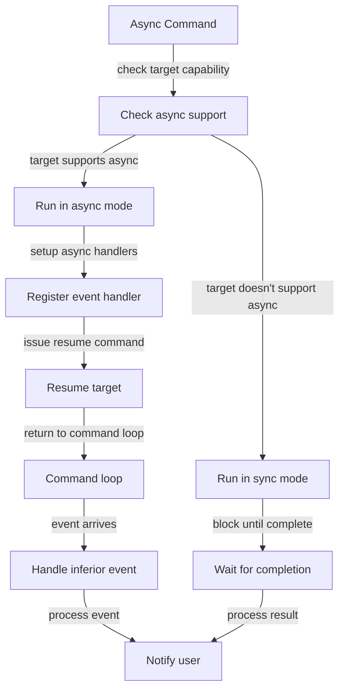
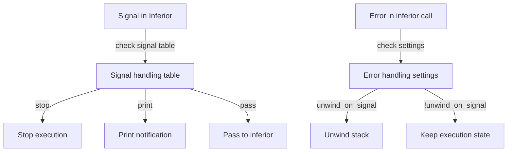

<!-- source: DeepWiki mcp.deepwiki.com · repo NVIDIA/cuda-gdb · extra page Inferior Process Control · fetched 2026-10-26 -->

# Inferior Process Control

Relevant source files

The following files were used as context for generating this wiki page:

- [gdb/cli/cli-interp.c](gdb/cli/cli-interp.c)
- [gdb/cli/cli-interp.h](gdb/cli/cli-interp.h)
- [gdb/infcall.c](gdb/infcall.c)
- [gdb/infcmd.c](gdb/infcmd.c)
- [gdb/infrun.c](gdb/infrun.c)
- [gdb/infrun.h](gdb/infrun.h)
- [gdb/interps.c](gdb/interps.c)
- [gdb/interps.h](gdb/interps.h)
- [gdb/mi/mi-interp.c](gdb/mi/mi-interp.c)
- [gdb/mi/mi-interp.h](gdb/mi/mi-interp.h)
- [gdb/observable.c](gdb/observable.c)
- [gdb/observable.h](gdb/observable.h)
- [gdb/testsuite/gdb.base/infcall-failure.c](gdb/testsuite/gdb.base/infcall-failure.c)
- [gdb/testsuite/gdb.base/infcall-failure.exp](gdb/testsuite/gdb.base/infcall-failure.exp)
- [gdb/testsuite/gdb.base/inferior-clone.exp](gdb/testsuite/gdb.base/inferior-clone.exp)
- [gdb/testsuite/gdb.mi/mi-reverse.exp](gdb/testsuite/gdb.mi/mi-reverse.exp)
- [gdb/testsuite/gdb.multi/gdb-settings.c](gdb/testsuite/gdb.multi/gdb-settings.c)
- [gdb/testsuite/gdb.multi/gdb-settings.exp](gdb/testsuite/gdb.multi/gdb-settings.exp)
- [gdb/testsuite/gdb.reverse/amd64-tailcall-reverse.exp](gdb/testsuite/gdb.reverse/amd64-tailcall-reverse.exp)
- [gdb/testsuite/gdb.reverse/finish-reverse-next.c](gdb/testsuite/gdb.reverse/finish-reverse-next.c)
- [gdb/testsuite/gdb.reverse/finish-reverse-next.exp](gdb/testsuite/gdb.reverse/finish-reverse-next.exp)
- [gdb/testsuite/gdb.reverse/singlejmp-reverse.exp](gdb/testsuite/gdb.reverse/singlejmp-reverse.exp)
- [gdb/testsuite/gdb.reverse/step-indirect-call-thunk.exp](gdb/testsuite/gdb.reverse/step-indirect-call-thunk.exp)
- [gdb/testsuite/gdb.reverse/until-precsave.exp](gdb/testsuite/gdb.reverse/until-precsave.exp)
- [gdb/testsuite/gdb.reverse/until-reverse.exp](gdb/testsuite/gdb.reverse/until-reverse.exp)

This document explains how GDB controls the execution of target programs (called "inferiors"). It covers how GDB starts, stops, steps through, and generally manages the execution lifecycle of debugged programs, including handling events like signals and breakpoints. For information about the breakpoint system itself, see [Breakpoint System](#2.1.2).

## Overview

In GDB, the program being debugged is called the "inferior" process. Inferior process control encompasses all mechanisms GDB uses to control the execution of this process - starting it, stopping it, stepping through it, executing until a specified point, and so on.

Sources: [gdb/infrun.c:82-100](). [gdb/infrun.c:150-220](). [gdb/infcmd.c:127-195]().

## Core Components

### Key Structures and Functions

The core of inferior process control is implemented in `infrun.c` which contains the functions for executing, stepping through, and controlling the inferior process.

#### Key Structures

- `thread_info`: Represents a thread in the inferior process, containing its state, waiting status, and control information.
- `inferior`: Represents an inferior process with its own address space, threads, and execution state.

#### Central Control Functions

- `proceed()`: The main function to continue execution of the inferior.
- `resume()`: Sends the resume command to the target. 
- `wait_for_inferior()`: Waits for the inferior to stop.
- `clear_proceed_status()`: Clears out variables indicating what to do when the inferior is continued.

Sources: [gdb/infrun.c:133-147](). [gdb/infrun.c:100-120]().

### Execution States

Threads and inferiors in GDB can be in various states that control how they respond to commands:

Sources: [gdb/infrun.c:162-174](). [gdb/gdbthread.h:56-80]().

### Execution Command Flow

When a user executes a command like `continue` or `step`, GDB follows this general flow:

1. The command handler (like `continue_command()`) is called
2. `clear_proceed_status()` clears the execution state
3. Command-specific setup is performed (e.g., setting step ranges)
4. `proceed()` is called to start execution
5. GDB waits for the inferior to stop with `wait_for_inferior()`
6. When the inferior stops, GDB processes the stop event and updates its state

Sources: [gdb/infcmd.c:600-646](). [gdb/infrun.c:100-120]().

## Process Execution Commands

GDB provides several commands to control the execution of the inferior process:

| Command | Function | Description |
|---------|----------|-------------|
| `run` | `run_command()` | Start execution from the beginning |
| `continue` | `continue_command()` | Continue execution from current point |
| `step` | `step_command()` | Step to next source line, entering functions |
| `next` | `next_command()` | Step to next source line, stepping over functions |
| `stepi` | `stepi_command()` | Step one machine instruction, entering functions |
| `nexti` | `nexti_command()` | Step one machine instruction, stepping over functions |
| `finish` | `finish_command()` | Continue until the current function returns |
| `until` | `until_command()` | Continue until control reaches a different line |

Sources: [gdb/infcmd.c:507-537](). [gdb/infcmd.c:651-736](). [gdb/infcmd.c:759-784]().

### Implementation of Execution Commands

The execution commands are implemented using a finite state machine (FSM) approach in newer versions of GDB:

The `step_command_fsm` class handles stepping through code, tracking how many steps are left and what kind of stepping is being done (e.g., stepping over functions vs. into them).

Sources: [gdb/infcmd.c:789-804](). [gdb/infcmd.c:812-889](). [gdb/infcmd.c:885-901]().

## Handling Special Execution Cases

### Multi-threaded Execution

GDB can operate in two modes for multi-threaded programs:

1. **All-stop mode**: When one thread stops, all threads stop
2. **Non-stop mode**: Threads can be controlled independently

The `non_stop` setting controls this behavior, and GDB has special handling to determine which threads to resume based on the current mode.

Sources: [gdb/infrun.c:229-304](). [gdb/infcmd.c:598-646]().

### Fork/Vfork Handling

When the inferior process calls `fork()` or `vfork()`, GDB provides options to control which process to follow:

- `follow-fork-mode`: Determines whether to follow the parent or child process
- `detach-on-fork`: Determines whether to detach from the process not being followed

GDB implements this in `follow_fork_inferior()` which sets up the appropriate inferior structures and adjusts the debugging state.

Sources: [gdb/infrun.c:440-731](). [gdb/infrun.c:739-752]().

### Reverse Execution

GDB supports reverse execution, allowing you to step or continue backward in the program's execution:

Reverse execution requires support from the target (usually through record and replay functionality) and is controlled by the `execution_direction` variable.

Sources: [gdb/infrun.h:110-119](). [gdb/testsuite/gdb.reverse/finish-reverse-next.exp:24-52]().

## Event Notification System

GDB uses an observer pattern to notify various components about execution events:

Key observable events include:
- `normal_stop`: When execution stops normally (at a breakpoint, etc.)
- `signal_received`: When the inferior receives a signal
- `exited`: When the inferior exits
- `target_resumed`: When the inferior is resumed

Sources: [gdb/observable.h:55-57](). [gdb/observable.h:215-248](). [gdb/interps.h:94-152]().

## Interpreter Integration

Different interpreters (CLI, MI, etc.) can handle execution events differently. GDB uses an interpreter system to route execution events to the appropriate handler:

Different interpreters implement methods like `on_normal_stop()`, `on_signal_received()`, etc., to handle execution events in a way appropriate for their interface.

Sources: [gdb/interps.h:94-152](). [gdb/interps.c:360-371](). [gdb/cli/cli-interp.c:106-173](). [gdb/mi/mi-interp.c:397-448]().

## Asynchronous Execution

GDB supports asynchronous execution where the GDB command prompt is available while the target is running:

Key components:
- `target_can_async_p()`: Checks if the target supports asynchronous execution
- `infrun_async()`: Enables/disables asynchronous mode
- `async_event_handler`: Processes asynchronous events from the inferior

Sources: [gdb/infrun.c:115-139](). [gdb/infcmd.c:332-350](). [gdb/event-top.c:100-200]().

## Error and Signal Handling

GDB has special handling for signals and errors that occur during inferior execution:

Key settings:
- `signal_stop[]`, `signal_print[]`, `signal_program[]`: Tables determining how to handle signals
- `unwind_on_signal_p`: Controls whether to unwind the stack when a signal is received during an inferior function call
- `unwind_on_terminating_exception_p`: Controls unwinding on C++ exceptions

Sources: [gdb/infrun.c:330-359](). [gdb/infcall.c:183-218]().

## Conclusion

Inferior process control is a core part of GDB that manages the execution of debugged programs. It involves a complex interplay of command processing, target communication, event handling, and state management. The system is designed to handle various execution modes, special cases like fork/vfork, and provide flexible interfaces for different user interfaces.

---

