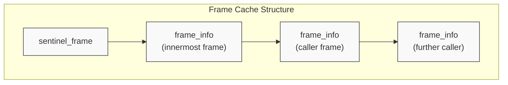
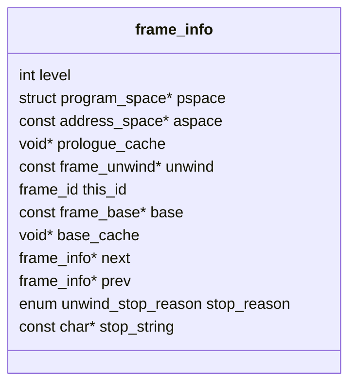
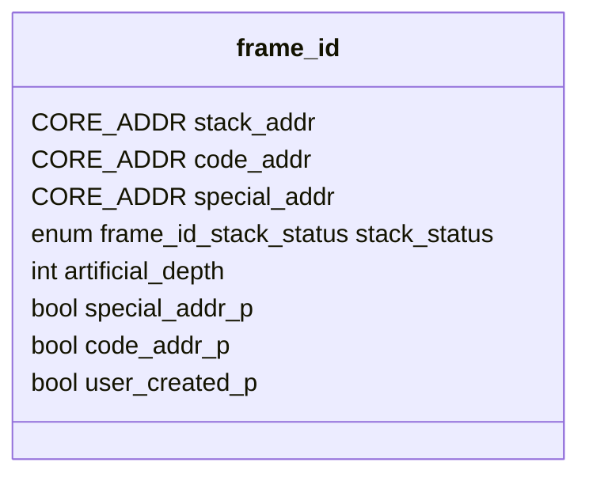
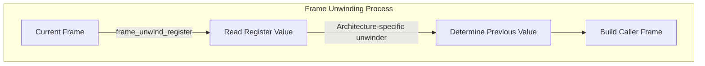
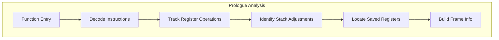
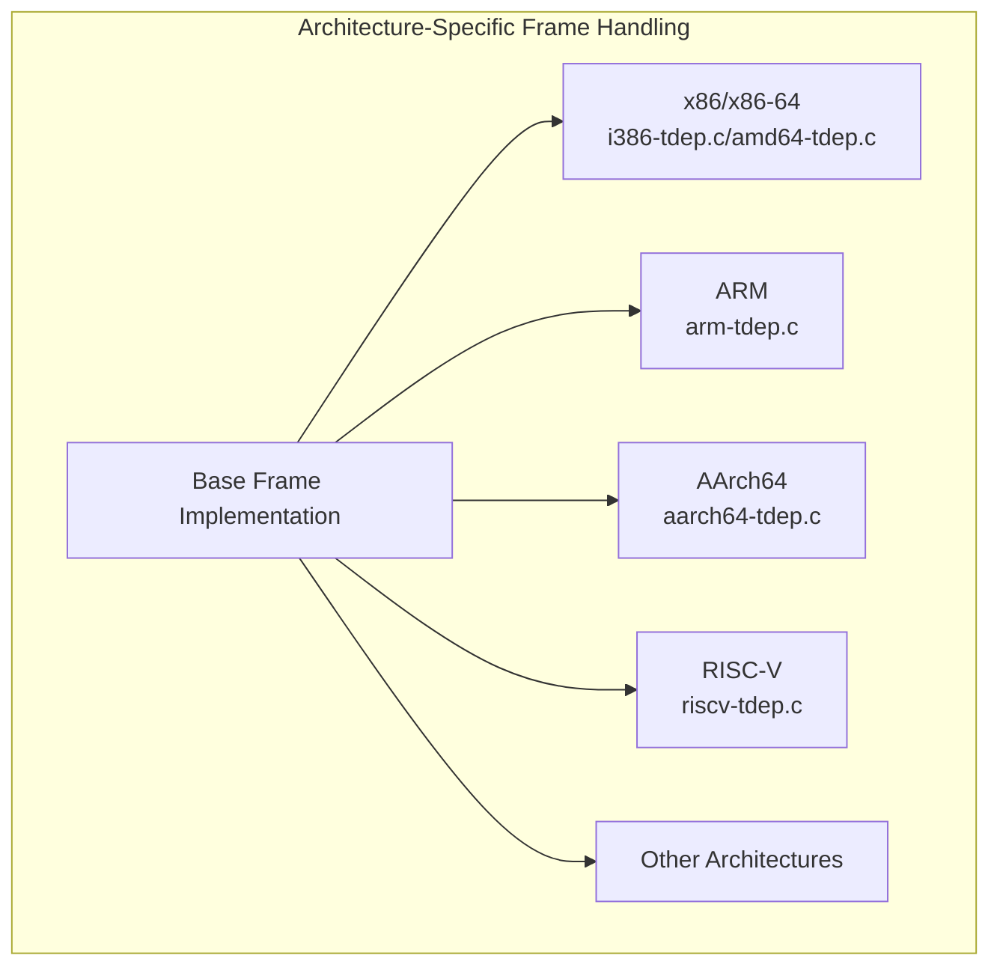
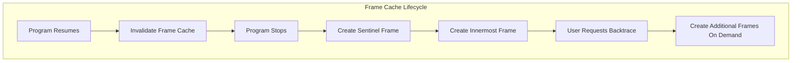

<!-- source: DeepWiki mcp.deepwiki.com · repo NVIDIA/cuda-gdb · extra page Stack Frame Management · fetched 2026-10-26 -->

# Stack Frame Management

Relevant source files

The following files were used as context for generating this wiki page:

- [gdb/aarch64-linux-nat.c](gdb/aarch64-linux-nat.c)
- [gdb/aarch64-linux-tdep.c](gdb/aarch64-linux-tdep.c)
- [gdb/aarch64-tdep.c](gdb/aarch64-tdep.c)
- [gdb/aarch64-tdep.h](gdb/aarch64-tdep.h)
- [gdb/alpha-tdep.c](gdb/alpha-tdep.c)
- [gdb/amd64-tdep.c](gdb/amd64-tdep.c)
- [gdb/amd64-windows-tdep.c](gdb/amd64-windows-tdep.c)
- [gdb/arch/aarch64-scalable-linux.c](gdb/arch/aarch64-scalable-linux.c)
- [gdb/arch/aarch64-scalable-linux.h](gdb/arch/aarch64-scalable-linux.h)
- [gdb/arch/aarch64.c](gdb/arch/aarch64.c)
- [gdb/arch/aarch64.h](gdb/arch/aarch64.h)
- [gdb/arm-tdep.c](gdb/arm-tdep.c)
- [gdb/features/aarch64-sme.c](gdb/features/aarch64-sme.c)
- [gdb/features/aarch64-sme2.c](gdb/features/aarch64-sme2.c)
- [gdb/frame.c](gdb/frame.c)
- [gdb/frame.h](gdb/frame.h)
- [gdb/i386-tdep.c](gdb/i386-tdep.c)
- [gdb/i386-tdep.h](gdb/i386-tdep.h)
- [gdb/i387-tdep.c](gdb/i387-tdep.c)
- [gdb/i387-tdep.h](gdb/i387-tdep.h)
- [gdb/ia64-tdep.c](gdb/ia64-tdep.c)
- [gdb/m68k-tdep.c](gdb/m68k-tdep.c)
- [gdb/mi/mi-cmd-stack.c](gdb/mi/mi-cmd-stack.c)
- [gdb/mips-tdep.c](gdb/mips-tdep.c)
- [gdb/nat/aarch64-scalable-linux-ptrace.c](gdb/nat/aarch64-scalable-linux-ptrace.c)
- [gdb/nat/aarch64-scalable-linux-ptrace.h](gdb/nat/aarch64-scalable-linux-ptrace.h)
- [gdb/nat/aarch64-scalable-linux-sigcontext.h](gdb/nat/aarch64-scalable-linux-sigcontext.h)
- [gdb/printcmd.c](gdb/printcmd.c)
- [gdb/python/py-framefilter.c](gdb/python/py-framefilter.c)
- [gdb/riscv-tdep.c](gdb/riscv-tdep.c)
- [gdb/s390-tdep.c](gdb/s390-tdep.c)
- [gdb/s390-tdep.h](gdb/s390-tdep.h)
- [gdb/sparc-nat.c](gdb/sparc-nat.c)
- [gdb/sparc-tdep.c](gdb/sparc-tdep.c)
- [gdb/sparc64-tdep.c](gdb/sparc64-tdep.c)
- [gdb/stack.c](gdb/stack.c)
- [gdb/testsuite/gdb.reverse/i386-avx-reverse.c](gdb/testsuite/gdb.reverse/i386-avx-reverse.c)
- [gdb/testsuite/gdb.reverse/i386-avx-reverse.exp](gdb/testsuite/gdb.reverse/i386-avx-reverse.exp)
- [gdbserver/linux-aarch64-low.cc](gdbserver/linux-aarch64-low.cc)

This page describes how GDB manages stack frames, which are the fundamental structures that represent function calls in a program's execution. Stack frame management involves tracking the state of the call stack, navigating through frames, and extracting values of registers and variables in different frames.

For information about stack commands in the user interface, see [CLI/CLI-cmds](#2.1.4). For information about architecture-specific frame implementations, see the corresponding architecture pages.

## Core Concepts and Data Structures

GDB maintains a cache of stack frames created when the program being debugged stops. The innermost frame (representing the currently executing function) is created first, and additional frames are created on demand as the user navigates up the call stack.

Sources: [gdb/frame.c:58-59](), [gdb/frame.c:108-196]()

### The frame_info Structure

The `frame_info` structure is the primary data structure for representing a stack frame in GDB. Each frame contains:

- **level**: Frame depth (innermost frame is 0)
- **next/prev**: Pointers to adjacent frames (inner/outer)
- **unwind**: Methods to extract information from this frame
- **prologue_cache**: Architecture-specific frame data
- **this_id**: Unique identifier for this frame

Sources: [gdb/frame.c:108-196]()

### Frame ID

Each frame is identified by a unique `frame_id` structure that allows GDB to track frames across stops and avoid duplicates.

A frame ID can be constructed in different ways depending on the available information. The most common forms include:

- **Normal frame ID**: Stack pointer + code address
- **Stack-less frame ID**: Just a code address (when stack is unavailable)
- **Special frame ID**: Includes additional architecture-specific address

Sources: [gdb/frame.c:689-755](), [gdb/frame.h:181-227]()

## Frame Unwinding Process

Frame unwinding is the process of determining the state of registers (especially the program counter and stack pointer) in the caller's frame. This is essential for navigating up the call stack and displaying correct backtraces.

The unwinding process is architecture-specific because different processors have different calling conventions and register saving behaviors. GDB uses a pluggable unwinder system where each architecture defines how to:

1. Recover the program counter (PC) of the caller
2. Determine the stack pointer (SP) of the caller
3. Extract the values of other registers as they were in the caller's frame

Sources: [gdb/frame.c:968-1007](), [gdb/frame.c:1199-1217](), [gdb/i386-tdep.c:998-1044](), [gdb/aarch64-tdep.c:164-194]()

### Frame Unwind Interface

Architecture implementations provide frame unwinders that implement methods to:

- **this_id**: Generate a unique ID for a frame
- **prev_register**: Determine register values in the caller frame
- **prev_pc**: Extract the caller's PC value

Sources: [gdb/frame-unwind.h](), [gdb/frame.c:582-627]()

## Prologue Analysis

Many architecture-specific implementations perform prologue analysis to understand frame structure. This involves examining the instructions at the beginning of a function to determine:

- Where the frame pointer is established
- Which registers are saved and where
- How the stack pointer is adjusted

This information is used to build a prologue cache that guides the unwinding process for that function.

Sources: [gdb/i386-tdep.c:1017-1097](), [gdb/aarch64-tdep.c:314-586]()

## Types of Frames

GDB supports several types of frames to handle different execution contexts:

1. **NORMAL_FRAME**: Standard function call frames
2. **DUMMY_FRAME**: Created for functions called by GDB itself
3. **INLINE_FRAME**: Represents inlined functions (no actual stack frame)
4. **TAILCALL_FRAME**: For tail call optimizations
5. **SIGTRAMP_FRAME**: Used for signal handlers
6. **ARCH_FRAME**: Architecture-specific special frames
7. **SENTINEL_FRAME**: Marks the end of the frame chain

Different frame types may require special handling during unwinding and presentation.

Sources: [gdb/frame.h:447-474](), [gdb/frame.c:450-474]()

## Frame Lookup and Navigation

### Finding Frames

GDB provides several methods to locate frames:

1. **By ID**: Using the frame's unique ID
2. **By Level**: Counting from the innermost frame
3. **By Address**: Finding the frame containing a specific address
4. **By Function**: Finding a frame executing a specific function

To optimize lookups, GDB maintains a frame stash (hash table) for quick retrieval of previously accessed frames.

Sources: [gdb/frame.c:915-965](), [gdb/frame.c:221-341]()

### Frame Navigation

The primary navigation functions include:

- **get_prev_frame**: Move to the caller's frame
- **get_next_frame**: Move to the called frame
- **skip_artificial_frames**: Skip past inline or tail call frames
- **select_frame**: Make a specific frame current

Sources: [gdb/frame.c:528-581](), [gdb/frame.h:278-358]()

## Architecture-Specific Extensions

Different architectures implement their own frame handling strategies:

Each architecture defines:

1. A frame cache structure for storing architecture-specific data
2. Prologue analysis functions to understand frame layout
3. Register unwinding methods for extracting caller state
4. Special frame handling (e.g., signal frames, compact unwinding)

Sources: [gdb/i386-tdep.c:998-1044](), [gdb/aarch64-tdep.c:164-194](), [gdb/arm-tdep.c:275-428](), [gdb/riscv-tdep.c:143-162]()

## Implementation Details

### Frame Cache Management

The frame cache is the central repository for frame information:

- Created when the program stops
- Invalidated when the program resumes or when context changes
- Frames are created on demand as navigation occurs
- Frames are linked in a doubly-linked list

Sources: [gdb/frame.c:57-70](), [gdb/frame.c:336-341]()

### Handling Special Cases

GDB includes special handling for various edge cases:

1. **Inline functions**: Multiple logical frames share a single physical frame
2. **Tail call optimization**: Last call in a function reuses the current frame
3. **Signal handlers**: Special frames with unique unwinding requirements
4. **Stack corruption**: Detecting and reporting invalid frame chains
5. **Missing debug info**: Fallback strategies when detailed info is unavailable

Sources: [gdb/frame.c:528-581](), [gdb/inline-frame.c]()

### Frame Register Access

Reading registers from a specific frame involves:

1. For the innermost frame: Reading directly from the target
2. For other frames: Using the unwinder to recover the previous value
3. Caching register values to avoid redundant computation

The `frame_register_unwind` and `frame_unwind_register` functions handle this process.

Sources: [gdb/frame.c:1174-1238]()

## Conclusion

Stack frame management is a core part of GDB's debugging functionality, enabling navigation through the call stack and inspection of program state at different levels of execution. The system uses a flexible architecture that supports different processor types and special frame conditions while providing a consistent interface to the rest of the debugger.

The combination of generic frame management with architecture-specific unwinders allows GDB to handle the complexities of diverse execution environments while presenting a unified view to the user.

---

