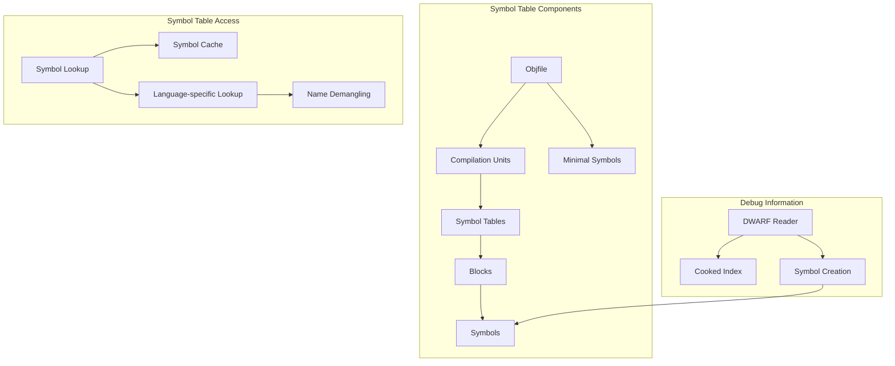
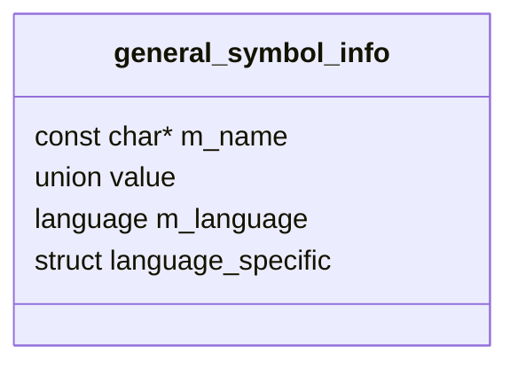
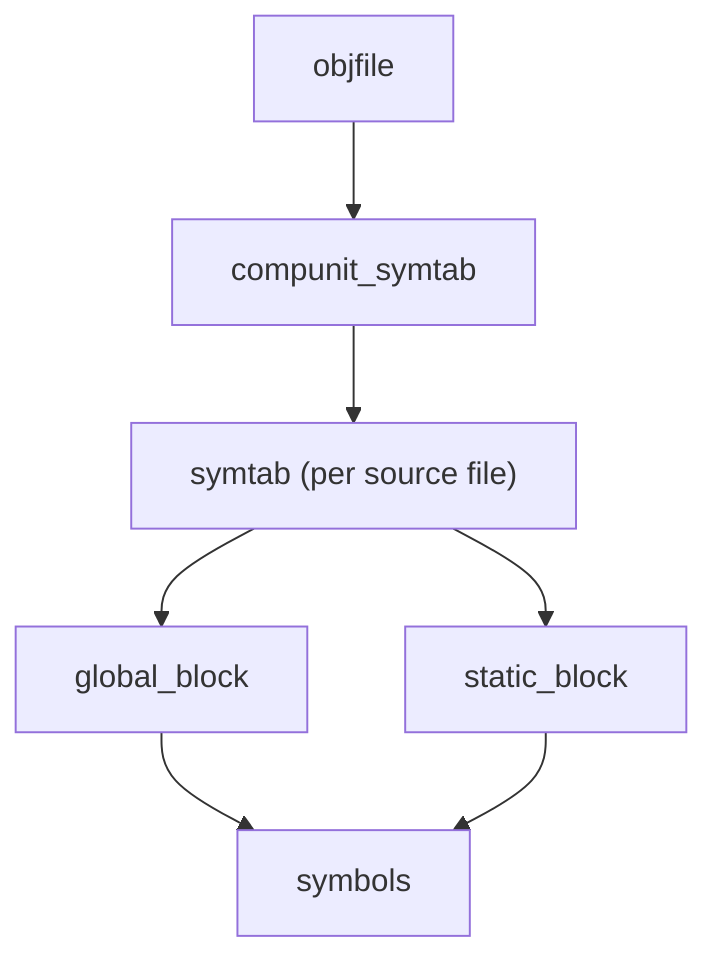
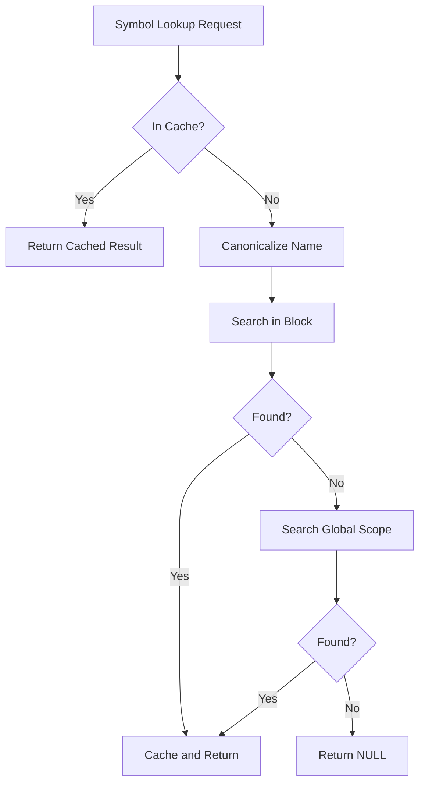
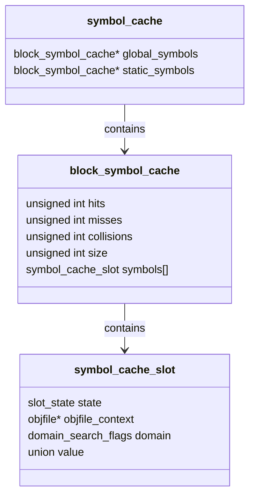
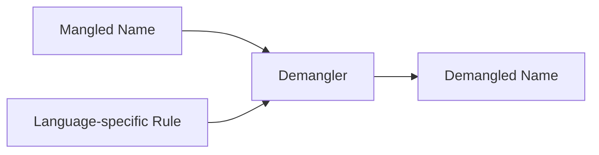
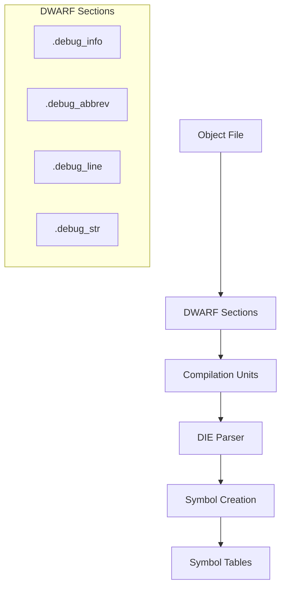
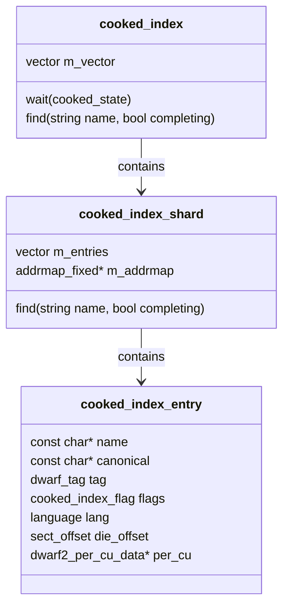
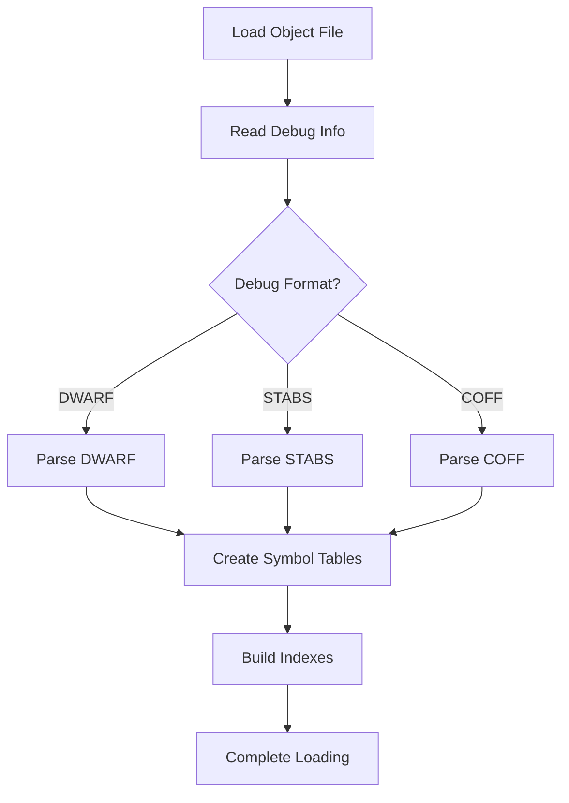
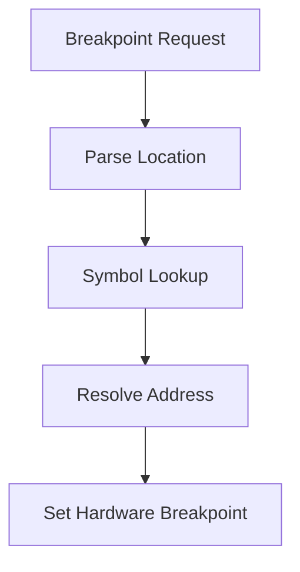

<!-- source: DeepWiki mcp.deepwiki.com · repo NVIDIA/cuda-gdb · extra page Symbol Table Management · fetched 2026-10-26 -->

# Symbol Table Management

Relevant source files

The following files were used as context for generating this wiki page:

- [gdb/coff-pe-read.c](gdb/coff-pe-read.c)
- [gdb/coffread.c](gdb/coffread.c)
- [gdb/compile/compile-loc2c.c](gdb/compile/compile-loc2c.c)
- [gdb/ctfread.c](gdb/ctfread.c)
- [gdb/dbxread.c](gdb/dbxread.c)
- [gdb/debuginfod-support.h](gdb/debuginfod-support.h)
- [gdb/disasm.c](gdb/disasm.c)
- [gdb/disasm.h](gdb/disasm.h)
- [gdb/dwarf2/abbrev-table-cache.c](gdb/dwarf2/abbrev-table-cache.c)
- [gdb/dwarf2/abbrev-table-cache.h](gdb/dwarf2/abbrev-table-cache.h)
- [gdb/dwarf2/abbrev.c](gdb/dwarf2/abbrev.c)
- [gdb/dwarf2/abbrev.h](gdb/dwarf2/abbrev.h)
- [gdb/dwarf2/ada-imported.c](gdb/dwarf2/ada-imported.c)
- [gdb/dwarf2/aranges.c](gdb/dwarf2/aranges.c)
- [gdb/dwarf2/aranges.h](gdb/dwarf2/aranges.h)
- [gdb/dwarf2/attribute.c](gdb/dwarf2/attribute.c)
- [gdb/dwarf2/attribute.h](gdb/dwarf2/attribute.h)
- [gdb/dwarf2/call-site.h](gdb/dwarf2/call-site.h)
- [gdb/dwarf2/comp-unit-head.c](gdb/dwarf2/comp-unit-head.c)
- [gdb/dwarf2/comp-unit-head.h](gdb/dwarf2/comp-unit-head.h)
- [gdb/dwarf2/cooked-index.c](gdb/dwarf2/cooked-index.c)
- [gdb/dwarf2/cooked-index.h](gdb/dwarf2/cooked-index.h)
- [gdb/dwarf2/cu.c](gdb/dwarf2/cu.c)
- [gdb/dwarf2/cu.h](gdb/dwarf2/cu.h)
- [gdb/dwarf2/die.c](gdb/dwarf2/die.c)
- [gdb/dwarf2/die.h](gdb/dwarf2/die.h)
- [gdb/dwarf2/dwz.c](gdb/dwarf2/dwz.c)
- [gdb/dwarf2/dwz.h](gdb/dwarf2/dwz.h)
- [gdb/dwarf2/index-cache.c](gdb/dwarf2/index-cache.c)
- [gdb/dwarf2/index-cache.h](gdb/dwarf2/index-cache.h)
- [gdb/dwarf2/index-common.h](gdb/dwarf2/index-common.h)
- [gdb/dwarf2/index-write.c](gdb/dwarf2/index-write.c)
- [gdb/dwarf2/line-header.h](gdb/dwarf2/line-header.h)
- [gdb/dwarf2/mapped-index.h](gdb/dwarf2/mapped-index.h)
- [gdb/dwarf2/read-debug-names.c](gdb/dwarf2/read-debug-names.c)
- [gdb/dwarf2/read-debug-names.h](gdb/dwarf2/read-debug-names.h)
- [gdb/dwarf2/read-gdb-index.c](gdb/dwarf2/read-gdb-index.c)
- [gdb/dwarf2/read.c](gdb/dwarf2/read.c)
- [gdb/dwarf2/read.h](gdb/dwarf2/read.h)
- [gdb/dwarf2/section.c](gdb/dwarf2/section.c)
- [gdb/elfread.c](gdb/elfread.c)
- [gdb/f-lang.c](gdb/f-lang.c)
- [gdb/gdb-gdb.gdb.in](gdb/gdb-gdb.gdb.in)
- [gdb/gdb-stabs.h](gdb/gdb-stabs.h)
- [gdb/gdbtypes.c](gdb/gdbtypes.c)
- [gdb/gdbtypes.h](gdb/gdbtypes.h)
- [gdb/linespec.c](gdb/linespec.c)
- [gdb/machoread.c](gdb/machoread.c)
- [gdb/mdebugread.c](gdb/mdebugread.c)
- [gdb/minsyms.c](gdb/minsyms.c)
- [gdb/minsyms.h](gdb/minsyms.h)
- [gdb/objfiles.c](gdb/objfiles.c)
- [gdb/objfiles.h](gdb/objfiles.h)
- [gdb/osdata.c](gdb/osdata.c)
- [gdb/psymtab.c](gdb/psymtab.c)
- [gdb/psymtab.h](gdb/psymtab.h)
- [gdb/quick-symbol.h](gdb/quick-symbol.h)
- [gdb/rust-lang.c](gdb/rust-lang.c)
- [gdb/source-cache.c](gdb/source-cache.c)
- [gdb/source-cache.h](gdb/source-cache.h)
- [gdb/source.c](gdb/source.c)
- [gdb/source.h](gdb/source.h)
- [gdb/stabsread.c](gdb/stabsread.c)
- [gdb/stabsread.h](gdb/stabsread.h)
- [gdb/symfile-debug.c](gdb/symfile-debug.c)
- [gdb/symfile.c](gdb/symfile.c)
- [gdb/symmisc.c](gdb/symmisc.c)
- [gdb/symtab.c](gdb/symtab.c)
- [gdb/symtab.h](gdb/symtab.h)
- [gdb/testsuite/gdb.dwarf2/gdb-index-cxx.exp](gdb/testsuite/gdb.dwarf2/gdb-index-cxx.exp)
- [gdb/testsuite/gdb.gdb/index-file.exp](gdb/testsuite/gdb.gdb/index-file.exp)
- [gdb/testsuite/gdb.linespec/cpcompletion.cc](gdb/testsuite/gdb.linespec/cpcompletion.cc)
- [gdb/testsuite/gdb.linespec/cpcompletion.exp](gdb/testsuite/gdb.linespec/cpcompletion.exp)
- [gdb/testsuite/gdb.linespec/cpls.cc](gdb/testsuite/gdb.linespec/cpls.cc)
- [gdb/xcoffread.c](gdb/xcoffread.c)

This page documents the symbol table management system in CUDA-GDB. Symbol tables are data structures that store information about program elements such as functions, variables, and types, along with their names, memory locations, and other attributes. They enable the debugger to map between symbols in source code and their corresponding locations in memory.

This document covers how symbols are stored, organized, and accessed in CUDA-GDB. For information about loading symbol files, see [Symfile Management](#5). For details about type system implementation, see [Types](#2.2).

## Overview of Symbol Table System

Symbol table management in CUDA-GDB consists of several interrelated components that work together to organize and provide access to symbolic information from debug data.

Sources: [gdb/symtab.h:400-445](), [gdb/symtab.c:130-190](), [gdb/dwarf2/read.c:30-85]()

## Core Data Structures

The symbol table system is built around several key data structures, with the most important being the general symbol information structure, which is the foundation for both full symbols and minimal symbols.

### Symbol Information

The base structure for all symbols is `struct general_symbol_info`, which contains:

This structure holds:

- The symbol's linkage name (as it appears in the object file)
- A union containing the symbol's value, which varies by symbol type
- The language associated with the symbol
- Language-specific information, such as demangled name

Sources: [gdb/symtab.h:446-562](), [gdb/symtab.c:837-884]()

### Full Symbols vs. Minimal Symbols

CUDA-GDB maintains two main types of symbols:

| Type | Description | Main Structure | Storage |
|------|-------------|----------------|---------|
| Full Symbols | Complete symbols with type information | `struct symbol` | In block structures within symbol tables |
| Minimal Symbols | Light-weight symbols with just name and address | `struct minimal_symbol` | In object files |

Full symbols provide comprehensive information but require more memory. Minimal symbols provide basic linking information for functions and variables when debug info isn't available.

Sources: [gdb/symtab.h:1320-1441](), [gdb/minsyms.c:20-100]()

### Symbol Tables and Blocks

Symbols are organized into a hierarchy of structures:

- **Object File**: Contains symbol information loaded from one binary
- **Compilation Unit**: Represents a single compiled source file or module
- **Symbol Table**: Contains symbols for a single source file
- **Blocks**: Represent scopes (global, static, function, lexical blocks)

Sources: [gdb/symtab.h:400-560](), [gdb/objfiles.h:20-100](), [gdb/symtab.c:475-520]()

## Symbol Lookup Mechanisms

CUDA-GDB provides various functions to look up symbols by name, with support for different scoping rules and language-specific requirements.

### Lookup Process

The symbol lookup process follows these general steps:

1. Check the symbol cache for previous lookup results
2. Apply language-specific canonicalization if needed
3. Search within the specified block or scope
4. Search through nested blocks according to language rules
5. Handle multiple matches according to user preferences
6. Cache the result for future lookups

Sources: [gdb/symtab.c:80-110](), [gdb/symtab.c:270-320]()

### Symbol Cache

To improve performance, CUDA-GDB implements a symbol cache:

The symbol cache reduces the need for repeated lookups of the same symbol, which can be expensive, especially with large debug information. The cache is organized by symbol type (global vs. static) and uses hashing to provide quick access.

Sources: [gdb/symtab.c:166-305](), [gdb/symtab.c:225-261]()

## Symbol Name Handling

Symbol names require special handling due to complexities like name mangling, language-specific rules, and required transformations.

### Name Types

Each symbol can have several different name representations:

- **Linkage Name**: The name used by the linker (might be mangled)
- **Natural Name**: The demangled, user-visible name
- **Print Name**: The name to display (demangled or not based on settings)
- **Search Name**: The name used for lookups (varies by language)

Sources: [gdb/symtab.h:454-475](), [gdb/symtab.c:455-476]()

### Name Demangling

For languages like C++ that use name mangling, CUDA-GDB provides demangling support:

The demangling process:
1. Identify the symbol's language
2. Apply language-specific demangling rules
3. Store both the original and demangled names
4. Use the appropriate name based on context

The demangled names are cached to avoid repeated demangling of the same symbol.

Sources: [gdb/symtab.c:885-989](), [gdb/cp-support.c]()

## DWARF Debug Information Processing

DWARF is the primary debug information format used by modern compilers. CUDA-GDB parses DWARF information to create symbol tables.

### DWARF Reader

The DWARF reader processes debug information from object files and converts it into GDB's internal symbol structures. Key components include:

DIE = Debug Information Entry, the basic unit of information in DWARF.

Sources: [gdb/dwarf2/read.c:30-100](), [gdb/dwarf2/read.c:740-820]()

### Cooked Index

The "cooked index" is an optimized in-memory representation of the DWARF debug information:

The cooked index provides fast access to symbols through various optimizations:
- Canonical representation of names for efficient lookup
- Maintained index of symbols by name
- Support for name completion
- Cached information to avoid re-parsing debug data

Sources: [gdb/dwarf2/cooked-index.h:102-258](), [gdb/dwarf2/cooked-index.c:50-145]()

## Symbol Table Creation and Population

Symbol tables are created and populated during the loading of debug information from object files.

### Symbol Creation Process

Key steps in the process:
1. Object file loading and initial analysis
2. Identification of the debug format
3. Format-specific parsing of debug information
4. Creation of compilation units and symbol tables
5. Building lookup indices for efficient access

Sources: [gdb/symfile.c:89-104](), [gdb/dwarf2/read.c:1015-1080]()

### Language-Specific Handling

CUDA-GDB supports multiple programming languages, with each language potentially requiring special handling for symbols:

| Language | Special Symbol Handling |
|----------|-------------------------|
| C | Name canonicalization for lookup |
| C++ | Name demangling, namespace handling, template processing |
| Rust | Path separation with "::" |
| Ada | Encoding/decoding of names, case insensitivity |
| Fortran | Case insensitivity, common blocks |

Sources: [gdb/dwarf2/cooked-index.c:234-256](), [gdb/symtab.c:274-320]()

## Practical Usage of Symbol Tables

This section explores how symbol tables are used in practice within the debugger.

### Symbol Lookup Use Cases

Symbol tables support various lookup scenarios:

1. **By name**: Finding a symbol by its name (potentially with scope)
2. **By address**: Finding the symbol corresponding to a memory address
3. **By location**: Looking up symbols in a specific file and line
4. **With wildcards**: Finding symbols matching patterns
5. **Multiple matches**: Handling cases where multiple symbols match

Sources: [gdb/symtab.c:80-120](), [gdb/symtab.c:705-744]()

### Integration with Breakpoints

Symbol tables are crucial for setting breakpoints:

When a user sets a breakpoint by name (e.g., "break function_name"), the debugger:
1. Looks up the symbol in the symbol tables
2. Determines the corresponding memory address
3. Sets a hardware breakpoint at that address

Sources: [gdb/linespec.c:71-108]()

## Performance Considerations

Symbol table management can significantly impact debugger performance, especially with large applications.

### Memory Usage

Several strategies help manage memory usage:
- Minimal symbols for basic information
- Partial symbol tables (psymtabs) loaded initially
- Full symbol tables loaded on demand
- Symbol caching to speed up repeated lookups

Sources: [gdb/psymtab.c:1-50](), [gdb/symtab.c:166-220]()

### Lazy Loading

CUDA-GDB uses lazy loading techniques to improve performance:

1. Only load minimal symbol information initially
2. Partially load symbols necessary for basic operation
3. Load full symbol information on demand
4. Use indexing to avoid loading unnecessary symbols

Sources: [gdb/dwarf2/read.c:1060-1100]()

## Conclusion

Symbol table management is a core component of CUDA-GDB, enabling the debugger to map between source-level symbols and their memory locations. The system balances comprehensive debug information with performance considerations through techniques like caching, indexing, and lazy loading.

The symbol table system integrates with multiple debug formats, handles language-specific requirements, and provides the foundation for many debugger features including variable inspection, breakpoints, and source display.

---

