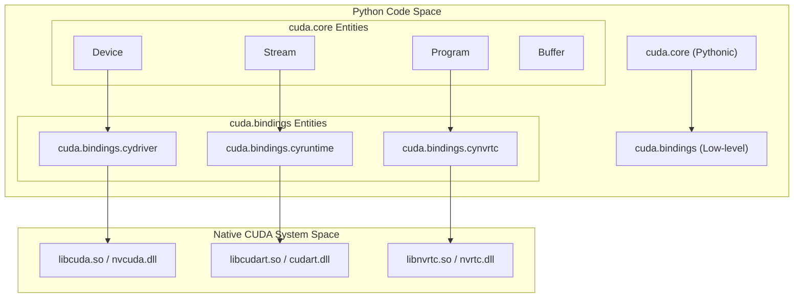
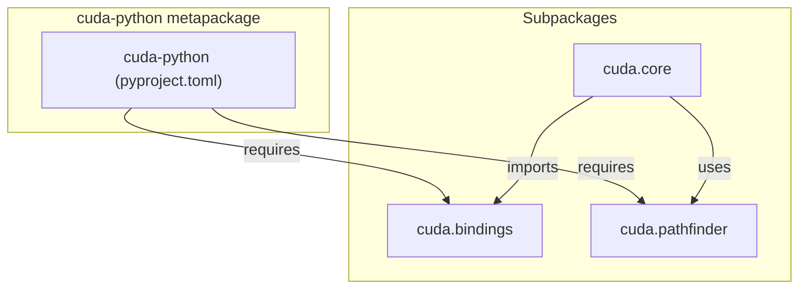

<!-- source: DeepWiki mcp.deepwiki.com · repo NVIDIA/cuda-python · page 1 Overview · fetched 2026-10-26 -->

# Overview

Relevant source files

The following files were used as context for generating this wiki page:

- [README.md](README.md)
- [cuda_core/cuda/core/__init__.py](cuda_core/cuda/core/__init__.py)
- [cuda_core/cuda/core/_graphics.pxd](cuda_core/cuda/core/_graphics.pxd)
- [cuda_core/cuda/core/_graphics.pyx](cuda_core/cuda/core/_graphics.pyx)
- [cuda_core/docs/source/release/1.0.0-notes.rst](cuda_core/docs/source/release/1.0.0-notes.rst)
- [cuda_core/examples/tma_tensor_map.py](cuda_core/examples/tma_tensor_map.py)
- [cuda_core/tests/test_graphics.py](cuda_core/tests/test_graphics.py)
- [cuda_core/tests/test_tensor_map.py](cuda_core/tests/test_tensor_map.py)
- [cuda_python/DESCRIPTION.rst](cuda_python/DESCRIPTION.rst)
- [cuda_python/LICENSE](cuda_python/LICENSE)
- [cuda_python/README.md](cuda_python/README.md)
- [cuda_python/docs/source/conf.py](cuda_python/docs/source/conf.py)
- [cuda_python/docs/source/index.rst](cuda_python/docs/source/index.rst)
- [cuda_python/pyproject.toml](cuda_python/pyproject.toml)
- [cuda_python/setup.py](cuda_python/setup.py)

CUDA Python is a comprehensive ecosystem for accessing NVIDIA's CUDA platform from Python. This page provides an introduction to the CUDA Python repository, its components, architecture, and key features.

## Purpose and Scope

The CUDA Python repository (`cuda-python`) serves as a central hub for Python access to CUDA APIs and provides multiple components that serve different user needs. CUDA Python is structured as a metapackage that contains a collection of subpackages, each versioned independently [README.md:20-22]().

The primary components within this repository are:

- `cuda.core`: Pythonic access to CUDA Runtime and other core functionality [README.md:5]().
- `cuda.bindings`: Low-level Python bindings to CUDA C APIs [README.md:6]().
- `cuda.pathfinder`: Utilities for locating CUDA components installed in the user's Python environment [README.md:7]().

For related CUDA Python technologies outside this repository, see:
- `cuda.coop`: CCCL's block-wide and warp-wide device primitives [README.md:8]().
- `cuda.compute`: CCCL's host-callable parallel algorithms [README.md:9]().
- `numba.cuda`: SIMT programming model for Python [README.md:10]().
- `cuda.tile`: Tile programming model for NumPy-like code in kernels [README.md:11]().
- `nvmath-python`: Access to NVIDIA Math Libraries [README.md:12]().

Sources: [README.md:3-16](), [cuda_python/docs/source/index.rst:7-21]()

## CUDA Python Architecture

The CUDA Python ecosystem is organized as a layered architecture where higher-level abstractions build upon low-level bindings to provide a productive development environment.

### Code-to-System Mapping: Abstraction Layers
The following diagram illustrates how Python entities in the `cuda.core` and `cuda.bindings` packages map to the underlying CUDA system components.

Sources: [cuda_core/cuda/core/__init__.py:11-13](), [cuda_core/cuda/core/_graphics.pyx:7-13](), [README.md:24-48]()

### Component Relationship
The `cuda-python` metapackage manages the dependency hierarchy, ensuring that the correct versions of `cuda.bindings` and `cuda.pathfinder` are available.

Sources: [cuda_python/setup.py:31-36](), [cuda_core/cuda/core/__init__.py:8-21]()

## Core Components

### cuda.core
The `cuda.core` package offers idiomatic access to the CUDA platform [README.md:24-26](). It introduces high-level abstractions like `Device`, `Stream`, `Event`, and `Buffer` [cuda_core/cuda/core/__init__.py:32-67]().

Key features include:
- **Pythonic Resource Management**: RAII-style objects like `GraphicsResource` for OpenGL interoperability [cuda_core/cuda/core/_graphics.pyx:46-84]().
- **TMA Support**: High-level access to Tensor Memory Accelerator for Hopper+ GPUs via `TensorMapDescriptor` [cuda_core/examples/tma_tensor_map.py:7-16]().
- **Memory Abstractions**: Unified `Buffer` interface supporting `DeviceMemoryResource`, `ManagedMemoryResource`, and `VirtualMemoryResource` [cuda_core/cuda/core/__init__.py:46-59]().

For details, see [Package Structure](#1.1).

### cuda.bindings
The `cuda.bindings` package provides full 1:1 coverage of the CUDA host APIs [README.md:36-38](). It includes bindings for:
- CUDA Driver and Runtime [README.md:42-43]()
- NVRTC (Runtime Compilation) [README.md:44]()
- nvJitLink and NVVM [README.md:45-46]()
- cuFile (GPUDirect Storage) [README.md:47]()

### cuda.pathfinder
`cuda.pathfinder` provides utilities for locating CUDA components, such as headers and dynamic libraries, within the user's environment [README.md:7](). It is used by `cuda.core` to resolve paths for JIT compilation [cuda_core/examples/tma_tensor_map.py:43]().

## Installation and Requirements

CUDA Python requires Python 3.10 or later [cuda_python/pyproject.toml:36](). It supports Linux and Windows platforms [cuda_python/pyproject.toml:16-17]().

The metapackage structure allows for flexible installation:
- `pip install cuda-python`: Installs the metapackage with standard dependencies [cuda_python/setup.py:31-36]().
- `pip install cuda-python[all]`: Installs the metapackage with all optional bindings [cuda_python/setup.py:37-39]().

For details, see [Installation and Requirements](#1.2).

## Current Development Status

The project is currently undergoing an overhaul to improve existing components and introduce new ones [README.md:18](). `cuda.core` is being actively expanded with features like the `cuda.core.checkpoint` module for process state management [cuda_core/docs/source/release/1.0.0-notes.rst:19-22]().

Sources: [README.md:18-22](), [cuda_core/docs/source/release/1.0.0-notes.rst:6-35]()

## Summary

The CUDA Python repository provides a layered approach to accessing NVIDIA's CUDA platform. By bridging low-level C APIs (`cuda.bindings`) with high-level Pythonic abstractions (`cuda.core`), it enables both performance-critical library development and productive application prototyping within the Python ecosystem.

Sources: [README.md:1-48](), [cuda_python/docs/source/index.rst:4-21]()

---

