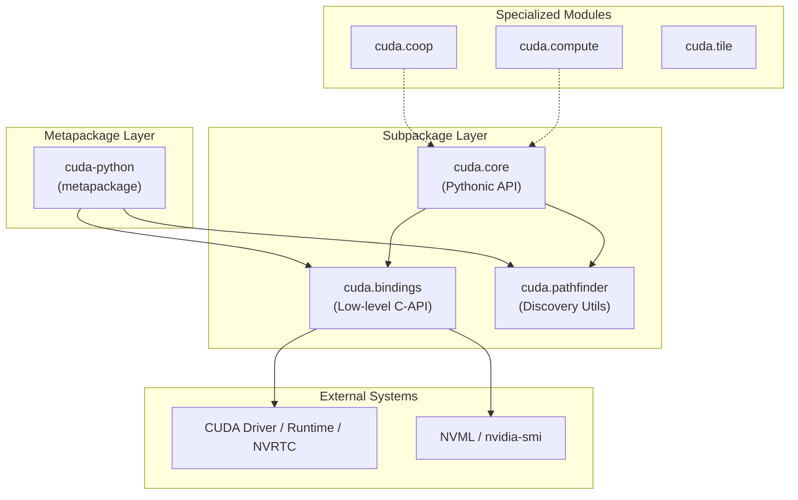
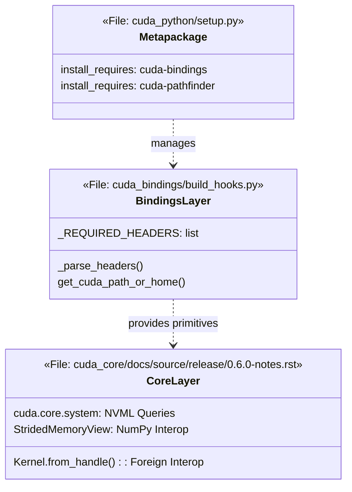

<!-- source: DeepWiki mcp.deepwiki.com · repo NVIDIA/cuda-python · page 1.1 Package Structure · fetched 2026-10-26 -->

# Package Structure

Relevant source files

The following files were used as context for generating this wiki page:

- [README.md](README.md)
- [cuda_bindings/README.md](cuda_bindings/README.md)
- [cuda_bindings/build_hooks.py](cuda_bindings/build_hooks.py)
- [cuda_bindings/docs/source/examples.rst](cuda_bindings/docs/source/examples.rst)
- [cuda_bindings/tests/test_examples.py](cuda_bindings/tests/test_examples.py)
- [cuda_core/README.md](cuda_core/README.md)
- [cuda_core/docs/nv-versions.json](cuda_core/docs/nv-versions.json)
- [cuda_core/docs/source/release/0.4.1-notes.rst](cuda_core/docs/source/release/0.4.1-notes.rst)
- [cuda_core/docs/source/release/0.4.2-notes.rst](cuda_core/docs/source/release/0.4.2-notes.rst)
- [cuda_core/docs/source/release/0.6.0-notes.rst](cuda_core/docs/source/release/0.6.0-notes.rst)
- [cuda_core/docs/source/release/0.7.0-notes.rst](cuda_core/docs/source/release/0.7.0-notes.rst)
- [cuda_python/DESCRIPTION.rst](cuda_python/DESCRIPTION.rst)
- [cuda_python/LICENSE](cuda_python/LICENSE)
- [cuda_python/README.md](cuda_python/README.md)
- [cuda_python/docs/source/conf.py](cuda_python/docs/source/conf.py)
- [cuda_python/docs/source/index.rst](cuda_python/docs/source/index.rst)
- [cuda_python/pyproject.toml](cuda_python/pyproject.toml)
- [cuda_python/setup.py](cuda_python/setup.py)

This document details the organization of the `cuda-python` metapackage and its relationship with the subpackages `cuda.core`, `cuda.bindings`, and `cuda.pathfinder`. It explains the hierarchical dependency structure and the versioning strategy used to maintain compatibility across the CUDA ecosystem.

## CUDA Python Metapackage Architecture

`cuda-python` is a metapackage that contains a collection of subpackages. Each subpackage is versioned independently, allowing installation of each component as needed [README.md:20-22](). This architecture allows the ecosystem to scale by adding specialized modules like `cuda.coop` and `cuda.compute` while maintaining a unified entry point for users [cuda_python/docs/source/index.rst:7-21]().

### Ecosystem Hierarchy

The following diagram illustrates the relationship between the metapackage, its core subpackages, and the underlying CUDA system.

Sources: [README.md:3-16](), [cuda_python/setup.py:33-36](), [cuda_core/docs/source/release/0.6.0-notes.rst:31-32]()

## Package Relationships and Dependencies

The `cuda-python` metapackage uses `setuptools` and `setuptools_scm` to manage dynamic versioning and dependency resolution [cuda_python/setup.py:9-17]().

### Dependency Hierarchy
The dependency flow is strictly defined to ensure that high-level Pythonic abstractions can always resolve to low-level C-API calls and find the necessary binary artifacts:

1.  **`cuda-python`**: Depends on `cuda-bindings` and `cuda-pathfinder` [cuda_python/setup.py:33-36]().
2.  **`cuda.core`**: Requires `cuda-bindings` for API execution. As of version 0.6.0, building `cuda.core` from source requires `cuda-bindings >= 12.9.0` due to Cython-level dependencies on `cynvvm` [cuda_core/docs/source/release/0.6.0-notes.rst:23-25]().
3.  **`cuda.bindings`**: Depends on `cuda.pathfinder` during the build process to locate CUDA headers (e.g., `cuda.h`, `cuda_runtime.h`) via the `build_hooks.py` PEP 517 backend [cuda_bindings/build_hooks.py:4-7](), [cuda_bindings/build_hooks.py:37-64]().

### Versioning Strategy
The project uses `setuptools_scm` to generate versions based on Git tags [cuda_python/setup.py:9-17]().
*   **Tagged Releases**: Use the `~=` compatible release matcher (e.g., `cuda-bindings~=12.8.0`) [cuda_python/setup.py:23-25]().
*   **Pre-releases**: Use the `==` exact matcher to ensure the metapackage aligns precisely with its subpackage development state [cuda_python/setup.py:26-28]().

Sources: [cuda_python/setup.py:20-40](), [cuda_bindings/build_hooks.py:80-96](), [cuda_core/docs/source/release/0.6.0-notes.rst:23-26]()

## Package Components

### `cuda.bindings` (Low-level Interfaces)
This package provides a 1:1 mapping to CUDA host APIs using Cython. It includes support for:
*   **Driver & Runtime**: Core memory and execution management [cuda_bindings/README.md:42-43]().
*   **NVRTC & NVVM**: Runtime compilation and IR manipulation [cuda_bindings/README.md:44-46]().
*   **nvJitLink**: Just-in-time linking of relocatable code [cuda_bindings/README.md:45]().
*   **cuFile**: GPUDirect Storage support [cuda_bindings/README.md:47]().

### `cuda.core` (Pythonic API)
`cuda.core` abstracts the low-level bindings into an object-oriented interface. Key features introduced in recent versions (0.6.0+) include:
*   **`cuda.core.system`**: An NVML-based module for hardware introspection (clocks, fans, PCI info) [cuda_core/docs/source/release/0.6.0-notes.rst:13-13]().
*   **`StridedMemoryView`**: Enhanced interoperability with NumPy and DLPack [cuda_core/docs/source/release/0.6.0-notes.rst:14-15]().
*   **Context Management**: Automatic cleanup to eliminate spurious driver errors during shutdown [cuda_core/docs/source/release/0.6.0-notes.rst:61-62]().

### `cuda.pathfinder` (Discovery)
`cuda.pathfinder` is a utility package used by both `bindings` and `core` to locate CUDA Toolkit components. It is essential for source builds to resolve `CUDA_PATH` or `CUDA_HOME` [cuda_bindings/build_hooks.py:68-74]().

## Code Entity Space Mapping

The following diagram maps high-level package concepts to specific implementation files and classes.

Sources: [cuda_python/setup.py:31-40](), [cuda_bindings/build_hooks.py:80-96](), [cuda_core/docs/source/release/0.6.0-notes.rst:44-49]()

## Distribution and Installation

Packages are distributed as wheels and source distributions (sdists). The metapackage structure simplifies installation for different user needs:

| Package Target | Command | Primary Content |
| :--- | :--- | :--- |
| **Full Ecosystem** | `pip install cuda-python` | Metapackage + Bindings + Pathfinder [cuda_python/setup.py:33-36]() |
| **Low-level Only** | `pip install cuda-bindings` | Cython-generated C-API wrappers [cuda_bindings/README.md:1-3]() |
| **Advanced Bindings** | `pip install cuda-bindings[all]` | Includes optional components like `nvjitlink` [cuda_python/setup.py:38-39]() |
| **Pythonic API** | `pip install cuda-core` | High-level abstractions (Device, Stream, Buffer) [cuda_core/README.md:1-3]() |

### Version Compatibility Table (Example)
The system performs a CUDA version compatibility check at import time to prevent mismatches between `cuda.core` and the installed `cuda-bindings` [cuda_core/docs/source/release/0.6.0-notes.rst:54-55]().

| cuda.core Version | Required cuda-bindings | Note |
| :--- | :--- | :--- |
| 0.6.0 | >= 12.9.0 | Required for `cynvvm` support [cuda_core/docs/source/release/0.6.0-notes.rst:23-25]() |
| 0.5.0 | >= 12.8.0 | Previous minimum requirement [cuda_core/docs/source/release/0.6.0-notes.rst:25-26]() |

Sources: [cuda_python/setup.py:31-40](), [cuda_core/docs/source/release/0.6.0-notes.rst:20-26](), [cuda_core/docs/source/release/0.6.0-notes.rst:54-55]()

---

