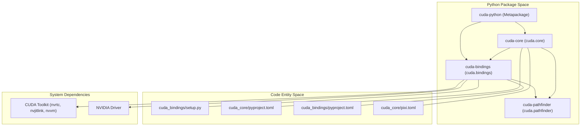
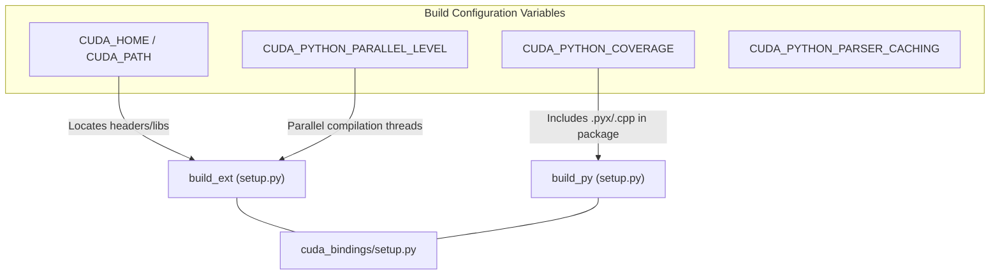

<!-- source: DeepWiki mcp.deepwiki.com · repo NVIDIA/cuda-python · page 1.2 Installation and Requirements · fetched 2026-10-26 -->

# Installation and Requirements

<details>
<summary>Relevant source files</summary>

The following files were used as context for generating this wiki page:

- [ci/tools/run-tests](ci/tools/run-tests)
- [cuda_bindings/DESCRIPTION.rst](cuda_bindings/DESCRIPTION.rst)
- [cuda_bindings/docs/source/install.rst](cuda_bindings/docs/source/install.rst)
- [cuda_bindings/docs/source/support.rst](cuda_bindings/docs/source/support.rst)
- [cuda_bindings/pixi.lock](cuda_bindings/pixi.lock)
- [cuda_bindings/pixi.toml](cuda_bindings/pixi.toml)
- [cuda_bindings/pyproject.toml](cuda_bindings/pyproject.toml)
- [cuda_bindings/setup.py](cuda_bindings/setup.py)
- [cuda_core/DESCRIPTION.rst](cuda_core/DESCRIPTION.rst)
- [cuda_core/docs/source/install.rst](cuda_core/docs/source/install.rst)
- [cuda_core/pixi.lock](cuda_core/pixi.lock)
- [cuda_core/pixi.toml](cuda_core/pixi.toml)
- [cuda_core/pyproject.toml](cuda_core/pyproject.toml)
- [cuda_pathfinder/pixi.lock](cuda_pathfinder/pixi.lock)
- [cuda_pathfinder/pixi.toml](cuda_pathfinder/pixi.toml)

</details>


This document provides comprehensive instructions for installing CUDA Python and its components, including system requirements, CUDA version compatibility, and environment setup. The ecosystem is composed of several packages: `cuda-python` (metapackage), `cuda.bindings`, `cuda.core`, and `cuda.pathfinder`.

## CUDA Python Ecosystem Overview

CUDA Python is structured as a collection of packages that provide both low-level bindings and high-level Pythonic abstractions.



Sources: [cuda_core/pyproject.toml:50-58](), [cuda_bindings/pyproject.toml:35-41](), [cuda_core/pixi.toml:182-187]()

## System Requirements

### Platform Support
CUDA Python supports the following platforms and architectures:
- **Linux**: x86-64, aarch64 (arm64) [cuda_core/pyproject.toml:34-34](), [cuda_core/pixi.toml:7]()
- **Windows**: x86-64 (AMD64) [cuda_core/pyproject.toml:35-35](), [cuda_core/pixi.toml:7]()

### Python Version Requirements
CUDA Python supports Python versions **3.10 through 3.14** [cuda_core/docs/source/install.rst:29-29]().
- Experimental **free-threaded** builds are supported for Python 3.14 [cuda_core/docs/source/install.rst:32-35]().
- Minimum requirement is Python 3.10 [cuda_core/pyproject.toml:22-22](), [cuda_bindings/pyproject.toml:21-21]().

### CUDA Version Compatibility
The ecosystem supports the two latest major CUDA versions.

| Component | CUDA 12 | CUDA 13 |
|-----------|---------|---------|
| CUDA Toolkit | 12.x | 13.x |
| Linux Driver | 525.60.13+ | 580.65+ |
| Windows Driver | 527.41+ | 580.88+ |

Sources: [cuda_core/docs/source/install.rst:13-24](), [cuda_bindings/docs/source/support.rst:9-16]()

## Installation Methods

### Using pip (PyPI)

#### Installing cuda.core
The `cuda-core` package uses optional extras to pin the appropriate `cuda-bindings` version.

```bash
# For CUDA 12
pip install cuda-core[cu12]

# For CUDA 13
pip install cuda-core[cu13]
```
Sources: [cuda_core/docs/source/install.rst:48-54](), [cuda_core/pyproject.toml:56-58]()

#### Installing cuda.bindings
To install bindings with all JIT components (NVRTC, NVVM, nvJitLink, nvFatbin):
```bash
pip install cuda-bindings[all]
```
Sources: [cuda_bindings/pyproject.toml:37-41]()

### Using Conda (conda-forge)
Conda-forge packages allow for explicit CUDA version pinning:
```bash
# Install for CUDA 12
conda install -c conda-forge cuda-core cuda-version=12

# Install for CUDA 13
conda install -c conda-forge cuda-core cuda-version=13
```
Sources: [cuda_core/docs/source/install.rst:63-69]()

### Development Environment Setup

#### Using Pixi
`pixi` is the recommended tool for a reproducible development environment across the repository. It manages CUDA dependencies, compilers, and Python environments automatically.

```bash
# Run tests for cuda.core against CUDA 13
pixi run -e cu13 test-core

# Run all tests (pathfinder -> bindings -> core)
pixi run -e cu13 test
```
Sources: [cuda_core/docs/source/install.rst:105-118](), [cuda_core/pixi.toml:120-129]()

#### Using uv
```bash
git clone https://github.com/NVIDIA/cuda-python
cd cuda-python/cuda_core
uv venv
source .venv/bin/activate
uv pip install -e .[cu13] --group test
```
Sources: [cuda_core/docs/source/install.rst:83-93]()

## Source Build Configuration

When building from source, several environment variables control the build process.



### Key Environment Variables
- `CUDA_HOME`: Path to the CUDA Toolkit installation. Used by `pixi` and `setuptools` to find headers [cuda_core/pixi.toml:143-151]().
- `CUDA_PYTHON_PARALLEL_LEVEL`: Number of threads to use for parallel Cython compilation [cuda_bindings/setup.py:22-22]().
- `CUDA_PYTHON_COVERAGE`: If set to `1`, includes source files in the package for coverage analysis [cuda_bindings/setup.py:24-24]().
- `CUDA_PYTHON_PARSER_CACHING`: Enables caching for the `pyclibrary` header parser during binding generation [cuda_bindings/pixi.toml:100-100]().

Sources: [cuda_bindings/setup.py:14-24](), [cuda_bindings/pixi.toml:99-112](), [cuda_core/pixi.toml:142-152]()

## Verification

To verify the installation and check the version of the installed components:

```python
import cuda.core
import cuda.bindings
import cuda.pathfinder

print(f"Core version: {cuda.core.__version__}")
print(f"Bindings version: {cuda.bindings.__version__}")
```

For automated verification in CI environments, the `ci/tools/run-tests` script is used to install wheels and execute the `pytest` suite for specific modules [ci/tools/run-tests:11-21]().

Sources: [ci/tools/run-tests:7-21](), [cuda_core/pyproject.toml:106-106](), [cuda_bindings/pyproject.toml:94-94]()

---

