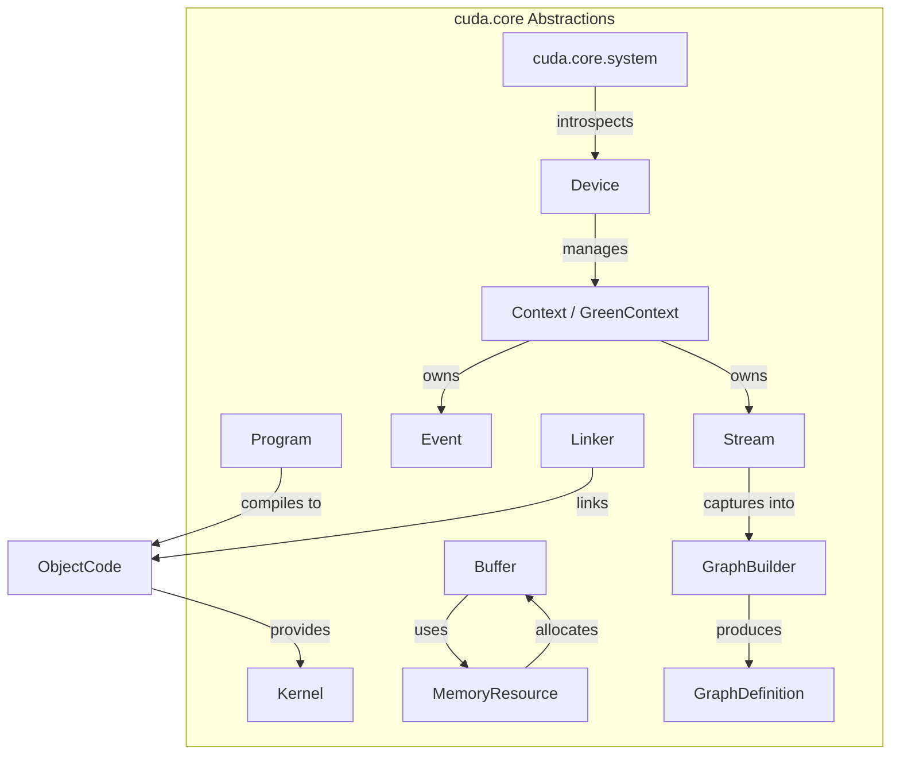
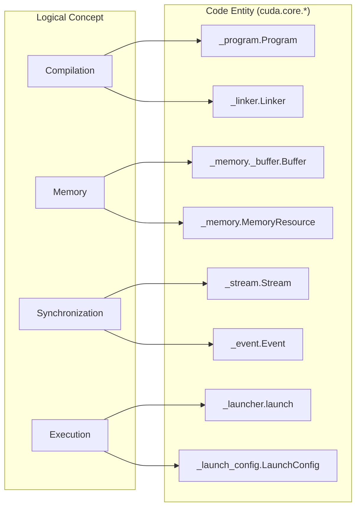

<!-- source: DeepWiki mcp.deepwiki.com · repo NVIDIA/cuda-python · page 2 cuda.core · fetched 2026-10-26 -->

# cuda.core

Relevant source files

The following files were used as context for generating this wiki page:

- [cuda_core/cuda/core/__init__.py](cuda_core/cuda/core/__init__.py)
- [cuda_core/cuda/core/_device.pyx](cuda_core/cuda/core/_device.pyx)
- [cuda_core/cuda/core/_event.pyx](cuda_core/cuda/core/_event.pyx)
- [cuda_core/cuda/core/_graphics.pxd](cuda_core/cuda/core/_graphics.pxd)
- [cuda_core/cuda/core/_graphics.pyx](cuda_core/cuda/core/_graphics.pyx)
- [cuda_core/cuda/core/_memory/_buffer.pyx](cuda_core/cuda/core/_memory/_buffer.pyx)
- [cuda_core/cuda/core/_memory/_graph_memory_resource.pyx](cuda_core/cuda/core/_memory/_graph_memory_resource.pyx)
- [cuda_core/cuda/core/_memory/_legacy.py](cuda_core/cuda/core/_memory/_legacy.py)
- [cuda_core/cuda/core/_memory/_memory_pool.pyx](cuda_core/cuda/core/_memory/_memory_pool.pyx)
- [cuda_core/cuda/core/_memory/_virtual_memory_resource.py](cuda_core/cuda/core/_memory/_virtual_memory_resource.py)
- [cuda_core/cuda/core/_module.pyx](cuda_core/cuda/core/_module.pyx)
- [cuda_core/cuda/core/_stream.pyx](cuda_core/cuda/core/_stream.pyx)
- [cuda_core/docs/source/release/1.0.0-notes.rst](cuda_core/docs/source/release/1.0.0-notes.rst)
- [cuda_core/examples/tma_tensor_map.py](cuda_core/examples/tma_tensor_map.py)
- [cuda_core/tests/conftest.py](cuda_core/tests/conftest.py)
- [cuda_core/tests/test_device.py](cuda_core/tests/test_device.py)
- [cuda_core/tests/test_event.py](cuda_core/tests/test_event.py)
- [cuda_core/tests/test_graphics.py](cuda_core/tests/test_graphics.py)
- [cuda_core/tests/test_launcher.py](cuda_core/tests/test_launcher.py)
- [cuda_core/tests/test_memory.py](cuda_core/tests/test_memory.py)
- [cuda_core/tests/test_module.py](cuda_core/tests/test_module.py)
- [cuda_core/tests/test_stream.py](cuda_core/tests/test_stream.py)
- [cuda_core/tests/test_tensor_map.py](cuda_core/tests/test_tensor_map.py)

## Purpose and Scope

The `cuda.core` package provides a high-level, Pythonic interface to CUDA. It serves as an abstraction layer over the low-level `cuda.bindings` [cuda_core/cuda/core/__init__.py:11-15](), offering an object-oriented API for GPU programming. While `cuda.bindings` provides a direct 1:1 mapping to the CUDA C APIs, `cuda.core` simplifies resource management (e.g., through RAII-like behavior and automatic stream handling) and enhances interoperability with the broader Python ecosystem (e.g., NumPy, PyTorch, CuPy).

For details on the underlying low-level bindings, see [cuda.bindings](#3).

Sources: [cuda_core/cuda/core/__init__.py:31-77](), [cuda_core/docs/source/release/1.0.0-notes.rst:4-30]()

## Architecture Overview

The `cuda.core` architecture is centered around managed handles and resource ownership. Most objects in this package wrap a C++ managed handle that tracks context dependencies and lifetime.

The package is organized into several subsystems, each documented in detail on its own child page.

Sources: [cuda_core/cuda/core/__init__.py:31-77](), [cuda_core/cuda/core/_device.pyx:15-40](), [cuda_core/cuda/core/_memory/_buffer.pyx:81-130]()

## Subsystems and Child Pages

### Device, Stream, and Event Abstractions
The `Device` class [cuda_core/cuda/core/_device.pyx:49-68]() represents a physical GPU and acts as the primary factory for `Stream` and `Event` objects. `cuda.core` supports both standard CUDA contexts and **Green Contexts** (introduced in CUDA 12.5) for fine-grained resource partitioning.
- **Key Classes:** `Device`, `Stream`, `Event`, `Context`.
- **Details:** See [Device, Stream, and Event Abstractions](#2.1).

Sources: [cuda_core/cuda/core/_device.pyx:49-100](), [cuda_core/cuda/core/_stream.pyx:75-138](), [cuda_core/cuda/core/_event.pyx:12-25]()

### Program Compilation and Linker System
`cuda.core` provides a unified interface for runtime compilation (NVRTC) and linking. The `Program` class [cuda_core/cuda/core/_program.py:61]() handles source-to-binary translation, while the `Linker` class [cuda_core/cuda/core/_linker.py:45]() manages JIT linking of PTX, CUBIN, and LTO IR.
- **Key Classes:** `Program`, `Linker`, `ObjectCode`, `Kernel`.
- **Details:** See [Program Compilation and Linker System](#2.2).

Sources: [cuda_core/cuda/core/_program.py:61](), [cuda_core/cuda/core/_linker.py:45](), [cuda_core/cuda/core/_module.pyx:60]()

### Memory Management
Memory is managed through `Buffer` objects [cuda_core/cuda/core/_memory/_buffer.pyx:81]() and `MemoryResource` (MR) implementations. `cuda.core` supports various allocation strategies, including device, pinned, managed (unified), and virtual memory, often backed by CUDA memory pools.
- **Key Classes:** `Buffer`, `DeviceMemoryResource`, `PinnedMemoryResource`, `VirtualMemoryResource`.
- **Details:** See [Memory Management](#2.3).

Sources: [cuda_core/cuda/core/_memory/_buffer.pyx:81-130](), [cuda_core/cuda/core/_memory/_device_memory_resource.py:11](), [cuda_core/cuda/core/_memory/_virtual_memory_resource.py:40]()

### StridedMemoryView and Interoperability
To facilitate zero-copy data exchange, `cuda.core` uses the `StridedMemoryView` [cuda_core/cuda/core/utils.py:57]() and implements the `__dlpack__` and `__cuda_array_interface__` protocols. It also defines a `__cuda_stream__` protocol [cuda_core/cuda/core/_stream.pyx:64-73]() for sharing streams between libraries.
- **Key Classes:** `StridedMemoryView`.
- **Details:** See [StridedMemoryView and Interoperability](#2.4).

Sources: [cuda_core/cuda/core/utils.py:57](), [cuda_core/cuda/core/_stream.pyx:64-73](), [cuda_core/cuda/core/_memory/_buffer.pyx:38-40]()

### Error Handling
`cuda.core` translates CUDA return codes into Python exceptions like `CUDAError` [cuda_core/cuda/core/_utils/cuda_utils.py:35](). It includes a `Transaction` context manager for robust resource cleanup during multi-step CUDA operations.
- **Key Components:** `CUDAError`, `handle_return`, `Transaction`.
- **Details:** See [Error Handling](#2.5).

Sources: [cuda_core/cuda/core/_utils/cuda_utils.py:33-48](), [cuda_core/docs/source/release/1.0.0-notes.rst:128-135]()

### CUDA Graphs
The graph subsystem allows for both stream capture via `GraphBuilder` [cuda_core/cuda/core/graph/__init__.py:72]() and explicit graph construction via `GraphDefinition` [cuda_core/cuda/core/graph/__init__.py:76]().
- **Key Classes:** `GraphBuilder`, `GraphDefinition`, `GraphNode`.
- **Details:** See [CUDA Graphs](#2.6).

Sources: [cuda_core/cuda/core/graph/__init__.py:69-77](), [cuda_core/docs/source/release/1.0.0-notes.rst:28-35]()

### System Telemetry (cuda.core.system)
The `cuda.core.system` module provides NVML-based hardware introspection, allowing users to query GPU temperature, power usage, and clock speeds directly from Python.
- **Key Classes:** `system.Device`, `system.Power`, `system.Clocks`.
- **Details:** See [System Telemetry (cuda.core.system)](#2.7).

Sources: [cuda_core/cuda/core/system/__init__.py:31](), [cuda_core/cuda/core/_device.pyx:23-41]()

## Code Entity Map

The following diagram maps high-level system concepts to the specific code entities that implement them within the `cuda.core` package.

Sources: [cuda_core/cuda/core/__init__.py:31-77](), [cuda_core/cuda/core/_launcher.pyx:44](), [cuda_core/cuda/core/_launch_config.py:43]()

---

