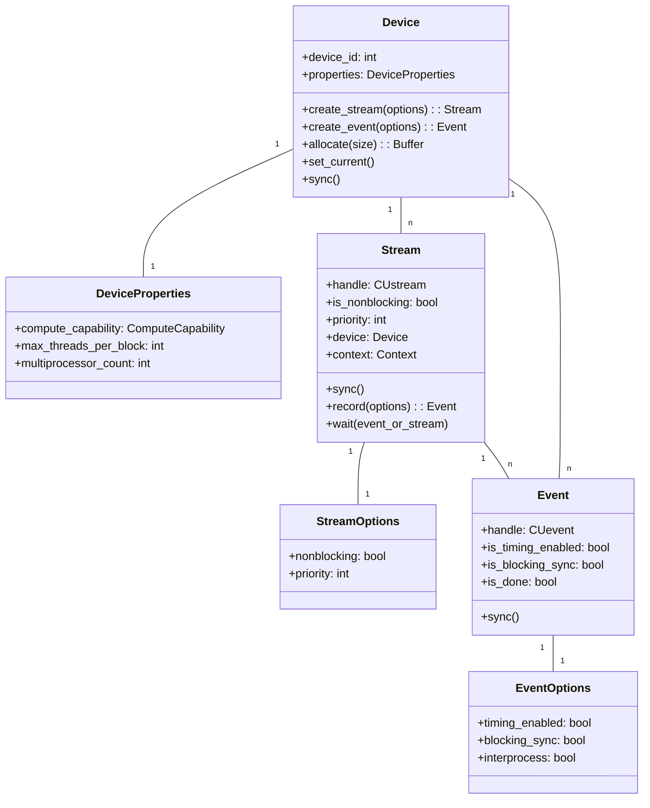
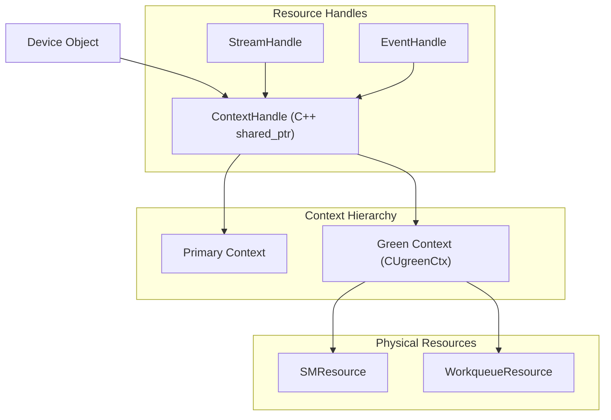

<!-- source: DeepWiki mcp.deepwiki.com · repo NVIDIA/cuda-python · page 2.1 Device, Stream, and Event Abstractions · fetched 2026-10-26 -->

# Device, Stream, and Event Abstractions

<details>
<summary>Relevant source files</summary>

The following files were used as context for generating this wiki page:

- [cuda_core/cuda/core/_context.pxd](cuda_core/cuda/core/_context.pxd)
- [cuda_core/cuda/core/_context.pyx](cuda_core/cuda/core/_context.pyx)
- [cuda_core/cuda/core/_cpp/REGISTRY_DESIGN.md](cuda_core/cuda/core/_cpp/REGISTRY_DESIGN.md)
- [cuda_core/cuda/core/_device.pyx](cuda_core/cuda/core/_device.pyx)
- [cuda_core/cuda/core/_device_resources.pxd](cuda_core/cuda/core/_device_resources.pxd)
- [cuda_core/cuda/core/_device_resources.pyx](cuda_core/cuda/core/_device_resources.pyx)
- [cuda_core/cuda/core/_event.pyx](cuda_core/cuda/core/_event.pyx)
- [cuda_core/cuda/core/_memory/_buffer.pyx](cuda_core/cuda/core/_memory/_buffer.pyx)
- [cuda_core/cuda/core/_memory/_graph_memory_resource.pyx](cuda_core/cuda/core/_memory/_graph_memory_resource.pyx)
- [cuda_core/cuda/core/_memory/_legacy.py](cuda_core/cuda/core/_memory/_legacy.py)
- [cuda_core/cuda/core/_memory/_memory_pool.pyx](cuda_core/cuda/core/_memory/_memory_pool.pyx)
- [cuda_core/cuda/core/_memory/_virtual_memory_resource.py](cuda_core/cuda/core/_memory/_virtual_memory_resource.py)
- [cuda_core/cuda/core/_module.pyx](cuda_core/cuda/core/_module.pyx)
- [cuda_core/cuda/core/_stream.pyx](cuda_core/cuda/core/_stream.pyx)
- [cuda_core/cuda/core/checkpoint.py](cuda_core/cuda/core/checkpoint.py)
- [cuda_core/cuda/core/typing.py](cuda_core/cuda/core/typing.py)
- [cuda_core/tests/conftest.py](cuda_core/tests/conftest.py)
- [cuda_core/tests/test_checkpoint.py](cuda_core/tests/test_checkpoint.py)
- [cuda_core/tests/test_device.py](cuda_core/tests/test_device.py)
- [cuda_core/tests/test_event.py](cuda_core/tests/test_event.py)
- [cuda_core/tests/test_green_context.py](cuda_core/tests/test_green_context.py)
- [cuda_core/tests/test_launcher.py](cuda_core/tests/test_launcher.py)
- [cuda_core/tests/test_memory.py](cuda_core/tests/test_memory.py)
- [cuda_core/tests/test_module.py](cuda_core/tests/test_module.py)
- [cuda_core/tests/test_stream.py](cuda_core/tests/test_stream.py)
- [cuda_core/tests/test_typing_imports.py](cuda_core/tests/test_typing_imports.py)

</details>


This document explains the core abstractions provided by `cuda.core` for interacting with NVIDIA GPUs. It focuses on three fundamental classes: `Device`, `Stream`, and `Event`. Together, these abstractions enable developers to manage GPU resources, control execution flow, and synchronize operations using a Pythonic interface that wraps the underlying CUDA Driver API.

## Abstraction Relationships

The following diagram illustrates the relationship between the core entities in `cuda.core`. Note that many of these objects wrap internal C++ handles (e.g., `StreamHandle`, `EventHandle`) to manage lifecycle and context dependencies.

**Entity Relationship Diagram**

Sources: [cuda_core/cuda/core/_device.pyx:49-67](), [cuda_core/cuda/core/_stream.pyx:47-90](), [cuda_core/cuda/core/_event.pyx:38-78]()

## Device Abstraction

The `Device` class represents a CUDA-capable GPU. It acts as the primary entry point for resource allocation and context management.

### Creating and Selecting a Device
The `Device` class is often used to manage the active CUDA context for a thread.

```python
from cuda.core import Device

# Initialize device 0
device = Device(0)

# Set as the current context for this thread
device.set_current()
```
The implementation uses `cuCtxGetCurrent` and `cuCtxPopCurrent` to manage a stack of contexts via thread-local storage (`_tls`).
Sources: [cuda_core/cuda/core/_device.pyx:44-46](), [cuda_core/tests/test_device.py:51-55](), [cuda_core/tests/conftest.py:149-161]()

### Device Properties
Detailed hardware information is accessed via `Device.properties`, which returns a `DeviceProperties` object. This object lazily fetches and caches attributes from the driver using `cuDeviceGetAttribute`.

| Property | Implementation Mapping |
|----------|------------------------|
| `compute_capability` | Returns a `ComputeCapability` namedtuple (major, minor) |
| `max_threads_per_block` | `CU_DEVICE_ATTRIBUTE_MAX_THREADS_PER_BLOCK` |
| `multiprocessor_count` | `CU_DEVICE_ATTRIBUTE_MULTIPROCESSOR_COUNT` |
| `arch` | String representation of CC (e.g., "80" for CC 8.0) |

Sources: [cuda_core/cuda/core/_device.pyx:87-134](), [cuda_core/tests/test_device.py:128-150]()

## Stream Abstraction

A `Stream` represents a queue of GPU operations. Operations within a stream are executed sequentially, while operations across different streams can be concurrent.

### Stream Creation
Streams are created through the `Device` object. Directly instantiating `Stream()` is disabled to prevent ambiguity.

```python
from cuda.core import Device, StreamOptions

device = Device()
# Create a non-blocking stream (default)
stream = device.create_stream(options=StreamOptions(nonblocking=True))
```
**Green Context Support**: If the current context is a "Green Context" (introduced in CUDA 12.5), `create_stream` automatically dispatches to `cuGreenCtxStreamCreate`.
Sources: [cuda_core/cuda/core/_stream.pyx:91-95](), [cuda_core/cuda/core/_stream.pyx:166-184]()

### Stream Synchronization and Interaction
- `stream.sync()`: Blocks the CPU thread until all work in the stream is finished (calls `cuStreamSynchronize`).
- `stream.wait(event)`: Makes the stream wait for an `Event` before executing subsequent work (calls `cuStreamWaitEvent`).
- `stream.record()`: Captures the current point in the stream as an `Event`.

Sources: [cuda_core/cuda/core/_stream.pyx:235-265](), [cuda_core/tests/test_stream.py:55-67]()

### Default Streams
`cuda.core` provides access to special stream handles:
- `LEGACY_DEFAULT_STREAM`: The global NULL stream.
- `PER_THREAD_DEFAULT_STREAM`: A stream local to the current thread.

Sources: [cuda_core/cuda/core/_stream.pyx:109-116](), [cuda_core/tests/test_stream.py:106-112]()

## Event Abstraction

An `Event` is a synchronization primitive used to monitor stream progress or measure timing.

### Recording and Timing
Events are recorded into streams. If created with `timing_enabled=True`, the elapsed time between two events can be calculated using the subtraction operator.

```python
options = EventOptions(timing_enabled=True)
start = stream.record(options=options)
# ... launch kernels ...
end = stream.record(options=options)
end.sync()

elapsed_ms = end - start
```
The subtraction operator internally calls `cuEventElapsedTime`.
Sources: [cuda_core/cuda/core/_event.pyx:112-126](), [cuda_core/tests/test_event.py:25-48]()

### Event State
- `event.is_done`: Returns `True` if all work captured by the event has completed (calls `cuEventQuery`).
- `event.sync()`: Blocks the CPU until the event is reached (calls `cuEventSynchronize`).

Sources: [cuda_core/cuda/core/_event.pyx:143-164](), [cuda_core/tests/test_event.py:63-78]()

## Context and GreenContext System

The `Context` system manages the lifetime of CUDA contexts. A significant feature is the `GreenContext`, which allows for resource partitioning (e.g., SM and Workqueue resources).

**Context and Resource Mapping**

Sources: [cuda_core/cuda/core/_context.pyx:16-40](), [cuda_core/cuda/core/_device.pyx:21-29](), [cuda_core/cuda/core/_device_resources.pyx:15-30]()

### Implementation Detail: Shared Handles
`cuda.core` uses a C++ backend to manage resource handles (`StreamHandle`, `EventHandle`, `ContextHandle`). These handles use `shared_ptr` to ensure that a context is not destroyed while streams or events associated with it are still alive.
Sources: [cuda_core/cuda/core/_resource_handles.pxd:1-30](), [cuda_core/cuda/core/_stream.pyx:165-184]()

## Summary Table: Class Responsibilities

| Class | Role | Key Driver API Calls |
|-------|------|----------------------|
| `Device` | GPU hardware entry point | `cuDeviceGet`, `cuCtxSetCurrent` |
| `DeviceProperties` | Hardware capability query | `cuDeviceGetAttribute` |
| `Stream` | Async command queue | `cuStreamCreate`, `cuStreamSynchronize` |
| `Event` | Sync and timing point | `cuEventCreate`, `cuEventRecord`, `cuEventElapsedTime` |
| `Buffer` | Memory handle | `cuMemAlloc`, `cuMemFree` |

Sources: [cuda_core/cuda/core/_device.pyx:49-67](), [cuda_core/cuda/core/_stream.pyx:75-90](), [cuda_core/cuda/core/_event.pyx:38-78](), [cuda_core/cuda/core/_memory/_buffer.pyx:81-103]()

---

