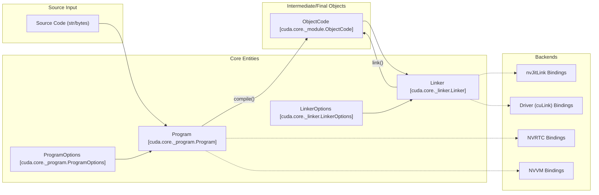
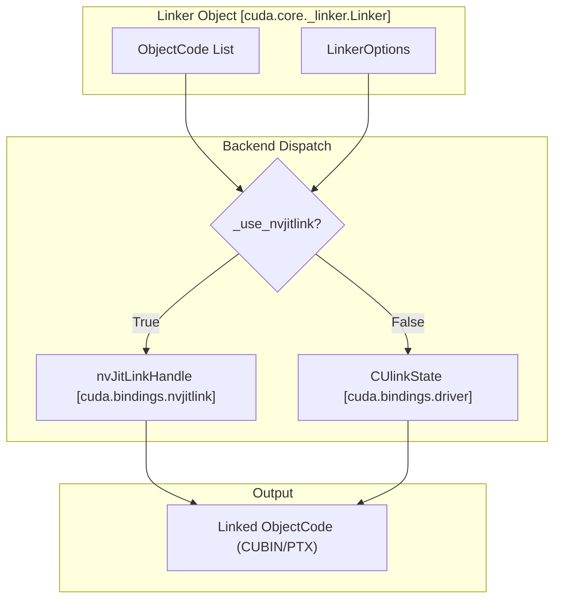

<!-- source: DeepWiki mcp.deepwiki.com · repo NVIDIA/cuda-python · page 2.2 Program Compilation and Linker System · fetched 2026-10-26 -->

# Program Compilation and Linker System

<details>
<summary>Relevant source files</summary>

The following files were used as context for generating this wiki page:

- [cuda_bindings/cuda/bindings/_internal/utils.pxd](cuda_bindings/cuda/bindings/_internal/utils.pxd)
- [cuda_bindings/cuda/bindings/_internal/utils.pyx](cuda_bindings/cuda/bindings/_internal/utils.pyx)
- [cuda_bindings/tests/conftest.py](cuda_bindings/tests/conftest.py)
- [cuda_bindings/tests/test_cuda.py](cuda_bindings/tests/test_cuda.py)
- [cuda_bindings/tests/test_cudart.py](cuda_bindings/tests/test_cudart.py)
- [cuda_bindings/tests/test_nvjitlink.py](cuda_bindings/tests/test_nvjitlink.py)
- [cuda_bindings/tests/test_nvvm.py](cuda_bindings/tests/test_nvvm.py)
- [cuda_core/cuda/core/_linker.pyx](cuda_core/cuda/core/_linker.pyx)
- [cuda_core/cuda/core/_program.pxd](cuda_core/cuda/core/_program.pxd)
- [cuda_core/cuda/core/_program.pyx](cuda_core/cuda/core/_program.pyx)
- [cuda_core/cuda/core/_utils/cuda_utils.pyx](cuda_core/cuda/core/_utils/cuda_utils.pyx)
- [cuda_core/cuda/core/utils/__init__.py](cuda_core/cuda/core/utils/__init__.py)
- [cuda_core/cuda/core/utils/_program_cache/__init__.py](cuda_core/cuda/core/utils/_program_cache/__init__.py)
- [cuda_core/cuda/core/utils/_program_cache/_abc.py](cuda_core/cuda/core/utils/_program_cache/_abc.py)
- [cuda_core/cuda/core/utils/_program_cache/_file_stream.py](cuda_core/cuda/core/utils/_program_cache/_file_stream.py)
- [cuda_core/cuda/core/utils/_program_cache/_in_memory.py](cuda_core/cuda/core/utils/_program_cache/_in_memory.py)
- [cuda_core/cuda/core/utils/_program_cache/_keys.py](cuda_core/cuda/core/utils/_program_cache/_keys.py)
- [cuda_core/tests/test_cuda_utils.py](cuda_core/tests/test_cuda_utils.py)
- [cuda_core/tests/test_linker.py](cuda_core/tests/test_linker.py)
- [cuda_core/tests/test_program.py](cuda_core/tests/test_program.py)

</details>


## Overview

This page documents the Program Compilation and Linker System in CUDA Python, which provides a comprehensive framework for compiling CUDA code at runtime and linking multiple code objects together. The system enables dynamic compilation of CUDA C++, PTX, or NVVM IR into executable binary formats (CUBIN) or intermediate representations, utilizing backends like NVRTC, NVVM, nvJitLink, and the CUDA Driver's cuLink.

Sources: [cuda_core/cuda/core/_program.pyx:4-8](), [cuda_core/cuda/core/_linker.pyx:4-9]()

## Compilation and Linking Pipeline

The following diagram bridges the high-level compilation flow to the specific code entities involved in the process:

**Diagram: Compilation and Linking Data Flow**


Sources: [cuda_core/cuda/core/_program.pyx:58-77](), [cuda_core/cuda/core/_linker.pyx:56-73](), [cuda_core/cuda/core/_module.py:21-45]()

## Program Class

The `Program` class is the primary entry point for compiling CUDA code. It abstracts the complexities of choosing between NVRTC (for C++) and NVVM (for IR).

### Class Definition and Implementation
The `Program` class handles initialization by normalizing the source code and code type, then selecting the appropriate internal handle (`_h_nvrtc` or `_h_nvvm`).

Sources: [cuda_core/cuda/core/_program.pyx:58-78](), [cuda_core/cuda/core/_program.pxd:9-22]()

### Compilation and Caching
The `compile()` method supports just-in-time compilation with an optional caching layer.

```python
object_code = program.compile(
    target_type="cubin", 
    name_expressions=["my_kernel"], 
    cache=my_cache_resource
)
```

- **Target Types**: Supports `"ptx"`, `"cubin"`, and `"ltoir"` [cuda_core/cuda/core/_program.pyx:99-100]().
- **Program Caching**: If a `ProgramCacheResource` is provided, the system derives a key from the code and options to skip re-compilation [cuda_core/cuda/core/_program.pyx:109-134]().
- **PCH Support**: Supports Precompiled Headers (PCH) through `ProgramOptions` [cuda_core/cuda/core/_program.pyx:122-125]().

Sources: [cuda_core/cuda/core/_program.pyx:87-141](), [cuda_core/tests/test_program.py:145-150]()

## ProgramOptions

`ProgramOptions` is a dataclass that normalizes options for both NVRTC and NVVM.

| Option | Type | Description |
|--------|------|-------------|
| `arch` | str | Target architecture (e.g., "sm_80") [cuda_core/tests/test_program.py:195]() |
| `relocatable_device_code` | bool | Enable RDC for linking [cuda_core/tests/test_program.py:164]() |
| `link_time_optimization` | bool | Enable LTO/NVVM IR generation [cuda_core/tests/test_program.py:168]() |
| `max_register_count` | int | Limit register usage per thread [cuda_core/tests/test_program.py:164]() |
| `no_cache` | bool | Disable internal JIT caching [cuda_core/tests/test_program.py:193]() |

Sources: [cuda_core/cuda/core/_program.pyx:73-76](), [cuda_core/tests/test_program.py:152-195]()

## Linker System

The `Linker` class provides a unified interface for combining multiple `ObjectCode` instances. It dynamically selects between the modern `nvJitLink` backend and the legacy Driver `cuLink` API.

### Backend Selection Logic
The selection is determined by `_linker._decide_nvjitlink_or_driver()`, which checks for `nvJitLink` availability and version (requires ≥ 12.3).

Sources: [cuda_core/tests/test_linker.py:21-26](), [cuda_core/cuda/core/_linker.pyx:108-119]()

### Linking Process
The linker consumes `ObjectCode` objects and produces a new `ObjectCode` containing the linked binary.

**Diagram: Linker Internal Backend Mapping**


Sources: [cuda_core/cuda/core/_linker.pyx:56-74](), [cuda_core/cuda/core/_linker.pyx:108-119]()

## LinkerOptions

`LinkerOptions` manages parameters for the linking process. Note that some options are backend-specific.

| Option | Backend | Description |
|--------|---------|-------------|
| `arch` | Both | Target compute capability [cuda_core/cuda/core/_linker.pyx:193-196]() |
| `lto` | nvJitLink | Enable Link Time Optimization [cuda_core/cuda/core/_linker.pyx:201]() |
| `ptxas_options` | Both | Options passed to the underlying ptxas tool [cuda_core/tests/test_linker.py:68-70]() |
| `kernels_used` | nvJitLink | Specific kernels to keep in the output [cuda_core/tests/test_linker.py:78-80]() |

Sources: [cuda_core/cuda/core/_linker.pyx:182-220](), [cuda_core/tests/test_linker.py:56-88]()

## ObjectCode

The `ObjectCode` class (defined in `cuda.core._module`) acts as the container for compiled or linked bytes. It holds the raw binary, the target format (`ptx`, `cubin`, `ltoir`), and any symbol mappings (kernel names) generated during compilation.

Key capabilities:
- `from_ptx(code, name)`: Creates an object from existing PTX [cuda_core/tests/test_linker.py:132]().
- `get_kernel(name)`: Retrieves a kernel handle from the compiled code [cuda_core/cuda/core/_module.py:130-159]().

Sources: [cuda_core/cuda/core/_module.py:21-45](), [cuda_core/tests/test_linker.py:93-94]()

## Error Handling

The system uses a specialized translation layer to provide descriptive error messages.

- **NVRTC/NVVM Errors**: Failures during `Program.compile()` raise `NVRTCError` or `nvvmError`, often including the full compilation log from the backend [cuda_core/cuda/core/_utils/cuda_utils.pyx:77-92, 103-118]().
- **Linker Errors**: `Linker.get_error_log()` retrieves detailed diagnostic messages from the linker backend [cuda_core/cuda/core/_linker.pyx:94-119]().
- **Explanations**: The `cuda_utils` layer maps raw error codes to human-readable explanations using `DRIVER_CU_RESULT_EXPLANATIONS` and `RUNTIME_CUDA_ERROR_EXPLANATIONS` [cuda_core/cuda/core/_utils/cuda_utils.pyx:29-30, 161-163]().

Sources: [cuda_core/cuda/core/_utils/cuda_utils.pyx:33-40](), [cuda_core/tests/test_linker.py:147-170](), [cuda_core/tests/test_cuda_utils.py:31-60]()

## Resource Management

Resource cleanup is handled via the `close()` method or internal `shared_ptr` logic in the Cython layer.

- **Program**: `program.close()` resets the internal NVRTC or NVVM handles [cuda_core/cuda/core/_program.pyx:79-86]().
- **Linker**: `linker.close()` destroys the `nvJitLink` or `cuLink` state [cuda_core/cuda/core/_linker.pyx:146-152]().

Sources: [cuda_core/cuda/core/_program.pyx:79-86](), [cuda_core/cuda/core/_linker.pyx:146-152]()

---

