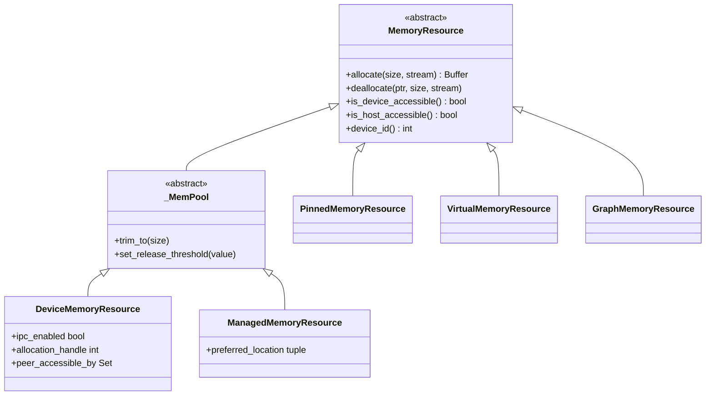
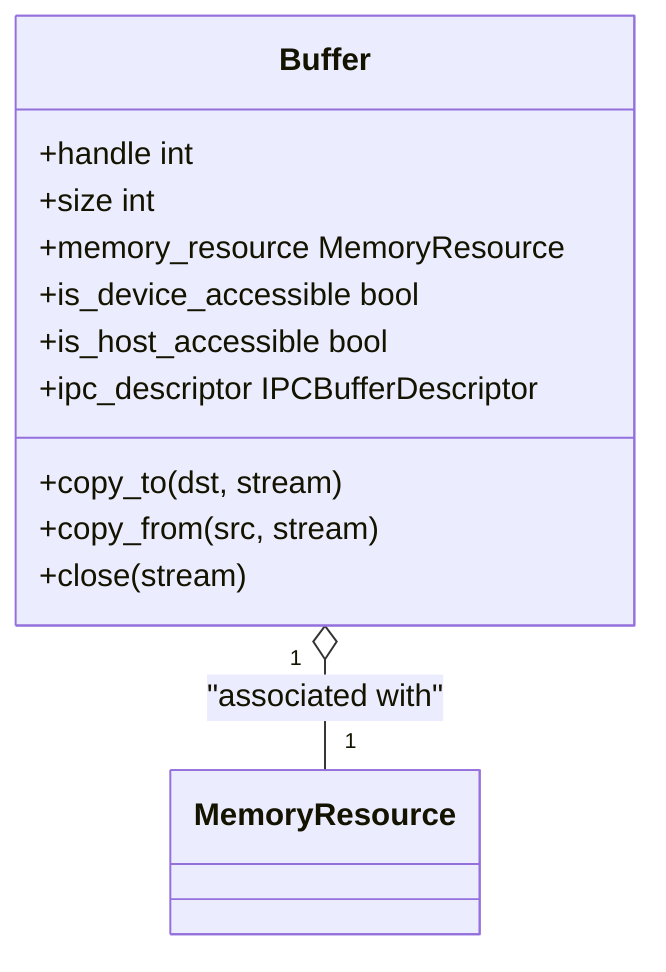
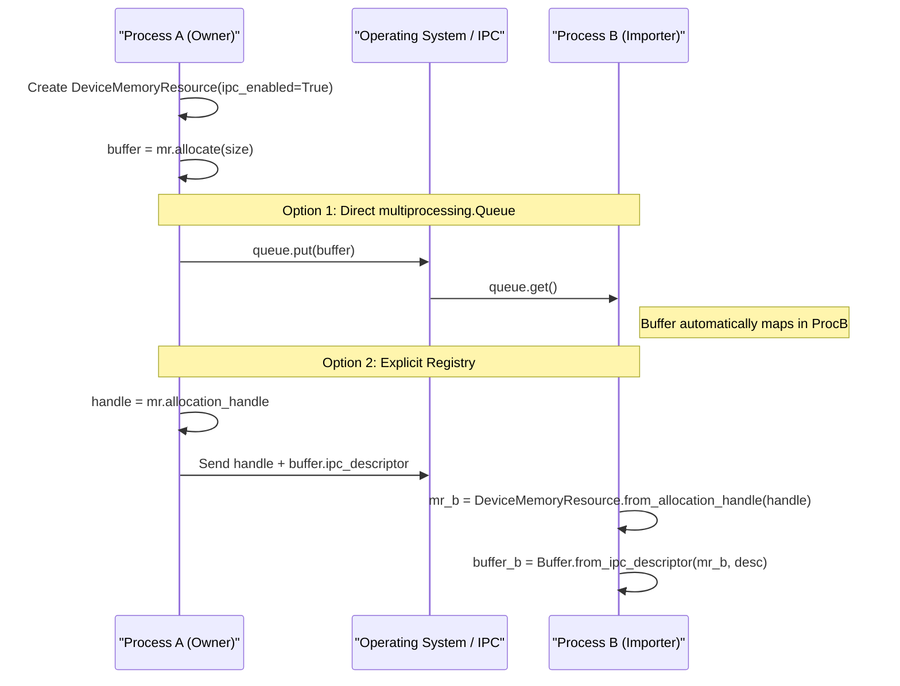

<!-- source: DeepWiki mcp.deepwiki.com · repo NVIDIA/cuda-python · page 2.3 Memory Management · fetched 2026-10-26 -->

# Memory Management

Relevant source files

The following files were used as context for generating this wiki page:

- [cuda_bindings/cuda/bindings/_test_helpers/mempool.py](cuda_bindings/cuda/bindings/_test_helpers/mempool.py)
- [cuda_core/cuda/core/_layout.pyx](cuda_core/cuda/core/_layout.pyx)
- [cuda_core/cuda/core/_memory/_device_memory_resource.pxd](cuda_core/cuda/core/_memory/_device_memory_resource.pxd)
- [cuda_core/cuda/core/_memory/_device_memory_resource.pyx](cuda_core/cuda/core/_memory/_device_memory_resource.pyx)
- [cuda_core/cuda/core/_memory/_ipc.pyx](cuda_core/cuda/core/_memory/_ipc.pyx)
- [cuda_core/cuda/core/_memory/_managed_memory_resource.pyx](cuda_core/cuda/core/_memory/_managed_memory_resource.pyx)
- [cuda_core/cuda/core/_memory/_peer_access_utils.pyx](cuda_core/cuda/core/_memory/_peer_access_utils.pyx)
- [cuda_core/cuda/core/_stream.pxd](cuda_core/cuda/core/_stream.pxd)
- [cuda_core/tests/conftest.py](cuda_core/tests/conftest.py)
- [cuda_core/tests/helpers/buffers.py](cuda_core/tests/helpers/buffers.py)
- [cuda_core/tests/helpers/collection_interface_testers.py](cuda_core/tests/helpers/collection_interface_testers.py)
- [cuda_core/tests/memory_ipc/test_errors.py](cuda_core/tests/memory_ipc/test_errors.py)
- [cuda_core/tests/memory_ipc/test_ipc_duplicate_import.py](cuda_core/tests/memory_ipc/test_ipc_duplicate_import.py)
- [cuda_core/tests/memory_ipc/test_leaks.py](cuda_core/tests/memory_ipc/test_leaks.py)
- [cuda_core/tests/memory_ipc/test_memory_ipc.py](cuda_core/tests/memory_ipc/test_memory_ipc.py)
- [cuda_core/tests/memory_ipc/test_peer_access.py](cuda_core/tests/memory_ipc/test_peer_access.py)
- [cuda_core/tests/memory_ipc/test_send_buffers.py](cuda_core/tests/memory_ipc/test_send_buffers.py)
- [cuda_core/tests/memory_ipc/test_serialize.py](cuda_core/tests/memory_ipc/test_serialize.py)
- [cuda_core/tests/memory_ipc/test_workerpool.py](cuda_core/tests/memory_ipc/test_workerpool.py)
- [cuda_core/tests/test_build_hooks.py](cuda_core/tests/test_build_hooks.py)
- [cuda_core/tests/test_device.py](cuda_core/tests/test_device.py)
- [cuda_core/tests/test_event.py](cuda_core/tests/test_event.py)
- [cuda_core/tests/test_launcher.py](cuda_core/tests/test_launcher.py)
- [cuda_core/tests/test_managed_memory_warning.py](cuda_core/tests/test_managed_memory_warning.py)
- [cuda_core/tests/test_memory.py](cuda_core/tests/test_memory.py)
- [cuda_core/tests/test_memory_peer_access.py](cuda_core/tests/test_memory_peer_access.py)
- [cuda_core/tests/test_module.py](cuda_core/tests/test_module.py)
- [cuda_core/tests/test_stream.py](cuda_core/tests/test_stream.py)

This page documents the memory management abstractions and utilities provided by the CUDA Python `cuda.core` package. Memory management in CUDA applications involves handling data across CPU and GPU memory spaces using various resource types, including pooled, managed, pinned, and virtual memory.

## Memory Resource Abstractions

The memory management system in `cuda.core` is built around specialized memory resources (MRs). These classes encapsulate CUDA memory allocation strategies and lifecycle management.

Sources:
- [cuda_core/cuda/core/_memory/_device_memory_resource.pyx:51-128]()
- [cuda_core/cuda/core/_memory/_managed_memory_resource.pyx:62-130]()
- [cuda_core/tests/test_memory.py:62-147]()

### DeviceMemoryResource (Stream-Ordered Pool)

`DeviceMemoryResource` manages a stream-ordered memory pool (`CUmemoryPool`). It is the primary resource for high-performance GPU allocations.

- **Ownership**: If created with `DeviceMemoryResourceOptions`, it creates and owns a new pool. If created with `options=None`, it wraps the driver's current or default pool for the device [cuda_core/cuda/core/_memory/_device_memory_resource.pyx:55-74]().
- **IPC Support**: Can be created with `ipc_enabled=True` to allow sharing allocations across process boundaries via `allocation_handle` [cuda_core/cuda/core/_memory/_device_memory_resource.pyx:77-103]().
- **Peer Access**: Supports cross-GPU access via the `peer_accessible_by` property, which allows managing which other devices can access this MR's allocations [cuda_core/tests/test_memory_peer_access.py:17-52]().

### ManagedMemoryResource (Unified Memory)

`ManagedMemoryResource` provides allocations accessible from both host and device with automatic migration. It wraps `CUmemoryPool` with `CU_MEMPOOL_ATTR_REUSE_ALLOW_MANAGED` [cuda_core/cuda/core/_memory/_managed_memory_resource.pyx:62-89]().

- **Preferred Location**: Users can specify where memory should reside by default (e.g., a specific GPU, Host, or specific Host NUMA node) using `ManagedMemoryResourceOptions` [cuda_core/cuda/core/_memory/_managed_memory_resource.pyx:25-59]().

### Specialized Resources

| Resource | Purpose | Source |
| :--- | :--- | :--- |
| `PinnedMemoryResource` | Page-locked host memory for high-bandwidth HtoD/DtoH transfers. | [cuda_core/cuda/core/_memory/_pinned_memory_resource.pyx]() |
| `VirtualMemoryResource` | Low-level management using the Virtual Memory Management (VMM) APIs. | [cuda_core/tests/test_memory.py:40-41]() |
| `GraphMemoryResource` | Memory management specialized for use within CUDA Graphs. | [cuda_core/tests/test_memory.py:34]() |

## Buffer Abstraction

The `Buffer` class provides a unified Pythonic interface for memory handles, regardless of the underlying `MemoryResource`.

### Memory Operations
- **Allocation**: Typically performed via `mr.allocate(size, stream=stream)` [cuda_core/tests/test_memory.py:172-180]().
- **Data Transfer**: `copy_to` and `copy_from` facilitate asynchronous transfers between buffers on a specified stream [cuda_core/tests/test_memory.py:193-214]().
- **Cleanup**: `close(stream)` triggers asynchronous deallocation. Buffers also support automatic cleanup via finalizers [cuda_core/tests/test_memory.py:179]().

Sources:
- [cuda_core/tests/test_memory.py:30-41]()
- [cuda_core/tests/test_memory.py:172-180]()

## Inter-Process Communication (IPC)

`cuda.core` provides a robust system for sharing GPU memory between processes, particularly optimized for use with Python's `multiprocessing`.

### IPC Data Flow

### Key IPC Components
- **`IPCAllocationHandle`**: A shareable reference to a memory pool (e.g., a file descriptor on Linux) [cuda_core/cuda/core/_memory/_device_memory_resource.pyx:163-172]().
- **`IPCBufferDescriptor`**: A serializable object containing the metadata required to map a specific allocation in a remote process [cuda_core/cuda/core/_memory.py:47]().
- **Registry**: A global mapping (per process) that associates UUIDs with `DeviceMemoryResource` instances, allowing `pickle` to automatically reconstruct `Buffer` objects by looking up their parent MR [cuda_core/cuda/core/_memory/_device_memory_resource.pyx:105-112]().

Sources:
- [cuda_core/cuda/core/_memory/_device_memory_resource.pyx:77-128]()
- [cuda_core/tests/memory_ipc/test_workerpool.py:21-58]()
- [cuda_core/tests/memory_ipc/test_send_buffers.py:19-61]()

## Peer-to-Peer (P2P) Access

For multi-GPU systems, `DeviceMemoryResource` allows explicit management of peer access.

- **`peer_accessible_by`**: This property acts like a mutable set of `Device` objects or ordinals. Adding a device to this set enables that device to directly access memory allocated by the resource [cuda_core/tests/test_memory_peer_access.py:17-42]().
- **Implementation**: Managed via `PeerAccessibleBySetProxy`, which performs the underlying `cuDeviceCanAccessPeer` and `cuCtxEnablePeerAccess` (or mempool equivalents) calls [cuda_core/cuda/core/_memory/_peer_access_utils.pyx:10-11]().

Sources:
- [cuda_core/tests/test_memory_peer_access.py:16-52]()
- [cuda_core/cuda/core/_memory/_device_memory_resource.pyx:26]()

## Summary of Allocation Methods

| Method | Context | Return Type | Synchronicity |
| :--- | :--- | :--- | :--- |
| `Device.allocate(size, stream)` | Current Device Pool | `Buffer` | Async |
| `MemoryResource.allocate(size, stream)` | Specific MR | `Buffer` | Resource-dependent |
| `Buffer.from_handle(ptr, size, mr)` | External Pointer | `Buffer` | Immediate |
| `Buffer.from_ipc_descriptor(mr, desc)` | IPC Import | `Buffer` | Immediate |

Sources:
- [cuda_core/tests/test_device.py:63-71]()
- [cuda_core/tests/test_memory.py:68-70]()
- [cuda_core/tests/memory_ipc/test_workerpool.py:100]()

---

