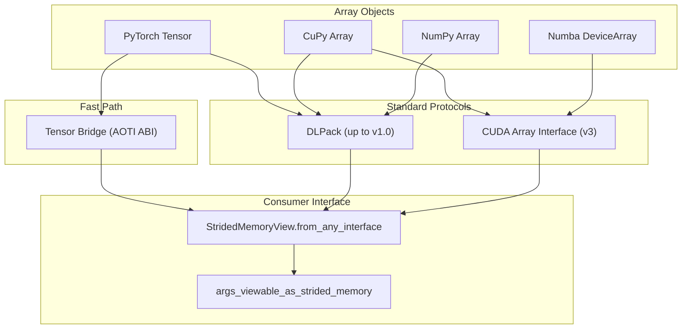
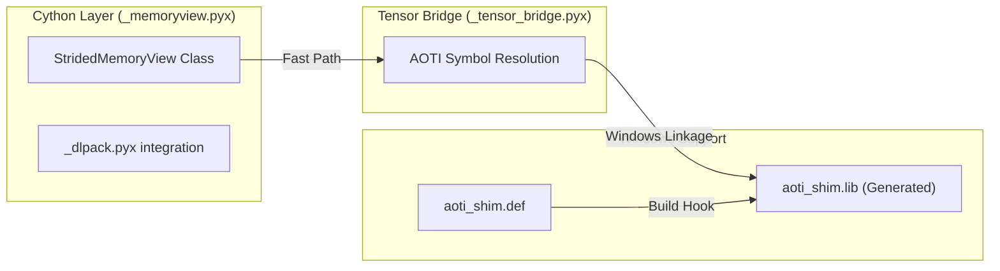

<!-- source: DeepWiki mcp.deepwiki.com · repo NVIDIA/cuda-python · page 2.4 StridedMemoryView and Interoperability · fetched 2026-10-26 -->

# StridedMemoryView and Interoperability

<details>
<summary>Relevant source files</summary>

The following files were used as context for generating this wiki page:

- [cuda_bindings/docs/build_docs.sh](cuda_bindings/docs/build_docs.sh)
- [cuda_bindings/docs/source/index.rst](cuda_bindings/docs/source/index.rst)
- [cuda_bindings/docs/source/overview.rst](cuda_bindings/docs/source/overview.rst)
- [cuda_bindings/docs/source/tips_and_tricks.rst](cuda_bindings/docs/source/tips_and_tricks.rst)
- [cuda_core/build_hooks.py](cuda_core/build_hooks.py)
- [cuda_core/cuda/core/__init__.pxd](cuda_core/cuda/core/__init__.pxd)
- [cuda_core/cuda/core/_dlpack.pxd](cuda_core/cuda/core/_dlpack.pxd)
- [cuda_core/cuda/core/_dlpack.pyx](cuda_core/cuda/core/_dlpack.pyx)
- [cuda_core/cuda/core/_include/aoti_shim.def](cuda_core/cuda/core/_include/aoti_shim.def)
- [cuda_core/cuda/core/_include/aoti_shim.h](cuda_core/cuda/core/_include/aoti_shim.h)
- [cuda_core/cuda/core/_include/dlpack.h](cuda_core/cuda/core/_include/dlpack.h)
- [cuda_core/cuda/core/_memory/_buffer.pxd](cuda_core/cuda/core/_memory/_buffer.pxd)
- [cuda_core/cuda/core/_memoryview.pyx](cuda_core/cuda/core/_memoryview.pyx)
- [cuda_core/cuda/core/_tensor_bridge.pyx](cuda_core/cuda/core/_tensor_bridge.pyx)
- [cuda_core/docs/build_docs.sh](cuda_core/docs/build_docs.sh)
- [cuda_core/docs/source/examples.rst](cuda_core/docs/source/examples.rst)
- [cuda_core/docs/source/getting-started.rst](cuda_core/docs/source/getting-started.rst)
- [cuda_core/docs/source/index.rst](cuda_core/docs/source/index.rst)
- [cuda_core/docs/source/interoperability.rst](cuda_core/docs/source/interoperability.rst)
- [cuda_core/setup.py](cuda_core/setup.py)
- [cuda_core/tests/test_utils.py](cuda_core/tests/test_utils.py)
- [cuda_python/docs/Makefile](cuda_python/docs/Makefile)
- [cuda_python/docs/build_docs.sh](cuda_python/docs/build_docs.sh)
- [cuda_python/docs/source/_templates/main.html](cuda_python/docs/source/_templates/main.html)

</details>


This document details the `StridedMemoryView` class in `cuda-python` and how it enables interoperability between CUDA-based code and various Python array libraries. The interoperability mechanisms described here allow seamless integration of CUDA kernels with array objects from libraries like NumPy, CuPy, Numba, PyTorch, and others that support standard memory-sharing protocols.

## 1. Overview of StridedMemoryView

`StridedMemoryView` is a class that provides a unified representation of strided dense arrays or tensors from different Python libraries. It extracts and standardizes metadata about memory layout, allowing CUDA kernels to work with arrays regardless of their original source. It is array-library-agnostic, meaning it does not depend on any specific array library to function.

```mermaid
classDiagram
    class StridedMemoryView {
        +int ptr
        +tuple shape
        +tuple strides
        +numpy.dtype dtype
        +int device_id
        +bool is_device_accessible
        +bool readonly
        +Any exporting_obj
        +from_any_interface(obj, stream_ptr)
        +from_dlpack(obj, stream_ptr)
        +from_buffer(buffer, shape, dtype, strides)
    }

    class "Array Protocols" {
        +__dlpack__()
        +__dlpack_device__()
        +__cuda_array_interface__
    }

    class "Tensor Bridge (Fast Path)" {
        +aoti_torch_get_data_ptr()
        +aoti_torch_get_sizes()
        +aoti_torch_get_strides()
    }

    "Array Protocols" <.. StridedMemoryView : via from_any_interface
    "Tensor Bridge (Fast Path)" <.. StridedMemoryView : via PyTorch optimization
```

Sources: [cuda_core/cuda/core/_memoryview.pyx:124-179](), [cuda_core/docs/source/interoperability.rst:69-81]()

The main attributes of `StridedMemoryView` are:

| Attribute | Type | Description |
|-----------|------|-------------|
| `ptr` | int | Pointer to the tensor buffer (as a Python `int`). |
| `shape` | tuple | Shape of the tensor. |
| `strides` | tuple or None | Strides of the tensor in counts (not bytes). |
| `dtype` | numpy.dtype | Data type of the tensor. |
| `device_id` | int | Device ID where the tensor is located (-1 for CPU tensors). |
| `is_device_accessible` | bool | Whether the tensor data can be accessed on the GPU. |
| `readonly` | bool | Whether the tensor data can be modified in place. |
| `exporting_obj` | Any | Reference to the original object (e.g., a `Buffer` or `torch.Tensor`). |

Sources: [cuda_core/cuda/core/_memoryview.pyx:163-178](), [cuda_core/tests/test_utils.py:173-188]()

## 2. Interoperability Protocols

`StridedMemoryView` supports multiple interoperability protocols to ensure compatibility across the ecosystem.



Sources: [cuda_core/cuda/core/_memoryview.pyx:35-55](), [cuda_core/cuda/core/_memoryview.pyx:127-145](), [cuda_core/docs/source/interoperability.rst:62-68]()

### 2.1. DLPack Protocol
`StridedMemoryView` supports DLPack up to version 1.0. When using DLPack, the consumer stream pointer is passed to the object's `__dlpack__` method. If `stream_ptr=-1` is provided, it indicates the consumer does not care about stream ordering, and `-1` is passed internally to `__dlpack__`.

Sources: [cuda_core/cuda/core/_memoryview.pyx:146-152](), [cuda_core/cuda/core/_memoryview.pyx:158-161]()

### 2.2. CUDA Array Interface (CAI)
For objects supporting CAI v3, `StridedMemoryView` establishes a stream order between the consumer stream and the producer stream (retrieved from the `stream` key in the CAI dictionary). This is implemented as an implicit `cudaStreamWaitEvent`.

Sources: [cuda_core/cuda/core/_memoryview.pyx:143-145](), [cuda_core/docs/source/interoperability.rst:62-65]()

### 2.3. PyTorch Tensor Bridge (Fast Path)
For PyTorch tensors, `cuda.core` implements a "Tensor Bridge" fast path using the PyTorch AOT Inductor (AOTI) stable C ABI. This avoids the overhead of the DLPack/CAI Python protocols by calling directly into the PyTorch C++ core via a vendored shim.

- **ABI Range**: Supported for PyTorch 2.3 through 2.11.
- **Implementation**: Uses `ctypes.CDLL` to load `torch._C` symbols with `RTLD_GLOBAL`.
- **Symbols**: Resolves functions like `aoti_torch_get_data_ptr`, `aoti_torch_get_sizes`, and `aoti_torch_get_strides`.

Sources: [cuda_core/cuda/core/_memoryview.pyx:45-70](), [cuda_core/cuda/core/_memoryview.pyx:85-98](), [cuda_core/cuda/core/_include/aoti_shim.h:64-76]()

## 3. Usage Patterns

### 3.1. The `args_viewable_as_strided_memory` Decorator
The recommended way to use `StridedMemoryView` is via the decorator. It wraps specified arguments in a proxy that provides a `.view(stream_ptr)` method.

```python
from cuda.core.utils import args_viewable_as_strided_memory

@args_viewable_as_strided_memory((0, 1)) # Arguments at index 0 and 1
def my_kernel_wrapper(input_arr, output_arr, stream):
    # .view() returns a StridedMemoryView
    in_view = input_arr.view(stream.ptr)
    out_view = output_arr.view(stream.ptr)
    
    # Access raw pointers for kernel launch
    launch_kernel(in_view.ptr, out_view.ptr, stream)
```

Sources: [cuda_core/tests/test_utils.py:154-158](), [cuda_core/docs/source/interoperability.rst:69-72]()

### 3.2. Manual Construction
`StridedMemoryView` can be instantiated manually using class methods:
- `StridedMemoryView.from_any_interface(obj, stream_ptr)`: Tries DLPack then CAI.
- `StridedMemoryView.from_dlpack(obj, stream_ptr)`: Explicitly uses DLPack.
- `StridedMemoryView.from_buffer(buffer, shape, dtype, strides)`: Creates a view from a `cuda.core.Buffer`.

Sources: [cuda_core/cuda/core/_memoryview.pyx:127-133](), [cuda_core/tests/test_utils.py:162-164]()

## 4. Narrow Data Type Support
`StridedMemoryView` supports narrow data types such as `bfloat16` if the `ml_dtypes` package is installed. This allows interoperability with `torch.bfloat16` or CuPy `bfloat16` arrays. If `ml_dtypes` is missing, encountering these types will raise a `NotImplementedError`.

Sources: [cuda_core/docs/source/interoperability.rst:86-95](), [cuda_core/cuda/core/_memoryview.pyx:101-104]()

## 5. Stream Synchronization Details

Proper synchronization is handled based on the source object's protocol:

| Protocol | Synchronization Mechanism |
|----------|---------------------------|
| **DLPack** | `stream_ptr` is passed to `__dlpack__(stream=stream_ptr)`. |
| **CAI** | An event is recorded on the producer stream and waited upon by the consumer stream. |
| **AOTI (Torch)** | Uses PyTorch's internal stream management symbols. |
| **Opt-out** | Pass `stream_ptr=-1` to skip all synchronization. |

Sources: [cuda_core/cuda/core/_memoryview.pyx:140-152](), [cuda_core/cuda/core/_memoryview.pyx:158-160](), [cuda_core/docs/source/interoperability.rst:62-68]()

## 6. Implementation Architecture

The system uses a combination of Cython for performance and a C shim for Windows compatibility.



Sources: [cuda_core/setup.py:50-67](), [cuda_core/cuda/core/_include/aoti_shim.def:1-10](), [cuda_core/cuda/core/_memoryview.pyx:85-98]()

---

