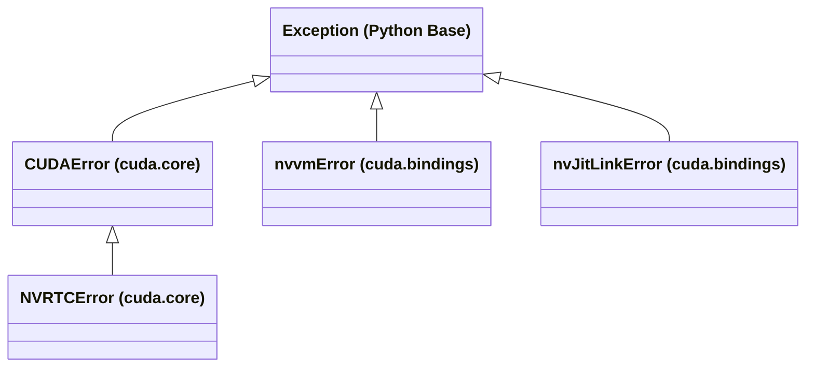
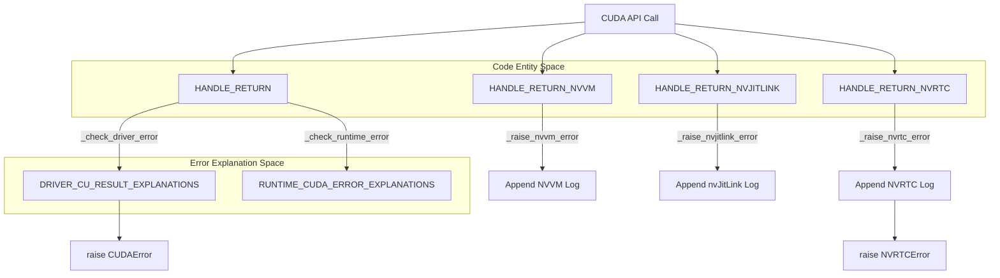
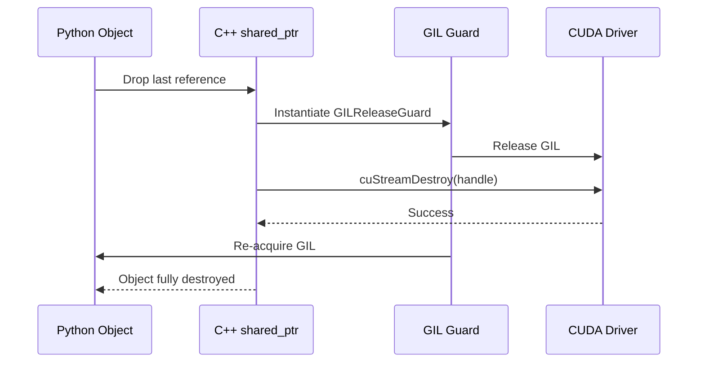

<!-- source: DeepWiki mcp.deepwiki.com · repo NVIDIA/cuda-python · page 2.5 Error Handling · fetched 2026-10-26 -->

# Error Handling

Relevant source files

The following files were used as context for generating this wiki page:

- [cuda_bindings/tests/conftest.py](cuda_bindings/tests/conftest.py)
- [cuda_bindings/tests/test_cuda.py](cuda_bindings/tests/test_cuda.py)
- [cuda_bindings/tests/test_cudart.py](cuda_bindings/tests/test_cudart.py)
- [cuda_core/cuda/core/_cpp/resource_handles.cpp](cuda_core/cuda/core/_cpp/resource_handles.cpp)
- [cuda_core/cuda/core/_cpp/resource_handles.hpp](cuda_core/cuda/core/_cpp/resource_handles.hpp)
- [cuda_core/cuda/core/_resource_handles.pxd](cuda_core/cuda/core/_resource_handles.pxd)
- [cuda_core/cuda/core/_resource_handles.pyx](cuda_core/cuda/core/_resource_handles.pyx)
- [cuda_core/cuda/core/_utils/cuda_utils.pxd](cuda_core/cuda/core/_utils/cuda_utils.pxd)
- [cuda_core/cuda/core/_utils/cuda_utils.pyx](cuda_core/cuda/core/_utils/cuda_utils.pyx)
- [cuda_core/cuda/core/_utils/driver_cu_result_explanations.py](cuda_core/cuda/core/_utils/driver_cu_result_explanations.py)
- [cuda_core/cuda/core/_utils/driver_cu_result_explanations_frozen.py](cuda_core/cuda/core/_utils/driver_cu_result_explanations_frozen.py)
- [cuda_core/cuda/core/_utils/enum_explanations_helpers.py](cuda_core/cuda/core/_utils/enum_explanations_helpers.py)
- [cuda_core/cuda/core/_utils/runtime_cuda_error_explanations.py](cuda_core/cuda/core/_utils/runtime_cuda_error_explanations.py)
- [cuda_core/cuda/core/_utils/runtime_cuda_error_explanations_frozen.py](cuda_core/cuda/core/_utils/runtime_cuda_error_explanations_frozen.py)
- [cuda_core/tests/test_cuda_utils.py](cuda_core/tests/test_cuda_utils.py)
- [cuda_core/tests/test_linker.py](cuda_core/tests/test_linker.py)
- [cuda_core/tests/test_object_protocols.py](cuda_core/tests/test_object_protocols.py)
- [cuda_core/tests/test_utils_enum_explanations_helpers.py](cuda_core/tests/test_utils_enum_explanations_helpers.py)

This page documents the error handling mechanisms in the `cuda.core` package. The error handling system provides consistent, informative error reporting for operations involving CUDA libraries through a layered approach that transforms low-level CUDA error codes into Python exceptions with detailed explanations and automated resource management.

## Exception Hierarchy

CUDA Python implements a specific exception hierarchy for representing errors from various CUDA subsystems. While `CUDAError` is the primary exception for driver and runtime issues, specialized exceptions exist for compilation and linking backends.

- `CUDAError`: Base exception for any CUDA-related error, primarily wrapping `CUresult` and `cudaError_t` [cuda_core/cuda/core/_utils/cuda_utils.pyx:33-34]().
- `NVRTCError`: Specific exception for NVRTC (runtime compilation) errors, which automatically captures and appends compilation logs [cuda_core/cuda/core/_utils/cuda_utils.pyx:37-38]().
- `nvvmError` / `nvJitLinkError`: Bindings-level exceptions used by the compiler backends in `cuda.core` [cuda_core/cuda/core/_utils/cuda_utils.pyx:22-23]().

Sources: [cuda_core/cuda/core/_utils/cuda_utils.pyx:22-38]()

## Error Handling Flow

The error handling system transforms low-level error codes from CUDA libraries into user-friendly Python exceptions. A critical feature of `cuda.core` is its ability to extract and clear thread-local errors at the C++ level to prevent error pollution.

### Resource Handle Error State
The C++ core maintains thread-local error state using `get_last_error`, `peek_last_error`, and `clear_last_error` [cuda_core/cuda/core/_cpp/resource_handles.hpp:43-50](). This ensures that if a CUDA call fails, the error is captured immediately before subsequent cleanup logic might overwrite it.

### Error Translation Layer
The `cuda_utils` module provides specialized handlers for each CUDA subsystem.

Sources: [cuda_core/cuda/core/_utils/cuda_utils.pyx:63-145](), [cuda_core/cuda/core/_cpp/resource_handles.hpp:40-50]()

## Error Checking Functions

The `cuda.core` package utilizes Cython-level error checkers that are optimized for performance while providing rich diagnostic information.

| Function | Signature | Purpose |
|----------|-----------|---------|
| `HANDLE_RETURN` | `(cydriver.CUresult err)` | Processes Driver API results, raising `CUDAError` on failure [cuda_core/cuda/core/_utils/cuda_utils.pyx:63](). |
| `HANDLE_RETURN_NVRTC` | `(nvrtcProgram prog, nvrtcResult err)` | Processes NVRTC results and fetches the compilation log if an error occurs [cuda_core/cuda/core/_utils/cuda_utils.pyx:69](). |
| `HANDLE_RETURN_NVVM` | `(nvvmProgram prog, nvvmResult err)` | Processes NVVM results and appends the internal program log to the exception [cuda_core/cuda/core/_utils/cuda_utils.pyx:95](). |
| `HANDLE_RETURN_NVJITLINK`| `(nvJitLinkHandle h, nvJitLinkResult err)`| Processes JIT Linker results and extracts the linker error log [cuda_core/cuda/core/_utils/cuda_utils.pyx:120](). |

Sources: [cuda_core/cuda/core/_utils/cuda_utils.pyx:63-145](), [cuda_core/cuda/core/_utils/cuda_utils.pxd:21-25]()

## Error Explanations

A unique feature of `cuda-python` is the inclusion of "Explanation Dictionaries." Standard CUDA error strings (e.g., via `cuGetErrorString`) are often terse. `cuda.core` augments these with detailed, human-readable text derived from the CUDA documentation.

- **`DRIVER_CU_RESULT_EXPLANATIONS`**: Maps `CUresult` integers to detailed descriptions [cuda_core/cuda/core/_utils/driver_cu_result_explanations.py]().
- **`RUNTIME_CUDA_ERROR_EXPLANATIONS`**: Maps `cudaError_t` integers to detailed descriptions [cuda_core/cuda/core/_utils/runtime_cuda_error_explanations.py]().

### Automated Docstring Cleanup
The system includes logic to clean up raw enum docstrings from the bindings to present a polished error message to the user [cuda_core/tests/test_cuda_utils.py:133-138]().

Example of an augmented error message:
`CUDA_ERROR_INVALID_CONTEXT: This most frequently indicates that there is no context bound to the current thread...` [cuda_core/tests/test_cuda_utils.py:94-101]()

Sources: [cuda_core/cuda/core/_utils/cuda_utils.pyx:161-184](), [cuda_core/tests/test_cuda_utils.py:83-138]()

## Resource Cleanup and Transactions

`cuda.core` utilizes a `Transaction` context manager (implemented via `ExitStack`) and RAII-style C++ handles to ensure safe resource cleanup even when errors occur.

### Transaction Context Manager
The `Transaction` system allows multiple CUDA operations to be grouped. If any operation fails, the `ExitStack` ensures that previously allocated resources within that transaction are correctly released [cuda_core/cuda/core/_utils/cuda_utils.pyx:12]().

### C++ Resource Handles
The underlying C++ implementation uses `shared_ptr` with custom deleters for CUDA handles (e.g., `CUcontext`, `CUstream`, `CUevent`). These deleters are GIL-aware:
- **`GILReleaseGuard`**: Releases the Python GIL when calling `cuStreamDestroy` or `cuMemFree` to prevent blocking other Python threads [cuda_core/cuda/core/_cpp/resource_handles.cpp:100-115]().
- **`GILAcquireGuard`**: Re-acquires the GIL if a C++ destructor needs to trigger a Python-level callback (e.g., a Memory Resource deallocation) [cuda_core/cuda/core/_cpp/resource_handles.cpp:134-148]().

Sources: [cuda_core/cuda/core/_cpp/resource_handles.cpp:93-160](), [cuda_core/cuda/core/_cpp/resource_handles.hpp:150-164]()

## Common Error Scenarios in Tests

The codebase includes extensive tests for error states, particularly in the Linker and Program subsystems:
- **Linker Undefined Reference**: Captured by `test_linker_get_error_log`, which demonstrates how `CUDAError` or `nvJitLinkError` is raised with a log containing the specific missing symbol (e.g., `Undefined reference to '_Z1Zv'`) [cuda_core/tests/test_linker.py:147-169]().
- **Invalid Architecture**: `test_linker_init_invalid_arch` verifies that passing an unsupported compute capability raises an `AttributeError` or `nvJitLinkError` [cuda_core/tests/test_linker.py:98-102]().
- **Memory Pool OOM**: Tests utilize `xfail_if_mempool_oom` to handle expected resource exhaustion in constrained environments [cuda_bindings/tests/test_cuda.py:15]().

Sources: [cuda_core/tests/test_linker.py:98-169](), [cuda_bindings/tests/test_cuda.py:15]()

---

