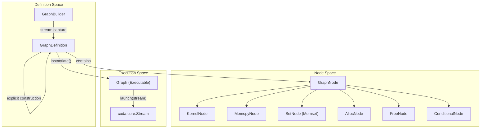
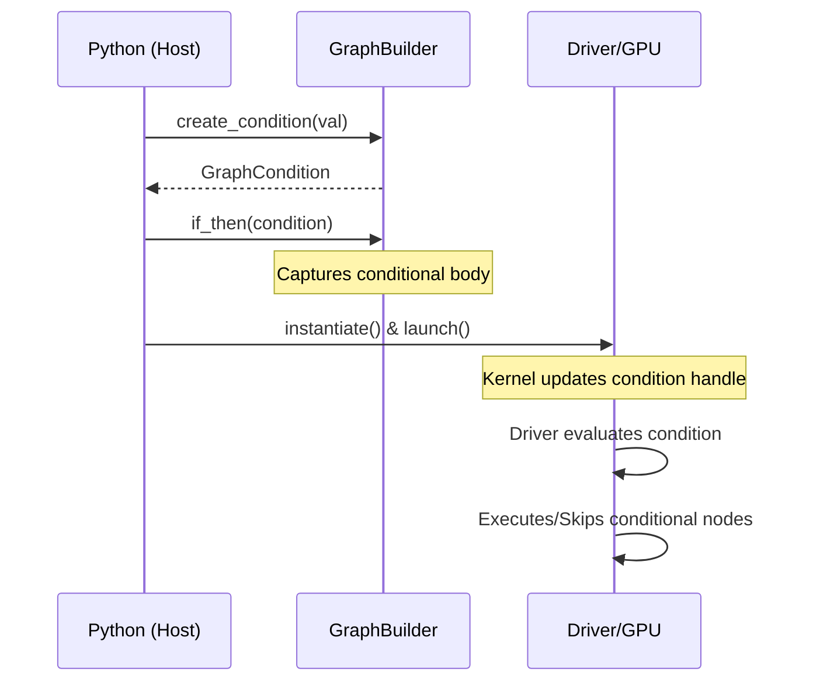

<!-- source: DeepWiki mcp.deepwiki.com · repo NVIDIA/cuda-python · page 2.6 CUDA Graphs · fetched 2026-10-26 -->

# CUDA Graphs

Relevant source files

The following files were used as context for generating this wiki page:

- [cuda_core/cuda/core/__init__.py](cuda_core/cuda/core/__init__.py)
- [cuda_core/cuda/core/_graphics.pxd](cuda_core/cuda/core/_graphics.pxd)
- [cuda_core/cuda/core/_graphics.pyx](cuda_core/cuda/core/_graphics.pyx)
- [cuda_core/cuda/core/graph/__init__.pxd](cuda_core/cuda/core/graph/__init__.pxd)
- [cuda_core/cuda/core/graph/__init__.py](cuda_core/cuda/core/graph/__init__.py)
- [cuda_core/cuda/core/graph/_graph_builder.pyx](cuda_core/cuda/core/graph/_graph_builder.pyx)
- [cuda_core/cuda/core/graph/_graph_definition.pyx](cuda_core/cuda/core/graph/_graph_definition.pyx)
- [cuda_core/cuda/core/graph/_graph_node.pyx](cuda_core/cuda/core/graph/_graph_node.pyx)
- [cuda_core/cuda/core/graph/_subclasses.pxd](cuda_core/cuda/core/graph/_subclasses.pxd)
- [cuda_core/cuda/core/graph/_subclasses.pyx](cuda_core/cuda/core/graph/_subclasses.pyx)
- [cuda_core/docs/source/release/1.0.0-notes.rst](cuda_core/docs/source/release/1.0.0-notes.rst)
- [cuda_core/examples/tma_tensor_map.py](cuda_core/examples/tma_tensor_map.py)
- [cuda_core/tests/graph/test_device_launch.py](cuda_core/tests/graph/test_device_launch.py)
- [cuda_core/tests/graph/test_graph_builder.py](cuda_core/tests/graph/test_graph_builder.py)
- [cuda_core/tests/graph/test_graph_builder_conditional.py](cuda_core/tests/graph/test_graph_builder_conditional.py)
- [cuda_core/tests/graph/test_graph_definition.py](cuda_core/tests/graph/test_graph_definition.py)
- [cuda_core/tests/graph/test_graph_memory_resource.py](cuda_core/tests/graph/test_graph_memory_resource.py)
- [cuda_core/tests/graph/test_graph_update.py](cuda_core/tests/graph/test_graph_update.py)
- [cuda_core/tests/graph/test_options.py](cuda_core/tests/graph/test_options.py)
- [cuda_core/tests/helpers/marks.py](cuda_core/tests/helpers/marks.py)
- [cuda_core/tests/helpers/misc.py](cuda_core/tests/helpers/misc.py)
- [cuda_core/tests/test_graphics.py](cuda_core/tests/test_graphics.py)
- [cuda_core/tests/test_tensor_map.py](cuda_core/tests/test_tensor_map.py)

The CUDA Graph subsystem in `cuda.core` provides two primary mechanisms for creating and executing task graphs: **Stream Capture** (via `GraphBuilder`) and **Explicit Construction** (via `GraphDefinition`). CUDA Graphs allow for reduced kernel launch overhead and the ability to define complex execution topologies, including conditional logic, which the CUDA driver can optimize as a single unit.

### Core Architecture

The graph subsystem is organized into three main phases:
1.  **Definition**: Building the graph structure using either capture or explicit node addition.
2.  **Instantiation**: Validating the definition and creating an executable graph (`Graph`).
3.  **Execution/Update**: Launching the executable graph on a stream and optionally updating its parameters without re-instantiation.

#### System Entities and Code Mapping
The following diagram maps high-level graph concepts to their specific class implementations in the `cuda.core.graph` module.

**Graph Entity Mapping**

Sources: [cuda_core/cuda/core/graph/_graph_definition.pyx:110-116](), [cuda_core/cuda/core/graph/_graph_builder.pyx:200-210](), [cuda_core/cuda/core/graph/_subclasses.pyx:38-54]()

---

### Graph Construction

#### 1. Stream Capture (GraphBuilder)
`GraphBuilder` allows users to record existing CUDA stream operations into a graph. This is the most common way to convert legacy imperative code into a graph.

*   **Usage**: Call `Device.create_graph_builder()` followed by `begin_building()`. Any work launched via `cuda.core.launch` or stream methods will be captured until `end_building()` is called.
*   **Nesting**: `GraphBuilder.embed()` (formerly `add_child`) allows including a previously defined graph into the current capture session.

Sources: [cuda_core/cuda/core/graph/_graph_builder.pyx:200-215](), [cuda_core/docs/source/release/1.0.0-notes.rst:69-71]()

#### 2. Explicit Construction (GraphDefinition)
`GraphDefinition` is used to construct a graph by manually adding nodes and defining dependencies (edges).

*   **Node Creation**: Nodes are added using methods like `launch()`, `memcpy()`, `allocate()`, and `memset()`.
*   **Dependencies**: Every node creation method returns a `GraphNode` object. You can create a dependency by calling a builder method on a predecessor node (e.g., `node_a.launch(...)` makes the new kernel node depend on `node_a`).
*   **Synchronization**: The `join(*nodes)` method creates an `EmptyNode` that acts as a barrier, depending on all provided input nodes.

Sources: [cuda_core/cuda/core/graph/_graph_definition.pyx:110-130](), [cuda_core/cuda/core/graph/_graph_node.pyx:75-81](), [cuda_core/cuda/core/graph/_graph_node.pyx:201-217]()

---

### Node Types and Subclasses

All nodes in a graph inherit from the base `GraphNode` class. The subsystem automatically dispatches to specialized subclasses when nodes are created or retrieved from the driver.

| Class | Purpose | Key Properties |
| :--- | :--- | :--- |
| `KernelNode` | Represents a `__global__` function launch. | `grid`, `block`, `shmem_size`, `kernel` |
| `MemcpyNode` | Represents data transfer between host/device. | `src`, `dst`, `size` |
| `MemsetNode` | Sets a memory range to a specific value. | `value`, `width`, `height`, `pitch` |
| `AllocNode` | Performs a memory allocation within the graph. | `dptr`, `bytesize`, `memory_type` |
| `FreeNode` | Frees memory allocated by an `AllocNode`. | `dptr` |
| `HostCallbackNode`| Executes a Python function on the host. | `callback` |
| `EmptyNode` | A "no-op" node used for synchronization. | N/A |

Sources: [cuda_core/cuda/core/graph/_subclasses.pyx:38-54](), [cuda_core/cuda/core/graph/_subclasses.pyx:82-97](), [cuda_core/cuda/core/graph/_subclasses.pyx:162-179]()

---

### Conditional Logic in Graphs

`cuda.core` supports advanced control flow within graphs using `GraphCondition`. This allows for conditional execution (`if/else`), loops (`while`), and multi-way branching (`switch`) entirely on the GPU.

1.  **Create Condition**: Use `gb.create_condition(default_value)` to get a `GraphCondition` handle.
2.  **Define Bodies**: The builder methods for conditionals return sub-builders (for `GraphBuilder`) or take sub-graphs.
3.  **Update at Runtime**: A `GraphCondition` can be passed as a kernel argument to `launch()`. Inside the kernel, the value is updated using `cudaGraphSetConditional`, which dictates which branch the graph takes in subsequent nodes.

**Conditional Node Flow**

Sources: [cuda_core/cuda/core/graph/_graph_definition.pyx:35-49](), [cuda_core/docs/source/release/1.0.0-notes.rst:97-122](), [cuda_core/tests/graph/test_graph_builder_conditional.py:1-50]()

---

### Instantiation and Execution

#### Graph Completion
A `GraphDefinition` or finished `GraphBuilder` is converted to an executable `Graph` via the `complete()` or `instantiate()` method. 

`GraphCompleteOptions` controls instantiation behavior:
*   `device_launch`: (Hopper+ only) Allows the graph to be launched from within a GPU kernel.
*   `upload_stream`: Automatically uploads the graph to the device after instantiation.
*   `auto_free_on_launch`: Automatically manages memory for internal allocation nodes.

Sources: [cuda_core/cuda/core/graph/_graph_builder.pyx:125-148](), [cuda_core/tests/graph/test_device_launch.py:103-108]()

#### Execution and Updates
Once instantiated, a `Graph` is executed using `graph.launch(stream)`.

If the logic of the graph remains the same but parameters (like kernel arguments or pointers) change, use `graph.update(new_definition)`. This is significantly faster than re-instantiating because it performs an in-place update of the executable graph, provided the topology (number of nodes and their dependencies) is identical.

Sources: [cuda_core/tests/graph/test_graph_update.py:49-58](), [cuda_core/tests/graph/test_graph_update.py:176-196]()

---

