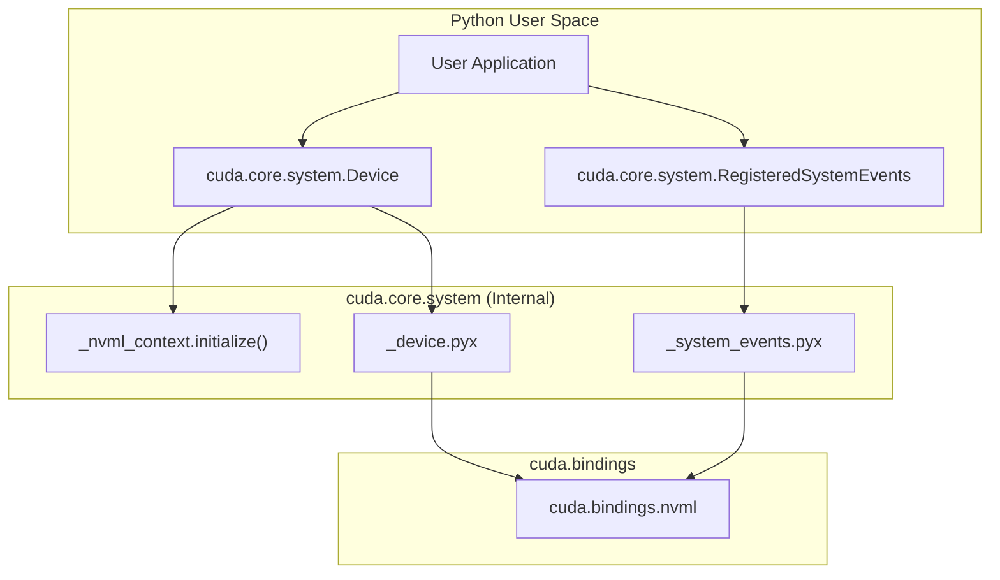
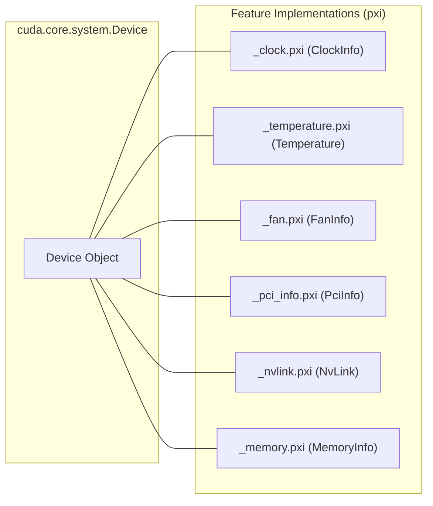

<!-- source: DeepWiki mcp.deepwiki.com · repo NVIDIA/cuda-python · page 2.7 System Telemetry (cuda.core.system) · fetched 2026-10-26 -->

# System Telemetry (cuda.core.system)

<details>
<summary>Relevant source files</summary>

The following files were used as context for generating this wiki page:

- [cuda_core/cuda/core/_cpp/resource_handles.cpp](cuda_core/cuda/core/_cpp/resource_handles.cpp)
- [cuda_core/cuda/core/_cpp/resource_handles.hpp](cuda_core/cuda/core/_cpp/resource_handles.hpp)
- [cuda_core/cuda/core/_resource_handles.pxd](cuda_core/cuda/core/_resource_handles.pxd)
- [cuda_core/cuda/core/_resource_handles.pyx](cuda_core/cuda/core/_resource_handles.pyx)
- [cuda_core/cuda/core/_utils/cuda_utils.pxd](cuda_core/cuda/core/_utils/cuda_utils.pxd)
- [cuda_core/cuda/core/system/__init__.py](cuda_core/cuda/core/system/__init__.py)
- [cuda_core/cuda/core/system/_clock.pxi](cuda_core/cuda/core/system/_clock.pxi)
- [cuda_core/cuda/core/system/_cooler.pxi](cuda_core/cuda/core/system/_cooler.pxi)
- [cuda_core/cuda/core/system/_device.pyx](cuda_core/cuda/core/system/_device.pyx)
- [cuda_core/cuda/core/system/_event.pxi](cuda_core/cuda/core/system/_event.pxi)
- [cuda_core/cuda/core/system/_fan.pxi](cuda_core/cuda/core/system/_fan.pxi)
- [cuda_core/cuda/core/system/_inforom.pxi](cuda_core/cuda/core/system/_inforom.pxi)
- [cuda_core/cuda/core/system/_nvlink.pxi](cuda_core/cuda/core/system/_nvlink.pxi)
- [cuda_core/cuda/core/system/_nvml_context.pyx](cuda_core/cuda/core/system/_nvml_context.pyx)
- [cuda_core/cuda/core/system/_pci_info.pxi](cuda_core/cuda/core/system/_pci_info.pxi)
- [cuda_core/cuda/core/system/_system.pyx](cuda_core/cuda/core/system/_system.pyx)
- [cuda_core/cuda/core/system/_system_events.pyx](cuda_core/cuda/core/system/_system_events.pyx)
- [cuda_core/cuda/core/system/_temperature.pxi](cuda_core/cuda/core/system/_temperature.pxi)
- [cuda_core/docs/source/api.rst](cuda_core/docs/source/api.rst)
- [cuda_core/docs/source/api_private.rst](cuda_core/docs/source/api_private.rst)
- [cuda_core/tests/system/test_system_device.py](cuda_core/tests/system/test_system_device.py)
- [cuda_core/tests/system/test_system_events.py](cuda_core/tests/system/test_system_events.py)
- [cuda_core/tests/test_enum_coverage.py](cuda_core/tests/test_enum_coverage.py)
- [cuda_core/tests/test_object_protocols.py](cuda_core/tests/test_object_protocols.py)

</details>


The `cuda.core.system` module provides a high-level, Pythonic interface for hardware introspection and management. It leverages the NVIDIA Management Library (NVML) to expose detailed telemetry for NVIDIA GPUs, including power management, thermal monitoring, clock control, and hardware event tracking.

While `cuda.core.Device` focuses on execution and memory management within the CUDA Driver API, `cuda.core.system.Device` provides the "administrative" view of the hardware [cuda_core/cuda/core/system/_device.pyx:143-152]().

## Architecture and Data Flow

The module is built on top of `cuda.bindings.nvml`. It manages an internal NVML context, ensuring the library is initialized before any telemetry calls are made [cuda_core/cuda/core/system/_nvml_context.pyx:1-10]().

### Component Interaction Diagram
This diagram shows how `cuda.core.system` bridges the gap between Python user code and the underlying NVML bindings.

**System Telemetry Component Bridge**

Sources: [cuda_core/cuda/core/system/_device.pyx:178-204](), [cuda_core/cuda/core/system/_system_events.pyx:72-103](), [cuda_core/cuda/core/system/_nvml_context.pyx:1-10]()

## The System Device Class

The `cuda.core.system.Device` class is the primary entry point for per-GPU telemetry. Unlike driver-level device handles, a system `Device` can be instantiated via index, UUID, or PCI Bus ID [cuda_core/cuda/core/system/_device.pyx:178-184]().

### Key Telemetry Categories

| Category | Description | Implementation File |
| :--- | :--- | :--- |
| **Identity** | Name, UUID, PCI Info, Architecture | `_device.pyx`, `_pci_info.pxi` |
| **Thermals** | Temperature sensors, thresholds, fan speeds | `_temperature.pxi`, `_fan.pxi` |
| **Clocks** | SM/Memory frequencies, throttle reasons | `_clock.pxi` |
| **Power** | Power usage, management limits, P-States | `_performance.pxi` |
| **Memory** | BAR1 memory, FB memory utilization | `_memory.pxi`, `_utilization.pxi` |
| **Topology** | NVLink status, NUMA affinity, P2P caps | `_nvlink.pxi`, `_device.pyx` |

### Code Entity Mapping
This diagram maps the high-level telemetry concepts to specific internal Cython implementation files (included via `_device.pyx`).

**Telemetry Implementation Mapping**

Sources: [cuda_core/cuda/core/system/_device.pyx:53-69]()

## Thermal and Fan Management

The module provides granular access to thermal sensors and cooling hardware.

*   **`Temperature`**: Provides current readings and thresholds (Shutdown, Slowdown, etc.) [cuda_core/cuda/core/system/_temperature.pxi:118-162]().
*   **`ThermalSettings`**: On supported architectures, allows iterating through multiple onboard sensors via `ThermalSensor` objects [cuda_core/cuda/core/system/_temperature.pxi:67-115]().
*   **`FanInfo`**: Reports fan speed (RPM) and allows querying or setting fan control policies on supported hardware [cuda_core/cuda/core/system/_fan.pxi:1-20]().

Sources: [cuda_core/cuda/core/system/_temperature.pxi:6-15](), [cuda_core/cuda/core/system/_temperature.pxi:118-141]()

## System Event Monitoring

`cuda.core.system` allows applications to listen for asynchronous hardware events, such as driver unbinding/binding or GPU errors.

### Event Monitoring Flow
1.  **Registration**: Call `register_events()` with a list of `SystemEventType` [cuda_core/cuda/core/system/_system_events.pyx:146-178]().
2.  **Waiting**: Use the returned `RegisteredSystemEvents` object to `wait()` for events [cuda_core/cuda/core/system/_system_events.pyx:109-143]().
3.  **Processing**: Handle the `SystemEvent` which contains the event type and the associated `Device` [cuda_core/cuda/core/system/_system_events.pyx:25-53]().

```python
from cuda.core import system
from cuda.core.system.typing import SystemEventType

# Register for driver unbind events
events = system.register_events([SystemEventType.UNBIND])

try:
    # Wait for 10 seconds
    event_batch = events.wait(timeout_ms=10000)
    for event in event_batch:
        print(f"Device {event.device.name} triggered {event.event_type}")
except system.TimeoutError:
    print("No events occurred")
```
Sources: [cuda_core/cuda/core/system/_system_events.pyx:158-160](), [cuda_core/cuda/core/system/_system_events.pyx:109-143]()

## Versioning and Compatibility

The module includes logic to verify compatibility between the core library and the underlying NVML bindings.

*   **`CUDA_BINDINGS_NVML_IS_COMPATIBLE`**: A boolean flag indicating if the installed `cuda.bindings` version supports the required NVML features (Requires >= 13.2.0 or specific 12.x branches) [cuda_core/cuda/core/system/_system.pyx:11-28]().
*   **`get_driver_version()`**: Can return either the user-mode CUDA driver version or the kernel-mode driver version (e.g., 580.65) if NVML is available [cuda_core/cuda/core/system/_system.pyx:32-48]().

Sources: [cuda_core/cuda/core/system/_system.pyx:11-28](), [cuda_core/cuda/core/system/_system.pyx:50-78]()

---

