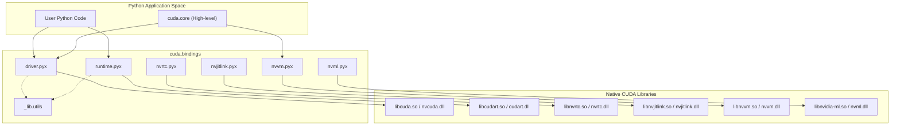
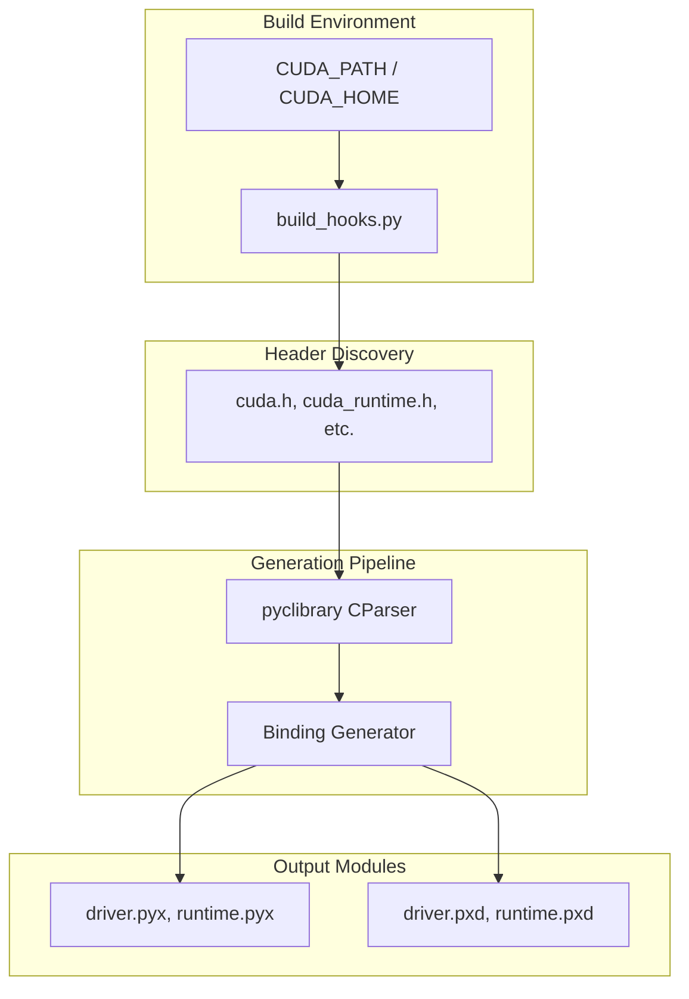

<!-- source: DeepWiki mcp.deepwiki.com · repo NVIDIA/cuda-python · page 3 cuda.bindings · fetched 2026-10-26 -->

# cuda.bindings

Relevant source files

The following files were used as context for generating this wiki page:

- [cuda_bindings/README.md](cuda_bindings/README.md)
- [cuda_bindings/build_hooks.py](cuda_bindings/build_hooks.py)
- [cuda_bindings/cuda/bindings/_lib/utils.pxd.in](cuda_bindings/cuda/bindings/_lib/utils.pxd.in)
- [cuda_bindings/cuda/bindings/_lib/utils.pxi.in](cuda_bindings/cuda/bindings/_lib/utils.pxi.in)
- [cuda_bindings/cuda/bindings/cyruntime_types.pxi.in](cuda_bindings/cuda/bindings/cyruntime_types.pxi.in)
- [cuda_bindings/cuda/bindings/driver.pxd.in](cuda_bindings/cuda/bindings/driver.pxd.in)
- [cuda_bindings/cuda/bindings/driver.pyx.in](cuda_bindings/cuda/bindings/driver.pyx.in)
- [cuda_bindings/cuda/bindings/runtime.pxd.in](cuda_bindings/cuda/bindings/runtime.pxd.in)
- [cuda_bindings/cuda/bindings/runtime.pyx.in](cuda_bindings/cuda/bindings/runtime.pyx.in)
- [cuda_bindings/docs/source/api.rst](cuda_bindings/docs/source/api.rst)
- [cuda_bindings/docs/source/examples.rst](cuda_bindings/docs/source/examples.rst)
- [cuda_bindings/docs/source/module/driver.rst](cuda_bindings/docs/source/module/driver.rst)
- [cuda_bindings/docs/source/module/nvjitlink.rst](cuda_bindings/docs/source/module/nvjitlink.rst)
- [cuda_bindings/docs/source/module/nvml.rst](cuda_bindings/docs/source/module/nvml.rst)
- [cuda_bindings/docs/source/module/nvrtc.rst](cuda_bindings/docs/source/module/nvrtc.rst)
- [cuda_bindings/docs/source/module/nvvm.rst](cuda_bindings/docs/source/module/nvvm.rst)
- [cuda_bindings/docs/source/module/runtime.rst](cuda_bindings/docs/source/module/runtime.rst)
- [cuda_bindings/docs/source/release/13.2.0-notes.rst](cuda_bindings/docs/source/release/13.2.0-notes.rst)
- [cuda_bindings/tests/test_examples.py](cuda_bindings/tests/test_examples.py)
- [cuda_core/README.md](cuda_core/README.md)
- [cuda_core/docs/nv-versions.json](cuda_core/docs/nv-versions.json)
- [cuda_core/docs/source/release/0.4.1-notes.rst](cuda_core/docs/source/release/0.4.1-notes.rst)
- [cuda_core/docs/source/release/0.4.2-notes.rst](cuda_core/docs/source/release/0.4.2-notes.rst)
- [cuda_core/docs/source/release/0.6.0-notes.rst](cuda_core/docs/source/release/0.6.0-notes.rst)
- [cuda_core/docs/source/release/0.7.0-notes.rst](cuda_core/docs/source/release/0.7.0-notes.rst)
- [cuda_python/docs/exts/enum_documenter.py](cuda_python/docs/exts/enum_documenter.py)

## Purpose and Scope

The `cuda.bindings` package provides low-level Python bindings to CUDA C APIs, enabling Python developers to directly access NVIDIA GPU functionality. It serves as a foundation for the CUDA Python ecosystem, offering complete coverage of and access to the CUDA host APIs from Python.

This package focuses on providing Python wrappers for the native CUDA C interfaces including the CUDA Driver API, Runtime API, NVRTC (runtime compilation), NVVM, and various graphics-related APIs. While these bindings are low-level and mirror the C API, they serve as the building blocks for higher-level abstractions like [cuda.core](#2).

Sources: [cuda_bindings/README.md:1-3](), [cuda_bindings/docs/source/api.rst:5-20]()

## Package Architecture

The `cuda.bindings` package uses a layered architecture to bridge Python with NVIDIA's CUDA C APIs. This is accomplished through Cython extensions that wrap the native libraries.

Title: Binding System Architecture

The package uses Cython to create Python extensions. The build process involves parsing CUDA headers at build-time to generate binding code that is compiled into Python-compatible modules.

Sources: [cuda_bindings/cuda/bindings/driver.pyx.in:1-21](), [cuda_bindings/cuda/bindings/runtime.pyx.in:1-22](), [cuda_bindings/build_hooks.py:4-18]()

## Key Components

### 1. CUDA Driver and Runtime Bindings
The Driver API (`cuda.bindings.driver`) and Runtime API (`cuda.bindings.runtime`) provide the primary interfaces for device management and execution. They include:
- **Handle Shadowing**: Cython classes like `CUcontext`, `CUstream`, and `CUevent` wrap native C handles.
- **Parameter Packing**: The `_HelperKernelParams` class in `utils.pxi` handles the complex task of packing Python objects into C-compatible kernel arguments.
- **FastEnum**: A specialized `_FastEnum` system for high-performance enumeration access.

For details, see [CUDA Driver and Runtime Bindings](#3.1).

Sources: [cuda_bindings/cuda/bindings/driver.pxd.in:11-194](), [cuda_bindings/cuda/bindings/_lib/utils.pxi.in:20-128]()

### 2. NVRTC and NVVM Bindings
These modules handle the compilation pipeline within the Python process:
- **NVRTC**: Provides runtime compilation of CUDA C++ source to PTX.
- **NVVM**: Provides a lower-level interface to the LLVM-based compiler infrastructure for generating PTX from LLVM IR.

For details, see [NVRTC and NVVM Bindings](#3.2).

Sources: [cuda_bindings/docs/source/module/nvrtc.rst:1-10](), [cuda_bindings/docs/source/module/nvvm.rst:9-26]()

### 3. nvJitLink Bindings
The `nvjitlink` module provides functionality for just-in-time linking of relocatable device code and LTO IR. It allows combining multiple compiled modules into a single executable binary at runtime.

For details, see [nvJitLink Bindings](#3.3).

Sources: [cuda_bindings/docs/source/module/nvjitlink.rst:1-10]()

### 4. EGL and Graphics Bindings
This area covers interoperability between CUDA and graphics APIs, as well as specialized storage and management interfaces:
- **cuFile**: Support for GPUDirect Storage (GDS).
- **NVML**: Bindings for the NVIDIA Management Library to monitor hardware state (clocks, temperature, etc.).
- **Graphics Interop**: Interfaces for EGL and other graphics frameworks.

For details, see [EGL and Graphics Bindings](#3.4).

Sources: [cuda_bindings/docs/source/module/nvml.rst:1-10](), [cuda_bindings/docs/source/module/cufile.rst:1-10]()

## Build System

Title: Header-to-Binding Code Generation

The build process for `cuda.bindings` is dynamic. It uses `build_hooks.py` to implement PEP 517 backend support, which performs header parsing and code generation before Cythonization. This ensures that the bindings are always synchronized with the version of the CUDA Toolkit present on the build machine.

Sources: [cuda_bindings/build_hooks.py:4-18](), [cuda_bindings/build_hooks.py:80-104](), [cuda_bindings/build_hooks.py:171-196]()

## Usage and Testing

### Testing Framework
The package includes several layers of validation:
- **Python Unit Tests**: Validating binding usage patterns in `tests/`.
- **Cython Unit Tests**: Low-level tests in `tests/cython/` that must be compiled against the CUDA Toolkit.
- **Benchmarks**: Performance analysis using `pytest-benchmark` to measure call overhead.

Sources: [cuda_bindings/README.md:22-49](), [cuda_bindings/README.md:66-73]()

### Kernel Launch Example
Preparing kernel parameters is a critical task handled by the bindings. The `_HelperKernelParams` class allows passing parameters as a tuple of values and a tuple of types, which it then packs into a `void**` for `cuLaunchKernel`.

Sources: [cuda_bindings/cuda/bindings/_lib/utils.pxi.in:57-116](), [cuda_bindings/README.md:33-35]()

---

