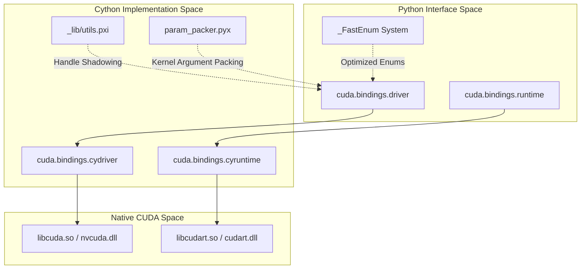
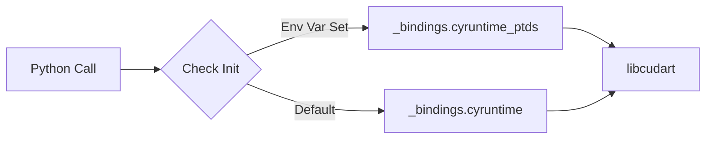

<!-- source: DeepWiki mcp.deepwiki.com · repo NVIDIA/cuda-python · page 3.1 CUDA Driver and Runtime Bindings · fetched 2026-10-26 -->

# CUDA Driver and Runtime Bindings

Relevant source files

The following files were used as context for generating this wiki page:

- [cuda_bindings/cuda/bindings/__init__.py](cuda_bindings/cuda/bindings/__init__.py)
- [cuda_bindings/cuda/bindings/_bindings/cydriver.pxd.in](cuda_bindings/cuda/bindings/_bindings/cydriver.pxd.in)
- [cuda_bindings/cuda/bindings/_bindings/cydriver.pyx.in](cuda_bindings/cuda/bindings/_bindings/cydriver.pyx.in)
- [cuda_bindings/cuda/bindings/_bindings/cyruntime.pxd.in](cuda_bindings/cuda/bindings/_bindings/cyruntime.pxd.in)
- [cuda_bindings/cuda/bindings/_bindings/cyruntime.pyx.in](cuda_bindings/cuda/bindings/_bindings/cyruntime.pyx.in)
- [cuda_bindings/cuda/bindings/_bindings/cyruntime_ptds.pxd.in](cuda_bindings/cuda/bindings/_bindings/cyruntime_ptds.pxd.in)
- [cuda_bindings/cuda/bindings/_bindings/cyruntime_ptds.pyx.in](cuda_bindings/cuda/bindings/_bindings/cyruntime_ptds.pyx.in)
- [cuda_bindings/cuda/bindings/_lib/utils.pxd.in](cuda_bindings/cuda/bindings/_lib/utils.pxd.in)
- [cuda_bindings/cuda/bindings/_lib/utils.pxi.in](cuda_bindings/cuda/bindings/_lib/utils.pxi.in)
- [cuda_bindings/cuda/bindings/cydriver.pxd.in](cuda_bindings/cuda/bindings/cydriver.pxd.in)
- [cuda_bindings/cuda/bindings/cydriver.pyx.in](cuda_bindings/cuda/bindings/cydriver.pyx.in)
- [cuda_bindings/cuda/bindings/cyruntime.pxd.in](cuda_bindings/cuda/bindings/cyruntime.pxd.in)
- [cuda_bindings/cuda/bindings/cyruntime.pyx.in](cuda_bindings/cuda/bindings/cyruntime.pyx.in)
- [cuda_bindings/cuda/bindings/cyruntime_functions.pxi.in](cuda_bindings/cuda/bindings/cyruntime_functions.pxi.in)
- [cuda_bindings/cuda/bindings/cyruntime_types.pxi.in](cuda_bindings/cuda/bindings/cyruntime_types.pxi.in)
- [cuda_bindings/cuda/bindings/driver.pxd.in](cuda_bindings/cuda/bindings/driver.pxd.in)
- [cuda_bindings/cuda/bindings/driver.pyx.in](cuda_bindings/cuda/bindings/driver.pyx.in)
- [cuda_bindings/cuda/bindings/runtime.pxd.in](cuda_bindings/cuda/bindings/runtime.pxd.in)
- [cuda_bindings/cuda/bindings/runtime.pyx.in](cuda_bindings/cuda/bindings/runtime.pyx.in)
- [cuda_bindings/cuda/bindings/utils/__init__.py](cuda_bindings/cuda/bindings/utils/__init__.py)
- [cuda_bindings/cuda/bindings/utils/_nvvm_utils.py](cuda_bindings/cuda/bindings/utils/_nvvm_utils.py)
- [cuda_bindings/cuda/bindings/utils/_ptx_utils.py](cuda_bindings/cuda/bindings/utils/_ptx_utils.py)
- [cuda_bindings/docs/source/module/driver.rst](cuda_bindings/docs/source/module/driver.rst)
- [cuda_bindings/docs/source/module/nvrtc.rst](cuda_bindings/docs/source/module/nvrtc.rst)
- [cuda_bindings/docs/source/module/runtime.rst](cuda_bindings/docs/source/module/runtime.rst)
- [cuda_bindings/docs/source/module/utils.rst](cuda_bindings/docs/source/module/utils.rst)
- [cuda_bindings/tests/test_utils.py](cuda_bindings/tests/test_utils.py)
- [cuda_bindings/tests/utils/check_cyclical_import.py](cuda_bindings/tests/utils/check_cyclical_import.py)

This page documents the Python bindings for the CUDA Driver and Runtime APIs within the `cuda-python` package. These bindings provide a low-level, high-performance bridge to the native CUDA C APIs.

## Architecture and Implementation

The `cuda.bindings` package uses a layered Cython architecture. The bindings are automatically generated from template files (`.pyx.in`, `.pxd.in`) to match the installed CUDA Toolkit version.

Sources: [cuda_bindings/cuda/bindings/driver.pyx.in:1-21](), [cuda_bindings/cuda/bindings/runtime.pyx.in:1-22](), [cuda_bindings/cuda/bindings/_lib/utils.pxi.in:9-12]()

## Key Binding Mechanics

### Handle and Struct Shadowing
CUDA handles (e.g., `CUcontext`, `CUstream`) are implemented as Cython extension classes that wrap the underlying C pointer. These classes provide a `getPtr()` method to retrieve the raw memory address.

| Python Class | Native C Type | Description |
| :--- | :--- | :--- |
| `CUcontext` | `CUcontext` | Driver API Context handle [cuda_bindings/cuda/bindings/driver.pxd.in:11-24]() |
| `CUstream` | `CUstream` | Driver API Stream handle [cuda_bindings/cuda/bindings/driver.pxd.in:181-194]() |
| `cudaStream_t` | `cudaStream_t` | Runtime API Stream handle [cuda_bindings/cuda/bindings/runtime.pxd.in:100-113]() |
| `CUgraph` | `CUgraph` | CUDA Graph handle [cuda_bindings/cuda/bindings/driver.pxd.in:249-262]() |

Sources: [cuda_bindings/cuda/bindings/driver.pxd.in:11-363](), [cuda_bindings/cuda/bindings/runtime.pxd.in:20-130]()

### The _FastEnum System
To minimize overhead when passing flags and constants, `cuda-python` uses an internal `_FastEnum` class. This provides the convenience of Python enums with the performance of raw integers during API calls.

Sources: [cuda_bindings/cuda/bindings/driver.pyx.in:16-16](), [cuda_bindings/cuda/bindings/_lib/utils.pxi.in:9-9]()

### Parameter Packing and Kernel Launch
The `_HelperKernelParams` class in `_lib/utils.pxi` handles the complex task of packing Python objects into a `void**` array for `cuLaunchKernel`.

- **Supported Types**: Includes `ctypes` primitives (e.g., `c_int`, `c_float`, `c_double`, `c_void_p`). [cuda_bindings/cuda/bindings/_lib/utils.pxi.in:21-38]()
- **Buffer Protocol**: Automatically extracts pointers from objects implementing the Python Buffer Protocol. [cuda_bindings/cuda/bindings/_lib/utils.pxi.in:50-56]()
- **Automatic Conversion**: Handles cases like passing a Python float to a double kernel parameter using `param_packer`. [cuda_bindings/cuda/bindings/_lib/utils.pxi.in:86-94]()

Sources: [cuda_bindings/cuda/bindings/_lib/utils.pxi.in:20-116]()

## Driver API Bindings (`cuda.bindings.driver`)

The Driver API requires explicit initialization and context management.

### Initialization and Versioning
- `cuInit(flags)`: Must be called before any other Driver API function. [cuda_bindings/cuda/bindings/cydriver.pyx.in:21-23]()
- `CUDA_VERSION`: The version of the CUDA API the bindings were generated against. [cuda_bindings/cuda/bindings/driver.pyx.in:48-48]()

### Memory and Context Constants
The bindings expose all standard CUDA flags, such as:
- `CU_MEMHOSTALLOC_PORTABLE`: For portable pinned memory. [cuda_bindings/cuda/bindings/driver.pyx.in:122-122]()
- `CU_STREAM_LEGACY` / `CU_STREAM_PER_THREAD`: Special stream handles. [cuda_bindings/cuda/bindings/driver.pyx.in:59-67]()

Sources: [cuda_bindings/cuda/bindings/driver.pyx.in:48-152](), [cuda_bindings/cuda/bindings/cydriver.pyx.in:19-50]()

## Runtime API Bindings (`cuda.bindings.runtime`)

The Runtime API provides a higher-level interface with implicit context management.

### Per-Thread Default Stream (PTDS)
The Runtime bindings support an optimized PTDS mode. If the environment variable `CUDA_PYTHON_CUDA_PER_THREAD_DEFAULT_STREAM` is set, the bindings automatically route calls through a PTDS-aware internal layer.

Sources: [cuda_bindings/cuda/bindings/_bindings/cyruntime.pyx.in:13-27](), [cuda_bindings/cuda/bindings/_bindings/cyruntime.pyx.in:31-45]()

### Attribute Helper Pattern
Structs such as `cudaDeviceProp` or `CUdevprop` are shadowed as Python classes. Attributes are accessed via properties that bridge to the underlying C struct members.

Sources: [cuda_bindings/docs/source/module/driver.rst:21-25](), [cuda_bindings/cuda/bindings/runtime.pyx.in:49-156]()

## Utility and Interop Functions

The `cuda.bindings.utils` module provides helpers for handle management and version validation.

- `get_cuda_native_handle(obj)`: A critical utility that extracts the raw integer address from any `cuda-python` handle object (Driver or Runtime). [cuda_bindings/cuda/bindings/utils/__init__.py:16-33]()
- `warn_if_cuda_major_version_mismatch()`: Ensures the runtime driver version matches the binding version. [cuda_bindings/cuda/bindings/utils/__init__.py:7-7]()
- **PTX Utilities**: Functions like `get_ptx_ver` and `get_minimal_required_cuda_ver_from_ptx_ver` help manage JIT requirements. [cuda_bindings/cuda/bindings/utils/__init__.py:6-6]()

Sources: [cuda_bindings/cuda/bindings/utils/__init__.py:1-33](), [cuda_bindings/tests/test_utils.py:68-101]()

## Graph APIs

Both Driver and Runtime bindings provide extensive coverage for CUDA Graphs, including:
- **Node Parameters**: Shadowing of `CUDA_KERNEL_NODE_PARAMS`, `CUDA_MEMSET_NODE_PARAMS`, and `CUDA_CONDITIONAL_NODE_PARAMS`. [cuda_bindings/docs/source/module/driver.rst:23-30]()
- **Capture/Update**: Bindings for `cuGraphInstantiate`, `cuGraphExecUpdate`, and stream capture attributes. [cuda_bindings/cuda/bindings/driver.pyx.in:75-119]()

Sources: [cuda_bindings/docs/source/module/driver.rst:23-32](), [cuda_bindings/cuda/bindings/driver.pyx.in:75-109]()

---

