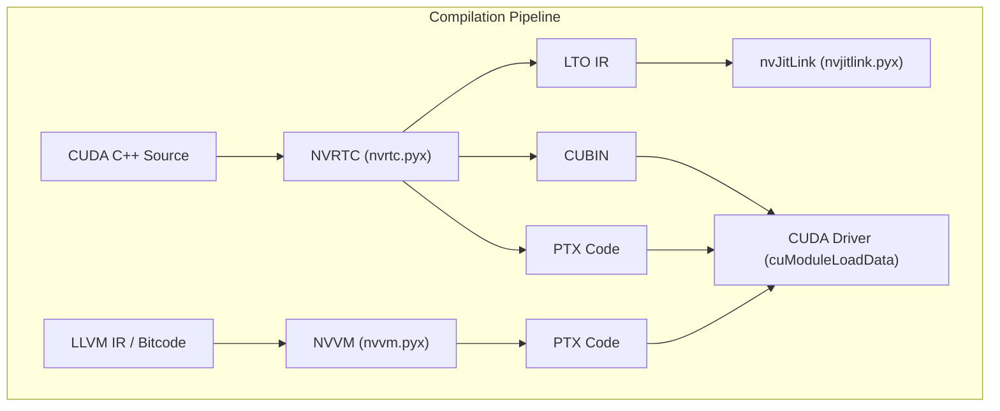
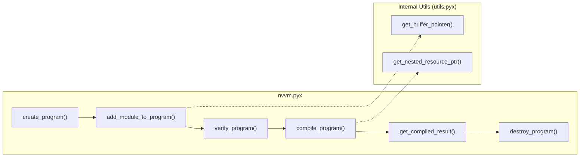
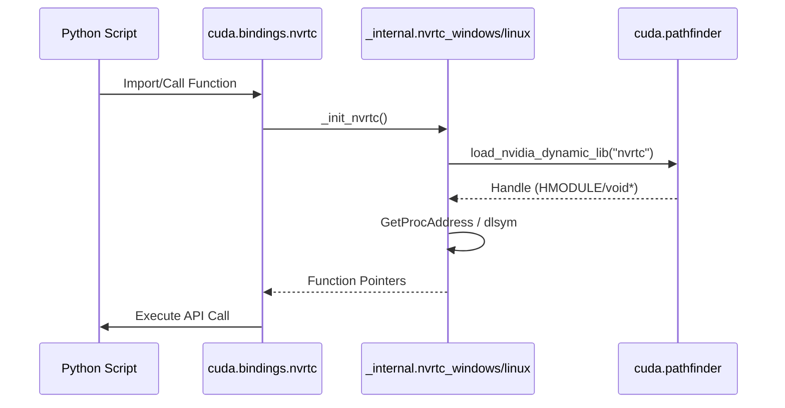

<!-- source: DeepWiki mcp.deepwiki.com · repo NVIDIA/cuda-python · page 3.2 NVRTC and NVVM Bindings · fetched 2026-10-26 -->

# NVRTC and NVVM Bindings

<details>
<summary>Relevant source files</summary>

The following files were used as context for generating this wiki page:

- [cuda_bindings/cuda/bindings/_internal/nvrtc.pxd](cuda_bindings/cuda/bindings/_internal/nvrtc.pxd)
- [cuda_bindings/cuda/bindings/_internal/nvrtc_linux.pyx](cuda_bindings/cuda/bindings/_internal/nvrtc_linux.pyx)
- [cuda_bindings/cuda/bindings/_internal/nvrtc_windows.pyx](cuda_bindings/cuda/bindings/_internal/nvrtc_windows.pyx)
- [cuda_bindings/cuda/bindings/_internal/nvvm.pxd](cuda_bindings/cuda/bindings/_internal/nvvm.pxd)
- [cuda_bindings/cuda/bindings/_internal/utils.pxd](cuda_bindings/cuda/bindings/_internal/utils.pxd)
- [cuda_bindings/cuda/bindings/_internal/utils.pyx](cuda_bindings/cuda/bindings/_internal/utils.pyx)
- [cuda_bindings/cuda/bindings/cynvrtc.pxd](cuda_bindings/cuda/bindings/cynvrtc.pxd)
- [cuda_bindings/cuda/bindings/cynvrtc.pyx](cuda_bindings/cuda/bindings/cynvrtc.pyx)
- [cuda_bindings/cuda/bindings/cynvvm.pxd](cuda_bindings/cuda/bindings/cynvvm.pxd)
- [cuda_bindings/cuda/bindings/cynvvm.pyx](cuda_bindings/cuda/bindings/cynvvm.pyx)
- [cuda_bindings/cuda/bindings/nvrtc.pxd](cuda_bindings/cuda/bindings/nvrtc.pxd)
- [cuda_bindings/cuda/bindings/nvrtc.pyx](cuda_bindings/cuda/bindings/nvrtc.pyx)
- [cuda_bindings/cuda/bindings/nvvm.pxd](cuda_bindings/cuda/bindings/nvvm.pxd)
- [cuda_bindings/cuda/bindings/nvvm.pyx](cuda_bindings/cuda/bindings/nvvm.pyx)
- [cuda_bindings/tests/test_interoperability.py](cuda_bindings/tests/test_interoperability.py)
- [cuda_bindings/tests/test_kernelParams.py](cuda_bindings/tests/test_kernelParams.py)
- [cuda_bindings/tests/test_nvjitlink.py](cuda_bindings/tests/test_nvjitlink.py)
- [cuda_bindings/tests/test_nvrtc.py](cuda_bindings/tests/test_nvrtc.py)
- [cuda_bindings/tests/test_nvvm.py](cuda_bindings/tests/test_nvvm.py)

</details>


## Purpose and Scope

This document covers the Python bindings for NVIDIA Runtime Compiler (NVRTC) and NVIDIA Virtual Machine (NVVM) provided in the CUDA Python ecosystem. These components enable runtime compilation, optimization, and execution of CUDA code directly from Python. They form critical parts of the Just-In-Time (JIT) compilation system for GPU programming within the `cuda.bindings` package.

## Architecture Overview

NVRTC and NVVM serve different but complementary roles in the CUDA compilation pipeline:

### Compilation Data Flow


- **NVRTC**: Provides runtime compilation of CUDA C++ source code to PTX (Parallel Thread Execution), CUBIN (CUDA Binary), or LTO IR (Link Time Optimization Intermediate Representation).
- **NVVM**: Works with LLVM-based intermediate representation (IR) for advanced compiler optimizations before generating PTX.

Sources:
- [cuda_bindings/cuda/bindings/nvvm.pyx:150-212]()
- [cuda_bindings/cuda/bindings/cynvrtc.pxd:43-59]()
- [cuda_bindings/tests/test_nvjitlink.py:80-97]()

## NVRTC Bindings

NVRTC allows dynamic compilation of CUDA C++ code at runtime. The bindings provide a direct mapping to the C API, handling string conversions and buffer management for compilation logs and resulting binaries.

### Program Lifecycle and Key Functions

| Function | Code Entity | Description |
|----------|-------------|-------------|
| `nvrtcCreateProgram` | [cuda_bindings/cuda/bindings/cynvrtc.pxd:43]() | Initializes an `nvrtcProgram` handle from source string. |
| `nvrtcCompileProgram` | [cuda_bindings/cuda/bindings/cynvrtc.pxd:47]() | Compiles the program with provided options (e.g., `-dlto`, `-arch`). |
| `nvrtcGetPTX` | [cuda_bindings/cuda/bindings/cynvrtc.pxd:51]() | Retrieves the generated PTX assembly. |
| `nvrtcGetLTOIR` | [cuda_bindings/cuda/bindings/cynvrtc.pxd:59]() | Retrieves LTO IR for use with `nvJitLink`. |
| `nvrtcGetProgramLog` | [cuda_bindings/cuda/bindings/cynvrtc.pxd:67]() | Retrieves compiler warnings and errors. |

### Implementation Detail: LTO IR Generation
NVRTC can produce LTO IR by passing the `-dlto` flag to `nvrtcCompileProgram`. This IR can then be consumed by `nvjitlink` for device-side linking.

Sources:
- [cuda_bindings/tests/test_nvjitlink.py:88-93]()
- [cuda_bindings/cuda/bindings/cynvrtc.pxd:57-59]()

## NVVM Bindings

NVVM works with LLVM-based intermediate representation to optimize CUDA code. It is exposed via the `cuda.bindings.nvvm` module.

### Code Entity Space: NVVM Program Management
The following diagram maps high-level operations to the specific Cython-backed functions used to manage the NVVM compilation lifecycle.



### API Reference

| Function | Description |
|----------|-------------|
| `create_program()` | Creates a new NVVM program handle ([cuda_bindings/cuda/bindings/nvvm.pyx:135]()). |
| `add_module_to_program()` | Adds NVVM IR (bitcode or text) to the program ([cuda_bindings/cuda/bindings/nvvm.pyx:150]()). |
| `lazy_add_module_to_program()` | Lazily adds bitcode modules ([cuda_bindings/cuda/bindings/nvvm.pyx:171]()). |
| `compile_program()` | Compiles the IR to PTX using `nested_resource[char]` for options ([cuda_bindings/cuda/bindings/nvvm.pyx:192]()). |
| `get_compiled_result()` | Retrieves the PTX result into a provided buffer ([cuda_bindings/cuda/bindings/nvvm.pyx:265]()). |

Sources:
- [cuda_bindings/cuda/bindings/nvvm.pyx:135-284]()
- [cuda_bindings/cuda/bindings/_internal/utils.pyx:44-153]()

## Internal Dynamic Loading Mechanism

The bindings utilize a dynamic loading architecture to remain independent of the specific CUDA Toolkit version present on the system at compile-time.

### Loading Logic


### Platform Implementations
- **Windows**: Uses `LoadLibraryExW` and `GetProcAddress` via `nvrtc_windows.pyx` [cuda_bindings/cuda/bindings/_internal/nvrtc_windows.pyx:32-53](). It searches for `nvrtc64_*.dll` or `nvvm64_*.dll`.
- **Linux**: Uses `dlopen` and `dlsym` via `nvrtc_linux.pyx`.
- **Pathfinder**: Both implementations rely on `cuda.pathfinder.load_nvidia_dynamic_lib` to locate the libraries in standard paths or Python site-packages [cuda_bindings/cuda/bindings/_internal/nvrtc_windows.pyx:114]().

Sources:
- [cuda_bindings/cuda/bindings/_internal/nvrtc_windows.pyx:105-195]()
- [cuda_bindings/cuda/bindings/_internal/utils.pyx:156-158]()

## Error Handling

Both NVRTC and NVVM use specialized exception classes to translate C return codes into Pythonic errors.

### NVVM Error Translation
NVVM status codes are checked by `check_status` [cuda_bindings/cuda/bindings/nvvm.pyx:55](). If the status is not `NVVM_SUCCESS` (0), an `nvvmError` is raised.

```python
class nvvmError(Exception):
    def __init__(self, status):
        self.status = status
        s = Result(status) # Result is a FastEnum
        cdef str err = f"{s.name} ({s.value})"
        super(nvvmError, self).__init__(err)
```

### NVRTC Error Handling
NVRTC functions return the `nvrtcResult` enum directly as the first element of a tuple. Users typically validate this against `nvrtcResult.NVRTC_SUCCESS`.

Sources:
- [cuda_bindings/cuda/bindings/nvvm.pyx:42-59]()
- [cuda_bindings/tests/test_nvrtc.py:9-14]()
- [cuda_bindings/cuda/bindings/cynvrtc.pxd:11-30]()

## Implementation Utilities

The bindings rely on internal Cython utilities for complex memory management:

- **`get_buffer_pointer`**: Extracts raw C pointers from Python objects supporting the buffer protocol (e.g., `bytes`, `bytearray`) [cuda_bindings/cuda/bindings/_internal/utils.pyx:44]().
- **`nullable_unique_ptr`**: A custom C++ template used in `.pxd` files to manage memory ownership for vectors passed to the C API [cuda_bindings/cuda/bindings/_internal/utils.pxd:15-125]().
- **`get_nested_resource_ptr`**: Handles the conversion of Python lists of strings into the `const char**` format required by compiler options [cuda_bindings/cuda/bindings/_internal/utils.pyx:105]().

Sources:
- [cuda_bindings/cuda/bindings/_internal/utils.pyx:44-153]()
- [cuda_bindings/cuda/bindings/_internal/utils.pxd:15-159]()

---

