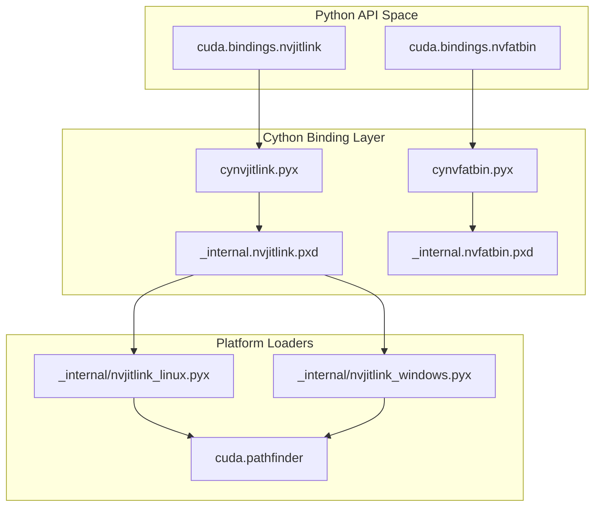
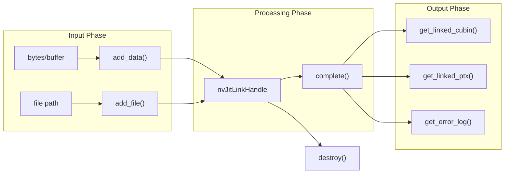

<!-- source: DeepWiki mcp.deepwiki.com · repo NVIDIA/cuda-python · page 3.3 nvJitLink Bindings · fetched 2026-10-26 -->

# nvJitLink Bindings

<details>
<summary>Relevant source files</summary>

The following files were used as context for generating this wiki page:

- [cuda_bindings/cuda/bindings/_internal/_fast_enum.py](cuda_bindings/cuda/bindings/_internal/_fast_enum.py)
- [cuda_bindings/cuda/bindings/_internal/cufile_linux.pyx](cuda_bindings/cuda/bindings/_internal/cufile_linux.pyx)
- [cuda_bindings/cuda/bindings/_internal/nvfatbin.pxd](cuda_bindings/cuda/bindings/_internal/nvfatbin.pxd)
- [cuda_bindings/cuda/bindings/_internal/nvfatbin_linux.pyx](cuda_bindings/cuda/bindings/_internal/nvfatbin_linux.pyx)
- [cuda_bindings/cuda/bindings/_internal/nvfatbin_windows.pyx](cuda_bindings/cuda/bindings/_internal/nvfatbin_windows.pyx)
- [cuda_bindings/cuda/bindings/_internal/nvjitlink.pxd](cuda_bindings/cuda/bindings/_internal/nvjitlink.pxd)
- [cuda_bindings/cuda/bindings/_internal/nvjitlink_linux.pyx](cuda_bindings/cuda/bindings/_internal/nvjitlink_linux.pyx)
- [cuda_bindings/cuda/bindings/_internal/nvjitlink_windows.pyx](cuda_bindings/cuda/bindings/_internal/nvjitlink_windows.pyx)
- [cuda_bindings/cuda/bindings/_internal/nvvm_linux.pyx](cuda_bindings/cuda/bindings/_internal/nvvm_linux.pyx)
- [cuda_bindings/cuda/bindings/_internal/nvvm_windows.pyx](cuda_bindings/cuda/bindings/_internal/nvvm_windows.pyx)
- [cuda_bindings/cuda/bindings/cynvfatbin.pxd](cuda_bindings/cuda/bindings/cynvfatbin.pxd)
- [cuda_bindings/cuda/bindings/cynvfatbin.pyx](cuda_bindings/cuda/bindings/cynvfatbin.pyx)
- [cuda_bindings/cuda/bindings/cynvjitlink.pxd](cuda_bindings/cuda/bindings/cynvjitlink.pxd)
- [cuda_bindings/cuda/bindings/cynvjitlink.pyx](cuda_bindings/cuda/bindings/cynvjitlink.pyx)
- [cuda_bindings/cuda/bindings/nvfatbin.pxd](cuda_bindings/cuda/bindings/nvfatbin.pxd)
- [cuda_bindings/cuda/bindings/nvfatbin.pyx](cuda_bindings/cuda/bindings/nvfatbin.pyx)
- [cuda_bindings/cuda/bindings/nvjitlink.pxd](cuda_bindings/cuda/bindings/nvjitlink.pxd)
- [cuda_bindings/cuda/bindings/nvjitlink.pyx](cuda_bindings/cuda/bindings/nvjitlink.pyx)
- [cuda_bindings/docs/source/module/nvfatbin.rst](cuda_bindings/docs/source/module/nvfatbin.rst)

</details>


## Overview

The nvJitLink bindings provide Python interfaces to NVIDIA's nvJitLink library, which enables just-in-time linking of relocatable device code and LTO IR (Link-Time Optimization Intermediate Representation). These bindings are part of the `cuda.bindings` package and allow Python applications to dynamically link various CUDA code formats—including PTX, CUBIN, LTOIR, and Fatbins—into executable GPU code.

This module serves as a low-level interface for JIT linking operations. For higher-level compilation and linking abstractions that manage these bindings automatically, see the `Linker` class in [Program Compilation and Linker System](2.2).

Sources: [cuda_bindings/cuda/bindings/nvjitlink.pyx:1-317]()

## Architecture

The nvJitLink bindings use a layered architecture to bridge Python calls to the underlying C library. The system uses a platform-specific loader to resolve symbols at runtime, ensuring compatibility across Linux and Windows environments without requiring static linking against the CUDA Toolkit.

### Component Relationship

The following diagram maps the Natural Language concepts to the specific Code Entities used in the implementation:

"Code Entity Space Mapping"


1.  **`cuda.bindings.nvjitlink`**: The public Python module providing a JIT linking interface [cuda_bindings/cuda/bindings/nvjitlink.pyx:1-317]().
2.  **`cuda.bindings.nvfatbin`**: A companion module for creating and managing CUDA Fatbinaries [cuda_bindings/cuda/bindings/nvfatbin.pyx:1-210]().
3.  **`cynvjitlink`**: The Cython layer defining C-level types like `nvJitLinkHandle` and `nvJitLinkResult` [cuda_bindings/cuda/bindings/cynvjitlink.pxd:15-50]().
4.  **`_internal/nvjitlink_*.pyx`**: Platform-specific logic that uses `cuda.pathfinder.load_nvidia_dynamic_lib` to find and load `nvJitLink.so` (Linux) or `nvJitLink.dll` (Windows) [cuda_bindings/cuda/bindings/_internal/nvjitlink_linux.pyx:78-81](), [cuda_bindings/cuda/bindings/_internal/nvjitlink_windows.pyx:105-105]().

Sources: [cuda_bindings/cuda/bindings/nvjitlink.pyx:1-317](), [cuda_bindings/cuda/bindings/nvfatbin.pyx:1-210](), [cuda_bindings/cuda/bindings/cynvjitlink.pxd:1-71](), [cuda_bindings/cuda/bindings/_internal/nvjitlink_linux.pyx:1-187]()

## Implementation Details

### Dynamic Symbol Resolution
The bindings do not link directly to `nvJitLink`. Instead, they maintain a set of function pointers (e.g., `__nvJitLinkCreate`, `__nvJitLinkAddData`) that are populated during initialization via `_init_nvjitlink()` [cuda_bindings/cuda/bindings/_internal/nvjitlink_linux.pyx:83-187]().

On Linux, this uses `dlsym(RTLD_DEFAULT, ...)` and falls back to `load_library()` if symbols are not in the global scope [cuda_bindings/cuda/bindings/_internal/nvjitlink_linux.pyx:95-100](). On Windows, it uses `GetProcAddress` on the handle returned by `load_nvidia_dynamic_lib` [cuda_bindings/cuda/bindings/_internal/nvjitlink_windows.pyx:105-109]().

### Data Flow: Linking Workflow
The JIT linking process follows a strict sequence of state transitions managed by the `nvJitLinkHandle`.

"nvJitLink State and Data Flow"


Sources: [cuda_bindings/cuda/bindings/nvjitlink.pyx:93-298](), [cuda_bindings/cuda/bindings/cynvjitlink.pxd:57-70]()

## API Reference

### Error Handling
The bindings use `nvJitLinkError` and `nvFatbinError` to wrap return codes from the C API. Status codes are checked via `check_status()`, which raises these exceptions if the result is not `SUCCESS` (0) [cuda_bindings/cuda/bindings/nvjitlink.pyx:82-86](), [cuda_bindings/cuda/bindings/nvfatbin.pyx:64-68]().

### nvJitLink Core API
- **`create(num_options, options)`**: Initializes a handle. `options` can be a Python sequence of strings, which the binding converts to `const char**` using `get_nested_resource_ptr` [cuda_bindings/cuda/bindings/nvjitlink.pyx:107-131]().
- **`add_data(handle, input_type, data, size, name)`**: Links in-memory buffers. It supports `bytes` and other buffer-protocol objects [cuda_bindings/cuda/bindings/nvjitlink.pyx:134-153]().
- **`complete(handle)`**: Finalizes the link operation. After this call, output can be retrieved [cuda_bindings/cuda/bindings/nvjitlink.pyx:175-185]().
- **`get_linked_cubin(handle, cubin)`**: Populates a provided buffer with the linked binary [cuda_bindings/cuda/bindings/nvjitlink.pyx:203-214]().

### nvFatbin API
The `nvfatbin` module provides specialized support for the CUDA Fatbinary format, often used to bundle code for multiple architectures.
- **`add_ptx(handle, code, size, arch, identifier, options)`**: Adds PTX source to a fatbinary [cuda_bindings/cuda/bindings/nvfatbin.pyx:135-164]().
- **`get_fatbin(handle, fatbin)`**: Retrieves the final fatbinary image [cuda_bindings/cuda/bindings/nvfatbin.pyx:200-210]().

Sources: [cuda_bindings/cuda/bindings/nvjitlink.pyx:107-214](), [cuda_bindings/cuda/bindings/nvfatbin.pyx:135-210]()

## Key Enums

### Result (nvJitLinkResult)
Defines API call result codes.
| Code | Enum Name | Description |
| :--- | :--- | :--- |
| 0 | `SUCCESS` | Operation successful |
| - | `ERROR_PTX_COMPILE` | Issue during PTX compilation |
| - | `ERROR_LTO_NOT_ENABLED` | Linkage requires `-lto` flag |

Sources: [cuda_bindings/cuda/bindings/nvjitlink.pyx:20-45]()

### InputType (nvJitLinkInputType)
Defines valid inputs for `add_data` and `add_file`.
| Value | Name | Description |
| :--- | :--- | :--- |
| 1 | `CUBIN` | CUDA Binaries |
| 2 | `PTX` | Parallel Thread Execution code |
| 3 | `LTOIR` | Link-Time Optimization IR |
| 4 | `FATBIN` | Fat binaries |

Sources: [cuda_bindings/cuda/bindings/nvjitlink.pyx:47-62]()

## Usage Example: LTO Linking

```python
from cuda.bindings import nvjitlink

# Options for LTO
opts = ["-lto", "-arch=sm_90"]
handle = nvjitlink.create(len(opts), opts)

try:
    # Add LTO IR produced by NVRTC or NVVM
    nvjitlink.add_data(handle, nvjitlink.InputType.LTOIR, lto_data, len(lto_data), "module1")
    
    # Perform link
    nvjitlink.complete(handle)
    
    # Retrieve result
    size = nvjitlink.get_linked_cubin_size(handle)
    cubin = bytearray(size)
    nvjitlink.get_linked_cubin(handle, cubin)
finally:
    nvjitlink.destroy(handle)
```

Sources: [cuda_bindings/cuda/bindings/nvjitlink.pyx:107-214]()

---

