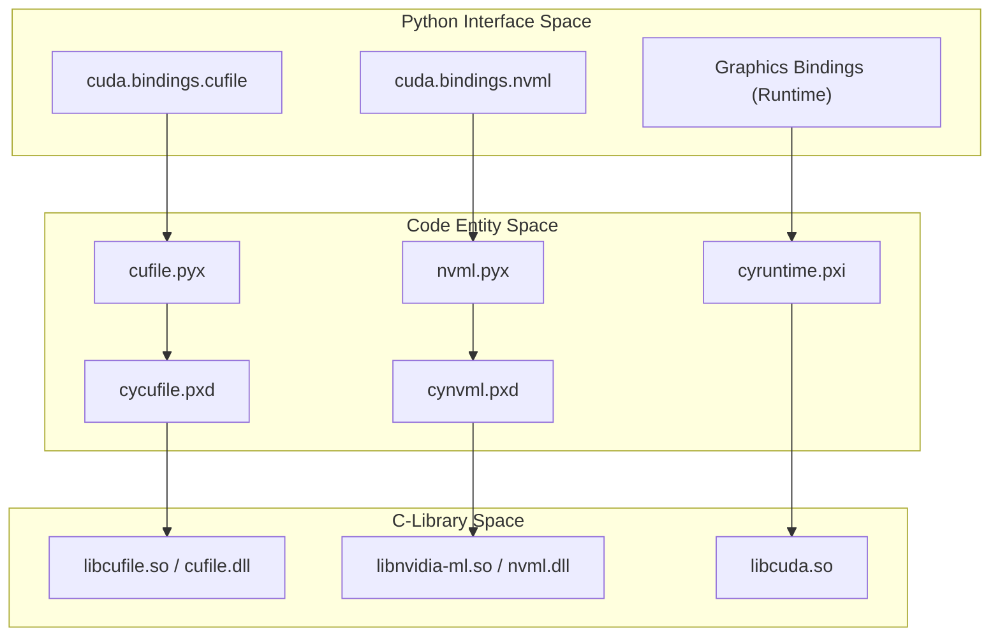
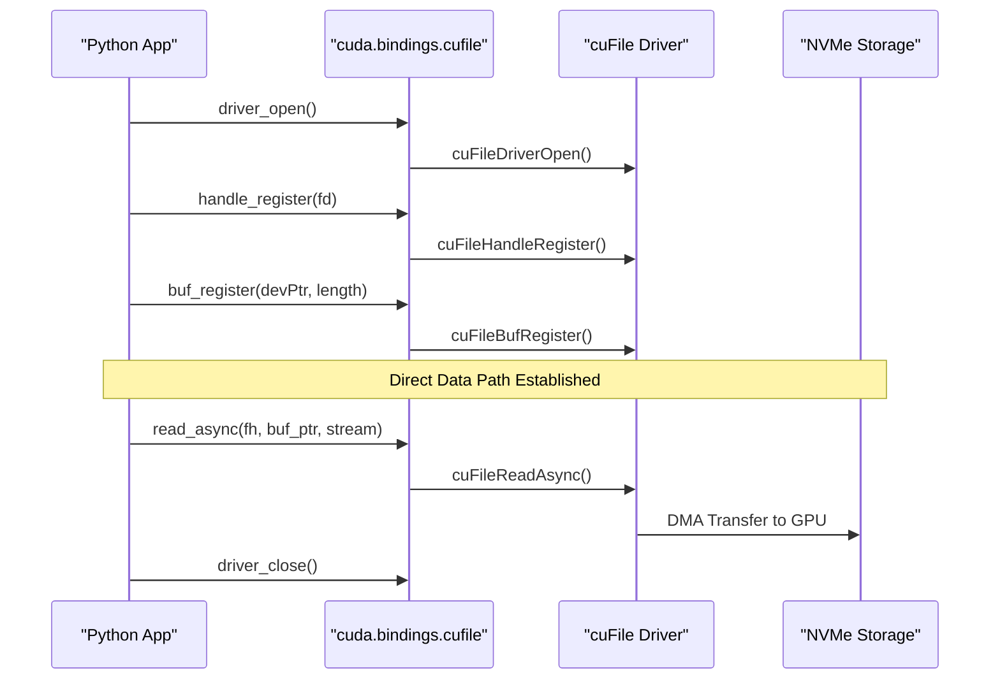
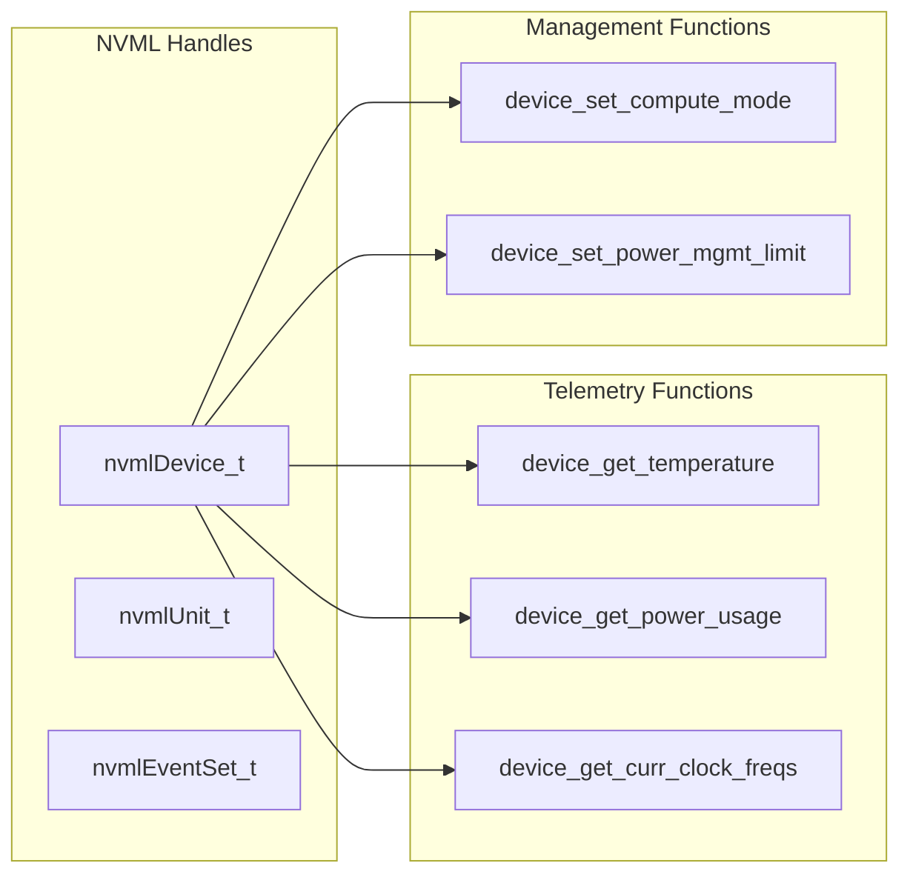

<!-- source: DeepWiki mcp.deepwiki.com · repo NVIDIA/cuda-python · page 3.4 EGL and Graphics Bindings · fetched 2026-10-26 -->

# EGL and Graphics Bindings

Relevant source files

The following files were used as context for generating this wiki page:

- [cuda_bindings/cuda/bindings/_internal/cufile.pxd](cuda_bindings/cuda/bindings/_internal/cufile.pxd)
- [cuda_bindings/cuda/bindings/_internal/nvml.pxd](cuda_bindings/cuda/bindings/_internal/nvml.pxd)
- [cuda_bindings/cuda/bindings/_internal/nvml_linux.pyx](cuda_bindings/cuda/bindings/_internal/nvml_linux.pyx)
- [cuda_bindings/cuda/bindings/_internal/nvml_windows.pyx](cuda_bindings/cuda/bindings/_internal/nvml_windows.pyx)
- [cuda_bindings/cuda/bindings/_lib/cyruntime/cyruntime.pxd](cuda_bindings/cuda/bindings/_lib/cyruntime/cyruntime.pxd)
- [cuda_bindings/cuda/bindings/_lib/cyruntime/cyruntime.pxi](cuda_bindings/cuda/bindings/_lib/cyruntime/cyruntime.pxi)
- [cuda_bindings/cuda/bindings/cufile.pxd](cuda_bindings/cuda/bindings/cufile.pxd)
- [cuda_bindings/cuda/bindings/cufile.pyx](cuda_bindings/cuda/bindings/cufile.pyx)
- [cuda_bindings/cuda/bindings/cycufile.pxd](cuda_bindings/cuda/bindings/cycufile.pxd)
- [cuda_bindings/cuda/bindings/cycufile.pyx](cuda_bindings/cuda/bindings/cycufile.pyx)
- [cuda_bindings/cuda/bindings/cynvml.pxd](cuda_bindings/cuda/bindings/cynvml.pxd)
- [cuda_bindings/cuda/bindings/cynvml.pyx](cuda_bindings/cuda/bindings/cynvml.pyx)
- [cuda_bindings/cuda/bindings/nvml.pxd](cuda_bindings/cuda/bindings/nvml.pxd)
- [cuda_bindings/cuda/bindings/nvml.pyx](cuda_bindings/cuda/bindings/nvml.pyx)
- [cuda_bindings/tests/nvml/conftest.py](cuda_bindings/tests/nvml/conftest.py)
- [cuda_bindings/tests/nvml/test_compute_mode.py](cuda_bindings/tests/nvml/test_compute_mode.py)
- [cuda_bindings/tests/nvml/test_cuda.py](cuda_bindings/tests/nvml/test_cuda.py)
- [cuda_bindings/tests/nvml/test_device.py](cuda_bindings/tests/nvml/test_device.py)
- [cuda_bindings/tests/nvml/test_gpu.py](cuda_bindings/tests/nvml/test_gpu.py)
- [cuda_bindings/tests/nvml/test_init.py](cuda_bindings/tests/nvml/test_init.py)
- [cuda_bindings/tests/nvml/test_nvlink.py](cuda_bindings/tests/nvml/test_nvlink.py)
- [cuda_bindings/tests/nvml/test_page_retirement.py](cuda_bindings/tests/nvml/test_page_retirement.py)
- [cuda_bindings/tests/nvml/test_pci.py](cuda_bindings/tests/nvml/test_pci.py)
- [cuda_bindings/tests/nvml/test_pynvml.py](cuda_bindings/tests/nvml/test_pynvml.py)
- [cuda_bindings/tests/nvml/util.py](cuda_bindings/tests/nvml/util.py)
- [cuda_bindings/tests/test_cufile.py](cuda_bindings/tests/test_cufile.py)
- [cuda_bindings/tests/test_graphics_apis.py](cuda_bindings/tests/test_graphics_apis.py)
- [ruff.toml](ruff.toml)

## Purpose and Scope

This document describes the EGL (OpenGL ES and EGL Native Platform Interface), GPUDirect Storage (cuFile), and device management (NVML) bindings provided by the CUDA Python library. These bindings enable interoperability between CUDA and various graphics APIs, high-performance storage paths, and hardware monitoring systems.

The bindings covered here include:
- **EGL and Graphics Interoperability**: Mechanism for sharing resources with OpenGL and EGL streams.
- **cuFile (GPUDirect Storage)**: High-bandwidth, low-latency data movement between storage and GPU memory.
- **NVML**: Hardware management and telemetry for NVIDIA GPUs.

Sources: [cuda_bindings/cuda/bindings/cufile.pyx:1-5](), [cuda_bindings/cuda/bindings/nvml.pyx:1-5](), [cuda_bindings/cuda/bindings/_lib/cyruntime/cyruntime.pxd:1-10]()

## Architecture Overview

The graphics and storage bindings provide Pythonic interfaces to specialized NVIDIA libraries. While EGL/Graphics bindings are often thin wrappers around the CUDA Runtime or Driver APIs, `cuFile` and `NVML` are standalone modules within `cuda.bindings`.

### System Entity Mapping

The following diagram maps high-level system components to the specific code entities in the `cuda-python` repository.

Sources: [cuda_bindings/cuda/bindings/cufile.pyx:1-20](), [cuda_bindings/cuda/bindings/nvml.pyx:1-20](), [cuda_bindings/cuda/bindings/_lib/cyruntime/cyruntime.pxi:1-10]()

## cuFile (GPUDirect Storage)

The `cufile` module provides bindings for NVIDIA GPUDirect Storage (GDS). GDS enables a direct data path between local or remote storage (like NVMe or NVMe-oF) and GPU memory, bypassing the CPU-side bounce buffers in system memory.

### Key Implementation Details
The `cuFile` bindings use a `Handle` (aliased from `CUfileHandle_t`) to represent registered files and a `BatchHandle` for asynchronous batch I/O operations [cuda_bindings/cuda/bindings/cufile.pxd:16-18]().

### cuFile Data Flow
The following diagram illustrates the lifecycle of a GDS operation using the `cuda-python` entities.

Sources: [cuda_bindings/cuda/bindings/cufile.pxd:47-86](), [cuda_bindings/tests/test_cufile.py:188-193]()

### Essential Functions

| Function | Description |
|----------|-------------|
| `driver_open()` | Initializes the cuFile driver session. Must be called before I/O [cuda_bindings/cuda/bindings/cufile.pxd:51](). |
| `handle_register(descr)` | Registers an OS file descriptor for GDS operations [cuda_bindings/cuda/bindings/cufile.pxd:47](). |
| `buf_register(ptr, len)` | Registers GPU memory for direct DMA access [cuda_bindings/cuda/bindings/cufile.pxd:49](). |
| `read_async(...)` | Performs asynchronous GDS read into GPU memory using a CUDA stream [cuda_bindings/cuda/bindings/cufile.pxd:63](). |

Sources: [cuda_bindings/cuda/bindings/cufile.pxd:47-73]()

## NVML (NVIDIA Management Library)

The `nvml` module provides bindings for monitoring and managing GPU states. It is extensively used for telemetry, power management, and device introspection.

### Device Management and Telemetry
NVML operates on `Device` handles (aliased from `nvmlDevice_t`) [cuda_bindings/cuda/bindings/nvml.pxd:32](). The library requires an initialization phase via `init_v2()` before any queries can be made [cuda_bindings/cuda/bindings/nvml.pxd:146]().

### NVML Entity Mapping

Sources: [cuda_bindings/cuda/bindings/nvml.pxd:16-73](), [cuda_bindings/tests/nvml/test_device.py:28-44]()

### Important Capabilities

- **Clock Monitoring**: Using `device_get_current_clock_freqs` to retrieve real-time frequency data [cuda_bindings/tests/nvml/test_device.py:40-44]().
- **Power Management**: Setting limits via `device_set_power_management_limit_v2` [cuda_bindings/tests/nvml/test_device.py:142-146]().
- **Compute Mode**: Changing the device's compute mode (e.g., Exclusive Process) via `device_set_compute_mode` [cuda_bindings/tests/nvml/test_compute_mode.py:21-33]().
- **NVLink**: Querying link counts and field values using `device_get_field_values` with `FieldId.DEV_NVLINK_LINK_COUNT` [cuda_bindings/tests/nvml/test_nvlink.py:8-35]().

Sources: [cuda_bindings/tests/nvml/test_device.py:1-168](), [cuda_bindings/tests/nvml/test_nvlink.py:1-35]()

## EGL and Graphics Interoperability

The graphics bindings enable CUDA to interact with external graphics frameworks. These are implemented as part of the runtime bindings and allow sharing of textures and buffers.

### EGL Streams and Frames
EGL streams act as a bridge for frame-based data transfer between producers (e.g., a camera or video decoder) and consumers (e.g., a CUDA kernel).

| Function | Description |
|----------|-------------|
| `cudaEGLStreamConsumerConnect` | Connects CUDA as a consumer to an existing EGL stream [cuda_bindings/cuda/bindings/_lib/cyruntime/cyruntime.pxd:29](). |
| `cudaEGLStreamConsumerAcquireFrame` | Retrieves a frame from the stream for CUDA processing [cuda_bindings/cuda/bindings/_lib/cyruntime/cyruntime.pxd:31](). |
| `cudaGraphicsResourceGetMappedEglFrame` | Extracts EGL frame metadata from a mapped graphics resource [cuda_bindings/cuda/bindings/_lib/cyruntime/cyruntime.pxd:17](). |

Sources: [cuda_bindings/cuda/bindings/_lib/cyruntime/cyruntime.pxd:14-33]()

### OpenGL and VDPAU
- **OpenGL**: Resources like `GLuint` buffers or images are registered via `cudaGraphicsGLRegisterBuffer` and `cudaGraphicsGLRegisterImage` [cuda_bindings/cuda/bindings/_lib/cyruntime/cyruntime.pxd:23-24]().
- **VDPAU**: Video surfaces are registered for CUDA access using `cudaGraphicsVDPAURegisterVideoSurface` [cuda_bindings/cuda/bindings/_lib/cyruntime/cyruntime.pxd:20]().

Sources: [cuda_bindings/cuda/bindings/_lib/cyruntime/cyruntime.pxd:18-25]()

## Implementation Details

The bindings in this module are generated via Cython and provide a bridge to the underlying C headers (`cufile.h`, `nvml.h`, `cudaEGL.h`).

### Struct and Enum Handling
Both `cufile` and `nvml` utilize the `_FastEnum` system for efficient constant lookups [cuda_bindings/cuda/bindings/cufile.pyx:11](), [cuda_bindings/cuda/bindings/nvml.pyx:12](). Complex C structures are mirrored as Cython extension classes (e.g., `_py_anon_pod1` for cuFile descriptors) that support the Python buffer protocol for direct memory access [cuda_bindings/cuda/bindings/cufile.pyx:78-128]().

### Versioning
`cuFile` and `NVML` both provide version-querying utilities:
- `cufile.get_version()` returns the library version as an integer [cuda_bindings/cuda/bindings/cufile.pxd:67]().
- `nvml.system_get_nvml_version()` and `nvml.system_get_driver_version()` provide environment introspection [cuda_bindings/cuda/bindings/nvml.pxd:150-151]().

Sources: [cuda_bindings/cuda/bindings/cufile.pyx:1-128](), [cuda_bindings/cuda/bindings/nvml.pyx:1-152]()

---

