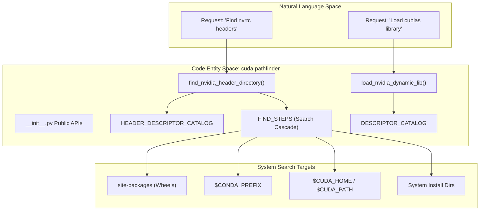
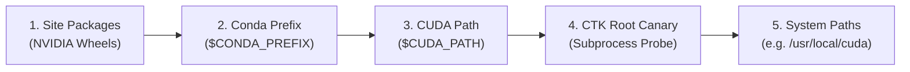

<!-- source: DeepWiki mcp.deepwiki.com · repo NVIDIA/cuda-python · page 4 cuda.pathfinder · fetched 2026-10-26 -->

# cuda.pathfinder

Relevant source files

The following files were used as context for generating this wiki page:

- [cuda_core/tests/test_optional_dependency_imports.py](cuda_core/tests/test_optional_dependency_imports.py)
- [cuda_pathfinder/DESCRIPTION.rst](cuda_pathfinder/DESCRIPTION.rst)
- [cuda_pathfinder/cuda/pathfinder/__init__.py](cuda_pathfinder/cuda/pathfinder/__init__.py)
- [cuda_pathfinder/cuda/pathfinder/_dynamic_libs/descriptor_catalog.py](cuda_pathfinder/cuda/pathfinder/_dynamic_libs/descriptor_catalog.py)
- [cuda_pathfinder/cuda/pathfinder/_headers/find_nvidia_headers.py](cuda_pathfinder/cuda/pathfinder/_headers/find_nvidia_headers.py)
- [cuda_pathfinder/cuda/pathfinder/_headers/header_descriptor.py](cuda_pathfinder/cuda/pathfinder/_headers/header_descriptor.py)
- [cuda_pathfinder/cuda/pathfinder/_headers/header_descriptor_catalog.py](cuda_pathfinder/cuda/pathfinder/_headers/header_descriptor_catalog.py)
- [cuda_pathfinder/cuda/pathfinder/_headers/supported_nvidia_headers.py](cuda_pathfinder/cuda/pathfinder/_headers/supported_nvidia_headers.py)
- [cuda_pathfinder/cuda/pathfinder/_optional_cuda_import.py](cuda_pathfinder/cuda/pathfinder/_optional_cuda_import.py)
- [cuda_pathfinder/docs/nv-versions.json](cuda_pathfinder/docs/nv-versions.json)
- [cuda_pathfinder/docs/source/api.rst](cuda_pathfinder/docs/source/api.rst)
- [cuda_pathfinder/docs/source/release.rst](cuda_pathfinder/docs/source/release.rst)
- [cuda_pathfinder/docs/source/release/1.2.0-notes.rst](cuda_pathfinder/docs/source/release/1.2.0-notes.rst)
- [cuda_pathfinder/docs/source/release/1.2.1-notes.rst](cuda_pathfinder/docs/source/release/1.2.1-notes.rst)
- [cuda_pathfinder/docs/source/release/1.4.2-notes.rst](cuda_pathfinder/docs/source/release/1.4.2-notes.rst)
- [cuda_pathfinder/docs/source/release/1.5.3-notes.rst](cuda_pathfinder/docs/source/release/1.5.3-notes.rst)
- [cuda_pathfinder/docs/source/release/1.5.4-notes.rst](cuda_pathfinder/docs/source/release/1.5.4-notes.rst)
- [cuda_pathfinder/pyproject.toml](cuda_pathfinder/pyproject.toml)
- [cuda_pathfinder/tests/test_find_nvidia_headers.py](cuda_pathfinder/tests/test_find_nvidia_headers.py)
- [cuda_pathfinder/tests/test_optional_cuda_import.py](cuda_pathfinder/tests/test_optional_cuda_import.py)
- [toolshed/conda_create_for_pathfinder_testing.ps1](toolshed/conda_create_for_pathfinder_testing.ps1)
- [toolshed/conda_create_for_pathfinder_testing.sh](toolshed/conda_create_for_pathfinder_testing.sh)

The `cuda.pathfinder` package is a standalone utility within the CUDA Python ecosystem designed to locate and load NVIDIA CUDA components across different platforms and installation methods [cuda_pathfinder/DESCRIPTION.rst:12-15](). It provides a robust discovery mechanism that handles the complexities of various distribution channels, including NVIDIA Python wheels (PyPI), Conda environments, system-wide CUDA Toolkit (CTK) installations, and OS-specific package managers [cuda_pathfinder/cuda/pathfinder/_headers/find_nvidia_headers.py:189-194]().

### Package Purpose and Scope
`cuda.pathfinder` aims to be a version-agnostic "one-stop solution" for finding CUDA artifacts [cuda_pathfinder/DESCRIPTION.rst:13-15](). It is used internally by `cuda.bindings` and `cuda.core` to resolve dependencies but can also be used independently by developers needing to find CUDA headers or libraries for their own JIT compilation pipelines.

The package maintains a **Descriptor Catalog** system, which defines the expected filenames, subdirectories, and environment variables for each supported CUDA component [cuda_pathfinder/cuda/pathfinder/_dynamic_libs/descriptor_catalog.py:30-34]()[cuda_pathfinder/cuda/pathfinder/_headers/header_descriptor_catalog.py:36-39]().

### High-Level Architecture

The following diagram illustrates how `cuda.pathfinder` maps logical CUDA component requests to physical file system locations.

**Pathfinder Component Discovery Flow**

Sources: [cuda_pathfinder/cuda/pathfinder/__init__.py:10-62](), [cuda_pathfinder/cuda/pathfinder/_headers/find_nvidia_headers.py:150-156](), [cuda_pathfinder/cuda/pathfinder/_headers/header_descriptor_catalog.py:36-40](), [cuda_pathfinder/cuda/pathfinder/_dynamic_libs/descriptor_catalog.py:30-34]()

---

### Dynamic Library Discovery
The package provides specialized logic for loading NVIDIA dynamic libraries (`.so` on Linux, `.dll` on Windows). This includes handling dependencies between libraries (e.g., `cusolver` requiring `nvJitLink` and `cublas`) and managing platform-specific loader requirements like `RTLD_DEEPBIND` or `AddDllDirectory` [cuda_pathfinder/cuda/pathfinder/_dynamic_libs/descriptor_catalog.py:122-129]()[cuda_pathfinder/cuda/pathfinder/_dynamic_libs/descriptor_catalog.py:65-66]().

Key features include:
*   **Version-Aware Sonames**: Mapping short names like `"cudart"` to specific versions like `libcudart.so.12` or `cudart64_13.dll` [cuda_pathfinder/cuda/pathfinder/_dynamic_libs/descriptor_catalog.py:35-41]().
*   **Subprocess Canary Probing**: A technique to find the system's CUDA installation by loading a "canary" library in an isolated process to avoid polluting the current process state [cuda_pathfinder/cuda/pathfinder/_headers/find_nvidia_headers.py:114-124]().

For details, see [Dynamic Library Discovery](#4.1).

### Header, Bitcode, and Binary Discovery
Beyond dynamic libraries, `cuda.pathfinder` facilitates the discovery of development-time artifacts and static utilities required for compilation and linking.

| Category | Public API | Description |
| :--- | :--- | :--- |
| **Headers** | `find_nvidia_header_directory()` | Locates directories containing headers like `cuda_runtime.h` or `nvrtc.h` [cuda_pathfinder/cuda/pathfinder/__init__.py:27-30](). |
| **Bitcode** | `find_bitcode_lib()` | Finds `libdevice.10.bc` and other bitcode files for NVVM compilation [cuda_pathfinder/cuda/pathfinder/__init__.py:41-43](). |
| **Static Libs** | `find_static_lib()` | Locates static libraries like `cudadevrt` for device-side linking [cuda_pathfinder/cuda/pathfinder/__init__.py:56-58](). |
| **Binaries** | `find_nvidia_binary_utility()` | Locates executable tools such as `nvcc`, `ptxas`, or `nvdisasm` [cuda_pathfinder/cuda/pathfinder/__init__.py:10-12](). |

The discovery process follows a strict search order (cascade) to ensure that if a user has installed NVIDIA wheels via `pip`, those are preferred over system-wide installations [cuda_pathfinder/cuda/pathfinder/_headers/find_nvidia_headers.py:189-194]().

For details, see [Header, Bitcode, and Binary Discovery](#4.2).

### Search Cascade Logic
The discovery functions utilize a common sequence of search steps defined in `FIND_STEPS` [cuda_pathfinder/cuda/pathfinder/_headers/find_nvidia_headers.py:150-156]().

**Discovery Step Priority**

Sources: [cuda_pathfinder/cuda/pathfinder/_headers/find_nvidia_headers.py:150-156](), [cuda_pathfinder/cuda/pathfinder/_headers/find_nvidia_headers.py:79-142]()

### Package Metadata and Dependencies
`cuda.pathfinder` is distributed as the `cuda-pathfinder` package on PyPI [cuda_pathfinder/pyproject.toml:5](). It is designed to have minimal dependencies, requiring only a modern Python environment (>=3.10) [cuda_pathfinder/pyproject.toml:9-11](). Testing is performed against multiple CUDA Toolkit versions (currently 12.x and 13.x) to ensure broad compatibility [cuda_pathfinder/pyproject.toml:21-47]().

Sources:
* [cuda_pathfinder/DESCRIPTION.rst:4-35]()
* [cuda_pathfinder/cuda/pathfinder/__init__.py:10-62]()
* [cuda_pathfinder/cuda/pathfinder/_headers/find_nvidia_headers.py:79-194]()
* [cuda_pathfinder/cuda/pathfinder/_headers/header_descriptor_catalog.py:36-194]()
* [cuda_pathfinder/cuda/pathfinder/_dynamic_libs/descriptor_catalog.py:30-170]()
* [cuda_pathfinder/pyproject.toml:4-47]()

---

