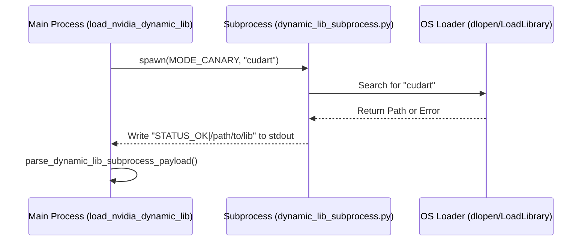

<!-- source: DeepWiki mcp.deepwiki.com · repo NVIDIA/cuda-python · page 4.1 Dynamic Library Discovery · fetched 2026-10-26 -->

# Dynamic Library Discovery

<details>
<summary>Relevant source files</summary>

The following files were used as context for generating this wiki page:

- [cuda_pathfinder/cuda/pathfinder/_dynamic_libs/dynamic_lib_subprocess.py](cuda_pathfinder/cuda/pathfinder/_dynamic_libs/dynamic_lib_subprocess.py)
- [cuda_pathfinder/cuda/pathfinder/_dynamic_libs/lib_descriptor.py](cuda_pathfinder/cuda/pathfinder/_dynamic_libs/lib_descriptor.py)
- [cuda_pathfinder/cuda/pathfinder/_dynamic_libs/load_dl_common.py](cuda_pathfinder/cuda/pathfinder/_dynamic_libs/load_dl_common.py)
- [cuda_pathfinder/cuda/pathfinder/_dynamic_libs/load_dl_linux.py](cuda_pathfinder/cuda/pathfinder/_dynamic_libs/load_dl_linux.py)
- [cuda_pathfinder/cuda/pathfinder/_dynamic_libs/load_dl_windows.py](cuda_pathfinder/cuda/pathfinder/_dynamic_libs/load_dl_windows.py)
- [cuda_pathfinder/cuda/pathfinder/_dynamic_libs/load_nvidia_dynamic_lib.py](cuda_pathfinder/cuda/pathfinder/_dynamic_libs/load_nvidia_dynamic_lib.py)
- [cuda_pathfinder/cuda/pathfinder/_dynamic_libs/platform_loader.py](cuda_pathfinder/cuda/pathfinder/_dynamic_libs/platform_loader.py)
- [cuda_pathfinder/cuda/pathfinder/_dynamic_libs/search_platform.py](cuda_pathfinder/cuda/pathfinder/_dynamic_libs/search_platform.py)
- [cuda_pathfinder/cuda/pathfinder/_dynamic_libs/search_steps.py](cuda_pathfinder/cuda/pathfinder/_dynamic_libs/search_steps.py)
- [cuda_pathfinder/cuda/pathfinder/_dynamic_libs/subprocess_protocol.py](cuda_pathfinder/cuda/pathfinder/_dynamic_libs/subprocess_protocol.py)
- [cuda_pathfinder/cuda/pathfinder/_dynamic_libs/supported_nvidia_libs.py](cuda_pathfinder/cuda/pathfinder/_dynamic_libs/supported_nvidia_libs.py)
- [cuda_pathfinder/cuda/pathfinder/_utils/driver_info.py](cuda_pathfinder/cuda/pathfinder/_utils/driver_info.py)
- [cuda_pathfinder/docs/source/release/1.3.5-notes.rst](cuda_pathfinder/docs/source/release/1.3.5-notes.rst)
- [cuda_pathfinder/docs/source/release/1.4.0-notes.rst](cuda_pathfinder/docs/source/release/1.4.0-notes.rst)
- [cuda_pathfinder/tests/child_load_nvidia_dynamic_lib_helper.py](cuda_pathfinder/tests/child_load_nvidia_dynamic_lib_helper.py)
- [cuda_pathfinder/tests/test_ctk_root_discovery.py](cuda_pathfinder/tests/test_ctk_root_discovery.py)
- [cuda_pathfinder/tests/test_driver_lib_loading.py](cuda_pathfinder/tests/test_driver_lib_loading.py)
- [cuda_pathfinder/tests/test_load_nvidia_dynamic_lib.py](cuda_pathfinder/tests/test_load_nvidia_dynamic_lib.py)
- [cuda_pathfinder/tests/test_load_nvidia_dynamic_lib_subprocess.py](cuda_pathfinder/tests/test_load_nvidia_dynamic_lib_subprocess.py)
- [cuda_pathfinder/tests/test_load_nvidia_dynamic_lib_using_mocker.py](cuda_pathfinder/tests/test_load_nvidia_dynamic_lib_using_mocker.py)
- [cuda_pathfinder/tests/test_search_steps.py](cuda_pathfinder/tests/test_search_steps.py)
- [cuda_pathfinder/tests/test_utils_driver_info.py](cuda_pathfinder/tests/test_utils_driver_info.py)

</details>


The `cuda.pathfinder` package provides a robust mechanism for locating and loading NVIDIA dynamic libraries (Shared Objects on Linux, DLLs on Windows). This system is designed to handle the complexities of the CUDA ecosystem, including multiple installation methods (pip wheels, Conda, system-wide installers) and platform-specific loader behaviors.

## Overview

The primary entry point for library discovery is the `load_nvidia_dynamic_lib` function [cuda_pathfinder/cuda/pathfinder/_dynamic_libs/load_nvidia_dynamic_lib.py:193-194](). It implements a multi-phase search strategy that prioritizes local environments (like virtual environments) before falling back to system-wide paths.

The discovery process distinguishes between two categories of libraries:
1.  **CTK Libraries**: Components of the CUDA Toolkit (e.g., `cudart`, `nvrtc`, `cublas`) which may be packaged in various ways [cuda_pathfinder/cuda/pathfinder/_dynamic_libs/supported_nvidia_libs.py:16]().
2.  **Driver Libraries**: System-level libraries shipped with the NVIDIA Display Driver (e.g., `libcuda.so`, `nvml.dll`). These skip local search steps and rely on the platform's native loader [cuda_pathfinder/cuda/pathfinder/_dynamic_libs/load_nvidia_dynamic_lib.py:51-54]().

### Core Architecture

The following diagram illustrates how high-level discovery requests map to internal code entities and search phases.

**Discovery Flow: From Library Name to Loaded Handle**

```mermaid
graph TD
    subgraph "Natural Language Space"
        REQ["Request: 'nvrtc'"]
        PLAT["Platform: Linux/Windows"]
    end

    subgraph "Code Entity Space (cuda.pathfinder)"
        API["load_nvidia_dynamic_lib()"]
        DESC["LIB_DESCRIPTORS (LibDescriptor)"]
        CTX["SearchContext"]
        STEPS["run_find_steps()"]
        LOADER["LOADER (PlatformLoader)"]
    end

    REQ --> API
    API --> DESC
    DESC --> CTX
    CTX --> STEPS
    STEPS --> EARLY["EARLY_FIND_STEPS (site-packages, conda)"]
    EARLY -- "If Not Found" --> SYS["load_with_system_search()"]
    SYS -- "If Not Found" --> LATE["LATE_FIND_STEPS (CUDA_PATH)"]
    LATE -- "If Not Found" --> CANARY["_try_ctk_root_canary()"]
    
    EARLY -- "Path Found" --> LOADER
    SYS -- "Loaded" --> LOADER
    LATE -- "Path Found" --> LOADER
    CANARY -- "Path Found" --> LOADER
    
    LOADER --> HANDLE["LoadedDL (ctypes handle)"]
end
```
**Sources:** [cuda_pathfinder/cuda/pathfinder/_dynamic_libs/load_nvidia_dynamic_lib.py:154-192](), [cuda_pathfinder/cuda/pathfinder/_dynamic_libs/search_steps.py:16-25]()

## Search Phases and Steps

For CTK-packaged libraries, the orchestrator executes a sequence of "Find Steps" [cuda_pathfinder/cuda/pathfinder/_dynamic_libs/search_steps.py:21-30](). Each step is a callable that returns a `FindResult` (containing an absolute path) or `None`.

### 1. Early Find Steps
These steps prioritize libraries installed within the current Python environment:
*   **`find_in_site_packages`**: Searches for libraries within pip-installed wheels (e.g., `nvidia-cuda-runtime-cu12`) [cuda_pathfinder/cuda/pathfinder/_dynamic_libs/search_steps.py:161-170]().
*   **`find_in_conda`**: Searches under `$CONDA_PREFIX` using Conda-specific directory layouts [cuda_pathfinder/cuda/pathfinder/_dynamic_libs/search_steps.py:172-182]().

### 2. System and Late Find Steps
If local search fails, the system attempts:
*   **`load_with_system_search`**: Invokes the native OS loader (`dlopen` on Linux, `LoadLibraryExW` on Windows) to find libraries already in the system search path [cuda_pathfinder/cuda/pathfinder/_dynamic_libs/load_dl_linux.py:158-180](), [cuda_pathfinder/cuda/pathfinder/_dynamic_libs/load_dl_windows.py:118-140]().
*   **`find_in_cuda_path`**: Searches directories specified by the `CUDA_PATH` or `CUDA_HOME` environment variables [cuda_pathfinder/cuda/pathfinder/_dynamic_libs/search_steps.py:185-199]().

### 3. Canary Probe (Subprocess Discovery)
A unique feature of `cuda.pathfinder` is the "Canary Probe". If a primary library (like `nvvm`) cannot be found, the system attempts to resolve a "canary" library (like `cudart`) via a fresh Python subprocess [cuda_pathfinder/cuda/pathfinder/_dynamic_libs/load_nvidia_dynamic_lib.py:102-132]().
*   If the subprocess resolves the canary's absolute path, the system derives the `CTK_ROOT` [cuda_pathfinder/cuda/pathfinder/_dynamic_libs/search_steps.py:139-144]().
*   It then searches for the original target library relative to that `CTK_ROOT` [cuda_pathfinder/cuda/pathfinder/_dynamic_libs/search_steps.py:147-153]().

**Sources:** [cuda_pathfinder/cuda/pathfinder/_dynamic_libs/load_nvidia_dynamic_lib.py:154-192](), [cuda_pathfinder/cuda/pathfinder/_dynamic_libs/search_steps.py:161-199]()

## Platform-Specific Loaders

The `LOADER` object abstracts the OS-level differences in library management.

### Linux (`load_dl_linux.py`)
*   **Mode**: Uses `os.RTLD_NOW | os.RTLD_GLOBAL` [cuda_pathfinder/cuda/pathfinder/_dynamic_libs/load_dl_linux.py:17]().
*   **Deepbind**: Supports `RTLD_DEEPBIND` if specified in the `LibDescriptor` to avoid symbol collisions [cuda_pathfinder/cuda/pathfinder/_dynamic_libs/load_dl_linux.py:153-155]().
*   **Path Resolution**: Uses `dlinfo` with `RTLD_DI_LINKMAP` and `RTLD_DI_ORIGIN` to resolve the absolute path of libraries loaded via system search [cuda_pathfinder/cuda/pathfinder/_dynamic_libs/load_dl_linux.py:88-126]().

### Windows (`load_dl_windows.py`)
*   **DLL Directory Management**: Uses `AddDllDirectory` to ensure dependent DLLs (e.g., `cublasLt` for `cublas`) can be found when loading from an absolute path [cuda_pathfinder/cuda/pathfinder/_dynamic_libs/load_dl_windows.py:60-81]().
*   **Search Flags**: Uses `LOAD_LIBRARY_SEARCH_DEFAULT_DIRS | LOAD_LIBRARY_SEARCH_DLL_LOAD_DIR` to strictly control search behavior in Python 3.8+ environments [cuda_pathfinder/cuda/pathfinder/_dynamic_libs/load_dl_windows.py:160-161]().
*   **Path Resolution**: Uses `GetModuleFileNameW` to retrieve the location of already-loaded modules [cuda_pathfinder/cuda/pathfinder/_dynamic_libs/load_dl_windows.py:83-101]().

**Sources:** [cuda_pathfinder/cuda/pathfinder/_dynamic_libs/load_dl_linux.py:1-180](), [cuda_pathfinder/cuda/pathfinder/_dynamic_libs/load_dl_windows.py:1-168]()

## Implementation Details

### The Library Catalog
The discovery logic is driven by a catalog of `LibDescriptor` objects. Each descriptor defines:
*   `linux_sonames` and `windows_dlls`: Filename patterns for the library [cuda_pathfinder/cuda/pathfinder/_dynamic_libs/supported_nvidia_libs.py:37-45]().
*   `dependencies`: Other libraries that must be loaded first [cuda_pathfinder/cuda/pathfinder/_dynamic_libs/supported_nvidia_libs.py:34-35]().
*   `site_packages_linux/windows`: Relative paths within pip wheels [cuda_pathfinder/cuda/pathfinder/_dynamic_libs/supported_nvidia_libs.py:55-69]().

### Subprocess Protocol
To prevent polluting the main process's dynamic loader state during "probes", `cuda.pathfinder` uses a specialized subprocess protocol [cuda_pathfinder/cuda/pathfinder/_dynamic_libs/subprocess_protocol.py]().
*   **Modes**: `MODE_CANARY` (find path) and `MODE_LOAD` (verify loadability) [cuda_pathfinder/cuda/pathfinder/_dynamic_libs/subprocess_protocol.py:10-12]().
*   **Payload**: A structured string containing status codes and absolute paths is communicated via `stdout` [cuda_pathfinder/cuda/pathfinder/_dynamic_libs/subprocess_protocol.py:33-35]().

**Subprocess Communication Flow**


**Sources:** [cuda_pathfinder/cuda/pathfinder/_dynamic_libs/load_nvidia_dynamic_lib.py:102-132](), [cuda_pathfinder/cuda/pathfinder/_dynamic_libs/subprocess_protocol.py:1-36]()

### Error Handling
The system raises specific exceptions to aid debugging:
*   `DynamicLibUnknownError`: The requested library name is not in the catalog [cuda_pathfinder/cuda/pathfinder/_dynamic_libs/load_nvidia_dynamic_lib.py:15-16]().
*   `DynamicLibNotAvailableError`: The library exists in the catalog but is not supported on the current OS [cuda_pathfinder/cuda/pathfinder/_dynamic_libs/load_nvidia_dynamic_lib.py:14]().
*   `DynamicLibNotFoundError`: The search cascade completed without finding the library. This error includes a detailed log of all directories searched and `listdir` snapshots [cuda_pathfinder/cuda/pathfinder/_dynamic_libs/search_steps.py:63-66]().

**Sources:** [cuda_pathfinder/cuda/pathfinder/_dynamic_libs/load_dl_common.py:1-20](), [cuda_pathfinder/cuda/pathfinder/_dynamic_libs/search_steps.py:47-66]()

---

