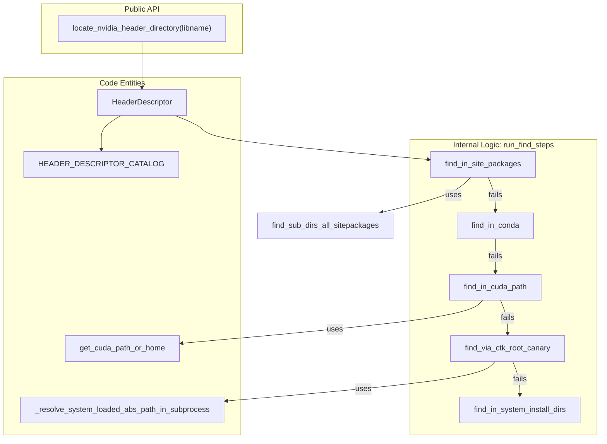
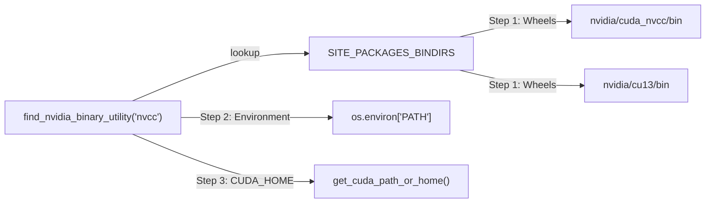

<!-- source: DeepWiki mcp.deepwiki.com · repo NVIDIA/cuda-python · page 4.2 Header, Bitcode, and Binary Discovery · fetched 2026-10-26 -->

# Header, Bitcode, and Binary Discovery

Relevant source files

The following files were used as context for generating this wiki page:

- [cuda_core/tests/test_optional_dependency_imports.py](cuda_core/tests/test_optional_dependency_imports.py)
- [cuda_pathfinder/cuda/pathfinder/__init__.py](cuda_pathfinder/cuda/pathfinder/__init__.py)
- [cuda_pathfinder/cuda/pathfinder/_binaries/find_nvidia_binary_utility.py](cuda_pathfinder/cuda/pathfinder/_binaries/find_nvidia_binary_utility.py)
- [cuda_pathfinder/cuda/pathfinder/_binaries/supported_nvidia_binaries.py](cuda_pathfinder/cuda/pathfinder/_binaries/supported_nvidia_binaries.py)
- [cuda_pathfinder/cuda/pathfinder/_dynamic_libs/descriptor_catalog.py](cuda_pathfinder/cuda/pathfinder/_dynamic_libs/descriptor_catalog.py)
- [cuda_pathfinder/cuda/pathfinder/_headers/find_nvidia_headers.py](cuda_pathfinder/cuda/pathfinder/_headers/find_nvidia_headers.py)
- [cuda_pathfinder/cuda/pathfinder/_headers/header_descriptor.py](cuda_pathfinder/cuda/pathfinder/_headers/header_descriptor.py)
- [cuda_pathfinder/cuda/pathfinder/_headers/header_descriptor_catalog.py](cuda_pathfinder/cuda/pathfinder/_headers/header_descriptor_catalog.py)
- [cuda_pathfinder/cuda/pathfinder/_headers/supported_nvidia_headers.py](cuda_pathfinder/cuda/pathfinder/_headers/supported_nvidia_headers.py)
- [cuda_pathfinder/cuda/pathfinder/_optional_cuda_import.py](cuda_pathfinder/cuda/pathfinder/_optional_cuda_import.py)
- [cuda_pathfinder/cuda/pathfinder/_static_libs/find_static_lib.py](cuda_pathfinder/cuda/pathfinder/_static_libs/find_static_lib.py)
- [cuda_pathfinder/docs/source/api.rst](cuda_pathfinder/docs/source/api.rst)
- [cuda_pathfinder/docs/source/release/1.4.2-notes.rst](cuda_pathfinder/docs/source/release/1.4.2-notes.rst)
- [cuda_pathfinder/docs/source/release/1.5.3-notes.rst](cuda_pathfinder/docs/source/release/1.5.3-notes.rst)
- [cuda_pathfinder/pyproject.toml](cuda_pathfinder/pyproject.toml)
- [cuda_pathfinder/tests/test_find_nvidia_binaries.py](cuda_pathfinder/tests/test_find_nvidia_binaries.py)
- [cuda_pathfinder/tests/test_find_nvidia_headers.py](cuda_pathfinder/tests/test_find_nvidia_headers.py)
- [cuda_pathfinder/tests/test_find_static_lib.py](cuda_pathfinder/tests/test_find_static_lib.py)
- [cuda_pathfinder/tests/test_optional_cuda_import.py](cuda_pathfinder/tests/test_optional_cuda_import.py)
- [toolshed/conda_create_for_pathfinder_testing.ps1](toolshed/conda_create_for_pathfinder_testing.ps1)
- [toolshed/conda_create_for_pathfinder_testing.sh](toolshed/conda_create_for_pathfinder_testing.sh)

The `cuda.pathfinder` package provides a robust discovery mechanism for locating non-dynamic CUDA components, including C/C++ header directories, LLVM bitcode libraries (`libdevice`), static libraries (e.g., `cudadevrt`), and binary utilities (e.g., `nvcc`, `ptxas`). This system abstracts the differences between various installation layouts, such as NVIDIA Python wheels, Conda environments, and standard CUDA Toolkit (CTK) system installs.

## Header Discovery System

The header discovery system is governed by a descriptor-based architecture. Instead of hardcoded paths, it uses a catalog of `HeaderDescriptorSpec` objects that define how to validate and locate the include directories for specific libraries [cuda_pathfinder/cuda/pathfinder/_headers/header_descriptor_catalog.py:15-33]().

### Header Descriptor Catalog
The `HEADER_DESCRIPTOR_CATALOG` contains specifications for both core CUDA Toolkit headers (packaged as `ctk`) and third-party or separately distributed headers (packaged as `other`) [cuda_pathfinder/cuda/pathfinder/_headers/header_descriptor_catalog.py:36-152]().

| Feature | Description |
| :--- | :--- |
| **Canary Probing** | Uses `use_ctk_root_canary` to trigger a subprocess that identifies the system CUDA root via `cudart` loading [cuda_pathfinder/cuda/pathfinder/_headers/find_nvidia_headers.py:114-122](). |
| **Layout Awareness** | Supports `conda_targets_layout` for handling `targets/<arch>/include` structures found in Conda [cuda_pathfinder/cuda/pathfinder/_headers/header_descriptor_catalog.py:31](). |
| **Subdirectory Search** | Checks specific sub-folders like `cccl` or `nvvm/include` before the base include directory [cuda_pathfinder/cuda/pathfinder/_headers/header_descriptor_catalog.py:48-50](). |

### Discovery Flow (HeaderFindStep)
The `locate_nvidia_header_directory` function executes a sequence of "find steps" [cuda_pathfinder/cuda/pathfinder/_headers/find_nvidia_headers.py:150-156]().

**Discovery Logic: Code Entity Mapping**
The following diagram maps the logical search steps to the internal implementation functions.

Title: Header Discovery Sequence

**Sources:** [cuda_pathfinder/cuda/pathfinder/_headers/find_nvidia_headers.py:79-165](), [cuda_pathfinder/cuda/pathfinder/_headers/header_descriptor_catalog.py:36-40]()

## Bitcode and Static Library Discovery

Static libraries and LLVM bitcode (primarily `libdevice.10.bc`) are located using specialized finders that prioritize Python wheels over environment-defined paths.

### Supported Static Components
*   **Bitcode:** `device` (libdevice) [cuda_pathfinder/cuda/pathfinder/__init__.py:82]().
*   **Static Libs:** `cudadevrt` [cuda_pathfinder/cuda/pathfinder/_static_libs/find_static_lib.py:36-46]().

### Search Implementation
The discovery for these components follows a prioritized search order:
1.  **Site-packages:** Scans `nvidia/cu13/lib` or `nvidia/cuda_runtime/lib` [cuda_pathfinder/cuda/pathfinder/_static_libs/find_static_lib.py:74-81]().
2.  **Conda:** Checks `$CONDA_PREFIX/Library` (Windows) or `$CONDA_PREFIX` (Linux) [cuda_pathfinder/cuda/pathfinder/_static_libs/find_static_lib.py:83-93]().
3.  **CUDA Path:** Uses `get_cuda_path_or_home()` to search the `lib64` or `lib/x64` directories of a local toolkit installation [cuda_pathfinder/cuda/pathfinder/_static_libs/find_static_lib.py:95-112]().

**Sources:** [cuda_pathfinder/cuda/pathfinder/_static_libs/find_static_lib.py:120-157](), [cuda_pathfinder/cuda/pathfinder/_static_libs/find_bitcode_lib.py:32-46]()

## Binary Utility Discovery

The `find_nvidia_binary_utility` API locates executable tools required for compilation and profiling. These are mapped in `SITE_PACKAGES_BINDIRS` to specific subdirectories within NVIDIA wheels [cuda_pathfinder/cuda/pathfinder/_binaries/supported_nvidia_binaries.py:13-32]().

### Categorization of Supported Binaries
| Category | Examples |
| :--- | :--- |
| **Compilers/Assemblers** | `nvcc`, `nvdisasm`, `ptxas`, `fatbinary` |
| **Linkers/Archivers** | `nvlink`, `nvprune` |
| **Debuggers/Sanitizers** | `cuda-gdb`, `compute-sanitizer` |
| **Profilers** | `nsys`, `ncu`, `nvprof` |

**Code Entity Association: Binary Search**
This diagram bridges the requested utility name to the filesystem search logic.

Title: Binary Utility Location Logic

**Sources:** [cuda_pathfinder/cuda/pathfinder/_binaries/supported_nvidia_binaries.py:7-32](), [cuda_pathfinder/cuda/pathfinder/__init__.py:77]()

## Key APIs and Data Structures

### `LocatedHeaderDir`
A dataclass returned by header discovery containing the normalized path and the discovery method [cuda_pathfinder/cuda/pathfinder/_headers/find_nvidia_headers.py:33-40]().
*   `abs_path`: Absolute path to the include directory.
*   `found_via`: String indicating source (e.g., `"site-packages"`, `"conda"`, `"system-ctk-root"`).

### `find_nvidia_header_directory(libname)`
The primary entry point for header discovery. It returns the raw string path or `None`. It is a cached wrapper around `locate_nvidia_header_directory` [cuda_pathfinder/cuda/pathfinder/_headers/find_nvidia_headers.py:198-208]().

### `get_cuda_path_or_home()`
A utility that resolves the local CUDA installation path by checking environment variables in order: `CUDA_HOME`, then `CUDA_PATH` [cuda_pathfinder/cuda/pathfinder/_utils/env_vars.py:62]().

**Sources:** [cuda_pathfinder/cuda/pathfinder/__init__.py:10-62](), [cuda_pathfinder/cuda/pathfinder/_headers/find_nvidia_headers.py:174-187]()

---

