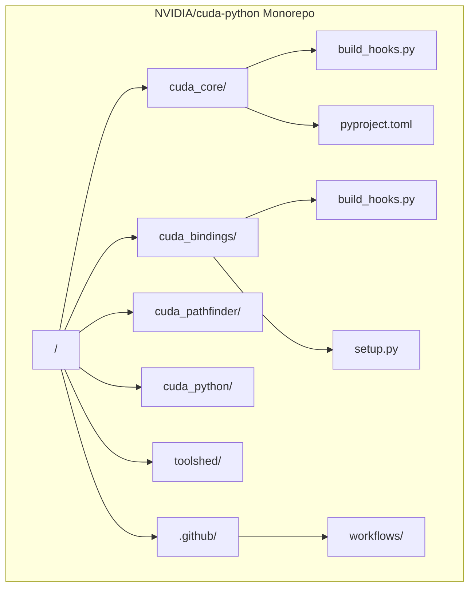
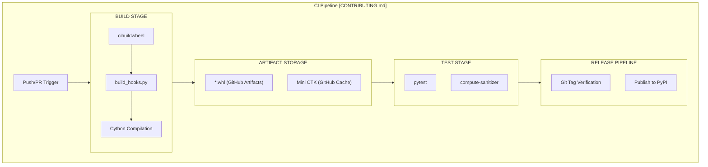

<!-- source: DeepWiki mcp.deepwiki.com · repo NVIDIA/cuda-python · page 5 Development Guide · fetched 2026-10-26 -->

# Development Guide

Relevant source files

The following files were used as context for generating this wiki page:

- [.coveragerc](.coveragerc)
- [.gitattributes](.gitattributes)
- [.gitignore](.gitignore)
- [.pre-commit-config.yaml](.pre-commit-config.yaml)
- [.spdx-ignore](.spdx-ignore)
- [CONTRIBUTING.md](CONTRIBUTING.md)
- [ci/.ci-pipeline-regen.md](ci/.ci-pipeline-regen.md)
- [ci/ci-pipeline.svg](ci/ci-pipeline.svg)
- [cuda_bindings/pyproject.toml](cuda_bindings/pyproject.toml)
- [cuda_bindings/setup.py](cuda_bindings/setup.py)
- [cuda_core/pyproject.toml](cuda_core/pyproject.toml)
- [toolshed/check_spdx.py](toolshed/check_spdx.py)

This guide provides information for developers contributing to the CUDA Python project. It covers the build system architecture, testing framework, and CI/CD pipeline. For details on the internal architecture, see [Overview](#1) and [cuda.core](#2).

## Repository Structure

The CUDA Python repository is organized as a monorepo containing multiple components that are built and packaged separately.

Sources: [cuda_core/pyproject.toml:12-13](), [cuda_bindings/pyproject.toml:11-12](), [cuda_bindings/setup.py:9]()

## Build System

The build system uses a custom `build_hooks` backend for `setuptools` to manage complex Cython compilation requirements and dependency discovery.

### Component Build Architecture

| Component | Build Backend | Key Dependencies |
| :--- | :--- | :--- |
| `cuda.core` | `build_hooks` | `Cython>=3.2`, `setuptools-scm`, `cuda-pathfinder` |
| `cuda.bindings` | `build_hooks` | `Cython>=3.2`, `pyclibrary`, `cuda-pathfinder` |
| `cuda.pathfinder` | `setuptools` | `setuptools-scm` |

Sources: [cuda_core/pyproject.toml:5-12](), [cuda_bindings/pyproject.toml:3-11]()

The build system supports parallel compilation via the `CUDA_PYTHON_PARALLEL_LEVEL` environment variable [cuda_bindings/setup.py:22](). It also handles specialized compiler flags, such as adjusting `extra_compile_args` when using `clang` [cuda_bindings/setup.py:46-48]().

For details, see [Build System](#5.1).

## Testing Framework

The repository uses `pytest` for testing, with specialized configurations for benchmarking and GPU-specific requirements.

### Test Environment Configuration
The project defines complex dependency groups in `pyproject.toml` to support different CUDA runtime environments and free-threaded Python builds:
*   `test-cu12`: Includes `cupy-cuda12x` and `cuda-toolkit[cudart]==12.*` [cuda_core/pyproject.toml:63]().
*   `test-cu13-ft`: Specialized group for free-threaded Python 3.13+ builds [cuda_core/pyproject.toml:68]().

### Local Test Execution
To run tests, developers typically use `pytest` with the `pytest-benchmark` plugin. The configuration intentionally disables benchmarks by default using `--benchmark-disable` to speed up standard test runs [cuda_bindings/pyproject.toml:87-88]().

For details, see [Testing Framework](#5.2).

## CI/CD Pipeline

The CI/CD pipeline is implemented using GitHub Actions and `cibuildwheel` to produce binary wheels for Linux (x86_64, aarch64) and Windows (AMD64).

### CI Pipeline Flow

The following diagram maps the high-level CI stages to the code entities and tools involved in the process.

Sources: [CONTRIBUTING.md:100-155](), [cuda_core/pyproject.toml:111-122](), [cuda_bindings/pyproject.toml:74-84]()

For details, see [CI/CD Pipeline](#5.3).

## Toolshed and Developer Utilities

The `toolshed/` directory contains internal utilities to maintain code quality and compliance.

*   **`check_spdx.py`**: A utility used in `pre-commit` hooks to ensure every file contains the correct SPDX license header [toolshed/check_spdx.py:1-36](). It validates copyright years against the current system time [toolshed/check_spdx.py:62]().
*   **`pre-commit`**: The project enforces strict linting using `ruff`, `mypy` (for `cuda_pathfinder`), and `cython-lint` [.pre-commit-config.yaml:17-98]().
*   **`delvewheel`**: Used on Windows to repair wheels and exclude specific libraries like `torch_cpu.dll` from being bundled [cuda_core/pyproject.toml:121]().

For details, see [Toolshed and Developer Utilities](#5.4).

## Versioning and Release

Versioning is managed by `setuptools_scm`, which derives the version from Git tags. The `tag_regex` is configured to preserve alpha/beta suffixes while stripping release candidate (rc) suffixes [cuda_core/pyproject.toml:104-108]().

Sources: [cuda_core/pyproject.toml:104-110](), [cuda_bindings/pyproject.toml:92-97]()

---

