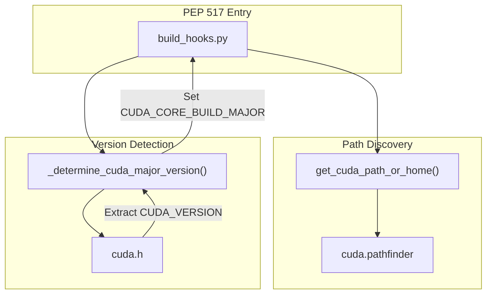
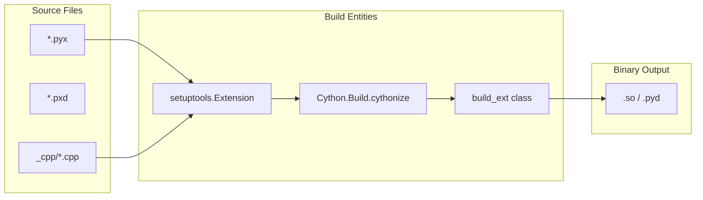
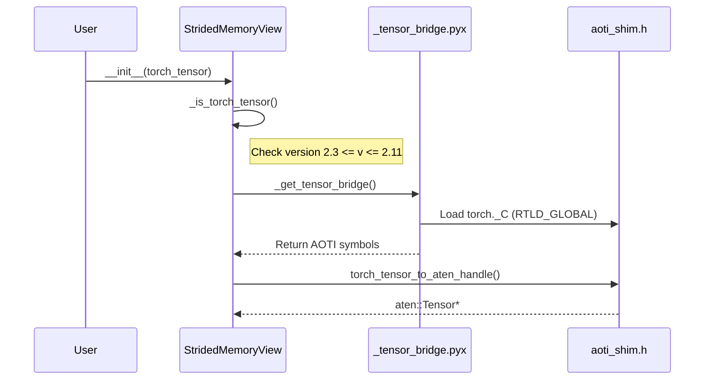

<!-- source: DeepWiki mcp.deepwiki.com · repo NVIDIA/cuda-python · page 5.1 Build System · fetched 2026-10-26 -->

# Build System

Relevant source files

The following files were used as context for generating this wiki page:

- [ci/tools/run-tests](ci/tools/run-tests)
- [cuda_bindings/pixi.lock](cuda_bindings/pixi.lock)
- [cuda_bindings/pixi.toml](cuda_bindings/pixi.toml)
- [cuda_bindings/pyproject.toml](cuda_bindings/pyproject.toml)
- [cuda_bindings/setup.py](cuda_bindings/setup.py)
- [cuda_bindings/tests/cython/build_tests.bat](cuda_bindings/tests/cython/build_tests.bat)
- [cuda_bindings/tests/cython/build_tests.py](cuda_bindings/tests/cython/build_tests.py)
- [cuda_bindings/tests/cython/build_tests.sh](cuda_bindings/tests/cython/build_tests.sh)
- [cuda_core/build_hooks.py](cuda_core/build_hooks.py)
- [cuda_core/cuda/core/_include/aoti_shim.def](cuda_core/cuda/core/_include/aoti_shim.def)
- [cuda_core/cuda/core/_include/aoti_shim.h](cuda_core/cuda/core/_include/aoti_shim.h)
- [cuda_core/cuda/core/_memoryview.pyx](cuda_core/cuda/core/_memoryview.pyx)
- [cuda_core/cuda/core/_tensor_bridge.pyx](cuda_core/cuda/core/_tensor_bridge.pyx)
- [cuda_core/pixi.lock](cuda_core/pixi.lock)
- [cuda_core/pixi.toml](cuda_core/pixi.toml)
- [cuda_core/pyproject.toml](cuda_core/pyproject.toml)
- [cuda_core/setup.py](cuda_core/setup.py)
- [cuda_core/tests/cython/build_tests.py](cuda_core/tests/cython/build_tests.py)
- [cuda_core/tests/cython/build_tests.sh](cuda_core/tests/cython/build_tests.sh)
- [cuda_core/tests/test_utils.py](cuda_core/tests/test_utils.py)
- [cuda_pathfinder/pixi.lock](cuda_pathfinder/pixi.lock)
- [cuda_pathfinder/pixi.toml](cuda_pathfinder/pixi.toml)
- [pixi.lock](pixi.lock)
- [pixi.toml](pixi.toml)

The Build System for the CUDA Python project is responsible for generating Python bindings to CUDA C/C++ APIs, compiling these bindings, and creating the necessary Python packages. This document details the architecture and workflow of the build system, from the `build_hooks` backend to the Cython compilation pipeline and the specialized AOTI shim for PyTorch.

## Overview

The CUDA Python build system serves several key functions:

- **Binding Generation**: Automates the creation of Cython code from CUDA headers.
- **Compilation Pipeline**: Compiles Cython code into C++ and then into Python extension modules using parallel build support.
- **Environment Management**: Utilizes `pixi` for reproducible development environments.
- **Versioning**: Implements `setuptools_scm` for git-based versioning.
- **PyTorch Interoperability**: Implements an Ahead-Of-Time Inductor (AOTI) shim for high-performance tensor bridging.

The project is split into several packages: `cuda.bindings` (low-level), `cuda.core` (high-level), and `cuda.pathfinder` (discovery).

## Build Backend and Hooks

CUDA Python uses a custom build backend defined in `build_hooks.py` to manage complex build-time dependencies, specifically the requirement that `cuda-bindings` must be present and discoverable by Cython when building `cuda-core`.

### PEP 517 Integration

The `pyproject.toml` files for both `cuda-core` and `cuda-bindings` specify `build-backend = "build_hooks"` [cuda_core/pyproject.toml:12-13](). This module implements the standard PEP 517 hooks while wrapping `setuptools.build_meta` [cuda_core/build_hooks.py:21-26]().

### Build Data Flow

The following diagram illustrates how the `build_hooks` backend coordinates the setup of the build environment, particularly the resolution of CUDA paths and versioning.

**Diagram: Build Hooks Logic Flow**

Sources:
- [cuda_core/pyproject.toml:12-13]() - Backend specification
- [cuda_core/build_hooks.py:32-59]() - `_import_get_cuda_path_or_home` implementation
- [cuda_core/build_hooks.py:73-115]() - `_determine_cuda_major_version` implementation

## Cython Compilation Pipeline

The compilation process transforms `.pyx` source files into shared libraries (`.so` or `.pyd`).

### Extension Configuration
Extensions are dynamically discovered by scanning the `cuda/core/` directory for `.pyx` files [cuda_core/build_hooks.py:148-151](). The system also automatically links corresponding `.cpp` files from the `_cpp/` directory if they match the module name [cuda_core/build_hooks.py:153-163]().

### Parallel and Optimized Build
The `setup.py` scripts support parallel compilation via the `CUDA_PYTHON_PARALLEL_LEVEL` environment variable [cuda_bindings/setup.py:14-22](). On Linux, the system defaults to C++17 and applies `-Wl,--strip-all` for non-debug builds [cuda_core/build_hooks.py:174-181]().

**Diagram: Code Entity Mapping (Compilation)**

Sources:
- [cuda_bindings/setup.py:42-50]() - `build_ext` class override
- [cuda_core/build_hooks.py:148-163]() - Extension discovery and source mapping
- [cuda_core/build_hooks.py:183-195]() - `cythonize` call with directives

## Versioning and Packaging

### setuptools_scm
Versioning is strictly derived from Git tags using `setuptools_scm`. The configuration preserves alpha/beta suffixes but strips release candidate (rc) suffixes to comply with internal versioning requirements [cuda_core/pyproject.toml:104-109]().

### cibuildwheel
The project uses `cibuildwheel` to generate cross-platform wheels.
- **Linux**: Skips `musllinux` builds and targets native architectures [cuda_core/pyproject.toml:112-116]().
- **Windows**: Uses `delvewheel` to repair wheels and bundle necessary DLLs, while explicitly excluding PyTorch DLLs (`torch_cpu.dll`, `torch_python.dll`) to avoid bloat and conflicts [cuda_core/pyproject.toml:118-122]().

Sources:
- [cuda_core/pyproject.toml:104-109]() - `setuptools_scm` configuration
- [cuda_core/pyproject.toml:111-122]() - `cibuildwheel` configuration

## Pixi Environments

Development and CI environments are managed using `pixi`. This ensures that all developers use the same versions of the CUDA Toolkit, compilers, and Python dependencies.

| Environment | Purpose | Key Features |
| :--- | :--- | :--- |
| `default` | Standard development | Includes `test`, `cython-tests`, and `local-deps` [cuda_core/pixi.toml:121-125]() |
| `cu12` / `cu13` | Version-specific testing | Targets specific CUDA major versions [cuda_core/pixi.toml:126-127]() |
| `docs` | Documentation building | Includes Sphinx and theme dependencies [cuda_core/pixi.toml:129]() |
| `examples` | Running tutorials | Includes `cupy` and `pytorch-gpu` [cuda_core/pixi.toml:128]() |

Sources:
- [cuda_core/pixi.toml:120-130]() - Environment definitions
- [cuda_core/pixi.toml:142-152]() - Platform-specific build configurations

## PyTorch AOTI Shim

The `cuda.core` package includes a high-performance "tensor bridge" for PyTorch. This bypasses standard DLPack/CAI overhead by using the Ahead-Of-Time Inductor (AOTI) C interface.

### Implementation Details
- **AOTI Shim**: Defined in `aoti_shim.h` and `aoti_shim.def`, it provides C-level access to PyTorch tensor internals [cuda_core/cuda/core/_include/aoti_shim.h:1-20]().
- **Lazy Loading**: The bridge is initialized lazily. `_get_tensor_bridge()` bootstraps the AOTI symbols by loading `torch._C` with `RTLD_GLOBAL` only when a `torch.Tensor` is first encountered [cuda_core/cuda/core/_memoryview.pyx:85-98]().
- **Version Guard**: The AOTI path is only used for PyTorch versions between 2.3 and 2.11, as these versions have a stable internal ABI for the `THPVariable` struct [cuda_core/cuda/core/_memoryview.pyx:45-70]().

**Diagram: Tensor Bridge Execution Flow**

Sources:
- [cuda_core/cuda/core/_memoryview.pyx:45-70]() - PyTorch version checking logic
- [cuda_core/cuda/core/_memoryview.pyx:85-98]() - AOTI bootstrap process
- [cuda_core/cuda/core/_tensor_bridge.pyx:1-50]() - Tensor bridge implementation

---

