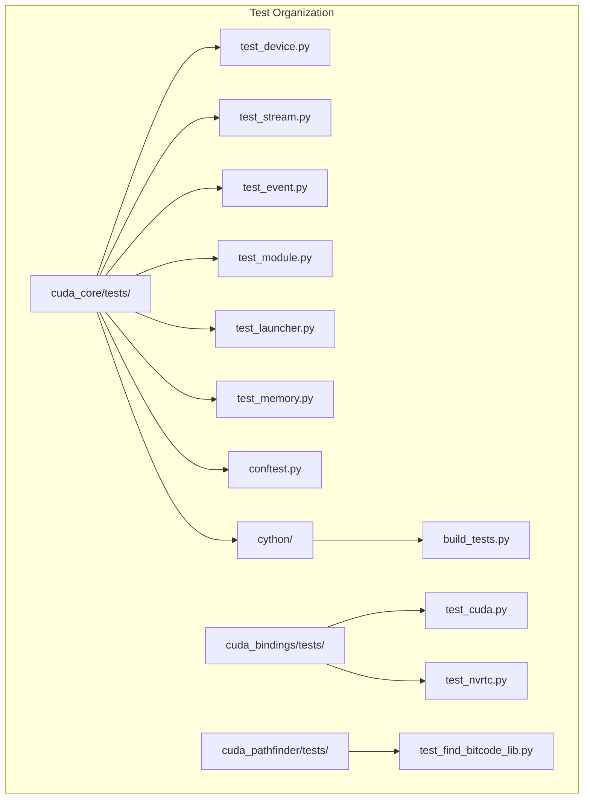
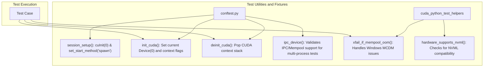

<!-- source: DeepWiki mcp.deepwiki.com · repo NVIDIA/cuda-python · page 5.2 Testing Framework · fetched 2026-10-26 -->

# Testing Framework

<details>
<summary>Relevant source files</summary>

The following files were used as context for generating this wiki page:

- [ci/tools/check_release_notes.py](ci/tools/check_release_notes.py)
- [ci/tools/run-tests](ci/tools/run-tests)
- [ci/tools/tests/test_check_release_notes.py](ci/tools/tests/test_check_release_notes.py)
- [cuda_bindings/pixi.lock](cuda_bindings/pixi.lock)
- [cuda_bindings/pixi.toml](cuda_bindings/pixi.toml)
- [cuda_bindings/tests/cython/build_tests.bat](cuda_bindings/tests/cython/build_tests.bat)
- [cuda_bindings/tests/cython/build_tests.py](cuda_bindings/tests/cython/build_tests.py)
- [cuda_bindings/tests/cython/build_tests.sh](cuda_bindings/tests/cython/build_tests.sh)
- [cuda_core/pixi.lock](cuda_core/pixi.lock)
- [cuda_core/pixi.toml](cuda_core/pixi.toml)
- [cuda_core/tests/conftest.py](cuda_core/tests/conftest.py)
- [cuda_core/tests/cython/build_tests.py](cuda_core/tests/cython/build_tests.py)
- [cuda_core/tests/cython/build_tests.sh](cuda_core/tests/cython/build_tests.sh)
- [cuda_core/tests/helpers/__init__.py](cuda_core/tests/helpers/__init__.py)
- [cuda_core/tests/helpers/latch.py](cuda_core/tests/helpers/latch.py)
- [cuda_core/tests/helpers/logging.py](cuda_core/tests/helpers/logging.py)
- [cuda_core/tests/memory_ipc/test_event_ipc.py](cuda_core/tests/memory_ipc/test_event_ipc.py)
- [cuda_core/tests/test_device.py](cuda_core/tests/test_device.py)
- [cuda_core/tests/test_event.py](cuda_core/tests/test_event.py)
- [cuda_core/tests/test_helpers.py](cuda_core/tests/test_helpers.py)
- [cuda_core/tests/test_launcher.py](cuda_core/tests/test_launcher.py)
- [cuda_core/tests/test_memory.py](cuda_core/tests/test_memory.py)
- [cuda_core/tests/test_module.py](cuda_core/tests/test_module.py)
- [cuda_core/tests/test_stream.py](cuda_core/tests/test_stream.py)
- [cuda_pathfinder/cuda/pathfinder/_static_libs/find_bitcode_lib.py](cuda_pathfinder/cuda/pathfinder/_static_libs/find_bitcode_lib.py)
- [cuda_pathfinder/pixi.lock](cuda_pathfinder/pixi.lock)
- [cuda_pathfinder/pixi.toml](cuda_pathfinder/pixi.toml)
- [cuda_pathfinder/tests/test_find_bitcode_lib.py](cuda_pathfinder/tests/test_find_bitcode_lib.py)
- [cuda_python_test_helpers/cuda_python_test_helpers/__init__.py](cuda_python_test_helpers/cuda_python_test_helpers/__init__.py)
- [pixi.lock](pixi.lock)
- [pixi.toml](pixi.toml)
- [pytest.ini](pytest.ini)

</details>


This document describes the testing framework used in the CUDA Python repository. It covers the test organization, infrastructure, execution, and integration with CI/CD pipelines.

## Test Organization

The CUDA Python repository uses `pytest` as its testing framework and organizes tests by package and component.

Title: Test Directory Structure


Tests follow the naming convention: `test_*.py` for test files and functions named `test_*` for test cases. 

Sources: [cuda_core/tests/test_device.py:1-12]() [cuda_core/tests/test_stream.py:1-10]() [cuda_core/tests/test_event.py:1-17]() [cuda_core/tests/test_module.py:1-15]() [cuda_core/tests/test_launcher.py:1-30]() [cuda_core/tests/test_memory.py:1-58]() [cuda_pathfinder/tests/test_find_bitcode_lib.py:1-10]()

## Test Infrastructure

The test infrastructure is built on `pytest` with specialized fixtures that manage CUDA initialization and cleanup.

Title: Test Utility Flow


### Key Fixtures and Helpers

The `conftest.py` file defines several critical fixtures:

*   `session_setup`: A session-scoped fixture that calls `cuInit(0)` and forces the multiprocessing start method to `spawn` to ensure CUDA compatibility [cuda_core/tests/conftest.py:124-131]().
*   `init_cuda`: A function-scoped fixture that sets `Device(0)` as current and configures `CU_CTX_SCHED_BLOCKING_SYNC` if the `CUDA_CORE_TEST_BLOCKING_SYNC` environment variable is set [cuda_core/tests/conftest.py:133-147]().
*   `deinit_cuda`: Pops the current CUDA context and clears thread-local device storage [cuda_core/tests/conftest.py:164-169]().
*   `ipc_device`: Checks for mempool and POSIX file descriptor support, skipping tests on platforms like WSL where IPC-enabled mempools are rejected [cuda_core/tests/conftest.py:187-208]().

### Memory Resource Helpers
Tests for `cuda.core.MemoryResource` often use dummy implementations for validation:
*   `DummyDeviceMemoryResource`: Wraps `cuMemAlloc`/`cuMemFree` [cuda_core/tests/test_memory.py:62-86]().
*   `DummyHostMemoryResource`: Uses `ctypes` for host-side allocation [cuda_core/tests/test_memory.py:88-115]().

Sources: [cuda_core/tests/conftest.py:124-208]() [cuda_core/tests/test_memory.py:62-115]()

## Cython Test Compilation

The framework includes tests that exercise the Cython API directly. These require a compilation step before they can be executed by `pytest`.

*   **Build Scripts**: Shell scripts (`build_tests.sh`) and batch files (`build_tests.bat`) invoke Python build scripts [cuda_core/pixi.toml:192-209]().
*   **Implementation**: `build_tests.py` uses `setuptools` and `Cython.Build.cythonize` to compile `.pyx` test files into shared libraries that are then imported by the test suite [cuda_core/tests/cython/build_tests.py:1-50]().
*   **Pixi Tasks**: The `test` task in `pixi.toml` explicitly depends on the `build-cython-tests` task [cuda_core/pixi.toml:211-227]().

Sources: [cuda_core/pixi.toml:192-227]() [cuda_core/tests/cython/build_tests.sh:1-10]() [cuda_bindings/tests/cython/build_tests.py:1-10]()

## Integration with Compute Sanitizer

The testing framework supports integration with NVIDIA's `compute-sanitizer` to detect memory errors and race conditions.

*   **CI Script**: The `run-tests` utility script uses a `${SANITIZER_CMD}` prefix when executing `pytest` [ci/tools/run-tests:51-92]().
*   **Environment**: When running in CI, this allows for tools like `memcheck` or `racecheck` to wrap the entire test process.

Sources: [ci/tools/run-tests:51-92]()

## Multi-process and IPC Testing

Tests involving Inter-Process Communication (IPC) use the `multiprocessing` module with the `spawn` method.

*   **Event IPC**: `test_event_ipc.py` validates sharing events across process boundaries [cuda_core/tests/memory_ipc/test_event_ipc.py:1-50]().
*   **Mempool IPC**: The `ipc_device` fixture ensures the hardware supports `handle_type_posix_file_descriptor_supported` before attempting IPC tests [cuda_core/tests/conftest.py:187-208]().

Sources: [cuda_core/tests/conftest.py:124-131]() [cuda_core/tests/conftest.py:187-208]()

## CI Execution (run-tests)

The `ci/tools/run-tests` script is the entry point for CI testing, handling package installation and test execution for different modules.

| Module | Installation Steps | Execution Command |
| :--- | :--- | :--- |
| **pathfinder** | `pip install ./*.whl --group test` | `pytest tests/` |
| **bindings** | `pip install *.whl[all] --group test` | `pytest tests/` & `pytest tests/cython` |
| **core** | `pip install *.whl --group test-cu{MAJOR}` | `pytest tests/` & `pytest tests/cython` |

The script also manages specific constraints, such as ensuring `cuda-toolkit` matches the requested version to avoid dependency conflicts [ci/tools/run-tests:83-85]().

Sources: [ci/tools/run-tests:1-94]()

## Running Tests Locally

### Using Pixi (Recommended)
The project provides `pixi` environments for consistent test execution:
```bash
# Run all core tests (includes building Cython tests)
pixi run -e default test

# Run tests for a specific CUDA version
pixi run -e cu12 test
```

### Using Pytest Directly
If dependencies are installed manually:
```bash
# Run tests for cuda.core
pytest cuda_core/tests/

# Run tests with specific markers or filters
pytest -v -k "test_device" cuda_core/tests/
```

Sources: [cuda_core/pixi.toml:120-128]() [cuda_core/pixi.toml:211-227]() [pytest.ini:1-10]()

---

